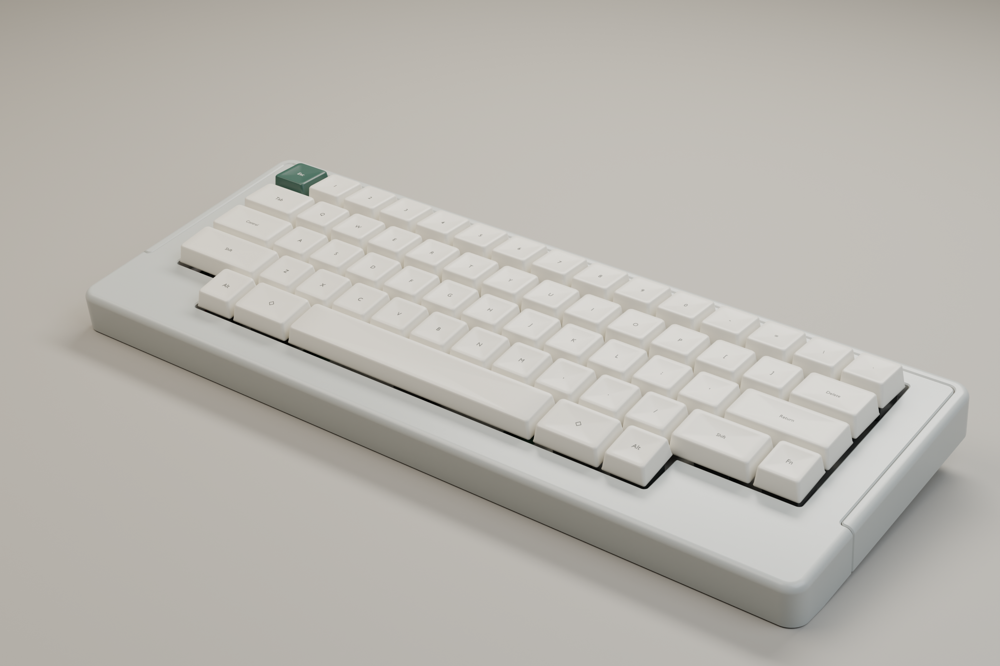

English | [Chinese](README.zh-CN.md)

# YETI60

A single-nRF52840 electrocapacitive keyboard PCB for the FELK60 case, derived from Cipulot EC60. The sensing geometry, board outline and mounting locations are retained; a rear USB daughterboard connects to J1.

## Current review

**CAD connectivity passes; production and complete hardware operation are not approved.** The [comprehensive review](docs/audit/yeti60-comprehensive-review.md) documents the remaining power-layout, target-firmware, tolerance, switch-access, resin-insert and cable/battery decisions.

| Scope | Evidence and result |
|---|---|
| PCB | Strict DRC 0 errors / 0 opens; 268 physical pin pairs pass. Inherited USB resistors corrected to 0 Ω; local power paths still need revision |
| Firmware | New schematic-bound control core passes host ASan/UBSan simulation; actual ADC/GPIO/USB/BLE HAL and target binary remain unfinished |
| Mechanical | Source PCB/plate/case nominal geometry has no overlap at the explicitly provisional Z stack; final dome/fastener/resin tolerances are unqualified |
| Battery | No pack selected. A conditional 50×20×2.9 mm envelope is available under the provisional stack, not a part recommendation |
| Visualization | Current PCB images/animation and assembled/exploded/battery-space studies, with illustrative model limits declared |

- [Complete review](docs/audit/yeti60-comprehensive-review.md)
- [Hardware and fabrication notes](hardware/ec60-nrf52840/README.md)
- [Firmware core, simulation and trace](firmware/yeti60/README.md)
- [Assembly renders](renders/yeti60-assembly/README.md)
- [PCB renders and 360° animation](renders/ec60-nrf52840/README.md)
- [Current audit index](docs/audit/README.md)

The case material is provisionally resin. SI/RF analysis remains deferred. Project-owned prose defaults to English with a parallel `.zh-CN.md`; machine-readable field names stay stable.

Based on [Cipulot/EC60](https://github.com/Cipulot/EC60) and [fredlb/felk60](https://github.com/fredlb/felk60). Upstream authors, licenses and original project names are retained. Existing `EC60-nRF52840.*` filenames and `YAECKB` library identifiers remain for technical compatibility; the public project name is **YETI60**.
