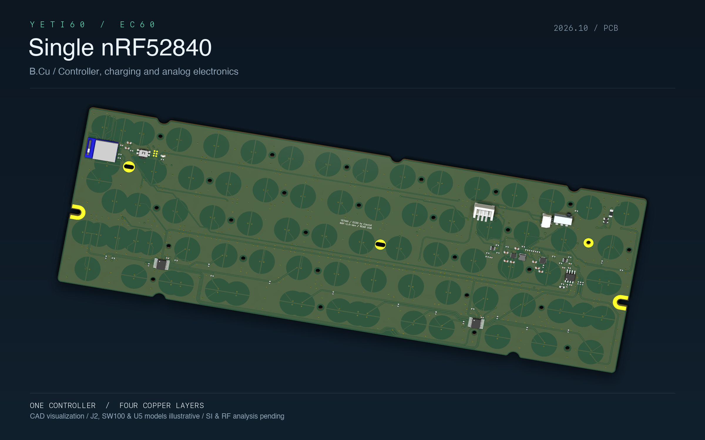

[English](README.md) | 简体中文

# YETI60

使用 FELK60 外壳、以 EC60 为基础的静电容蓝牙键盘改版。当前方案为**单颗 nRF52840**，同时负责静电容扫描、USB 和蓝牙；移除原 STM32。允许修改 PCB，尽量保持外壳、安装孔和键位不变。

Type-C 位于后侧（数字键／Esc 一侧），经后侧子板连接主板 J1。外壳暂按树脂考虑。

[查看上一阶段 360° 动画](renders/ec60-nrf52840/pcb-turntable.gif) · [下载 MP4](renders/ec60-nrf52840/pcb-turntable.mp4)

图中的 J2、SW100、U5 使用示意或通用模型，具体限制见渲染说明。

- [PCB 静态渲染与 360° 动画](renders/ec60-nrf52840/README.zh-CN.md)
- [PCB 修复与验证报告](docs/audit/pcb-review-2026-10-27.zh-CN.md)
- [当前单主控设计与状态](hardware/ec60-nrf52840/README.zh-CN.md)
- [KiCad 项目](hardware/ec60-nrf52840/EC60-nRF52840.kicad_pro)
- [设计约束](design-constraints.json)
- [原板、机械与固件审查记录](docs/audit/README.zh-CN.md)
- [历史双主控方案](docs/felk60-bluetooth.zh-CN.md)

先完成 PCB 电路、布局、布线和基本电气／制造规则检查，再进行信号干扰模拟。当前 PCB 已通过本轮严格 DRC 和连通检查，两个主控焊盘内过孔需填孔盖铜，尚未批准生产；nRF52840 扫描固件、实物装配和射频测试尚未完成。

`EC60/` 和 `felk60/` 保留为上游子模块。派生硬件放在 `hardware/`，EC60 派生设计的许可证见同目录 `LICENSE.EC60`。

## 当前全面复查

项目公开名称改为 YETI60，文档正在统一为英文默认、中文并行。见[阶段记录](docs/audit/yeti60-review-checkpoint.zh-CN.md)。当前 nRF52840 控制核心已完成主机模拟；装配匹配、供电局部布线复查及新装配渲染仍在进行。旧渲染对应上一阶段 PCB，不代表当前装配结果。
