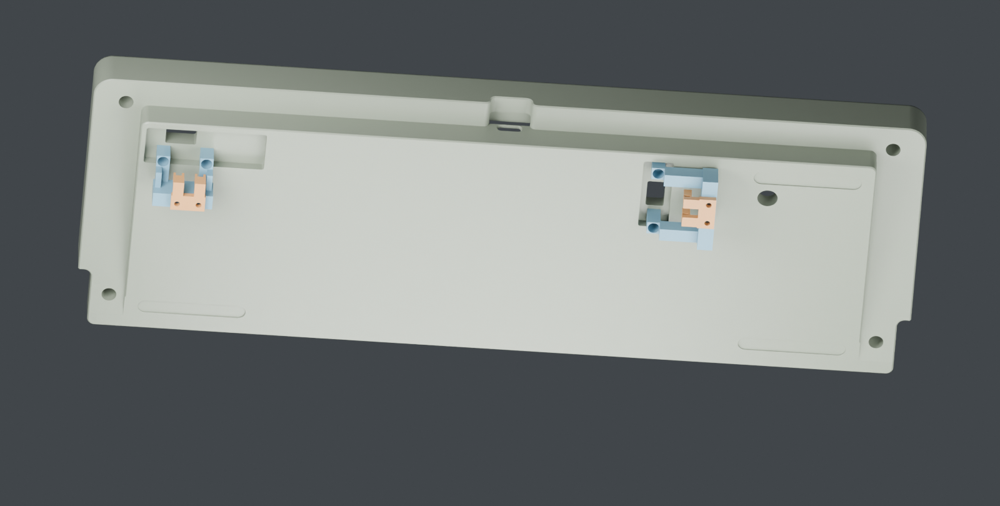

English | [Chinese](parking-guide.zh-CN.md)

# M05 plug parking supports

The J2 and J4 supports use the existing M05 cover screws. Each support has a fixed carrier and a removable shelf that holds the exposed guide pins on one parallel-jaw tool. This lets both tools hold their housings below the mainboard during the vertical deck lift.

## Parts for one keyboard

| Part | Quantity | File or specification |
|---|---:|---|
| J2 carrier and rod shelf | One of each | Carrier [STL](parking-support/J2-carrier.stl) / [STEP](parking-support/J2-carrier.step) and shelf [STL](parking-support/J2-rod-shelf.stl) / [STEP](parking-support/J2-rod-shelf.step) |
| J4 carrier and rod shelf | One of each | Carrier [STL](parking-support/J4-carrier.stl) / [STEP](parking-support/J4-carrier.step) and shelf [STL](parking-support/J4-rod-shelf.stl) / [STEP](parking-support/J4-rod-shelf.step) |
| Parallel-jaw tools | 2 | One assembled [M05 tool](tool-guide.md) for each housing so both remain gripped. |
| Carrier screws | 4 | Reuse the M2 × 0.4 × 4 mm low-head cover screws and the existing cover inserts. |
| Shelf screws and inserts | 4 of each | M2 × 0.4 × 5 mm screws and Ø3.2 × 2.5 mm knurled M2 inserts. The carrier insert bores are Ø3.35 mm × 3.2 mm deep. |
| Rod ties and shims | 4 each | Four nylon ties with straps up to 2.2 × 0.8 mm. Use smooth insulating shims under the pins, cut to fit the saddle floor. |

Print the four rigid parts in tough insulating resin at 100% in millimetres. Select STEP or STL for each part. The STEP files preserve case assembly coordinates. The STL files are moved to local origins for printing. Post-cure before checking the screw seats, shelves and insert bores. Cold-bond the shelf inserts into the carriers before bringing the parts near any electronics.

## Fit the supports during an unpowered trial

1. With the covers removed, fasten each carrier to its original cover screw seats. Fit the carriers before inserting the jaws. Support the case so there is room for the tools below and for lifting the deck from above.
2. Use an inert pack gauge and unpowered connectors. Grip J2, withdraw it along +Y and lower it 0.45 mm toward the underside. Keep it gripped as you bring the J2 shelf up from below around the exposed pins. Fit two M2 × 5 mm screws from below. Repeat at J4 with withdrawal along −X.
3. Fit each insulating shim under its rod so the released housing stays in the parked pose. The nominal shim is 0.436 mm for a 1.44 mm PCB, 0.270 mm for 1.6062 mm and 0.116 mm for 1.76 mm. Fit to the actual case and tool. Thread a tie around each pin through the slot under its saddle. Mark the pin positions at the saddles and check that the ties hold the pins down and prevent sideways sliding.
4. With both housings supported, check that the wires can feed through the guide slots. Lift the deck along the 25 mm straight path. During reassembly first return the deck to its seats, support each tool while removing its shelf and ties, then partially raise and re-seat J4 followed by J2.

The [parking support report](../../06-validation/m05-parking-support.json) checks the fixed carriers against the tool strokes and checks 12 mm of vertical shelf approach at each port and board thickness. The rod slots have 0.175 mm nominal per-side clearance. The [lift report](../../06-validation/m05-lift.json) uses the resulting parked-housing positions. Printed stiffness, fit, tie preload, lateral retention and repeated handling still require samples.
