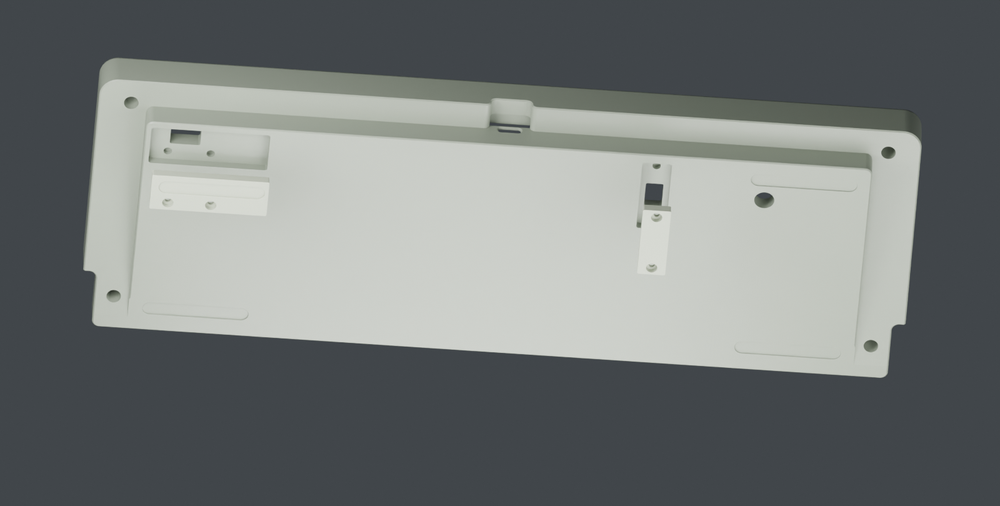
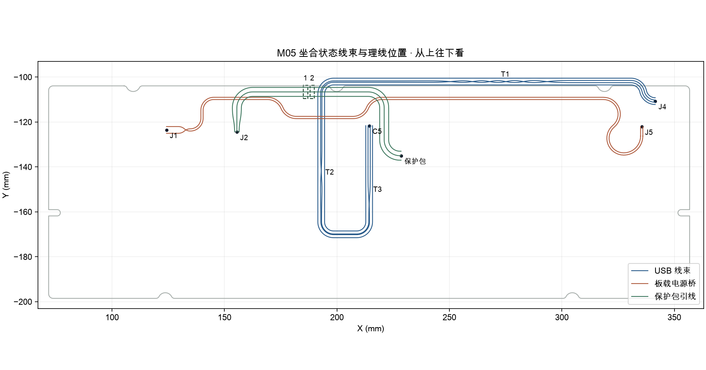

[English](print-guide.md) | 中文

# E73 的 M05 维修口试制件

M05 为 CORNER-05 的装拆试验增加两个可拆盖。它保留 M04 的外形尺寸、脚垫位置及上壳、钢定位板和 C5 子板的安装基准。右后脚垫槽完整位于 J4 封盖上，拆盖时脚垫一起取下。制造总表仍列 M04 作为当前底壳基线。

## 一套试制件需要的文件和材料

| 零件 | 数量 | 文件或规格 |
|---|---:|---|
| M05 底壳 | 1 | [打印 STL](bottom-m05-REVIEW.stl) · [STEP](bottom-m05-REVIEW.step) |
| J2 封盖 | 1 | [打印 STL](cover-J2-REVIEW.stl) · [STEP](cover-J2-REVIEW.step) |
| J4 封盖 | 1 | [打印 STL](cover-J4-REVIEW.stl) · [STEP](cover-J4-REVIEW.step) |
| 封盖螺钉 | 4 | M2 × 0.4，头下长度 4 mm，带平底承压面的低头内六角。头部直径 ≤3.90 mm，高度 ≤1.50 mm。SUNCO M2 低头系列的标称头部尺寸为 Ø3.8 × 1.3 mm。[厂商尺寸表](https://th.misumi-ec.com/en/vona2/detail/221005676582/?Tab=codeList) |
| 封盖螺纹嵌件 | 4 | M2 × 0.4，滚花黄铜，Ø3.2 × 2.5 mm，与 C5 规格相同。另备四枚，孔深按本页施工。 |
| 胶和脚垫 | 按需 | 用外壳规定的冷粘胶固定嵌件。使用整机清单中的四个脚垫，其中一个装在 J4 封盖上。 |
| 平行夹头工具 | 每个端口 1 套 | [工具说明](tool-guide.zh-CN.md)提供握块打印文件、夹片下料图和试配步骤。 |
| 停放支撑 | 每个端口 1 套 | [支撑说明](parking-guide.zh-CN.md)提供两套底座、托架、紧固件和停放顺序。 |

使用韧性工程 SLA 树脂，按毫米、100% 比例打印。三种零件各做一件，每件从 STEP 和 STL 中选一个文件。两种格式使用相同的壳体坐标。在树脂完全后固化后复查承压面、脚垫槽和盲孔。安排打印支撑和排液方向时，避免支撑损伤这些面。

## 制作 M05 配套线束

九根导线均按 [M05 自由长度表](harness/wire-lengths-m05.zh-CN.csv)制作。自由长度沿绝缘层测量，从一端胶壳出口量到另一端出口或保护包的应力释放面。裁线时按实际端子另计剥皮和压接的余量。试装使用 AWG28 多股铜线，成品绝缘外径最大 0.65 mm。

| 项目 | 材料与安装位置 |
|---|---|
| J4 到 C5 的 USB 线束 | 两只 SHR-04V-S 胶壳、八只 SSH-003T-P0.2-H 端子。1–4 号逐针直连，两根数据线的自由长度目标均为 285.189 mm。 |
| 主板电源桥 | J5 用一只 SHR-02V-S，J1 用一只 SHR-04V-S，共四只端子。J5.1 接 J1.1，J5.2 接 J1.4，J1 中间两孔留空。交叉处两根电源桥导线都走 USB 线束上方。 |
| 保护包到 J2 | 主板端用一只 SHR-03V-S 和三只端子，针序为 PACK+、PACK−、NTC。实物须为符合规格的完整保护包，试配可用无电量块。 |
| 电池理线件 | 两件新打印件 [BAT-R1](harness/BAT-R1-M05.stl) 和 [BAT-R2](harness/BAT-R2-M05.stl)。中心分别位于外壳 X 186 mm 和 189 mm，两件的 Y 均为 −106.60 mm。[BAT-R1 定位 STEP](harness/BAT-R1-M05.step)与 [BAT-R2 定位 STEP](harness/BAT-R2-M05.step)保留装配坐标。 |
| 其他理线件及胶膜 | 其余 14 件刚性件和 17 片胶膜的下料形状沿用[现有理线件套件](../../04-assembly/retainers.zh-CN.md)。两片电池胶膜装到新支架，可对照 [BAT-R1](harness/BAT-R1-film-M05.step) 和 [BAT-R2](harness/BAT-R2-film-M05.step) 的折后模型。 |

两件电池支架按其他理线件的比例和工艺打印。试配壳底时核查标称 0.10 mm 的胶层。线槽内避免溢胶，固定后导线仍需能沿槽轴向滑动。

从 **J4 向 C5** 按下表布置数据对的绞合段。圈数对应 CAD 中心线几何。制作后可用[坐合线束 STEP](harness/seated-wires-REFERENCE.step)核对完整走线形状。

| 标记 | 位置 | 中心线段长 | 圈数 |
|---|---|---:|---:|
| T1 | 后侧直段，X 从 312.190 到 230.000 mm，Y 为 −102.000 mm | 82.190 mm | 3.060 |
| T2 | 向前直段，X 为 193.000 mm，Y 从 −126.674 到 −164.500 mm | 37.826 mm | 0.613 |
| T3 | 回程直段，X 为 214.313 mm，Y 从 −164.500 到 −142.000 mm | 22.500 mm | 0.327 |

按新线长，四根供电和回流导线合计 1.095 m。沿用[原充电模型](../../06-validation/power-process.zh-CN.md)，60 °C 下纳入计算的串联电阻为 0.426 Ω，500 mA 时比 M04 多约 1.55 mV 压降。[M05 线束与试装报告](../../06-validation/m05-harness.json)记录了计算前提、未计入的损耗，以及按 M05 实际壳体模型检查的三种板厚各七个插头姿态。

## 装电子件前试配封盖

1. 先把两只盖分别放进对应的凹槽，确认可垂直向下取出。每侧标称留缝 0.35 mm，CAD 外表面齐平。修整时保持封盖与底壳齐平，也保留右后脚垫槽原有高度。
2. 四个嵌件盲孔按 **Ø3.35 ±0.05 mm** 修孔。从孔轴中心所在的承压台阶计算，盲孔深度为 **2.90 mm**。冷粘嵌件，外端面比该处台阶内缩 **0.30 mm**。待空壳上的胶固化后再装电池和 PCB。
3. 确认螺钉能压住封盖，末端与盲孔底留有间隙。CAD 中标称螺纹重叠 **2.15 mm**，螺钉末端距孔底 **0.45 mm**。实测头部尺寸和孔底余量，并检查封盖受力、树脂裂纹、嵌件松动及装脚垫后是否摇晃。
4. 将右后脚垫完整贴在 J4 封盖槽内，留出两只螺钉的位置。取下两只盖后可接近 J2 和 J4。试装用无电池尺寸量块代替电池，并保持线束断电。
5. 按上图试放 C5、临时定位的理线件、主板和断电线束。上电前测通断，并核对 J1 中间两孔留空。确认电池侧弯在两只理线件之前形成，USB 前侧回环能向前移动，电源桥留在其上方。拆卸顺序为先 J2、再 J4，最后垂直抬起主板和定位板。在永久固定理线件前，取下封盖验证实际工具空间和导线滑动。

[CAD 报告](../../06-validation/service-case-m05.json)检查了外形尺寸、四处新增嵌件的支撑、八处原有螺孔保护区、封盖拆出行程，以及打开后 J2、J4 的通道。[关壳装拆检查](../../06-validation/case-service.zh-CN.md)记录了配套的线束试验。M05 用于机械试配，仍需验证实际拔插工具、带线完整拆装、承载和反复拆装，之后才能用于正式装配。

上壳和封盖已拆下且两个插头已停放时，[连续抬升报告](../../06-validation/m05-lift.json)检查了三种板厚下 25 mm 的直线行程。模型中的电源桥与所检静止物体始终至少保有 0.15 mm 间隙。报告也核对了移动的 PCB 和刚体包络与全部七根静止导线之间的空间。实际插头拔出、导线随动和工具受力仍需用样件验证。
