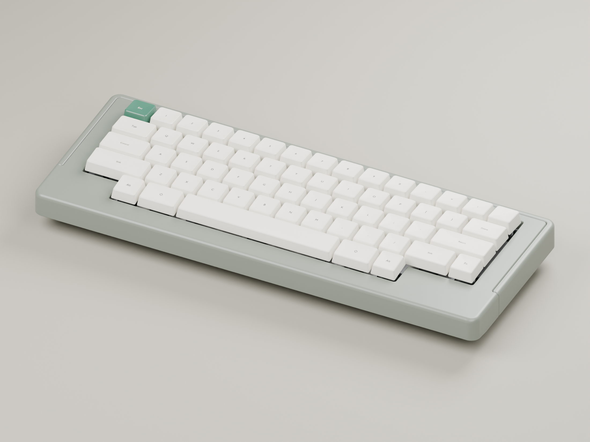
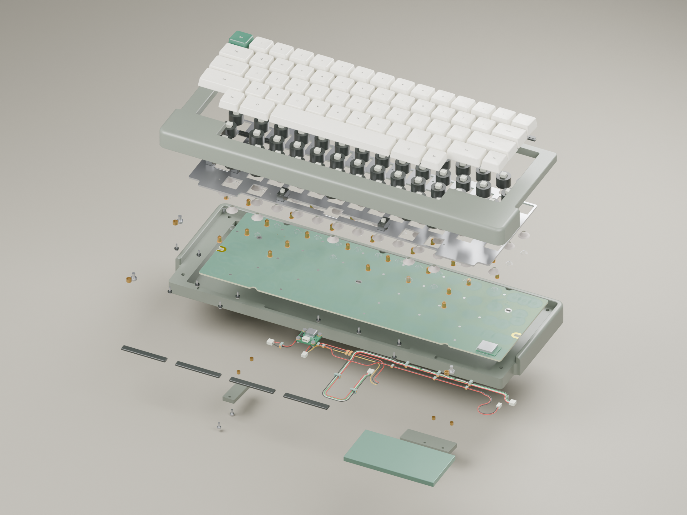
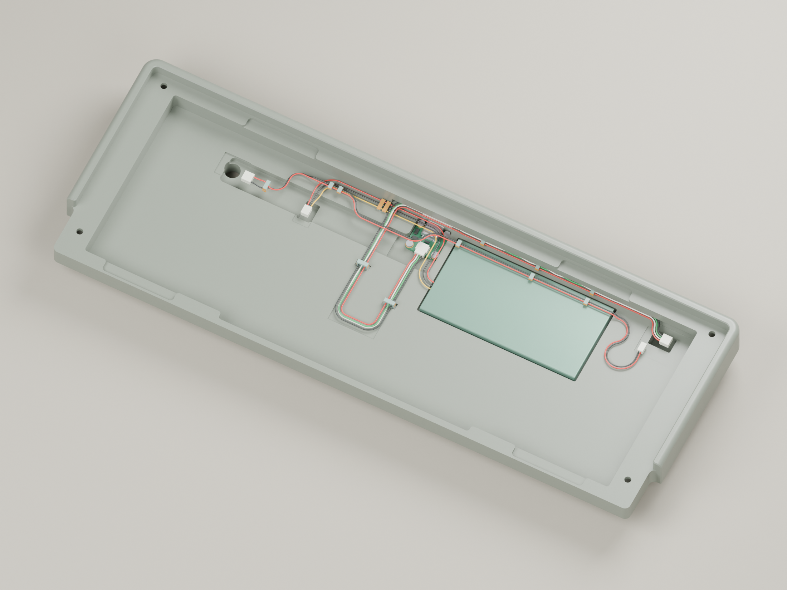
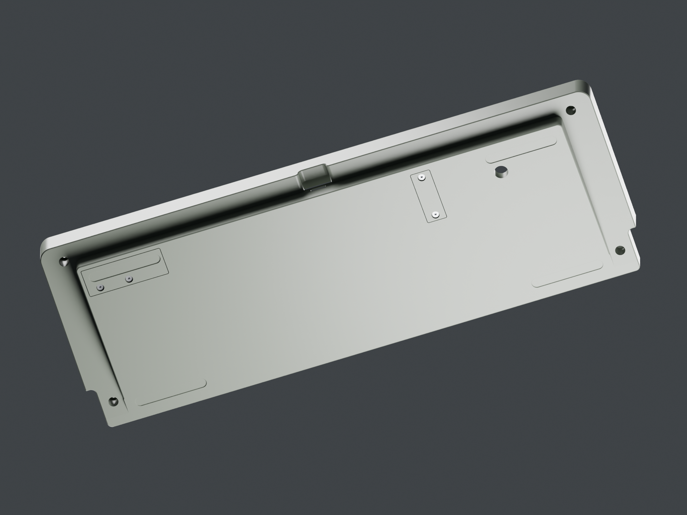
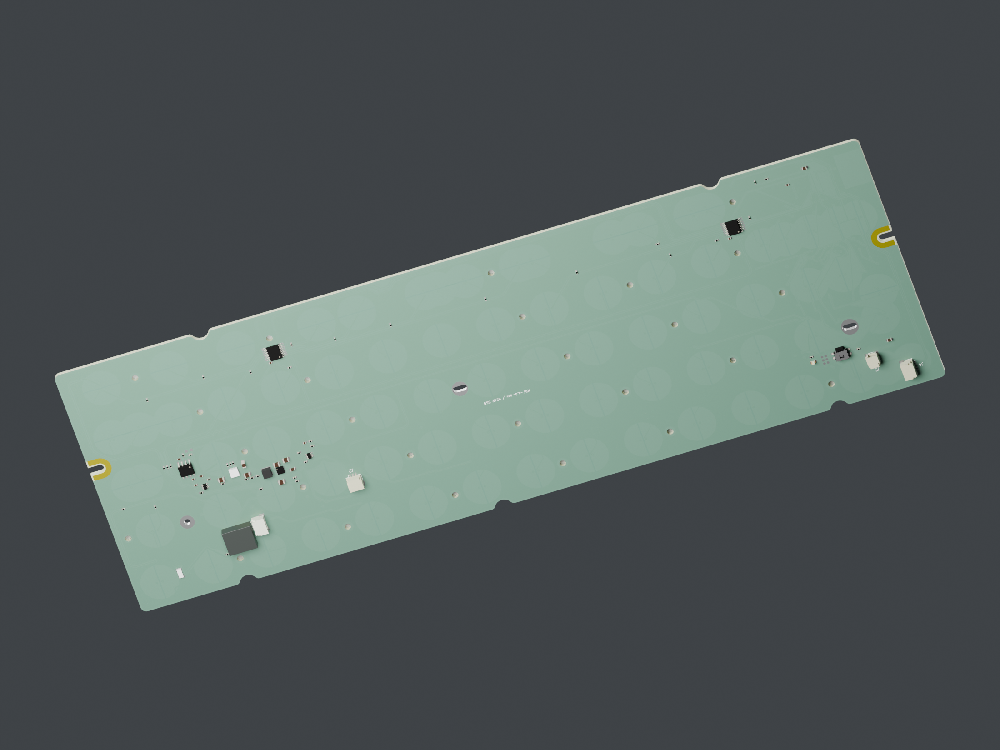

English | [Chinese](assembly-views.zh-CN.md)

# CORNER-07 assembly views

The shell surfaces use the FELK60-based upper case, the M05 relieved trial bottom and its two access covers at their source dimensions. The steel plate uses the current NiZ DXF. The mainboard shows copper, solder mask, markings and drills from the selected native PCB. The illustrated finish, keycap profile and legends can differ from purchased parts.

Read the stack from the bottom case upward through the PCB, insulated standoffs, conical springs, silicone domes, steel plate, NiZ housings and sliders, upper case and caps. The illustration separates the wiring, battery and C5 from their installed positions so they can be seen. It shows the four feet together below the shell. Use the CAD and guides for slot assignments and installation datums.

The exploded and interior views show the enlarged front guides in the relieved seats and the matching USB line route. The standard M05 shares the external shape, mounting stack and cover interfaces. [Relieved trial assembly](../02-mechanical/service-case-m05/print-guide.md#m05-relieved-bottom-trial)

| Assembly stage | Parts and reference |
|---|---|
| 1. Prepare the case and steel plate | Inspect finished case dimensions, bores and switch opening samples. Prepare four M3 inserts and eight M2 inserts, including four for the access covers. Cut four gaskets for each of the two plate faces. [Manufacturing instructions](../01-pcb/ordering-and-printing.md) |
| 2. Complete the mainboard | Solder and inspect all 75 fitted references in the prescribed order. Keep the pack disconnected during initial tests. [Illustrated bench guide](soldering.md) |
| 3. Dry-fit the sensing stack | Use 60 NiZ housings/sliders, 60 domes, 60 springs and three plate stabilizer pairs. Fit two short wires and the centered 6U wire. Use 28 standoffs, 28 insulating discs, 28 washers and 28 M1.6 screws. Leave H26 unused. [Mechanism guide](key-mechanism.md) |
| 4. Flash and calibrate outside the shell | Confirm USB and BLE behavior, save all 60 key baselines with the calibrator and load the normal image while preserving settings. [Firmware installation](../05-firmware/installation.md) |
| 5. Trial the M05 lower shell | Install the existing C5 and an inert gauge for the pack. Temporarily locate the nine wires and 16 rigid guides and check both covers come off downward. [M05 first-article guide](../02-mechanical/service-case-m05/print-guide.md) |
| 6. Verify service and closure | Release J2 then J4, park the plugs and lift the PCB and plate vertically. Reverse the sequence, check wire and pack clearance and verify the four M3 closure screws. [Parking supports and sequence](../02-mechanical/service-case-m05/parking-guide.md) |

The interior view shows the installed geometry with the PCB hidden. Some clips in this view attach to the removed PCB. Match their installed Z positions and mating faces to the retainer STEP references. The nine wire centrelines come from the checked relieved-trial seated routes, with diameter set to the specified insulation limit.

The underside view shows the two seated covers and their four low-head screws before fitting the feet. The larger cover at the left of this underside view is J4. The narrower cover is J2.

The scene includes models for 73 fitted references. U1 and SW100 use the design envelopes. The five mating plugs, battery wrap, NiZ plastic, domes, springs, keycaps, stabilizers, gaskets and thread details are visual representations. Use the [source manifest](../06-validation/assembly-render.json) to check the exact revision, model coverage and image hashes. Tool access and cable motion have separate [case service checks](../06-validation/case-service.md). Resin and tape performance, RF behavior and physical electrical acceptance remain open.
