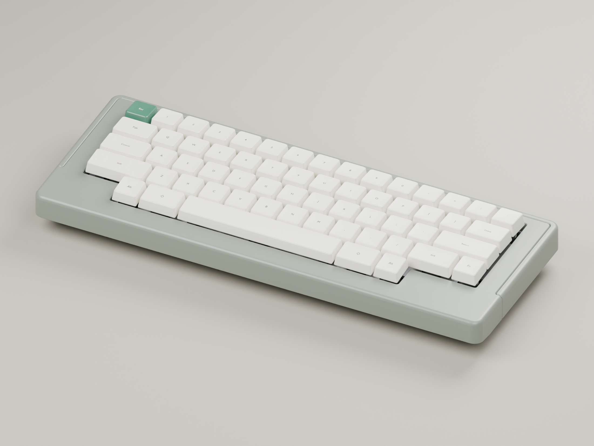
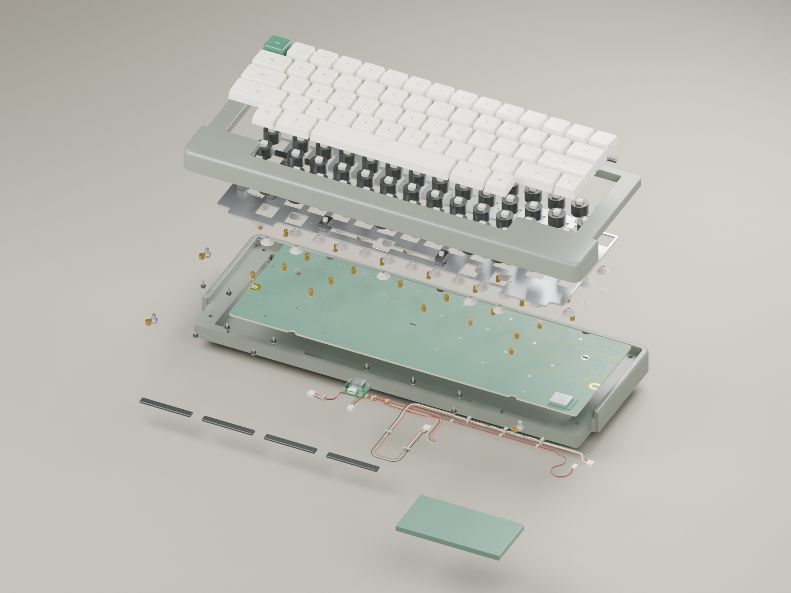
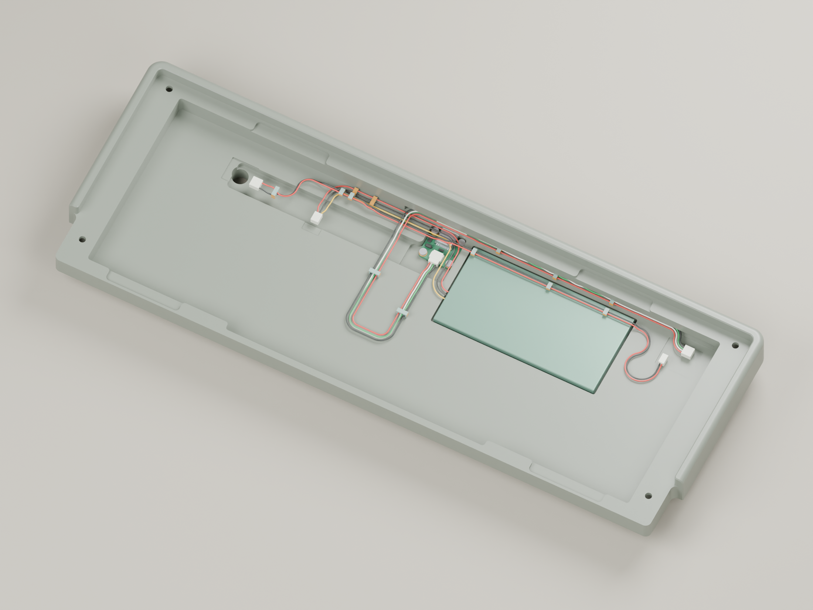
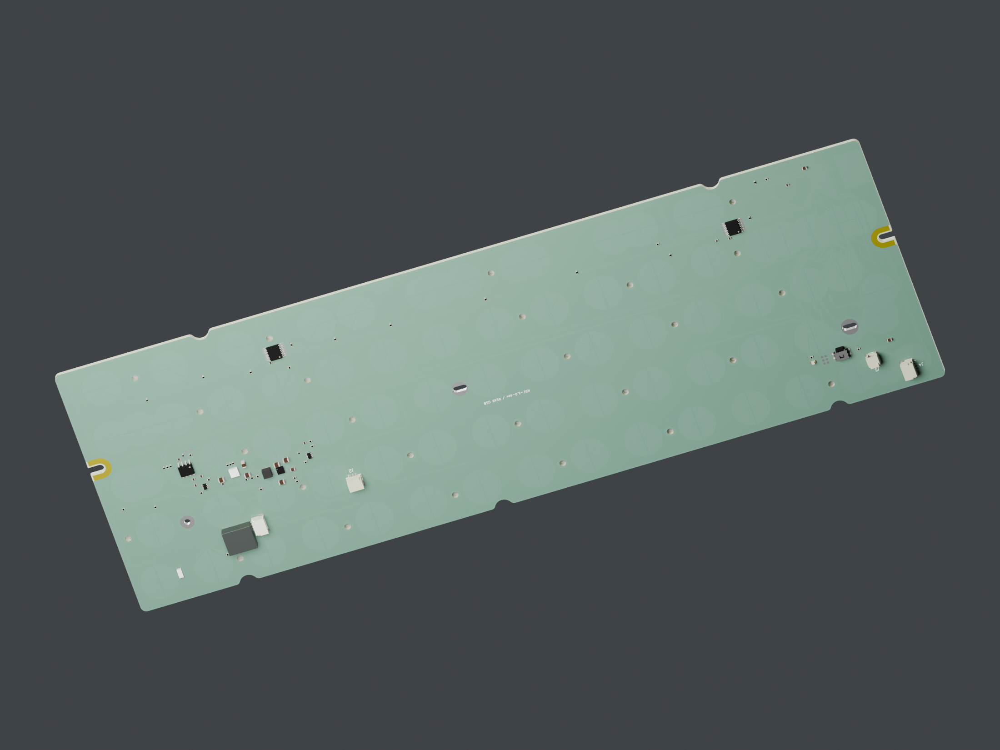

[English](assembly-views.md) | 中文

# CORNER-05 整机装配图

上下壳采用本交付包中基于 FELK60 的上壳和 M04 底壳，保留原始尺寸。钢定位板使用当前 NiZ 版 DXF。主板的铜层、阻焊、标记和钻孔来自当前原生 PCB。表面质感、键帽轮廓和字符是示意，采购成品可能有所不同。

从底壳向上看，依次对应主板、绝缘隔柱、锥形弹簧、胶碗、钢定位板、NiZ 轴座与滑块、上壳和键帽。为了看清线束、电池和 C5 子板，爆炸图将它们移出安装位置。四个脚垫集中展示在外壳下方。各线槽和安装基准请查阅配套图纸及指南。

| 装配阶段 | 零件及对应说明 |
|---|---|
| 1. 准备外壳和钢定位板 | 检查外壳成品尺寸、孔和轴座开口试片。准备 4 个 M3 和 4 个 M2 冷粘嵌件。定位板上下各裁 4 片垫条。[制造要求](../01-pcb/ordering-and-printing.zh-CN.md) |
| 2. 焊装主板 | 按顺序焊装并检查 75 个实装位号。初次上电时断开电池。[图文台架教程](soldering.zh-CN.md) |
| 3. 试装感应机构 | 准备 60 个 NiZ 轴座和滑块、60 个胶碗、60 根弹簧、三组钢板卫星轴。装两根短钢丝和一根居中 6U 钢丝。使用 28 个隔柱、28 片绝缘片、28 个垫片及 28 颗 M1.6 螺钉，H26 留空。[机构指南](key-mechanism.zh-CN.md) |
| 4. 在壳外刷写及校准 | 核查 USB 和蓝牙功能。用校准固件保存全部 60 键的基线，再保留设置刷入正常固件。[固件安装](../05-firmware/installation.zh-CN.md) |
| 5. 试装底壳 | 用 4 颗 M2 螺钉和绝缘垫片检查现有 C5 的安装。确认完整保护包尺寸，保持电池插头断开。用临时方式定位三组线束和 16 件刚性理线件，并与 M04 底壳试配。[线束走向](harness-routing.zh-CN.md) · [理线件指南](retainers.zh-CN.md) |
| 6. 核实装拆空间 | 永久粘接之前，用实际插头和导线验证装入及取出过程，确认插头、导线和电池未被拉扯或夹住。在这些检查与样机电气验收完成后，用 4 颗 M3 合壳螺钉及垫片验证关壳状态。[电池包要求](../03-bom/battery-requirements.zh-CN.md) |

底壳图将主板隐藏，以便查看线束的安装位置。图中部分夹件实际固定在主板底面，请按理线件 STEP 确定其 Z 高度和粘接面。九根导线的中心线来自标称线束检查，直径使用规定的绝缘外径上限。

图内 73 个主板位号采用三维模型，U1 和 SW100 采用设计包络。五个配对插头、电池外皮、NiZ 塑料件、胶碗、弹簧、键帽、卫星轴、垫条和螺纹细节为示意。[来源清单](../06-validation/assembly-render.json)记录具体版本、模型覆盖及图像校验值。工具空间、线束装拆运动、树脂和胶带性能、射频及实物电气仍待验收。
