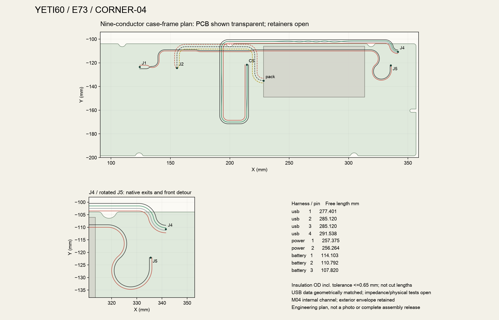

English | [Chinese](harness-routing.zh-CN.md)

# E73 corner harness and internal case channel

CORNER-04 rotates **mainboard J5 by 180° at the same origin**; J4 and the already-made **C5 JSH daughterboard stay unchanged**. J5 now exits toward the front of the case, permitting a separate route past the J4 USB cable. The bounded copper repair is replayed after the original routing patch and independently checked by native DRC. It affects GND, USB_FEED and ROW_DRV4 locally; USB data traces and effective sensing lands are retained.

**Engineering routing study, not complete closed-case assembly acceptance.** [Native wire/plug/obstacle study](../06-validation/harness-study.json) and [source specification](../02-mechanical/interconnect-spec.json). Retainers, complete insertion/service movement and the final assembly/explosion remain open. The drawings are coordinate plans, not photographs or measured assemblies.



[Per-conductor length table](../03-bom/harness-conductors.csv)

## Connections and purchasing

| Harness | Mainboard connection | Other end | Net / physical order |
|---|---|---|---|
| USB, four conductors | J4, SHR-04V-S | C5 SH4, SHR-04V-S | 1→1 USB supply, 2→2 D−, 3→3 D+, 4→4 GND |
| Power bridge, two conductors | J5, SHR-02V-S | J1, SHR-04V-S | J5.1→J1.1 VBUS; J5.2→J1.4 GND; J1.2/J1.3 empty |
| Protected-pack leads, three conductors | J2, SHR-03V-S | Protected pack / separate NTC | 1 PACK+, 2 PACK−, 3 separate 10k NTC referenced to PACK− |

Net connectors: **three SHR-04V-S**, **one SHR-02V-S**, **one SHR-03V-S** and **15 SSH-003T-P0.2-H crimp contacts**, including the pack's three contacts. Do not double-count a pack-supplied plug/leads. Soldered board headers are already in the 75-part mainboard BOM or the existing C5.

Use AWG28 stranded copper, measured insulation diameter **≤0.65 mm including tolerance**, rated for the pack/USB current and compatible with the genuine SH contacts. Thin-wall wire must be selected by its supplier drawing; the AWG number alone does not set insulation diameter. Supply colours: red, black, white D−, green D+, yellow NTC. Wire/contact bend and crimp compatibility remains an incoming qualification requirement. A generic thick silicone lead is not this geometry.

The exact per-conductor nominal **free lengths** and native endpoint coordinates are recorded in the study. Free length is measured along insulation **between housing exit planes**, or housing exit to the pack strain-relief face; it is **not raw cut length**. The vendor must add the correct terminal insertion/strip allowances and validate a sample against the final retention fixture. The old 150 mm equal-wire cable is not applicable. Current USB data conductors are geometrically matched; the outer power/GND conductors have different lengths because of bends. Guide design still has to freeze before cable production.

The USB pair uses 3.25 rear turns, a half-turn on the descending run and a quarter-turn on the return. The resulting phase restores the actual endpoint pin order. This is not a supplier-qualified 90-ohm cable or a USB eye test. Keep the pair together and qualify the completed cable electrically; do not infer impedance from AWG or twist count alone.

## Case and battery interface

The [M04 bottom STEP](../02-mechanical/bottom.step) and [STL](../02-mechanical/bottom.stl) add an **internal** rear channel to the reviewed M03 baseline. The exterior envelope is preserved. The new removal is screened against selected native exterior faces and all four M3 / four M2 insert support guards; this is a geometric screen, not structural FEA or resin qualification. Retained wall after the specified case tolerance is approximately **2.01 mm**.

The protected pack body remains ≤85 ×43 ×4.8 mm including protection, sensors, wrap, tabs and growth. Its required **external pigtail exit** is at local `[0,14,4.5]` mm relative to the minimum-X/Y/Z pack-body corner, pointing −X; in the case this is `[228.5,-135,-4.9]` mm. External insulated leads are screened separately from the pack-body box. Have the supplier show the complete strain relief, body and pigtail exit on one drawing; do not substitute a bare-cell outline.

## What the CAD study covers

- Native-derived J1/J2/J4/J5 pad order, footprint side and net roles, plus the fixed C5 interface.
- Continuous round-wire solids for all nine conductors; conservative full tubes around the twisting data pair, rather than sparse collision samples.
- All 75 fitted native XY envelopes with explicit incoming height limits, 28 installed PCB fasteners, nominal C5 STEP and its four fasteners, mated plug envelopes, main PCB, top/bottom shells and expanded protected-pack body.
- The nominal 1.6062 mm CAD envelope and ordinary manufactured PCB endpoints 1.44 /1.76 mm. Minimum static bend radius 4 mm; globally inspected route envelope ±0.25 mm; minimum gap 0.15 mm after that envelope. Case coordinate error and a 0.002 mm computation guard are additional in case checks.
- Same-harness non-twisted conductor checks use a separate ±0.10 mm relative envelope; shared route motion is not counted twice. Only the twisted data pair intentionally touches insulation. Its individual strand/contact/pull-out behavior is not qualified.
- Start/end contact overlap exceptions are bounded local portals, not a global exemption for an owning header or the entire battery body.

The approximately 0.156 mm minimum between independent expanded harnesses and 0.165 mm minimum PCB gap are tight engineering acceptance limits, **not evidence that unmeasured hand routing or arbitrary print tolerances will fit**. Inspect the final fixture and assembled routing. Retainer geometry, adhesive/film tolerances, PCB withdrawal and service must be included before complete assembly release.

## Reproduce

Run after the current native PCB, local-model and copper checks:

```sh
/Applications/KiCad/KiCad.app/Contents/Frameworks/Python.framework/Versions/Current/bin/python3 scripts/export_e73_harness_map.py
uv run --python 3.14.7 --with-requirements requirements-audit.txt python scripts/check_e73_corner_harness.py --publish
```

A failed study returns nonzero. Do not treat a historical green report as current without checking every `source_sha256` and output hash. Ordinary-process repair guards are exercised by `python3 tests/audit/test_e73_connector_repair.py`; native placement mutations also reject the wrong J5 orientation.
