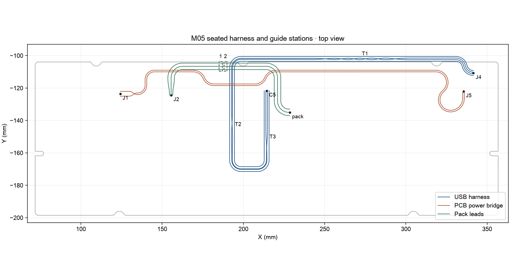

English | [Chinese](retainers.zh-CN.md)

# E73 cable retainers: parts, printing and dry fitting

Use the [M05 print checklist and wire lengths](../02-mechanical/service-case-m05/print-guide.md) for the CORNER-07 first article. M05 reuses the fourteen USB and power guides from M04 and moves both battery guides and their folded films.

This set follows **E73 CORNER-07**, its rotated mainboard J5 and the nine-conductor route to the existing C5 daughterboard. Use the current [wire connections and conductor lengths](harness-routing.md).

**Engineering parts for review and measured dry fitting.** Rigid-body, film, wire-capture and tolerance checks do not qualify resin strength, tape adhesion, human access or the complete installation/withdrawal sequence. Complete closed-case assembly release remains open. Do not permanently bond the review set before the process and service gates are resolved.

## What to make

| Item | Net quantity | Files / process |
|---|---:|---|
| Rigid guides and removable covers | **16** | [M05 individual STL set](../02-mechanical/retention/M05-retainer-STLs-REVIEW.zip), one per part. See the process screen below before quoting |
| Guide assembly references | 16 | Use the shared USB and power STEP files, such as [USB-R1](../02-mechanical/retention/assembly-reference/USB-R1.step), and the [M05 battery STEP references](../02-mechanical/service-case-m05/print-guide.md#build-the-matched-m05-harness). These files retain installed case coordinates |
| Cut/fold film pieces | **17** | [Film blank template](../02-mechanical/retention/film-blanks.svg); cut from the specified film, **do not 3D-print the film STEP models** |
| Full part/count table | 33 pieces total | [M05 retainer and film CSV](../02-mechanical/retention/parts.csv) |
| Geometric requirements | 1 specification | [Retainer specification](../02-mechanical/retention-spec.json) |

Rigid parts: three `USB-R` roof guides; two `USB-F` floor bases and their two removable lids; two `BAT-R` floor guides; five `PWR-R` PCB guides; `PWR-F-upper` and `PWR-F-lower`. Seven rigid guides attach to the case, six to the PCB, and three are removable covers/halves.

Film pieces: three USB rear straps, four USB front side patches, two battery straps, five power rear straps, two power fan-out side patches and one lower power fan-out strap. Folded straps have two bonding legs; side patches bridge both mating pieces. A floating rectangle below a wire is not a complete retainer.

## Manufacturing requirements

- **Millimetres, 100% scale.** Local STL files are translated to the origin and, where needed, rigidly turned so the channel is accessible for printing. Their shape and volume are checked against the assembly STEP. No scale or shrink compensation is baked into them.
- Extract the M05 ZIP to get 16 individual STL files. JLC3DP asks for one model per uploaded file. Its ordinary SLA size floor is **5 × 5 × 5 mm** or **10 × 2 × 2 mm**. All 16 guides fall below both options. Its general size tolerance for parts of this length is **±0.20 mm**. The required **0.05 mm** surface-point limit and **0.30 mm** finished web remain specific to these guide geometries. The parts need a supplier-confirmed process and measured trial parts before final assembly. [JLC3DP model limits](https://jlc3dp.com/help/article/3d-printing-design-guideline) · [JLC3DP upload instructions](https://jlc3dp.com/help/article/how-to-place-a-3d-printing-order) · [M05 process screen](../06-validation/m05-retainer-process.json)
- Use an insulating tough engineering resin or an insulating machined polymer that can meet the finished dimensions. The files do not establish that every low-cost SLA service can meet them. Agree on the small-part process, support removal and post-cure before fabrication.
- Maximum finished surface-point error: **0.05 mm in 3D**. Minimum measured remaining web: **0.30 mm** after support removal and bonding-face finishing. Inspect the rear stepped roofs, groove edges, front lid roofs and battery guide walls. Do not enlarge wire channels or sand a thin web below the limit.
- Single-wire groove radius: **0.50 mm**; central USB pair channel radius: **1.01 mm**. The shrink allowance in the checker accounts for the stated part-profile error; it is not an instruction to change these CAD dimensions.
- Fit bonding lands to the **actual post-cured case** and inspect the nominal **0.10 mm bondline** and remaining webs. Two independently printed, unfinished surfaces are not assumed to fit that gap automatically. Do not force a guide against a wall or compress the battery to make it fit.
- Print orientation is not installation orientation. Restore the part to its assembly STEP pose using the indexed drawing/datums. Do not mirror parts or transfer the slicer's arrangement coordinates into the keyboard.

## USB front clearance study

Applying a hypothetical **0.20 mm** surface-point error to the current guide design calls for a **0.625 mm** single-wire groove radius and a **0.70 mm** nominal web to retain the specified **0.30 mm** finished web. Enlarging the pair groove and thickening the USB front guides at their current axis consumes the floor and PCB clearances. The 0.20 mm value is an engineering trial budget for these surfaces. The public SLA size tolerance does not establish that budget on these features. [JLC3DP dimensional guidance](https://jlc3dp.com/help/article/3d-printing-design-guideline)

The CAD trial lowered the USB front wire axis by **0.60 mm** and recessed each guide seat by **1.05 mm**. This leaves **0.174 mm** clearance to the bare PCB after allowances at **1.76 mm** board thickness. The original **0.62 mm** deep floor relief gave **0.158 mm** clearance to the seated wires. Halfway through J4 withdrawal the ground wire had only **0.073 mm** clearance, and at full axial withdrawal the D− wire fell **0.215 mm below zero** on the same tolerance-adjusted measure. [CAD report](../06-validation/m05-usb-retainer-recess.json)

Extending the relief **2.00 mm toward the front** clears the nine wire envelopes in all seven modeled poses at **1.44, 1.6062 and 1.76 mm** board thickness. The minimum residual gap across wires, fitted parts, fasteners, the pack envelope and the shell is **0.158 mm**. The modified area leaves **3.56 mm** or more to the checked exterior surfaces after allowances, with both service covers and all eight existing insert keepouts clear of the cut. [CAD report](../06-validation/m05-usb-retainer-recess.json)

With the upper shell and both access covers removed and J2/J4 parked, the modeled deck and power bridge clear a **25 mm continuous vertical lift** at all three board thicknesses. The deck includes the steel plate, PCB, fitted components, fasteners and board-mounted guides. The tightest rigid clearance after allowances is **0.174 mm**, between the thickest PCB and the enlarged front guide envelope. Both parked housings clear the deck by **0.550 mm**. The moving bridge wires retain a certified clearance of at least **0.150 mm**. This trial uses the proposed guide envelopes. The finished grooves, bonding, cable movement during withdrawal and physical service still need verification. Use the supplied M05 shell for the current build. [CAD report](../06-validation/m05-usb-retainer-recess.json)

## Film material and cutting

Candidate: **3M 5413 polyimide film tape**. Its manufacturer lists **0.069 mm typical total thickness**. The project requires **≤0.075 mm including adhesive on the actual received lot**; the typical value is not a guaranteed maximum or an adhesive qualification on the selected resin. [3M technical data](https://multimedia.3m.com/mws/media/136011O/3m-polyimide-film-tape-5413-tds.pdf)

Use one small roll and cut the 17 indexed pieces; the net count is not 17 rolls. The SVG is in millimetres and includes a 50 mm scale bar. Print it without page fitting and verify that bar before using it as a paper reference. The CSV gives nominal blank dimensions. Folded blanks include **0.5 mm trim stock at each end**; fold on the actual guide and trim to the assembly STEP envelope. They are not claimed exact neutral-axis bend developments. Do not leave extra film projecting into the PCB, case wall or another wire.

The CAD film geometry includes side legs and both front/fan-out seam patches. Keep contact lands clean and follow the adhesive supplier's instructions. The model's bonded area is a geometric contact check; peel strength, creep and wire retention still require a coupon/sample test. Treat removed film as replaceable consumable, not a repeatedly reusable fastener.

## Dry-fit order and location checks

1. Complete the [bare-PCB soldering and bench tests](soldering.md). Keep guides/adhesive away from reflow heat, exposed lands, sensing surfaces and the J3 programming contacts.
2. Inventory all 16 rigid parts and 17 film pieces. Use the local STL files for fabrication and the case-coordinate STEP files for placement. Measure the groove, roof and web dimensions before touching a PCB.
3. With the case and electronics **separate**, dry-fit the three USB rear guides, two USB front bases and two battery guides to the M05 case. Match their mounting faces and the inspected bondline. Locate the battery guides at X **186** and **189 mm**, both at Y **−106.60 mm**. Use temporary positioning for this review stage.
4. Dry-fit five `PWR-R` guides and `PWR-F-upper` on the PCB underside, avoiding components, vias/pads that must remain accessible and mounting hardware. The printed pose is often upside-down relative to this installed pose. Check against the actual board thickness and assembly reference.
5. Seat the four USB conductors in their assigned outer/pair channels, the three pack conductors in their numbered battery channels, and the two bridge wires in their own power channels. Do not cross J5.1/J5.2; J1.2/J1.3 remain empty. Ensure each guide actually contains its intended wire rather than leaving the wire underneath or beside it.
6. Trial the two USB front lids and lower power fan-out half. The USB side patches retain each base/lid pair; the power side patches retain its upper/lower pair. Check both mating pieces and the bottom strap before replacing any temporary positioning with adhesive.
7. Check the entire harness against the case/PCB, fasteners, full protected-pack envelope and the stated route. The CAD limits include small residual gaps, so visual plausibility alone is insufficient. Any glue squeeze-out or untrimmed film is additional material that must fit inside the accepted envelope.
8. **Hold final bonding and closure** until the complete installation/withdrawal and tool-access procedure is qualified. Opening the top case or turning SW100 off is not full battery isolation; unplug USB and isolate the pack before electrical rework. Use the current electrical guide for the actual power checks.

## Evidence and limits

[M04 retainer study](../06-validation/retention-study.json) covers the nominal board plus 1.44/1.76 mm thickness endpoints, complete films, guide/film/PCB/case/pack/component/fastener collisions and foreign wires. The [M05 harness study](../06-validation/m05-harness.json) records the moved battery guides and films.

[Print-export study](../06-validation/retention-prints.json) checks rigid transforms, millimetre mesh bounds and volume. These reports are source-bound design evidence, not physical solder, adhesive, resin, USB/BLE, EC, charging or battery thermal acceptance.
