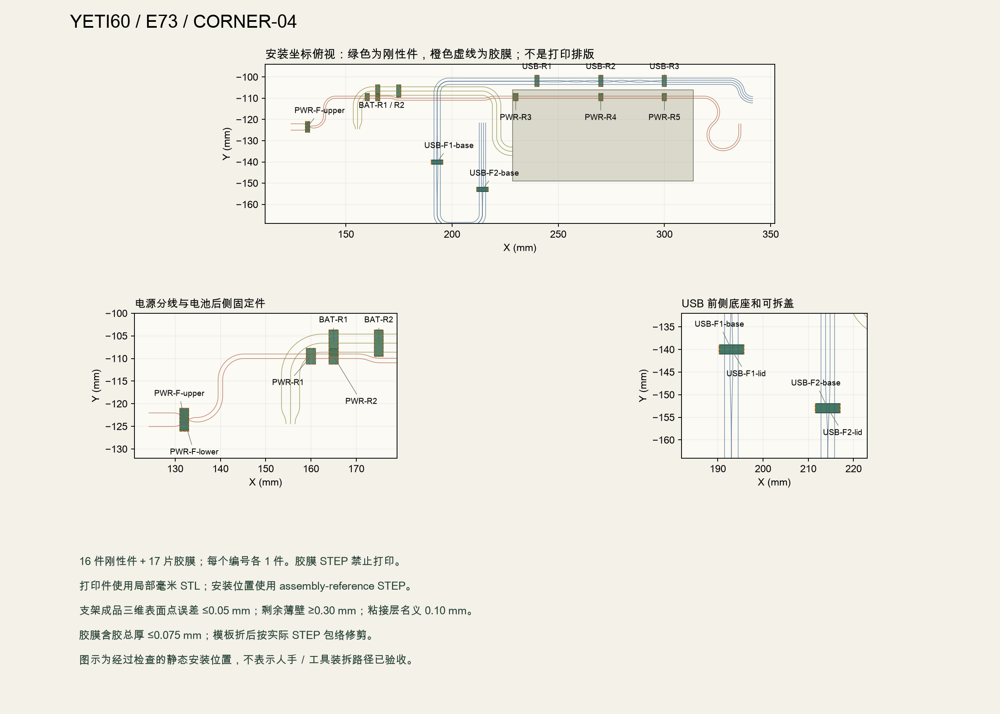

[English](retainers.md) | 中文

# E73 理线件：材料、打印与试装

本页记录 M04 基线。M05 首件请按 [M05 打印与布线清单](../02-mechanical/service-case-m05/print-guide.zh-CN.md) 选取线长和配套零件。

本套对应 **E73 CORNER-06**、旋转后的主板 J5 及连接现有 C5 子板的九根导线。接法及线长见[当前线束说明](harness-routing.zh-CN.md)。

**这是供审查和测量试装的工程零件。** 刚体、胶膜、导线入槽及公差检查，不能证明树脂强度、胶粘保持力、工具可达性或完整装入／退出流程。整机关壳仍未放行；工艺及维修动作解决前，不要永久粘接审查版零件。

## 需要制作什么

| 项目 | 净数量 | 文件／工艺 |
|---|---:|---|
| 刚性支架及可拆盖 | **16 个** | [局部坐标 STL 套装](../02-mechanical/retention/print/ALL-16-GUIDES-ONE-EACH.stl)，每种各一；也可逐个打印命名 STL，各一份，二选一，不能重复下单 |
| 支架装配参考 | 16 个 | [装配参考目录](../02-mechanical/retention/assembly-reference/USB-R1.step)，STEP 保留实际壳体安装坐标 |
| 裁切／折弯胶膜 | **17 片** | [胶膜下料图](../02-mechanical/retention/film-blanks.zh-CN.svg)，从指定薄膜裁切，**胶膜 STEP 不能用于 3D 打印** |
| 完整零件及数量表 | 合计 33 件 | [理线件表格](../02-mechanical/retention/parts.zh-CN.csv) |
| 几何要求 | 1 份规格 | [理线件规格](../02-mechanical/retention-spec.json) |

刚性件包括：3 个 `USB-R` 顶部支架；2 个 `USB-F` 底座及对应 2 个可拆盖；2 个 `BAT-R` 底壳支架；5 个 `PWR-R` PCB 支架；`PWR-F-upper` 与 `PWR-F-lower`。其中 7 个固定在壳内、6 个固定在 PCB，另有 3 个可拆盖／半件。

胶膜包括：3 片 USB 后部保持带、4 片 USB 前部接缝贴片、2 片电池保持带、5 片电源后部保持带、2 片电源分线接缝贴片、1 片下层分线保持带。折叠带包含两条侧面粘接腿；接缝片跨接两个配合件。悬在导线下方的一片矩形不能算完整固定件。

## 制作要求

- **毫米单位，100% 比例。** 打印 STL 已移到局部原点，必要时刚性翻转，使线槽便于制作；形状、体积均与装配 STEP 核对，不含缩放或收缩补偿。
- `ALL-16-GUIDES-ONE-EACH` 排版只含每种刚性件一个，方便一次制作，不能另算第 17 个零件。若供方需要逐件安排方向和支撑，使用单独文件。
- 使用满足成品尺寸的韧性工程树脂或绝缘机加工聚合物。文件不能证明所有低价 SLA 服务都能达到要求；先与供方核实小件工艺、支撑去除和后固化方式。
- 成品任一点的最大三维位置误差 **0.05 mm**；去支撑及修整粘接面后，实测最小余肉 **0.30 mm**。重点检查后部台阶顶壁、槽边、前盖顶壁及电池支架侧壁；不能随意扩槽或把薄壁磨到限值以下。
- 单线槽半径 **0.50 mm**，USB 中央线对槽半径 **1.01 mm**。检查中缩小可用槽域是为了计入零件误差，不是让工厂修改 CAD 尺寸。
- 粘接面须与**实际完成后固化的外壳**试配，并核实标称 **0.10 mm 胶层**和剩余薄壁。不能假定两件独立打印、未经修整的表面天然适配这个间隙；禁止强压支架或压缩电池。
- 打印方向不等于安装方向。按装配 STEP 和索引基准恢复零件姿态，不能镜像，也不能把切片软件里的排版坐标当成键盘安装坐标。

## 薄膜材料及裁切

候选为 **3M 5413 聚酰亚胺胶带**，制造商给出的典型总厚度为 **0.069 mm**。本项目要求到货批次**含胶总厚不超过 0.075 mm**；典型值不是保证上限，也不能替代在所选树脂上的粘接验收。[3M 技术资料](https://multimedia.3m.com/mws/media/136011O/3m-polyimide-film-tape-5413-tds.pdf)

准备一小卷，按表裁出 17 片，不是购买 17 卷。SVG 使用毫米单位，附 50 mm 标尺；纸质打印时关闭“适应页面”，先测量标尺。CSV 给出名义下料尺寸；折叠片每端另留 **0.5 mm 修剪量**，在实物支架上折弯后，按装配 STEP 包络修剪。这不是宣称精确展开的弯曲中性层尺寸。多余胶膜不能伸进 PCB、壳壁或其他导线。

CAD 已包含侧腿及前部／分线接缝片。保持粘接区清洁，遵循胶粘剂供方工艺。模型中的接触面积只验证几何粘接区域；剥离、蠕变及导线保持力仍须样片试验。拆除后更换胶膜，不把它当成可反复复用的紧固件。

## 试装顺序及位置检查

1. 先完成[空板焊接和台架检查](soldering.zh-CN.md)。支架和胶不得接触回流焊热区、裸焊盘、感应表面及 J3 刷写触点。
2. 清点 16 个刚性件和 17 片薄膜。局部 STL 用于制造，壳体坐标 STEP 用于定位。接近 PCB 前先测量槽、顶壁和余肉。
3. 外壳与电子组件**分开**时，先在 M04 底壳试配 3 个 USB 后支架、2 个 USB 前底座、2 个电池支架，核实粘接面与胶层。审查阶段仅临时定位，最终装入／维修流程尚未放行。
4. 在 PCB 背面试配 5 个 `PWR-R` 和 `PWR-F-upper`，避开元件、必须保留可达的过孔／焊盘及紧固件。其安装方向通常与打印方向相反，要按实际板厚及装配参考核对。
5. USB 四线分别进入外侧槽／中央线对槽，保护包三线进入对应编号槽，电源桥两线进入各自槽位。J5.1／J5.2 不能交叉；J1.2／J1.3 留空。每个支架必须真的容纳目标导线，不能让导线从支架下面或旁边绕过。
6. 试配两只 USB 前盖及下层电源分线件。USB 侧贴片固定相应底座／盖；电源侧贴片固定上下半件。核对两个配合件和底部保持带，再考虑把临时定位换成胶粘。
7. 检查整条线束与外壳、PCB、紧固件及完整保护包包络。CAD 剩余间隙较小，不能仅凭看起来合理判断；溢胶和未剪净薄膜都属于必须纳入包络的额外材料。
8. **完整安装／退出和工具可达性验收前，暂停永久粘接及关壳。** 打开上壳或关闭 SW100 都不等于完全隔离电池；电气返修前断开 USB 并隔离保护包。实际供电检查按当前电气教程执行。

## 证据及边界

[理线件检查](../06-validation/retention-study.json)覆盖标称板及 1.44／1.76 mm 端点、完整薄膜、支架／薄膜／PCB／外壳／保护包／元件／紧固件干涉和其他线束。逐针入槽检查要求非空导线段处于正确的缩限槽域内；错位空支架、悬空平膜、过厚膜及穿入 PCB 的错误样本均须拒绝。

[打印导出检查](../06-validation/retention-prints.json)核实刚性坐标变换、毫米网格边界及体积。这些是绑定来源的设计证据，不能替代实物焊接、胶、树脂、USB／蓝牙、静电容、充放电及电池温升验收。
