English | [Chinese](soldering.zh-CN.md)

# Bare PCB to bench bring-up

This guide covers all 75 fitted parts. No physical unit has validated it. Verify harness access before closure. Physical thermal, safety and RF acceptance require a prototype.

## 01 · Inspect and prepare

Keep the battery, domes and springs away from soldering. Use magnification, ESD tools, flux compatible with the cleaning process, controlled reflow/hot air, thermocouples, a DMM and a current-limited supply. U5/U6 have underside exposed pads; the E73 footprint also contains lands inside its body projection. An iron touching visible edges alone does not establish those joints. Follow the selected paste and component reflow limits; inspect hidden joints by an appropriate process. Do not solder or scrape the EC sensing electrodes. The map marks actual pad 1, not a photograph of the received package.

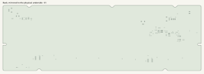

## 02 · Populate the supply stage

Fit the listed power passives and U5/U6. Match every value and footprint to the table, including the 0805 effective-capacitance requirements. F1 is a fast 1 A Littelfuse fuse, not a resettable fuse; L1 is the specified 3020 inductor. Inspect IC pin 1 and exposed-pad paste coverage. Ordinary tented through-vias are retained; do not replace them with filled/capped fabrication. Leave U1 uninstalled until rail checks pass. No battery or power is connected during placement.

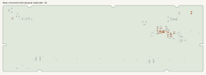

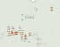

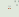

| Reference | Value | Package | Side |
|---|---|---|---|
| C30 | 10u/10V | C_0603_1608Metric | back |
| C40 | 2.2u/25V | C_0805_2012Metric | back |
| C41 | 22u/10V | C_0805_2012Metric | back |
| C42 | 22u/10V | C_0805_2012Metric | back |
| C43 | 22u/10V | C_0805_2012Metric | back |
| C44 | 100n/16V | C_0603_1608Metric | back |
| C45 | 22u/10V | C_0805_2012Metric | back |
| C46 | 22u/10V | C_0805_2012Metric | back |
| F1 | 1A_FAST_0466001_NRHF | Fuse_Littelfuse_0466_1206 | back |
| L1 | 1.5uH_74438336015 | WE-MAPI 3020, 3.0 x 3.0 x 2.0 mm | back |
| R40 | 2.21k/1% | R_0402_1005Metric | back |
| R41 | 7.50k/1% | R_0402_1005Metric | back |
| R42 | 100k | R_0402_1005Metric | back |
| R43 | 100k | R_0402_1005Metric | back |
| R44 | 100k | R_0402_1005Metric | back |
| R45 | 100k | R_0402_1005Metric | back |
| R46 | 100k | R_0402_1005Metric | back |
| R47 | 100 | R_0402_1005Metric | back |
| R48 | 100k | R_0402_1005Metric | back |
| R55 | 69.8k/1% | R_0402_1005Metric | back |
| R56 | 1.69k/1% | R_0402_1005Metric | back |
| U5 | BQ24074RGT | VQFN-16-1EP_3x3mm_P0.5mm_EP1.6x1.6mm | back |
| U6 | TPS63031DSK | WSON-10-1EP_2.5x2.5mm_P0.5mm_EP1.2x2mm | back |

## 03 · Populate power gating and sensing

Install U7/U8, their pull-downs, QOD resistors and the battery divider/filter. R51/R52 are 1 MΩ, not 1 kΩ. With U1 absent, R49/R50 keep the battery-measurement and analog-front-end gates low. Do not bypass these gates or tie their enable pins high. Battery reporting is disabled in the delivered firmware pending measurement integration; fitting the hardware does not qualify a percentage reading.

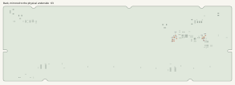

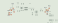

| Reference | Value | Package | Side |
|---|---|---|---|
| C47 | 10n | C_0402_1005Metric | back |
| C48 | 1u/10V | C_0402_1005Metric | back |
| R49 | 100k | R_0402_1005Metric | back |
| R50 | 100k | R_0402_1005Metric | back |
| R51 | 1M/1% | R_0402_1005Metric | back |
| R52 | 1M/1% | R_0402_1005Metric | back |
| R53 | 100 | R_0402_1005Metric | back |
| R54 | 100 | R_0402_1005Metric | back |
| U7 | TPS22919DCK | SOT-363_SC-70-6 | back |
| U8 | TPS22919DCK | SOT-363_SC-70-6 | back |

## 04 · Populate the EC front end

Fit the two 74HC4051 multiplexers, OPA350 and listed row/column/feedback parts. C10 is 220 pF; do not replace it with the stocked 100 nF capacitors. R17 is 1 kΩ and the reset pull-up R26 belongs to the next stage. Keep EC surfaces free of solder debris, fingerprints and cleaning residue. These circles are PCB sensing copper, not locations for MX sockets or per-key diodes.

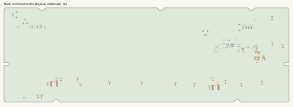

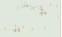

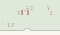

| Reference | Value | Package | Side |
|---|---|---|---|
| C10 | 220p | C_0402_1005Metric | back |
| C11 | 100n | C_0402_1005Metric | back |
| C12 | 100n | C_0402_1005Metric | back |
| C13 | 1u | C_0402_1005Metric | back |
| C9 | 100n | C_0402_1005Metric | back |
| R10 | 100k | R_0402_1005Metric | back |
| R11 | 100k | R_0402_1005Metric | back |
| R12 | 100k | R_0402_1005Metric | back |
| R13 | 100k | R_0402_1005Metric | back |
| R14 | 100k | R_0402_1005Metric | back |
| R15 | 100k | R_0402_1005Metric | back |
| R16 | 100k | R_0402_1005Metric | back |
| R17 | 1k | R_0402_1005Metric | back |
| R18 | 100k | R_0402_1005Metric | back |
| R19 | 100k | R_0402_1005Metric | back |
| R20 | 100k | R_0402_1005Metric | back |
| R21 | 100k | R_0402_1005Metric | back |
| R23 | 100k | R_0402_1005Metric | back |
| R24 | 100k | R_0402_1005Metric | back |
| R25 | 100k | R_0402_1005Metric | back |
| R3 | 100 | R_0402_1005Metric | back |
| R4 | 100 | R_0402_1005Metric | back |
| R5 | 100 | R_0402_1005Metric | back |
| R6 | 100 | R_0402_1005Metric | back |
| R7 | 100 | R_0402_1005Metric | back |
| R8 | 100k | R_0402_1005Metric | back |
| R9 | 100k | R_0402_1005Metric | back |
| U2 | 74HC4051 | TSSOP16 | back |
| U3 | OPA350 | SOIC-8_3.9x4.9mm_P1.27mm | back |
| U4 | 74HC4051 | TSSOP16 | back |

## 05 · Fit reset and the status LED

Fit SW1, R26, R32 and D2. D2 pad 1 is GND/cathode and pad 2 is LED_A/anode; verify the received LED's polarity mark. A dark LED alone is not a failed USB or BLE test. J3 is a six-pad pogo interface already on the PCB and needs no soldered header in this design. JP1 remains open; do not bridge it during assembly.

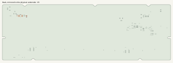

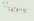

| Reference | Value | Package | Side |
|---|---|---|---|
| D2 | STATUS | LED_0603_1608Metric | back |
| R26 | 10k | R_0402_1005Metric | back |
| R32 | 2.2k | R_0402_1005Metric | back |
| SW1 | EVQPUC02K_RESET | Panasonic_EVQPUL_EVQPUC | back |

## 06 · Fit the module decoupling capacitors

Fit back-side C31 (100 nF, 0402) and C32 (4.7 µF/16 V, 0603). C31 has moved to the lower corner beside the 3.3 V launch; do not fit it at the old upper-right location. These MLCCs are unpolarized, but their pad net assignments in the diagram are important for voltage tests. Keep their installed heights within the assembly limits.

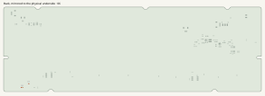

| Reference | Value | Package | Side |
|---|---|---|---|
| C31 | 100n/16V | C_0402_1005Metric | back |
| C32 | 4.7u/16V | C_0603_1608Metric | back |

## 07 · Fit the connectors and power switch

Fit J1/J2/J4/J5 and SW100 after the smaller parts. All four headers are SH 1.0 mm; J2 is three-pin, not PH 2.0 mm. Inspect electrical pins and shell anchors. The existing C5 daughterboard is reused. USB harness: C5 pins 1/2/3/4 to J4 1/2/3/4. Power bridge: J5.1 to J1.1 and J5.2 to J1.4; J1.2/J1.3 stay empty. Check every conductor with power disconnected; never infer mating pin order from wire colors or a mirrored housing photo. Final closed-case cable lengths are not yet released. With all power disconnected, identify ON by continuity SW100.1–SW100.2 (VSYS to REG_EN), and OFF by SW100.2–SW100.3 (REG_EN to GND); do not guess from lever direction.

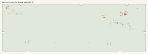

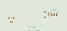

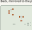

| Reference | Value | Package | Side |
|---|---|---|---|
| J1 | USB_POWER_IN | JST-SR-4 | back |
| J2 | PROTECTED_1S_4V2_NTC10K | JST SH 1.0 mm side-entry 3-pin | back |
| J4 | USB_C5_INPUT | JST SH 1.0 mm side-entry 4-pin | back |
| J5 | USB_POWER_OUT | JST SH 1.0 mm side-entry 2-pin | back |
| SW100 | JS102011SAQN_POWER | SW_SPDT_CK_JS102011SAQN | back |

## 08 · Check the rails before installing U1

Use insulating supports on the open bench, with no battery and no host attached. Check for persistent shorts between USB_5V/GND, VSYS/GND and +3.3V/GND; charging capacitors can change resistance readings, so a beep alone is inconclusive. Feed the confirmed USB power path from a 5.0 V current-limited source; 50 mA is a project initial screening limit, not a specified keyboard operating current. Stop if limiting persists or any part heats. Check F1 input/output, then switch SW100 on and measure C45.1 to GND: expect about 3.3 V; 3.20–3.40 V is a project bench screening window with a suitable DMM, not full regulator qualification. U5 VSYS is a power-path output, not the 3.3 V rail. Disconnect power before rework. Do not inject 5 V at J3 or J2.

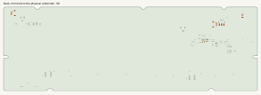

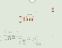

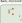

## 09 · Install the front-side E73

Disconnect all power, then install U1 on the front. Match pad 1 and antenna direction to the front-view drawing. Check the underside lands with an appropriate reflow/inspection method; do not assume edge wetting proves all 43 joints. Support and protect already fitted back-side parts and follow the module's thermal limits. Recheck shorts and the 3.3 V rail before programming. Preserve the four-layer antenna keepout. The retained steel plate still covers the provisional antenna band; this guide does not guarantee BLE range.

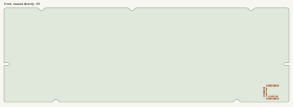

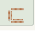

| Reference | Value | Package | Side |
|---|---|---|---|
| U1 | E73-2G4M08S1C | E73-2G4M08S1C | front |

## 10 · Program and test without a battery

Use the matching calibrator HEX through a 3.3 V logic SWD probe. J3: 1 VTref/+3.3V, 2 SWDIO, 3 GND, 4 SWDCLK, 5 RESET_N, 6 GND. VTref is a voltage reference, not permission to power the board from the probe. Use one confirmed power source and common ground. Initial HEX programs UICR NFC pins; BIN alone does not. No UF2 bootloader is provided. Disconnect the bench supply physically before connecting host USB; do not back-feed two 5 V sources. Connect the data-capable C5 USB cable and check host enumeration; no key events before valid calibration is expected. Use another keyboard to operate the calibration terminal. Keep a record of supply voltage/current, USB device detection and any fault logs.

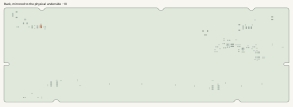

## 11 · Qualify the protected pack separately

Before connecting a real pack, obtain its signed electrical/thermal/dimensional specification and confirm J2 polarity: 1 PACK+, 2 PACK−, 3 the separate 10 kΩ NTC. Never short the NTC input as an operating substitute or solder directly to an unapproved cell. SW100 off does not isolate charging: R42/R43/R44 permit autonomous USB100 slow charging. Running firmware disables charging before host configuration and selects USB500 only after acceptance; system load shares that input budget. Perform the documented power-path, temperature, timer, termination and unplug/suspend tests with appropriate equipment. These physical tests are still open; this guide is not a passed safety test.

## 12 · Fit the mechanism and calibrate all 60 keys

Complete hot work and cleaning first. Follow the NiZ/steel-plate stabilizer guide: 60 housings/sliders, 60 domes and springs, three plate-mounted stabilizer pairs, and 28 insulated mounting sets; H26 receives no hardware. You can test the plate/PCB assembly without a shell, supported so components cannot touch the bench. Calibrate released and fully pressed samples for every active key using the matching calibrator, save, then program the matching normal HEX while preserving the final 64 KiB settings partition. Check USB typing, BLE pairing/reconnect, wake and key release on the bench. Final wire retention, closed-case assembly/explosion, thermal and RF acceptance remain open; do not force the case closed or compress the pack.

## Related instructions and sources

[NiZ / plate](key-mechanism.md) · [Firmware](../05-firmware/installation.md)

[TI BQ24074](https://www.ti.com/lit/ds/symlink/bq24074.pdf)
[TI TPS63031](https://www.ti.com/lit/ds/symlink/tps63031.pdf)
[SEGGER J-Link Commander](https://kb.segger.com/J-Link_Commander)
