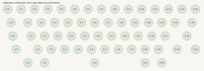

[English](installation.md) | [Chinese](installation.zh-CN.md)

# Firmware for the E73 lower-right PCB

Use the CORNER-04 build under `hardware/e73-hhkb-corner/firmware/`, with `manifest.json` and both `releases/normal/yeti60-e73.hex` and `releases/calibrator/yeti60-e73.hex`. Root-level pre-migration images and Raytac images do not match this PCB calibration identity. The [corner review](../06-validation/corner-review.md) controls the design hold.

Reproduce after the current native routing, USB-reference and bounded-fit checks:

```sh
uv run --python 3.14.7 --with-requirements requirements-audit.txt python scripts/build_e73_corner_firmware.py
python3 scripts/check_e73_corner_firmware.py
```

The builder requires the pinned ZMK workspace, its pinned Docker image and a running Docker daemon. It builds in an ignored isolated root, checks both linked ARM images, runs the core/calibration/USB/GPIO/scan/key-pipeline/NVS/recovery and RC sensitivity suite, and runs linked-target and suite mutation tests before copying images. `--prepare-only` prepares the pin contract without building. `--development-build` builds/tests in the ignored workspace and publishes no images.

Use **HEX for initial SWD programming**: it also releases NFC pins as GPIO through UICR. The BIN omits that explicit record. Application address is zero; no UF2 bootloader is assumed. Confirm the custom J3 pinout before connecting a probe. Follow the [existing calibration procedure](https://github.com/wZuck/YETI60/blob/master/firmware/target/README.md#calibration-and-operation), substituting these candidate HEX files. Program calibrator first, complete all 60 keys, save, then program normal while preserving the final 64 KiB settings partition. Full erase loses calibration and BLE bonds. A changed PCB fingerprint requires fresh calibration.

Both images use internal RC low-frequency clock and REG1 LDO. After host configuration, charging and USB HID operate together with USB priority; suspend disables charger input, and detach permits BLE fallback. These are linked-binary and host-model checks. No unit has passed physical USB/BLE/EC, battery charging, thermal or RF tests. Battery reporting remains disabled pending pack/measurement integration. The passive RC model uses assumed parasitics, not extracted PCB/NiZ capacitance.

[Manifest](manifest.json) · [Normal HEX](releases/normal/yeti60-e73.hex) · [Calibrator HEX](releases/calibrator/yeti60-e73.hex)

## First programming with a J-Link

Install the [SEGGER J-Link software](https://kb.segger.com/J-Link_Commander), and use a probe with 3.3 V target logic. Power the board through the verified supply path, switch SW100 on and confirm 3.3 V before connecting. J3 pin 1 is VTref, not a probe power input; pins 2/3/4/5/6 are SWDIO/GND/SWDCLK/RESET_N/GND. Do not connect two competing 5 V sources.

Open a terminal in the directory containing this image manifest and `releases/`: `05-firmware/` in the delivery folder, or `hardware/e73-hhkb-corner/firmware/` in the repository. Start Commander (Windows uses `JLink.exe`):

```sh
JLinkExe -device nRF52840_xxAA -if SWD -speed 1000 -autoconnect 1
```

At its prompt, program the calibrator:

```text
r
h
loadfile releases/calibrator/yeti60-e73.hex
r
g
q
```

Check that download/verification succeeds. These are documented Commander commands, not a physical flash test of this board. A locked factory module may require recovery; recovery/full-chip erase loses settings. Do not use it for an update after calibration. The code partition is `0x00000–0xEFFFF`; preserve settings at `0xF0000–0xFFFFF`. Inspect the programmer's erase plan and back up settings before updating. If it proposes a full erase, stop and resolve preservation first. HEX includes the required UICR record; no UF2 drive is expected.

## Capture every key and install normal firmware

Disconnect the bench supply before connecting the host USB cable. Calibrator exposes the USB logging/shell interface. Open its serial port in a terminal; 115200, 8N1 and no hardware flow control is a suitable terminal setting. Use another keyboard to enter commands. First assemble the plate, domes and springs; finger-touching bare electrodes is not the final mechanism's calibration.

Use the [60-key row/column sheet](../04-assembly/calibration-keys.csv) and front-view diagram. Only the central spacebar EC position is active; stabilizer side stems are passive.



1. Release every key, run `yeti_calibrate release`, and wait for the 128-frame completion message.
2. Hold one key fully down **before** running its command. For the diagram's `0,0` position use `yeti_calibrate press 0 0`. Keep it held until the 128-sample completion message, then release. Repeat the corresponding command for all 60 active positions.
3. Run `yeti_calibrate status`. Resolve insufficient samples, overlap, saturation or guard failures; do not bypass them. Run `yeti_calibrate save` only after every key passes.
4. Reconnect the SWD probe with the same voltage/polarity precautions and program `releases/normal/yeti60-e73.hex` using the sequence above, preserving the settings partition. Do not mix a normal image from another bundle.
5. Confirm USB key-down/release, modifiers, Fn and large-key edge return; then test BLE pairing, reconnect, wake and USB priority. A changed housing/dome/spring/plate stack or PCB fingerprint requires recalibration.

Record real results; the delivered host tests do not replace these unit tests.
