English | [Chinese](build-guide.zh-CN.md)

# YETI60 illustrated soldering and assembly guide

This guide follows the current P2 mainboard, C5 JSH, 1600 mAh single-cell pack and source-sized FELK60-derived case. Every step has a separate illustration. No physical unit exists yet: these are engineering illustrations, not photographs of a completed build. Actual part, dome/housing, stencil, charging and first-article acceptance requirements still apply.

[PCBs to fabricate and complete materials](../../README.md#which-pcbs-to-fabricate) · [Mainboard purchase plan](../../hardware/bom/mainboard-purchase.csv) · [C5 self-build parts](../../hardware/bom/daughterboard.csv) · [Assembly dimensions](../engineering/assembly.md)

Mainboard parts are on the back; mainboard views are mirrored horizontally for looking at that face. C5 views look at its F.Cu component face. Rear means the number-row side. Gold rings identify native pad 1; compare them with the actual package mark. PCB tracks are omitted. Mechanical exploded offsets and unqualified dome/housing/cap shapes are illustrative.

Steps 12–13 apply only to a bare C5 build; skip them with a populated daughterboard. The other checks still apply.

Step index

- [01 Prepare the boards, parts and tools](#step-01)
- [02 Identify and inspect the bare PCB](#step-02)
- [03 Support the PCB and print solder paste](#step-03)
- [04 Place all 43 resistors](#step-04)
- [05 Place all 17 capacitors](#step-05)
- [06 Place power and protection devices](#step-06)
- [07 Place the EC analog front end](#step-07)
- [08 Place the single nRF52840 module](#step-08)
- [09 Place connectors, switches and the LED](#step-09)
- [10 Reflow, cool and inspect the solder joints](#step-10)
- [11 Complete the unpowered electrical checks](#step-11)
- [12 Optional C5: print paste and place seven parts](#step-12)
- [13 Optional C5: reflow and inspect both USB rows](#step-13)
- [14 Check C5 and the four-wire USB harness](#step-14)
- [15 First USB power-up, without a battery](#step-15)
- [16 Program and verify the calibrator through J3](#step-16)
- [17 Finish the resin shells and bond eight inserts](#step-17)
- [18 Prepare the steel plate and 60 housings](#step-18)
- [19 Center the domes and conical sensing springs](#step-19)
- [20 Install the 29 insulated PCB fastener sets](#step-20)
- [21 Fit lower gaskets, C5 and open guide bases](#step-21)
- [22 Inspect and retain the qualified battery pack](#step-22)
- [23 Lay the seven wires and close the removable guides](#step-23)
- [24 Fit 60 matched keycaps and check travel](#step-24)
- [25 Calibrate every key, save and load normal firmware](#step-25)
- [26 Test USB, BLE and charge-state behavior open](#step-26)
- [27 Fit upper gaskets and close the shell](#step-27)
- [28 Fit four feet and repeat the final checks](#step-28)

## 01 — Prepare the boards, parts and tools

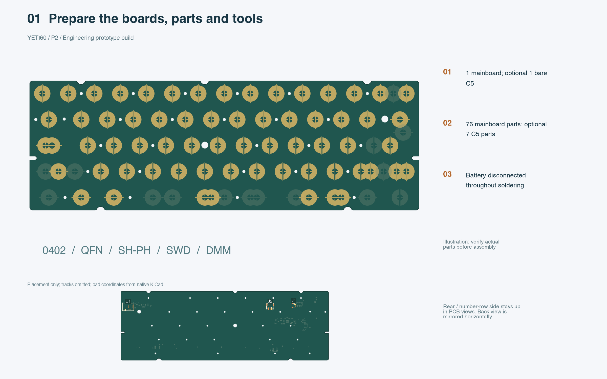

[Vector enlargement](images/01-step.svg)

1. Fabricate the main PCB; add one bare C5 JSH only if self-assembling it. Use the linked four-layer files in the README.
2. Order parts by exact value, package and rating. Keep the five matched stock pools separate from unqualified substitutes.
3. Prepare magnification, ESD handling, paste/stencil and controlled reflow equipment, tweezers, a multimeter, current-limited USB source and SWD probe. Keep the battery disconnected.

**Check before continuing:** Freeze actual MPNs and a compatible soldering profile before applying paste. A soldering iron alone cannot complete hidden underside joints.

## 02 — Identify and inspect the bare PCB

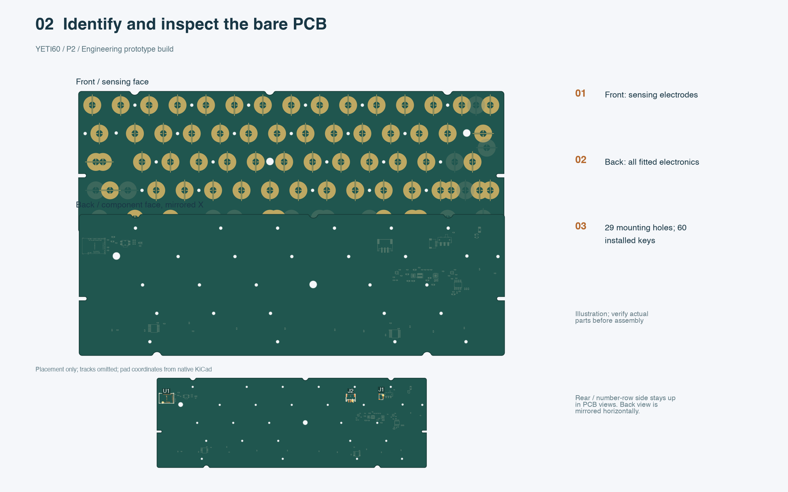

[Vector enlargement](images/02-step.svg)

1. Identify the front sensing face and rear component face; the numbered illustrations show which face is visible.
2. Check the 29 mounting holes, board edge and clean sensing electrodes. Do not sand, tin or coat the sensing pads.
3. Inspect bare-board copper/mask defects and compare the received dimensions/thickness with the fabrication requirements.

**Check before continuing:** There are 74 alternative electrode sites but only 60 installed keys. Never populate sensing pads as switches or add per-key diodes.

## 03 — Support the PCB and print solder paste

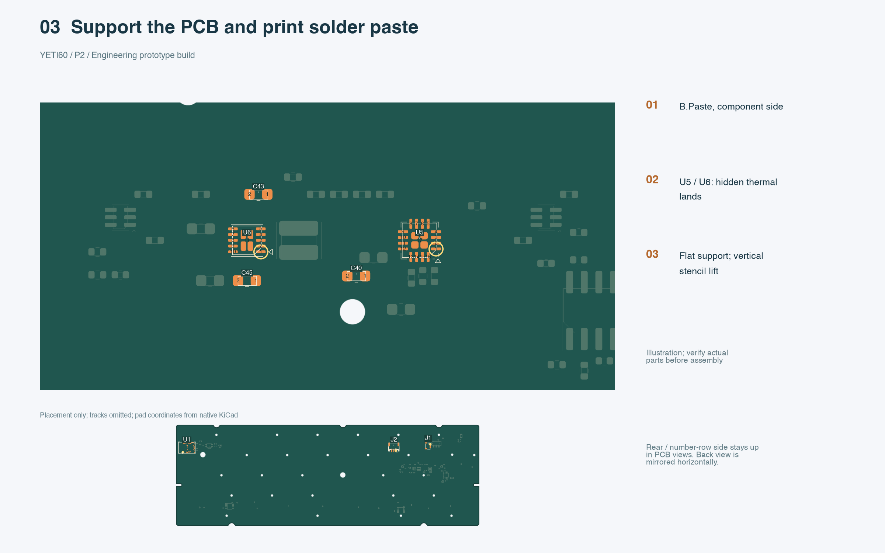

[Vector enlargement](images/03-step.svg)

1. Hold the PCB flat, component face upward, without scratching or bending the sensing face.
2. Align a qualified stencil to the current B.Paste pattern, with JP1 apertures blocked/omitted in the approved stencil plan. Print once, lift vertically and inspect deposits for bridges or missing paste.
3. Inspect U5/U6 exposed-pad apertures and the module lands especially carefully. Ordinary open thermal vias need process control against solder wicking.

**Check before continuing:** The native paste drawing is not a qualified stencil recipe. Confirm aperture reduction/segmentation and paste/profile with the assembler; do not flood a thermal pad with solder.

## 04 — Place all 43 resistors

[Vector enlargement](images/04-step.svg)

1. Sort 0402 resistors by value and use the reference table below, not body appearance.
2. Place R30/R31 as 0 ohm links. Fit R40=2.21k, R55=69.8k and R56=1.69k, all 1%; do not use approximate stock values.
3. Fit the remaining gain, pull-down, LED and divider resistors. Leave JP1 open.

**Check before continuing:** Count 43 fitted resistors. Resistors have no polarity; value and location are critical.

References placed in this step: R10, R11, R12, R13, R14, R15, R16, R17, R18, R19, R20, R21, R23, R24, R25, R26, R3, R30, R31, R32, R4, R40, R41, R42, R43, R44, R45, R46, R47, R48, R49, R5, R50, R51, R52, R53, R54, R55, R56, R6, R7, R8, R9.

| References | Quantity | Design value | Package |
|---|---:|---|---|
| R3, R4, R5, R6, R7, R47, R53, R54 | 8 | 100 | R_0402_1005Metric |
| R8, R9, R10, R11, R12, R13, R14, R15, R16, R18, R19, R20, R21, R23, R24, R25, R42, R43, R44, R45, R46, R48, R49, R50 | 24 | 100k | R_0402_1005Metric |
| R17 | 1 | 1k | R_0402_1005Metric |
| R26 | 1 | 10k | R_0402_1005Metric |
| R30, R31 | 2 | 0 | R_0402_1005Metric |
| R32 | 1 | 2.2k | R_0402_1005Metric |
| R40 | 1 | 2.21k/1% | R_0402_1005Metric |
| R41 | 1 | 7.50k/1% | R_0402_1005Metric |
| R51, R52 | 2 | 1M/1% | R_0402_1005Metric |
| R55 | 1 | 69.8k/1% | R_0402_1005Metric |
| R56 | 1 | 1.69k/1% | R_0402_1005Metric |

## 05 — Place all 17 capacitors

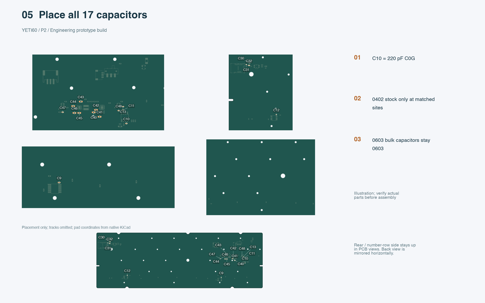

[Vector enlargement](images/05-step.svg)

1. Fit C10 as 220 pF C0G 0402, and C47 as 10 nF 0402. Follow the table for all remaining capacitors.
2. Use stock 100 nF only at C9/C11/C12/C31, and stock 1 uF only at C13/C48.
3. Keep C40/C44 and the bulk capacitors in their specified 0603 packages. Check voltage, dielectric and effective DC-biased capacitance.

**Check before continuing:** Count 17 capacitors. These specified ceramic capacitors are non-polarized; do not substitute larger 0805 stock into 0603 sites.

References placed in this step: C10, C11, C12, C13, C30, C31, C32, C40, C41, C42, C43, C44, C45, C46, C47, C48, C9.

| References | Quantity | Design value | Package |
|---|---:|---|---|
| C9, C11, C12 | 3 | 100n | C_0402_1005Metric |
| C10 | 1 | 220p | C_0402_1005Metric |
| C13 | 1 | 1u | C_0402_1005Metric |
| C30, C41, C42, C43, C45, C46 | 6 | 10u/10V | C_0603_1608Metric |
| C31 | 1 | 100n/16V | C_0402_1005Metric |
| C32 | 1 | 4.7u/10V | C_0603_1608Metric |
| C40 | 1 | 1u/10V | C_0603_1608Metric |
| C44 | 1 | 100n/16V | C_0603_1608Metric |
| C47 | 1 | 10n | C_0402_1005Metric |
| C48 | 1 | 1u/10V | C_0402_1005Metric |

## 06 — Place power and protection devices

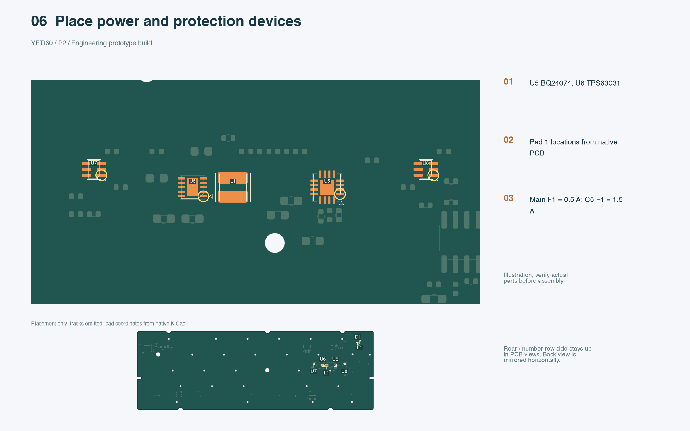

[Vector enlargement](images/06-step.svg)

1. Align the actual package pin-1 marks to the native pad-1 positions for U5 BQ24074, U6 TPS63031 and U7/U8 TPS22919.
2. Fit L1 as the specified 1.5 uH part and F1 as the mainboard 1206/0.5 A fuse; the C5 fuse is different.
3. Fit D1 PRTR5V0U2X in its exact SOT-143 orientation. Inspect the underside-pad paste before setting down U5/U6.

**Check before continuing:** Do not omit U5/U6 exposed ground pads or replace the inductor with a ferrite bead. Package dots must be checked against the actual supplier drawing.

References placed in this step: U5, U6, U7, U8, L1, D1, F1.

| References | Quantity | Design value | Package |
|---|---:|---|---|
| D1 | 1 | PRTR5V0U2X | SOT-143 |
| F1 | 1 | 500mA | Fuse_1206_3216Metric |
| L1 | 1 | 1.5uH_74438336015 | L_Wuerth_MAPI-3015 |
| U5 | 1 | BQ24074RGT | VQFN-16-1EP_3x3mm_P0.5mm_EP1.6x1.6mm |
| U6 | 1 | TPS63031DSK | WSON-10-1EP_2.5x2.5mm_P0.5mm_EP1.2x2mm |
| U7, U8 | 2 | TPS22919DCK | SOT-363_SC-70-6 |

## 07 — Place the EC analog front end

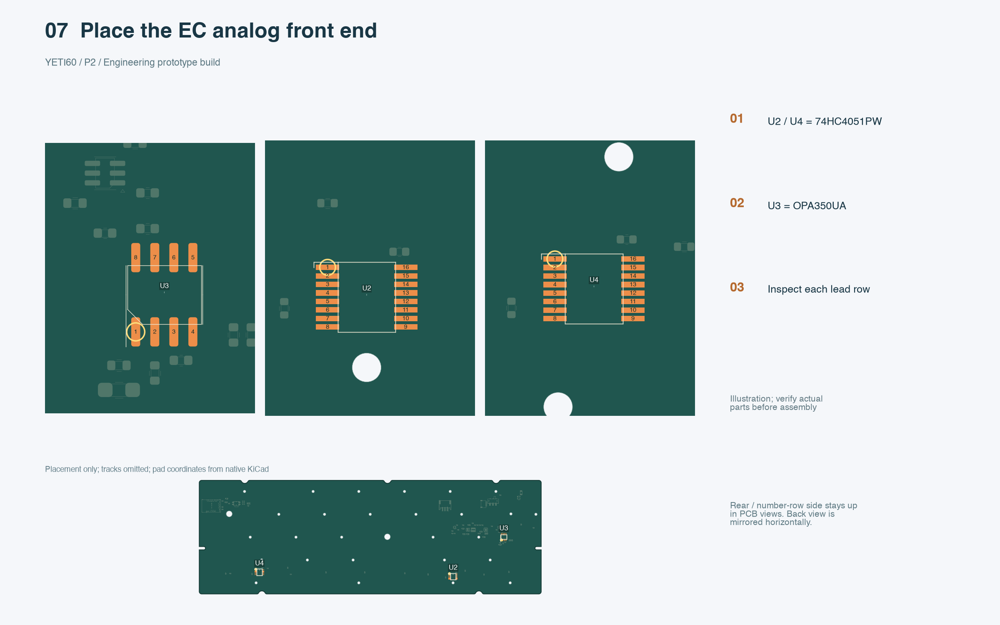

[Vector enlargement](images/07-step.svg)

1. Fit U2 and U4 as 74HC4051PW TSSOP-16, not HCT or a different package.
2. Fit U3 OPA350UA SOIC-8; it is neither the dual OPA2350 nor an MSOP device.
3. Align pin 1, inspect the fine leads and avoid moving the surrounding 0402 parts.

**Check before continuing:** All three ICs must match the native pad-1 marks and BOM. JP1 is still open.

References placed in this step: U2, U3, U4.

| References | Quantity | Design value | Package |
|---|---:|---|---|
| U2, U4 | 2 | 74HC4051 | TSSOP16 |
| U3 | 1 | OPA350 | SOIC-8_3.9x4.9mm_P1.27mm |

## 08 — Place the single nRF52840 module

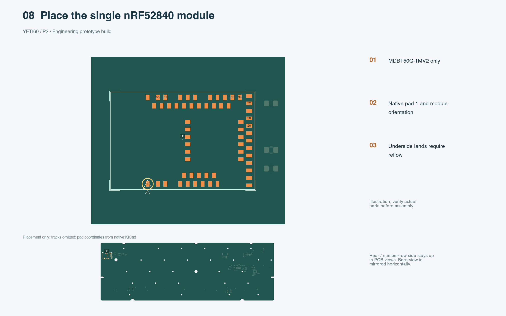

[Vector enlargement](images/08-step.svg)

1. Confirm Raytac MDBT50Q-1MV2, including the actual ordering suffix; do not use the stock nice!nano board.
2. Match the module drawing, pin 1 and antenna end to the native footprint. Check the underside lands before placement.
3. Keep paste and metal debris out of the antenna area. Place the module flat without sliding it across neighboring pads.

**Check before continuing:** This is a module soldered directly to the PCB, with underside joints. No headers or second controller are installed.

References placed in this step: U1.

| References | Quantity | Design value | Package |
|---|---:|---|---|
| U1 | 1 | MDBT50Q-1MV2 | Raytac_MDBT50Q |

## 09 — Place connectors, switches and the LED

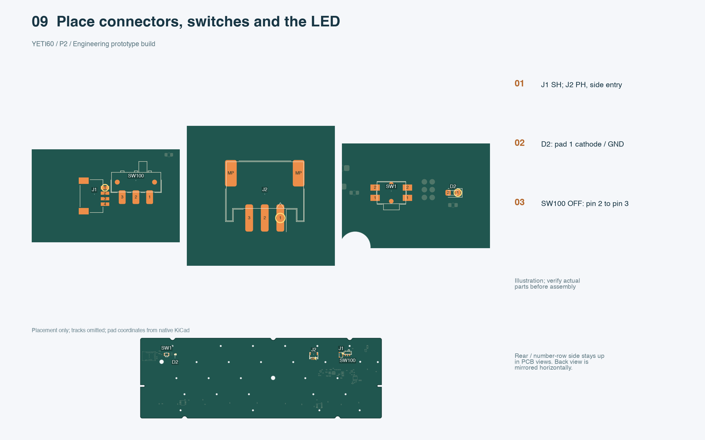

[Vector enlargement](images/09-step.svg)

1. Fit main J1 SH and J2 PH in the native side-entry orientation; align the retention feet as well as signal pins.
2. Fit SW1 reset and SW100 power controls. Find OFF electrically: with power absent, SW100 pin 2 connects to GND pin 3 in OFF, not VSYS pin 1.
3. Fit D2 only with a qualified 0603 LED: cathode at pad 1 GND, anode at pad 2 LED_A. Confirm all these parts accept the common reflow process.

**Check before continuing:** All 76 fitted parts are now placed. JP1 is absent and J3 is bare probe pads. If any chosen part cannot share the profile, revise the stencil/assembly plan before printing, rather than leaving unpopulated paste deposits.

References placed in this step: J1, J2, SW1, SW100, D2.

| References | Quantity | Design value | Package |
|---|---:|---|---|
| D2 | 1 | STATUS | LED_0603_1608Metric |
| J1 | 1 | REAR_USB_DAUGHTERBOARD | JST-SR-4 |
| J2 | 1 | PROTECTED_1S_4V2_NTC10K | JST_PH_S3B-PH-SM4-TB_1x03-1MP_P2.00mm_Horizontal |
| SW1 | 1 | EVQPUC02K_RESET | Panasonic_EVQPUL_EVQPUC |
| SW100 | 1 | JS102011SAQN_POWER | SW_SPDT_CK_JS102011SAQN |

## 10 — Reflow, cool and inspect the solder joints

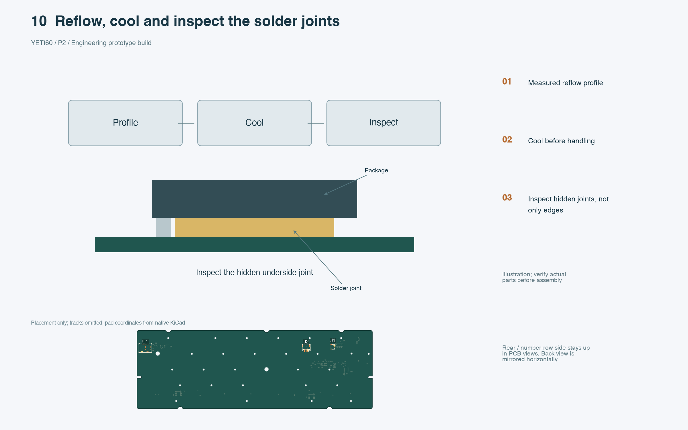

[Vector enlargement](images/10-step.svg)

1. Run the qualified paste/component profile with a measured board-temperature record. Do not use an invented universal oven or hot-air setting.
2. Let the supported board cool before moving it. Inspect for shifted parts, tombstones, bridges, opens and solder balls.
3. Inspect accessible joints under magnification and arrange X-ray/process evidence for U5/U6/module underside joints. Repair defects with controlled rework, then clean and fully dry using a materials-compatible process.

**Check before continuing:** An attractive outer fillet does not prove an underside joint is soldered. Keep the battery and case away from all heating operations.

## 11 — Complete the unpowered electrical checks

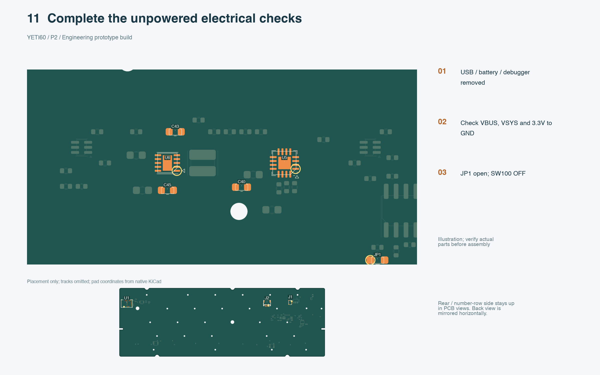

[Vector enlargement](images/11-step.svg)

1. Disconnect USB, battery and debugger. Confirm SW100 OFF and inspect JP1 remains unbridged.
2. Measure settled resistance from VBUS/USB_5V, VSYS and +3.3V to GND. A brief capacitor-charging beep alone is not a short diagnosis.
3. Verify connector numbering, D2 polarity, fuse paths and solder bridges under magnification. Record results before applying power.

**Check before continuing:** Resolve persistent hard shorts or abnormal readings first. No universal resistance threshold is claimed for this populated circuit.

## 12 — Optional C5: print paste and place seven parts

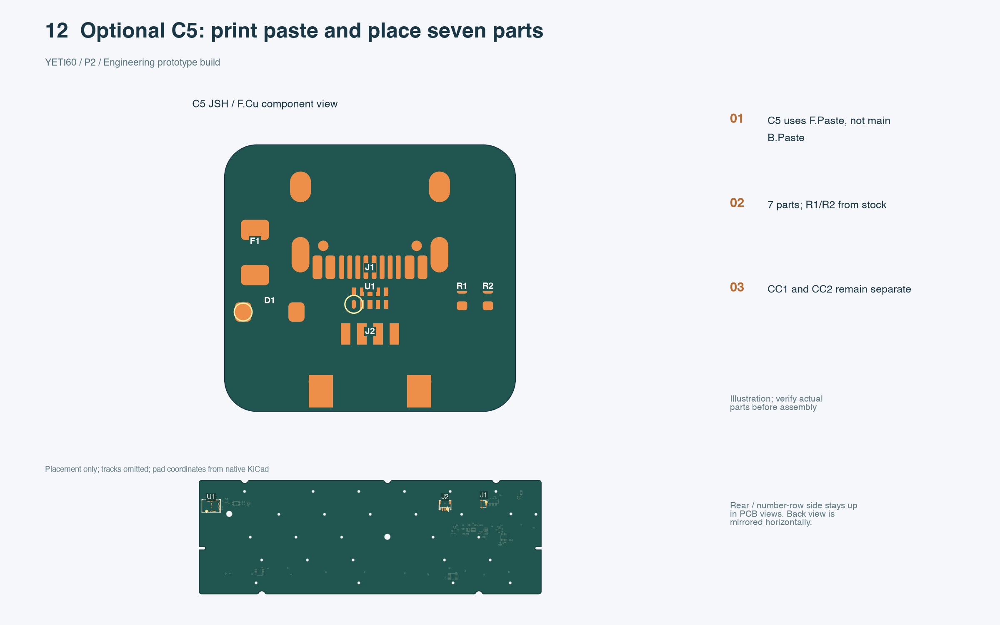

[Vector enlargement](images/12-step.svg)

1. Skip this step only if using a populated C5. For self-assembly, use the pinned four-layer C5 JSH board and local seven-part BOM.
2. Support its F.Cu component face upward and print the qualified F.Paste stencil. Place R1/R2=5.1k, U1 TPD4E05U06DQAR, D1 SMF6.0A and F1 ASMD1206-150.
3. Place USB-C J1 and SH J2, checking all signal and shell/retention lands. Align U1 pin 1 and the D1 cathode to the actual footprint/net drawing.

**Check before continuing:** The two CC resistors are independent. Do not connect CC1 to CC2. Stock USB-C substitutes still require dimensional confirmation.

## 13 — Optional C5: reflow and inspect both USB rows

[Vector enlargement](images/13-step.svg)

1. Use a separately qualified C5 paste/component profile and let the board cool before inspection.
2. Inspect USB-C fine signal contacts and shell anchors; verify both reversible D+/D- contact groups connect to their intended nets without adjacent shorts.
3. Inspect the underside U1 USON joints and D1 polarity, then test SH numbered continuity, fuse continuity and separate CC pull-down paths.

**Check before continuing:** A mechanically fitting USB plug does not prove its contacts are soldered. The seven C5 parts are not part of the mainboard's count of 76.

## 14 — Check C5 and the four-wire USB harness

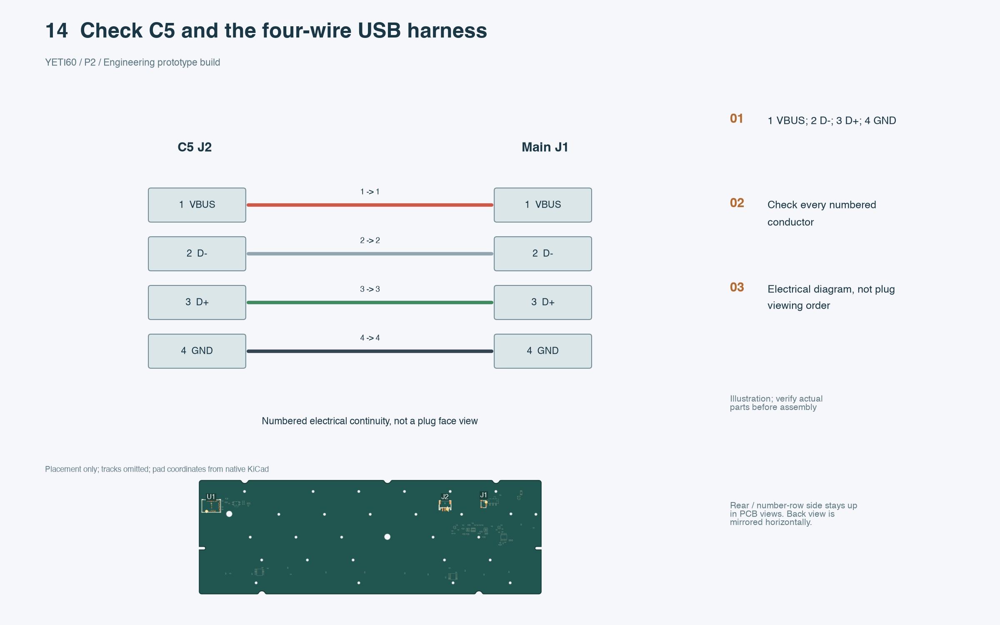

[Vector enlargement](images/14-step.svg)

1. Use two SHR-04V-S housings and eight suitable contacts with AWG28 stranded conductors, OD <=0.8 mm each.
2. With every power source removed, check numbered continuity: C5 SH pin 1 to main J1 pin 1, then 2-to-2, 3-to-3 and 4-to-4; check adjacent isolation.
3. Verify crimps and latches before mating. Use the controlled individual lengths; the 150 mm centerline is not a universal equal-wire cut length.

**Check before continuing:** Numbered continuity governs. Opposing plugs can look reversed; wire colors and visual left/right order are not sufficient.

## 15 — First USB power-up, without a battery

[Vector enlargement](images/15-step.svg)

1. Connect the checked C5/harness on an insulating fixture. Leave J2 empty and initially leave SW100 OFF.
2. Apply a controlled 5 V USB input with a conservative initial 100 mA current limit; this is a bring-up ceiling, not a measured expected current. Stop if it stays in current limit or parts heat abnormally.
3. Record USB_5V at C40 and VSYS at C43. Turn SW100 ON and check +3.3V at C45 against U6's actual specification. Power down before changing probe wiring.

**Check before continuing:** Do not raise the current limit to conceal a fault. VSYS is a PowerPath output and need not equal a hypothetical 3.7 V battery. The blank module is not expected to enumerate as a keyboard.

## 16 — Program and verify the calibrator through J3

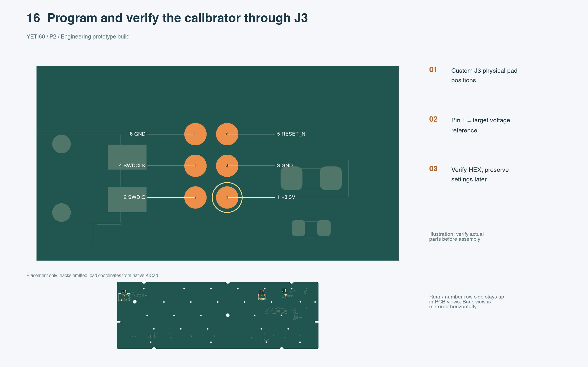

[Vector enlargement](images/16-step.svg)

1. Power off before mating the custom six-pogo fixture. Use J3 pin 1 as 3.3 V target reference, not a second supply.
2. Connect 2 SWDIO, 3 GND, 4 SWDCLK, 5 RESET_N and 6 GND using the actual pad numbers. Power the board through the checked USB path.
3. Select nRF52840 in the probe tool, program firmware/releases/calibrator/yeti60.hex, verify its contents and reset. Reserve calibration until the EC mechanical stack is installed.

**Check before continuing:** J3 is not the standard ARM connector pinout. Never attach two active 3.3 V supplies. Later normal-firmware updates must preserve settings at 0xF0000–0xFFFFF.

## 17 — Finish the resin shells and bond eight inserts

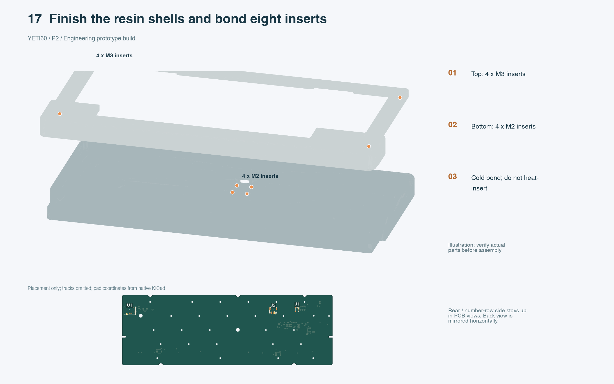

[Vector enlargement](images/17-step.svg)

1. Use the current unscaled top/bottom files, fully post-cure the selected resin and inspect shell registration.
2. Finish four M3 insert seats in the top and four M2 daughterboard seats in the bottom to the specified dimensions.
3. Cold-bond with resin-compatible structural epoxy; keep adhesive out of threads, align the insert axes and allow full cure before loading.

**Check before continuing:** Do not heat-insert into thermoset resin or substitute unqualified RTV. Confirm actual bore sizes, insert flushness and thread depth on samples.

## 18 — Prepare the steel plate and 60 housings

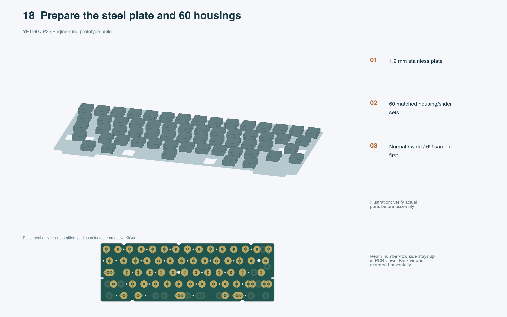

[Vector enlargement](images/18-step.svg)

1. Deburr the 1.2 mm stainless plate, finish its 29 M2 threads and clean all metal debris away from the PCB.
2. Dry-fit matched independently mountable Topre-compatible housings/sliders at all 60 active positions.
3. Fit the matched stabilized housings, wires and clips for wide keys and the 6U HHKB spacebar. Test free movement before adding domes.

**Check before continuing:** Qualify a normal key, wide key and 6U spacebar first. Original HHKB integrated-plate housings and generic 7U MX stabilizers are not assumed compatible.

## 19 — Center the domes and conical sensing springs

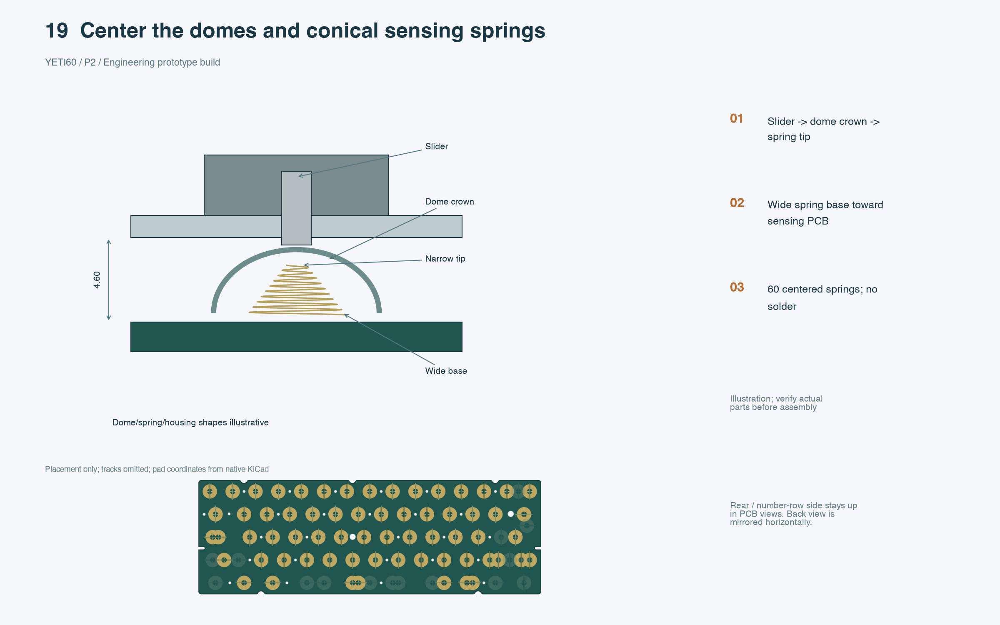

[Vector enlargement](images/19-step.svg)

1. Use a jig to hold the plate/housings inverted without loading the slider stems.
2. Place matched domes with their crowns toward the sliders. Each conical spring has its narrow end toward the dome crown and wide base toward the PCB.
3. Use the active-key map to center 60 spring bases over their electrodes. Keep the 14 unused layout positions empty.

**Check before continuing:** Spring/dome shapes in the section are illustrative. Check the chosen parts' actual seating and return; do not solder conical springs to electrodes.

## 20 — Install the 29 insulated PCB fastener sets

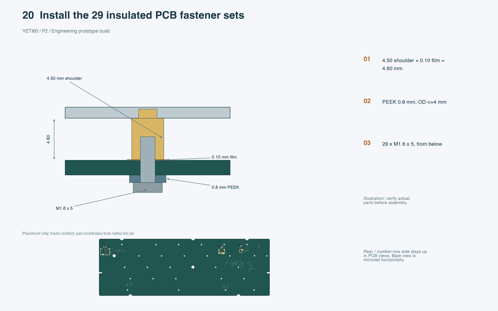

[Vector enlargement](images/20-step.svg)

1. Install the adapter standoffs under the tapped plate: 4.50 mm brass shoulder, upper M2 stud and lower M1.6 female thread.
2. Place a 0.10 mm polyimide ring between every shoulder and the PCB sensing face, then lower the PCB without shifting the springs.
3. From the component side, fit 0.8 mm PEEK washers, OD <=4 mm, and 29 M1.6 x 5 screws. Tighten progressively with sample-qualified torque.

**Check before continuing:** Nominal plate-to-PCB gap is 4.60 mm. Do not use the stock M1.6 x 2 screws, metal washers against sensing copper, or force misaligned holes.

## 21 — Fit lower gaskets, C5 and open guide bases

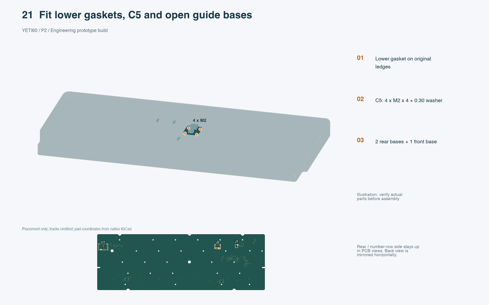

[Vector enlargement](images/21-step.svg)

1. Cut the specified 2 mm gasket stock to the existing lower ledges, keeping ports, wires and service openings clear.
2. Fit C5 on its four M2 inserts with M2 x 4 screws and 0.30 mm insulating washers; inspect USB-mouth alignment.
3. Bond the two rear guide bases and one front base at the checked case coordinates. Leave the two rear bridges removable and support the plate/PCB assembly above the case while routing.

**Check before continuing:** Do not scale the placed guide files or stack them at a common origin. Let base adhesive cure before installing wires.

## 22 — Inspect and retain the qualified battery pack

[Vector enlargement](images/22-step.svg)

1. Accept only the specified protected single-cell 1600 mAh pack with supplier-approved full envelope <=85 x 43 x 4.8 mm, independent thermal interruption and separate NTC.
2. Before mating J2, measure pack polarity and verify the custom PHR-3 numbering: 1 positive, 2 negative, 3 10k NTC to negative.
3. Place nonconductive removable retention and edge protection in the pocket, keeping the total floor budget <=0.20 mm. Leave the pack electrically disconnected until all routing checks pass.

**Check before continuing:** No soldering or hot work near the pack. Do not use the stock 110 mAh cell, compress the pouch or infer polarity from plug shape.

## 23 — Lay the seven wires and close the removable guides

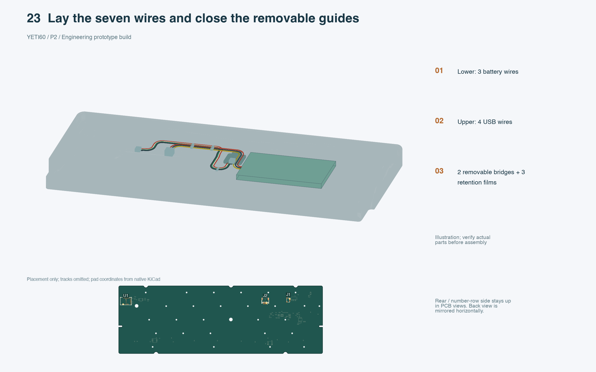

[Vector enlargement](images/23-step.svg)

1. Lay three lower battery wires in the rear bases, fit the two removable bridges using 0.05 mm side-land tape, then lay four upper USB wires.
2. Route the front USB loop through its base; preserve the checked bends and keep all wires away from screws, edges and the pouch.
3. Apply three upper insulating retention pieces, film plus adhesive <=0.10 mm, wrapped down the guide sides. Recheck continuity/polarity, mate J1 and finally J2, then lower the supported assembly without pinching wires.

**Check before continuing:** USB inner bend radii are at least 4.5 mm; battery at least 5 mm in the checked route. Do not permanently epoxy removable bridges or leave a floating retention strip.

## 24 — Fit 60 matched keycaps and check travel

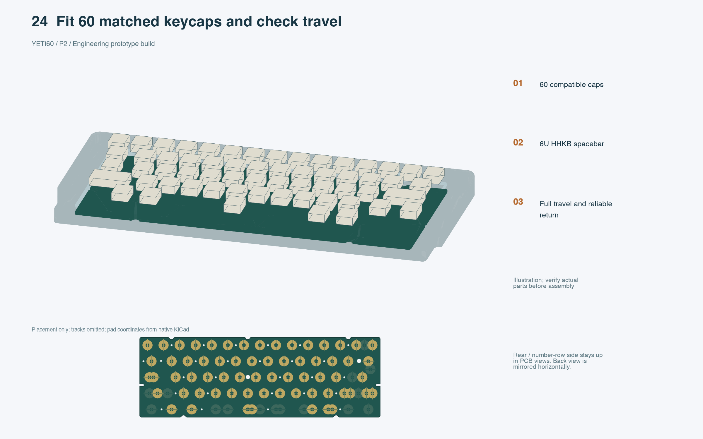

[Vector enlargement](images/24-step.svg)

1. Support the plate while pressing compatible caps onto the selected slider stems. Fit the matched 6U spacebar and stabilized wide caps without bending wires.
2. Check every cap's clearance, full travel and return, including the perimeter and adjacent wide keys.
3. Check the Fn key and all active positions against the HHKB mapping. Do not assume the stock 133-key set is compatible without a stem/spacebar check.

**Check before continuing:** All 60 keys move freely before calibration. Correct binding mechanically instead of masking it with scan thresholds.

## 25 — Calibrate every key, save and load normal firmware

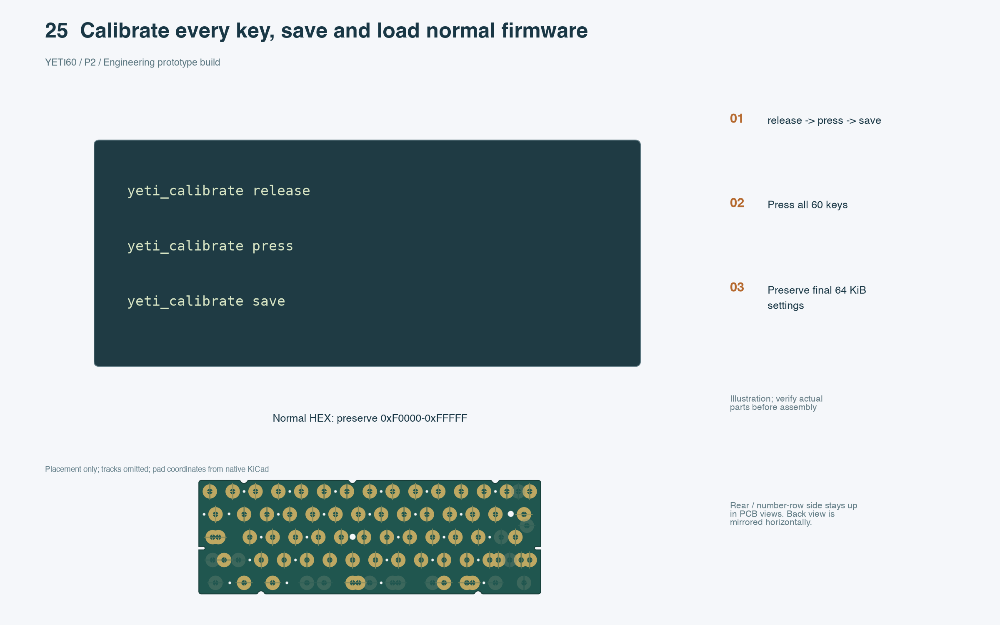

[Vector enlargement](images/25-step.svg)

1. With the complete mechanical stack supported at its intended preload, boot the calibrator and open its USB CDC console. Execute console commands one at a time, allowing release sampling before starting the press stage.
2. Run yeti_calibrate release with every key released, then yeti_calibrate press and fully press/release each of the 60 keys. Release all keys and run yeti_calibrate save; inspect the reported result.
3. Power down before reconnecting SWD. Program and verify firmware/releases/normal/yeti60.hex using range/sector-aware flashing that preserves 0xF0000–0xFFFFF. Restart and check that calibration is retained.

**Check before continuing:** Do not use full-chip erase/recover after saving calibration. Rejected ranges or ADC saturation require diagnosis. Keys intentionally emit no events before valid calibration.

## 26 — Test USB, BLE and charge-state behavior open

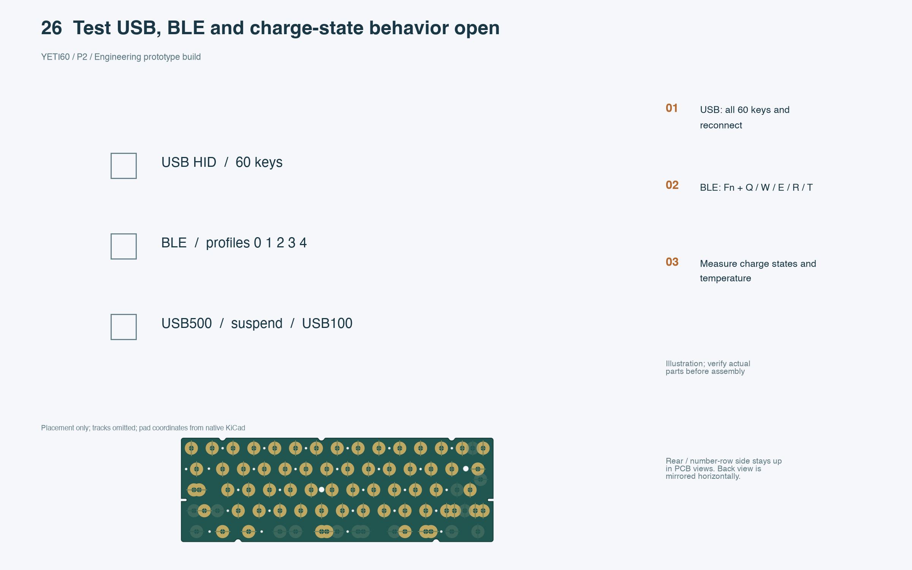

[Vector enlargement](images/26-step.svg)

1. Using normal firmware, test every key over USB, held keys, multiple keys and reset/reconnect behavior.
2. With the accepted battery, disconnect USB and test BLE. Fn+Q/W/E/R/T select profiles 0/1/2/3/4 in the current keymap; verify pairing and retained bonds on the intended hosts.
3. Check configured-host USB500 behavior separately from preconfiguration, suspend and switch-off USB100 behavior. Record actual current/temperature; the predicted runtime is not an acceptance measurement.

**Check before continuing:** A successful firmware build is not this test. Complete the pack's thermal/charge qualification before relying on charging; no battery-percentage reporting is enabled.

## 27 — Fit upper gaskets and close the shell

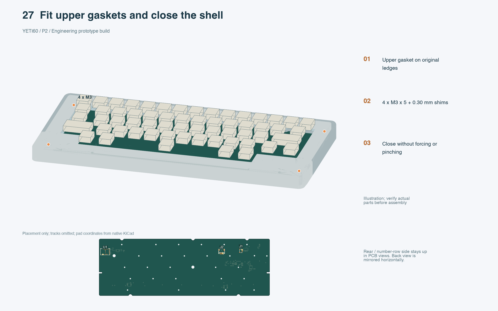

[Vector enlargement](images/27-step.svg)

1. Remove USB and switch off before final handling; disconnect the pack if adjusting the internal wiring. Fit upper gaskets only on the original ledges.
2. Check no wire or retention film protrudes into mating surfaces. Close the shell without force, preserving plate registration and the qualified gasket compression.
3. Fit four M3 x 5 screws with 0.30 mm shims and tighten progressively. If key feel or sensing changes after closure, reopen and correct the stack before recalibrating.

**Check before continuing:** Check no insert bottoms out, no pouch pressure and no clipped wires. The unqualified longer stock screws are not default substitutes.

## 28 — Fit four feet and repeat the final checks

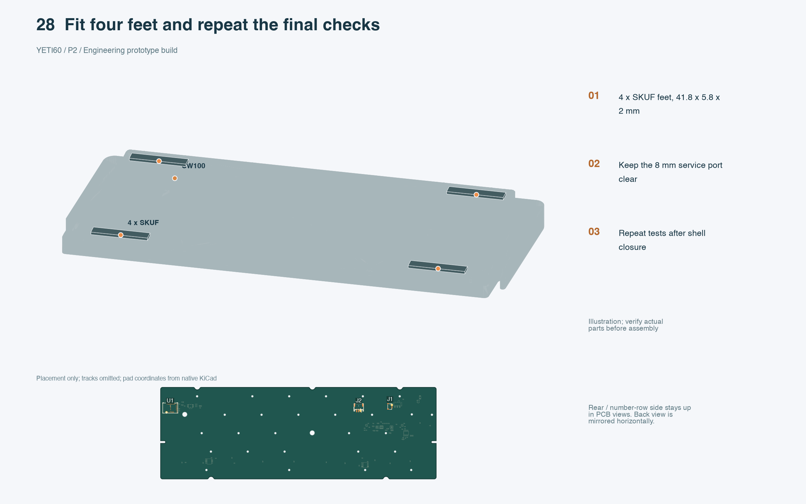

[Vector enlargement](images/28-step.svg)

1. Clean the four original underside pockets and install four adhesive-backed SKUF feet, 41.8 x 5.8 x 2 mm. Do not cover the SW100 service port.
2. Set the keyboard on a flat surface; check stable support, USB access and SW100 operation through the 8 mm port using an insulated tool.
3. Repeat all 60 keys, wide-key return, USB/BLE reconnect and an unplugged power cycle. Save the measured bring-up/calibration/assembly records for this serial-numbered unit.

**Check before continuing:** Complete first-article acceptance remains required. No completed hardware, lifetime, charging or RF certification is implied by these illustrations.

## Rebuild and sources

Run `scripts/export_yeti60_build_map.py` with KiCad Python, then `scripts/draw_yeti60_build_guide.py` with the CAD environment from `requirements-audit.txt`. The generator checks that all 76 mainboard components are placed exactly once, and checks the 60 active electrodes, 29 mounts and current assembly/harness sources. See the [guide evidence](../audit/yeti60-build-guide.json) for source and image hashes.

The per-operation illustrated format follows the [DELTA OMEGA build guide](https://github.com/wZuck/delta-omega/blob/main/docs/BUILD_GUIDES.md). Images and references are redrawn from YETI60 native data; its MX soldering operations do not apply here.

Soldering references: [TI QFN/SON attachment SLUA271C](https://www.ti.com/lit/an/slua271c/slua271c.pdf), stencil, reflow and hidden-joint inspection sections; [Raytac MDBT50Q-1MV2 documentation](https://www.raytac.com/product/ins.php?index_id=24), module pin/dimension data and separate solder-process package; [C&K JS data](https://www.ckswitches.com/media/1422/js.pdf), switch package and soldering limits. Power, cable and firmware instructions also follow the repository [power calculations](../engineering/power-budget.md), [interconnect specification](../engineering/interconnects.md) and [target firmware procedure](../../firmware/target/README.md).
