[English](soldering.md) | [中文](soldering.zh-CN.md)

# 从裸板焊接到台架测试

本指南覆盖 75 件实装元件，尚无样机验证。关壳前请核实线束装拆条件。温升、实物安全及无线验收待样机确认。

## 01 · 检查裸板与工具

电池、胶碗和弹簧远离焊接区。准备放大检查、ESD 工具、兼容清洗工艺的助焊剂、可控回流／热风、热电偶、万用表及限流电源。U5／U6 有底部散热焊盘，E73 封装也有位于模组本体投影内部的焊盘；仅用烙铁触碰可见边缘不能证明这些焊点已连接。按所选焊膏及元件回流限制操作，采用适当方法检查隐藏焊点。不要给静电容感应电极上锡或刮磨。图中标记的是实际焊盘 1，不是来料封装照片。

## 02 · 焊接电源级

按表焊接电源无源件及 U5／U6，逐项核对数值和封装，尤其是 0805 电容的有效容量要求。F1 是 Littelfuse 1 A 快断保险丝，不是自恢复保险丝；L1 使用指定的 3020 电感。检查芯片焊盘 1 和散热焊盘焊膏覆盖。保留普通盖油贯通孔，不改用填孔／铜盖帽工艺。电源检查通过前不安装 U1；放置及焊接时不接电池或任何电源。

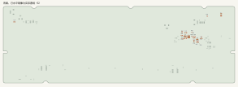

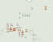

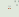

| 位号 | 数值 | 封装 | 安装面 |
|---|---|---|---|
| C30 | 10u/10V | C_0603_1608Metric | 背面 |
| C40 | 2.2u/25V | C_0805_2012Metric | 背面 |
| C41 | 22u/10V | C_0805_2012Metric | 背面 |
| C42 | 22u/10V | C_0805_2012Metric | 背面 |
| C43 | 22u/10V | C_0805_2012Metric | 背面 |
| C44 | 100n/16V | C_0603_1608Metric | 背面 |
| C45 | 22u/10V | C_0805_2012Metric | 背面 |
| C46 | 22u/10V | C_0805_2012Metric | 背面 |
| F1 | 1A_FAST_0466001_NRHF | Fuse_Littelfuse_0466_1206 | 背面 |
| L1 | 1.5uH_74438336015 | WE-MAPI 3020, 3.0 x 3.0 x 2.0 mm | 背面 |
| R40 | 2.21k/1% | R_0402_1005Metric | 背面 |
| R41 | 7.50k/1% | R_0402_1005Metric | 背面 |
| R42 | 100k | R_0402_1005Metric | 背面 |
| R43 | 100k | R_0402_1005Metric | 背面 |
| R44 | 100k | R_0402_1005Metric | 背面 |
| R45 | 100k | R_0402_1005Metric | 背面 |
| R46 | 100k | R_0402_1005Metric | 背面 |
| R47 | 100 | R_0402_1005Metric | 背面 |
| R48 | 100k | R_0402_1005Metric | 背面 |
| R55 | 69.8k/1% | R_0402_1005Metric | 背面 |
| R56 | 1.69k/1% | R_0402_1005Metric | 背面 |
| U5 | BQ24074RGT | VQFN-16-1EP_3x3mm_P0.5mm_EP1.6x1.6mm | 背面 |
| U6 | TPS63031DSK | WSON-10-1EP_2.5x2.5mm_P0.5mm_EP1.2x2mm | 背面 |

## 03 · 焊接电源门控及电池采样

安装 U7／U8、下拉电阻、QOD 电阻及电池分压／滤波。R51／R52 是 1 MΩ，不是 1 kΩ。U1 尚未安装时，R49／R50 将电池测量和模拟前端门控保持为低。不要旁路门控或把使能脚直接接高。交付固件仍关闭电量上报，等待测量集成；焊好电路不代表电量百分比已验收。

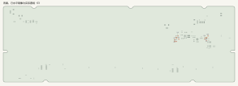

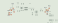

| 位号 | 数值 | 封装 | 安装面 |
|---|---|---|---|
| C47 | 10n | C_0402_1005Metric | 背面 |
| C48 | 1u/10V | C_0402_1005Metric | 背面 |
| R49 | 100k | R_0402_1005Metric | 背面 |
| R50 | 100k | R_0402_1005Metric | 背面 |
| R51 | 1M/1% | R_0402_1005Metric | 背面 |
| R52 | 1M/1% | R_0402_1005Metric | 背面 |
| R53 | 100 | R_0402_1005Metric | 背面 |
| R54 | 100 | R_0402_1005Metric | 背面 |
| U7 | TPS22919DCK | SOT-363_SC-70-6 | 背面 |
| U8 | TPS22919DCK | SOT-363_SC-70-6 | 背面 |

## 04 · 焊接静电容模拟前端

焊接两只 74HC4051、OPA350，以及表中的行列／反馈元件。C10 为 220 pF，不能用库存 100 nF 电容替代。R17 是 1 kΩ；复位上拉 R26 属于下一步。感应面不得残留焊渣、指印或清洗残留。这些圆形区域是 PCB 感应铜箔，不是 MX 热插拔座或逐键二极管焊接位。

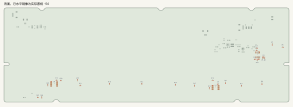

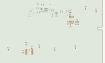

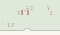

| 位号 | 数值 | 封装 | 安装面 |
|---|---|---|---|
| C10 | 220p | C_0402_1005Metric | 背面 |
| C11 | 100n | C_0402_1005Metric | 背面 |
| C12 | 100n | C_0402_1005Metric | 背面 |
| C13 | 1u | C_0402_1005Metric | 背面 |
| C9 | 100n | C_0402_1005Metric | 背面 |
| R10 | 100k | R_0402_1005Metric | 背面 |
| R11 | 100k | R_0402_1005Metric | 背面 |
| R12 | 100k | R_0402_1005Metric | 背面 |
| R13 | 100k | R_0402_1005Metric | 背面 |
| R14 | 100k | R_0402_1005Metric | 背面 |
| R15 | 100k | R_0402_1005Metric | 背面 |
| R16 | 100k | R_0402_1005Metric | 背面 |
| R17 | 1k | R_0402_1005Metric | 背面 |
| R18 | 100k | R_0402_1005Metric | 背面 |
| R19 | 100k | R_0402_1005Metric | 背面 |
| R20 | 100k | R_0402_1005Metric | 背面 |
| R21 | 100k | R_0402_1005Metric | 背面 |
| R23 | 100k | R_0402_1005Metric | 背面 |
| R24 | 100k | R_0402_1005Metric | 背面 |
| R25 | 100k | R_0402_1005Metric | 背面 |
| R3 | 100 | R_0402_1005Metric | 背面 |
| R4 | 100 | R_0402_1005Metric | 背面 |
| R5 | 100 | R_0402_1005Metric | 背面 |
| R6 | 100 | R_0402_1005Metric | 背面 |
| R7 | 100 | R_0402_1005Metric | 背面 |
| R8 | 100k | R_0402_1005Metric | 背面 |
| R9 | 100k | R_0402_1005Metric | 背面 |
| U2 | 74HC4051 | TSSOP16 | 背面 |
| U3 | OPA350 | SOIC-8_3.9x4.9mm_P1.27mm | 背面 |
| U4 | 74HC4051 | TSSOP16 | 背面 |

## 05 · 焊接复位与状态灯

安装 SW1、R26、R32、D2。D2 焊盘 1 为 GND／阴极，焊盘 2 为 LED_A／阳极；核对来料 LED 的极性标记。灯不亮本身不能判定 USB 或蓝牙失败。J3 是 PCB 上现成的六焊盘 pogo 接口，本设计不焊排针。JP1 保持断开，装配时不要短接。

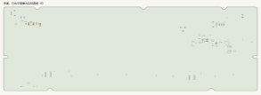

| 位号 | 数值 | 封装 | 安装面 |
|---|---|---|---|
| D2 | STATUS | LED_0603_1608Metric | 背面 |
| R26 | 10k | R_0402_1005Metric | 背面 |
| R32 | 2.2k | R_0402_1005Metric | 背面 |
| SW1 | EVQPUC02K_RESET | Panasonic_EVQPUL_EVQPUC | 背面 |

## 06 · 焊接模组附近去耦电容

焊接背面的 C31（100 nF、0402）及 C32（4.7 µF／16 V、0603）。C31 已移到下角 3.3 V 引出附近，不要按旧版右上角位置安装。MLCC 无极性，但图中的焊盘网络用于后续测压，必须分清。安装后高度应满足装配限制。

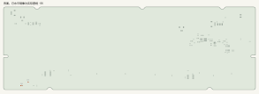

| 位号 | 数值 | 封装 | 安装面 |
|---|---|---|---|
| C31 | 100n/16V | C_0402_1005Metric | 背面 |
| C32 | 4.7u/16V | C_0603_1608Metric | 背面 |

## 07 · 焊接接口与电源开关

小元件完成后安装 J1／J2／J4／J5 及 SW100。四个接口均为 SH 1.0 mm；J2 为三针，不是 PH 2.0 mm。检查信号脚及固定脚。已有 C5 子板直接沿用。USB 线束：C5 的 1／2／3／4 对应 J4 的 1／2／3／4。电源桥：J5.1→J1.1、J5.2→J1.4，J1.2／J1.3 留空。断电逐根测通断，不能按颜色或镜像插头照片猜针序。完整关壳线长尚未放行。 完全断电后，以 SW100.1～SW100.2 导通（VSYS 接 REG_EN）定义开机，以 SW100.2～SW100.3 导通（REG_EN 接地）定义关机，不按拨杆方向猜测。

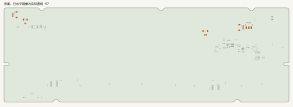

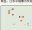

| 位号 | 数值 | 封装 | 安装面 |
|---|---|---|---|
| J1 | USB_POWER_IN | JST-SR-4 | 背面 |
| J2 | PROTECTED_1S_4V2_NTC10K | JST SH 1.0 mm side-entry 3-pin | 背面 |
| J4 | USB_C5_INPUT | JST SH 1.0 mm side-entry 4-pin | 背面 |
| J5 | USB_POWER_OUT | JST SH 1.0 mm side-entry 2-pin | 背面 |
| SW100 | JS102011SAQN_POWER | SW_SPDT_CK_JS102011SAQN | 背面 |

## 08 · 安装 U1 前先检查电源

裸板放在绝缘支撑上，不接电池和电脑。先检查 USB_5V／GND、VSYS／GND、+3.3V／GND 是否持续短路；电容充电会改变阻值，不能只按蜂鸣判定。用 5.0 V 限流电源接入已核对的 USB 电源路径；50 mA 是项目首次筛查限值，不是键盘工作电流规格。持续限流或元件发热时停止。检查 F1 两端，再打开 SW100，测 C45.1 对 GND，应接近 3.3 V；3.20～3.40 V 是使用合适万用表时的项目台架筛查窗，不代表稳压器完整验收。U5 的 VSYS 是电源路径输出，不是 3.3 V 电源。返修前断电，禁止向 J3 或 J2 注入 5 V。

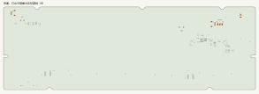

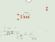

## 09 · 安装正面 E73 模组

完全断电后，将 U1 安装在正面，按正面图核对焊盘 1 与天线方向。采用适当回流及检查方法确认底部焊点，不能凭边缘润湿认定 43 个焊点都已连接。支撑、保护已经焊好的背面元件，并遵守模组热限制。刷写前重新查短路和 3.3 V。保留四层天线禁铜区；钢定位板仍覆盖暂定天线带，本教程不保证蓝牙距离。

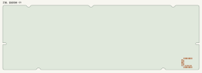

| 位号 | 数值 | 封装 | 安装面 |
|---|---|---|---|
| U1 | E73-2G4M08S1C | E73-2G4M08S1C | 正面 |

## 10 · 不接电池先刷写与测 USB

用 3.3 V 逻辑 SWD 探针写入匹配的校准版 HEX。J3：1 VTref／+3.3V、2 SWDIO、3 GND、4 SWDCLK、5 RESET_N、6 GND。VTref 是电压参考，不代表可由探针给整板供电。只使用一个已核实的供电源并共地。首次 HEX 包含 NFC 引脚 UICR 配置，单独 BIN 不包含；本设计没有 UF2 引导程序。接电脑 USB 前，物理断开台架电源，避免两个 5 V 电源互相反灌。接 C5 的可传数据 USB 线，检查电脑枚举；未获得有效校准前不发按键事件属于预期行为。使用另一把键盘操作校准终端，记录电压、电流、USB 设备识别及故障日志。

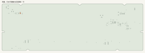

## 11 · 单独核对保护电池包

连接真实电池前，取得签字确认的电气、温度及尺寸规格，核对 J2：1 PACK+、2 PACK−、3 独立 10 kΩ NTC。不能用短接 NTC 代替正常温度检测，也不能直接给未经批准的裸电芯焊接。SW100 关闭不等于充电隔离：R42／R43／R44 允许自主 USB100 慢充。固件运行时，主机配置前关闭充电，配置获准后才选择 USB500，系统负载与充电共享输入预算。使用适当仪器执行电源路径、温度、定时、终止及拔线／挂起测试；这些实物测试仍未完成，本教程不是安全测试通过记录。

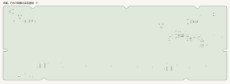

## 12 · 装机构并校准全部 60 键

先完成所有热作业及清洗，再按 NiZ／钢板卫星轴指南装 60 套轴座／滑块、60 个胶碗及弹簧、3 对钢板卫星轴和 28 套绝缘固定件，H26 不装任何固定件。可以不装外壳测试定位板／PCB 总成，但必须支撑到元件不碰台面。使用匹配校准版，采集每个有效键的释放与完全按下样本，保存后写入匹配正常版 HEX，并保留最后 64 KiB 设置分区。在台架上测试 USB 打字、蓝牙配对／重连、唤醒及释放。最终理线、关壳总装／爆炸图、温升和射频验收仍未完成，不要强行合壳或挤压电池。

## 关联说明与资料

[NiZ / plate](../../build/key-mechanism.zh-CN.md) · [Firmware](../../testing/e73-corner-firmware.zh-CN.md)

[TI BQ24074](https://www.ti.com/lit/ds/symlink/bq24074.pdf)
[TI TPS63031](https://www.ti.com/lit/ds/symlink/tps63031.pdf)
[SEGGER J-Link Commander](https://kb.segger.com/J-Link_Commander)
