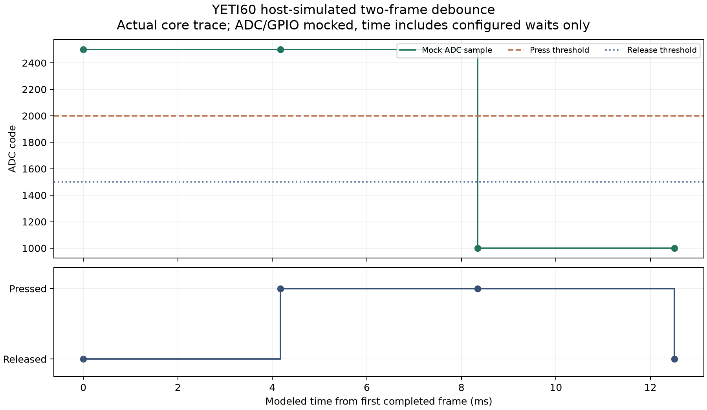

English | [Chinese](yeti60-comprehensive-review.zh-CN.md)

# YETI60 comprehensive electrical, firmware and assembly review

**Result: CAD connectivity passes; this is not a production-ready or fully qualified assembly.** This review covers the current single-nRF52840 PCB, host-executed control core and source-derived case/plate geometry. It intentionally leaves SI/RF simulation deferred as previously requested.

## Findings requiring further engineering

1. **Power layout still needs revision.** U6 VOUT-to-FB and the second output capacitor currently connect through approximately 29–30 mm of copper-path primitives. Charger input and battery capacitor paths are about 9.35 mm / two vias and 16.19 mm / two vias. TI specifies short, wide power paths and nearby passives; zero DRC errors do not establish loop stability or acceptable transient behavior. A simple capacitor-rotation trial collided with retained sensing-ground copper and was reverted. The verified PCB remains intact. This is a layout concern, not a claim that oscillation has been measured. [TI TPS63031 layout guidance](https://www.ti.com/lit/ds/symlink/tps63031.pdf), [BQ24074 datasheet](https://www.ti.com/lit/gpn/bq24074).
2. **The nRF target firmware is not complete.** The actual new portable C core passes host simulation, but ADC/GPIO/HID HALs are mocked. There is no flashable target application, proven USB enumeration, BLE pairing/radio stack or physical EC calibration. These are separate tasks from the passing host tests.
3. **The final Z stack and resin construction are unqualified.** PCB-top to plate-bottom spacing is an explicit provisional 4.6 mm parameter; no exact dome/housing/fastener stack is selected. Original M3 metal-thread pilots remain approximately 2.529 mm and are not a resin-insert design.
4. **The internal power switch is not externally accessible.** SW100 has no defined enclosure opening or actuator extension. An internal setup switch may be acceptable, but an accessible power control requires a mechanical/placement decision.
5. **Hole correspondence has limited tolerance margin.** All 29 plate holes correspond, with a maximum center offset of 0.05337 mm. For a nominal 2.0 mm M2 screw in the 2.2 mm PCB clearance, the worst remaining radial margin is only 0.04663 mm before manufacturing tolerances. This correspondence check does not approve a screw/print tolerance stack.
6. **Battery, rear daughterboard and cable envelopes are not selected.** The candidate pack spaces below are geometric budgets, not part selections. The daughterboard still needs actual connector/plug/overmould/cable and separate CC1/CC2 terminations. The old 8×2 mm diagnostic aperture probe does not qualify a real Type-C assembly.

## Circuit and routing checks

- Strict native DRC: **0 errors, 0 opens**. All **268** physical pin pairs and schematic/PCB parity pass. The comparison to the previous verified design has no connectivity regressions.
- **Fixed a functional migration issue:** R30/R31 were inherited 27 Ω USB series resistors. They are now **0 Ω links**, synchronized across PCB, schematic, netlist, generators and local footprint values. The nRF52840 PHY already contains its own series termination. [Nordic verified answer](https://devzone.nordicsemi.com/f/nordic-q-a/94955/resistors-for-d-and-d-).
- Scan input U1.20 is P0.04/AIN2; battery input U1.21 is P0.05/AIN3. Mux channel order is generated from the actual U2/U4 COL0–COL14 nets, not assumed from the old STM32 GPIO names.
- Inductor-side straight tracks were widened to 0.35 mm. Diagonal/IC necks remain 0.2 mm to preserve clearance to the existing NTC via. No global clearance rule was relaxed.
- The strict report retains 102 non-assembled-geometry courtyard warnings and 5 off-center via-endpoint warnings with valid copper contact. ERC has 0 electrical errors and inherited grid/alias warnings. Special filled/capped U1 vias-in-pad remain required.

These conservative path measurements sum complete contacted primitives; they can overestimate the exact centerline length and do not extract return-path inductance:

| Connection | Conservative copper length (mm) | Vias |
|---|---:|---:|
| U6.4 → L1.1 | 3.515 | 0 |
| U6.2 → L1.2 | 3.515 | 0 |
| U6.5 → C43.1 | 3.233 | 0 |
| U6.8 → C44.1 | 2.427 | 0 |
| U6.1 → C45.1 | 2.062 | 0 |
| U6.1 → C46.1 | 29.243 | 0 |
| U6.1 → U6.10 | 30.036 | 0 |
| U5.13 → C40.1 | 9.348 | 2 |
| U5.2 → C41.1 | 16.186 | 2 |
| U5.10 → C42.1 | 2.805 | 0 |

Evidence: [CAD report](../../hardware/ec60-nrf52840/audit-current.json), [functional electrical report](yeti60-electrical.json), [fabrication notes](../../hardware/ec60-nrf52840/fabrication-notes.md).

## Firmware simulation

The host executable compiles `firmware/yeti60/core.c` with ASan/UBSan. It covers 75 positions, mutually exclusive mux banks, channel order, one-row drive, open-drain discharge/release, explicit waits, hysteresis, two-frame debounce, 2,000 deterministic noise-band frames, invalid configuration, ADC error/overrange, atomic failed-frame release, high-Z analog shutdown, shared-ADC exclusion and the 50 ms battery-divider wait. USB100/USB500/suspend policy, modifiers/6KRO rollover, held-key transport handover and failed-send retries are exercised.

This review also fixed aliased configuration/HAL reinitialization, invalid USB enum acceptance, and loss of the old-host key-release retry during a failed handover. Those cases now execute in the simulator.

[Raw trace](yeti60-firmware-trace.csv) · [Simulation results and source hashes](yeti60-firmware-simulation.json) · [Control-core documentation](../../firmware/yeti60/README.md).

The trace clock sums configured waits and mock ADC acquisition; it excludes actual CPU, ISR and radio scheduling costs. Thresholds are illustrative ADC codes. It is not a physical latency/noise result, target binary or instruction-level nRF peripheral simulation. Actual USB descriptor power limits, low-frequency RC configuration, HAL behavior, wake policy and BLE stack remain to be integrated.

## PCB / case / plate fit

The original 7° FELK60 shell geometry, current PCB outline/holes and the audited HHKB plate are registered in the same coordinate frame. Gasket support ledges at Z=3.19 and 6.39 mm, with the source's 2 mm gaskets at 50% compression, place the 1.2 mm plate at Z=4.19–5.39 mm. The provisional 4.6 mm plate gap sets finished PCB top/bottom at −0.41 / −2.00 mm.

- PCB-to-case and plate-to-case overlap volumes: **0 mm³** at the stated nominal stack.
- PCB minimum case distance: approximately **0.80 mm**.
- Raytac module envelope minimum case distance: **1.86 mm**.
- J2 height is **5.5 mm**, read from the [JST SMT side-entry drawing](https://www.jst.com/wp-content/uploads/2025/06/ePH.pdf). Its physical body outline is distinct from the larger pad/courtyard rectangle. The nominal housing-envelope clearance is about **1.91 mm**, excluding the mating plug/wires.
- The provisional 3.5 mm SW100 envelope has only **0.41 mm** nominal case distance. Final part geometry and stack tolerance need confirmation.
- Native exported substrate-body thickness is 1.50 mm; the PCB declaration including copper/mask is **1.59 mm**. The mechanical check rebuilds a conservative 1.59 mm finished-board envelope from the exact native bottom face, preserving XY and holes. It does not stretch or silently change the design PCB.
- PCB/case overlap was also checked at provisional gaps 4.0, 4.3, 4.6, 4.9 and 5.2 mm. That sweep is not qualification of the EC dome mechanism or of every component at every gap.

Evidence: [assembly report](yeti60-assembly.json), [current footprint/height metadata](yeti60-pcb-mechanical-metadata.json). Known source heights and explicitly provisional envelopes are distinguished in those records.

## Battery-space budget

No battery is selected. Under the provisional 4.6 mm stack, one candidate envelope is **50×20×2.9 mm**, at case coordinates X=155–205, Y=−179 to −159 mm. It clears the conservative component XY keepouts and 3 mm-radius mounting-fastener exclusion boxes. The modeled distance is at least 0.50 mm above and 0.51 mm below.

The **maximum pack envelope** must include its protection board and growth/swelling allowance; these are not individually modeled or approved. Insulation consumes the stated external gaps. A nominal 3 mm cell must not be assumed to fit a 2.9 mm budget. Changing the eventual dome/standoff gap changes the available thickness: over the sampled 4.0–5.2 mm gaps, flat-floor pack thickness after two 0.5 mm clearances varies from about 3.51 to 2.31 mm. Cable routing, NTC and final cell documentation remain required.

## Render outputs and document policy

[Assembled, exploded and battery-space renders](../../renders/yeti60-assembly/README.md) use the same provisional transforms as the checks. Case, plate and PCB geometry are source-derived; keycaps, switch bodies, component envelopes, material appearance and the battery-space block are illustrative. They do not prove manufactured fit. [Current PCB-only renders and animation](../../renders/ec60-nrf52840/README.md) are regenerated for YETI60.

Project-owned documents use English by default with parallel `.zh-CN.md` versions. Upstream attribution, licenses, and compatibility filenames such as `EC60-nRF52840.*` and `YAECKB.pretty` remain intact. The intermediate review was pushed as `8f1b0fc`; the remaining layout/manufacturing items above are deliberately still open.

Assembly images now use Cycles physical lighting and source-sized FELK60 case tessellation. The original case solids receive no geometry modifiers or resizing. [Geometry verification](yeti60-render-geometry.json) records bounding sizes and mesh tolerances; [render documentation](../../renders/yeti60-assembly/README.md) distinguishes source geometry from illustrative keycaps, switches and finishes.
