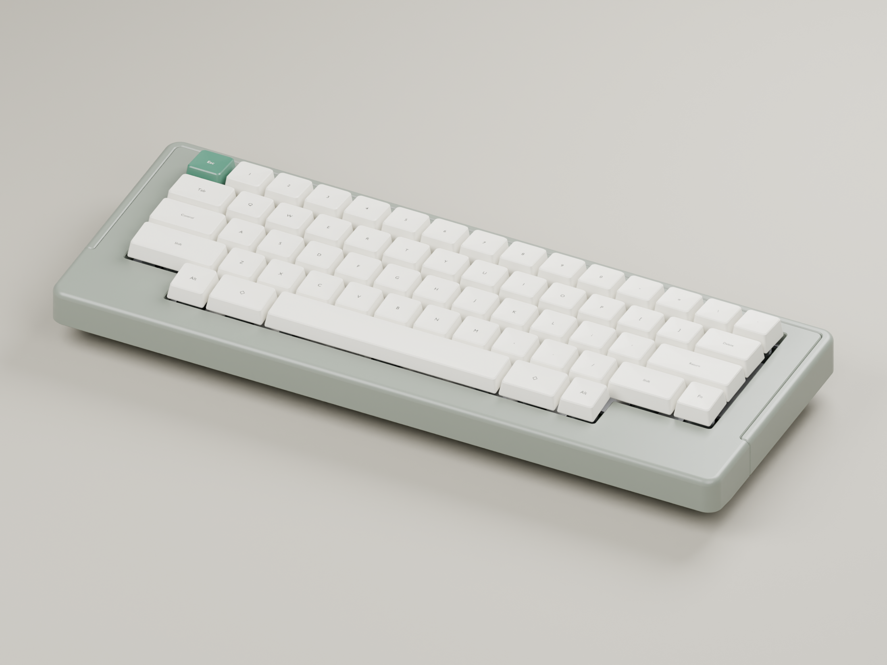
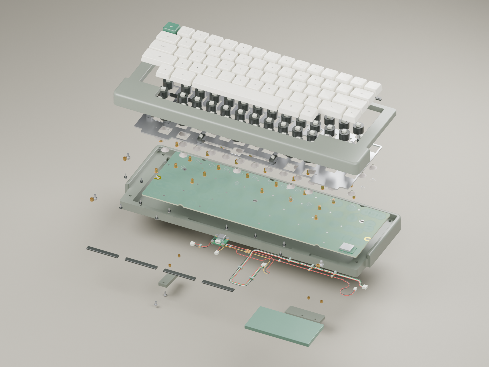
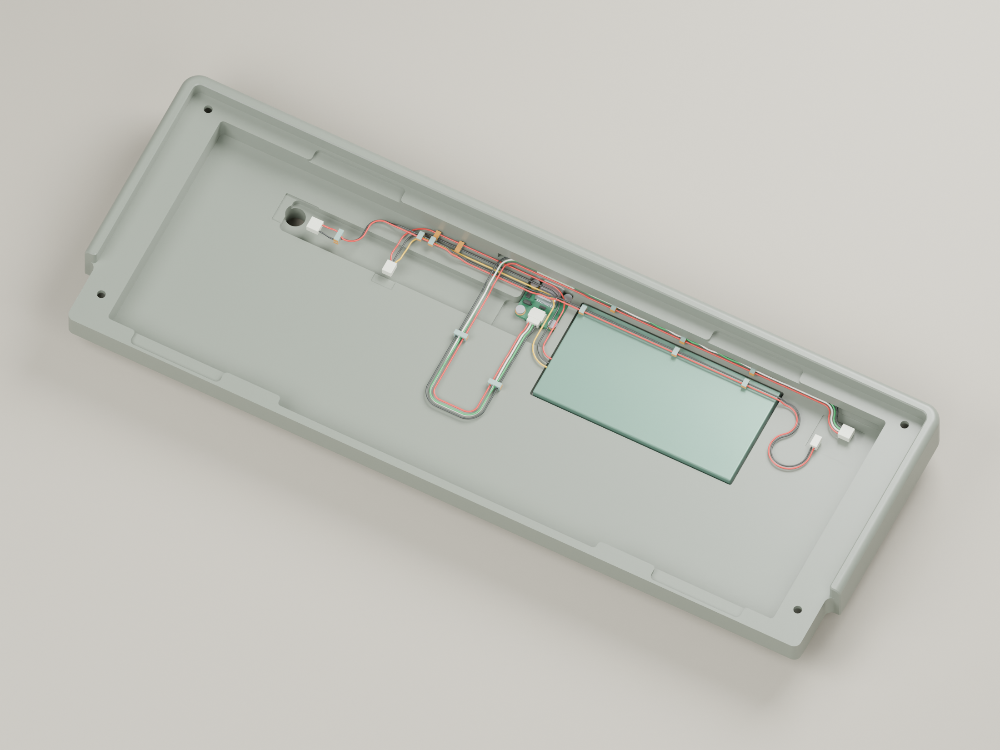
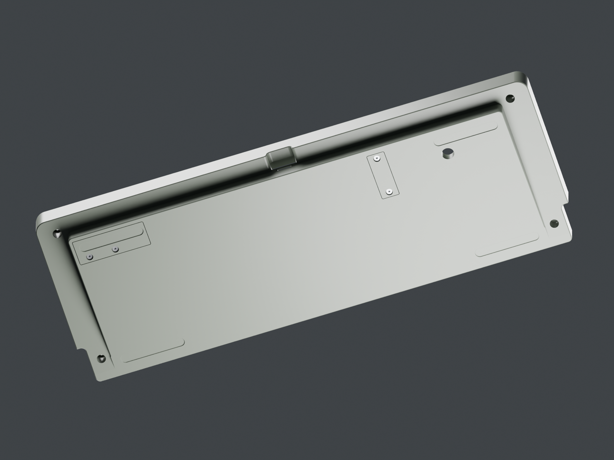
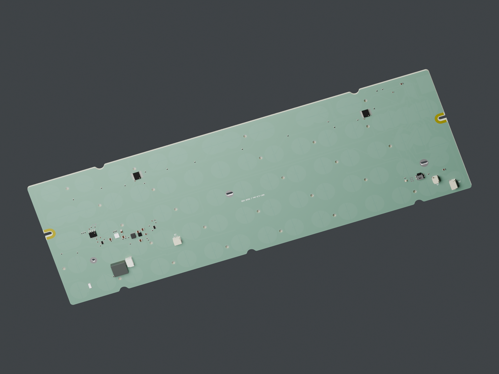

[English](e73-assembly-views.md) | 中文

# CORNER-07 整机装配图

上下壳采用本交付包中基于 FELK60 的上壳和 M05 底壳及两块检修盖，保留原始尺寸。钢定位板使用当前 NiZ 版 DXF。主板的铜层、阻焊、标记和钻孔来自当前原生 PCB。表面质感、键帽轮廓和字符是示意，采购成品可能有所不同。

从底壳向上看，依次对应主板、绝缘隔柱、锥形弹簧、胶碗、钢定位板、NiZ 轴座与滑块、上壳和键帽。为了看清线束、电池和 C5 子板，爆炸图将它们移出安装位置。四个脚垫集中展示在外壳下方。各线槽和安装基准请查阅配套图纸及指南。

爆炸图和内部视图采用标准 M05 的底壳、前端理线件及线束路径。试装让位版时，按首件指南安装改版底壳上的支架座和加大前端理线件，并使用配套线长表。外部轮廓、安装堆叠及检修盖接口共用。[让位版装配](e73-m05-prototype.zh-CN.md#m05-让位版底壳试制)

| 装配阶段 | 零件及对应说明 |
|---|---|
| 1. 准备外壳和钢定位板 | 检查外壳成品尺寸、孔和轴座开口试片。准备 4 个 M3 及 8 个 M2 冷粘嵌件，M2 中有 4 个用于检修盖。定位板上下各裁 4 片垫条。[制造要求](e73-ordering-printing.zh-CN.md) |
| 2. 焊装主板 | 按顺序焊装并检查 75 个实装位号。初次上电时断开电池。[图文台架教程](../assembly/e73-corner/soldering.zh-CN.md) |
| 3. 试装感应机构 | 准备 60 个 NiZ 轴座和滑块、60 个胶碗、60 根弹簧、三组钢板卫星轴。装两根短钢丝和一根居中 6U 钢丝。使用 28 个隔柱、28 片绝缘片、28 个垫片及 28 颗 M1.6 螺钉，H26 留空。[机构指南](key-mechanism.zh-CN.md) |
| 4. 在壳外刷写及校准 | 核查 USB 和蓝牙功能。用校准固件保存全部 60 键的基线，再保留设置刷入正常固件。[固件安装](../testing/e73-corner-firmware.zh-CN.md) |
| 5. 试装底壳 | 安装已有 C5 子板，用无电量块代表电池。按 [M05 首件指南](e73-m05-prototype.zh-CN.md) 临时定位九根导线和 16 件刚性理线件，检查两块检修盖可下取。 |
| 6. 核实装拆和合壳 | 依次试拔 J2、J4，停放后垂直抬起主板和定位板。按相反顺序复装，检查线束和电池无拉扯或夹压，再验证四颗 M3 合壳螺钉。[停放支撑与动作顺序](e73-m05-parking-support.zh-CN.md) |

底壳图将主板隐藏，以便查看线束的安装位置。图中部分夹件实际固定在主板底面，请按理线件 STEP 确定其 Z 高度和粘接面。九根导线的中心线来自已检查的 M05 坐合路线，直径使用规定的绝缘外径上限。

这是安装脚垫前的底部视图。图左较宽的是 J4 盖，较窄的是 J2 盖。两块盖上共装四颗低头螺钉。

图内 73 个主板位号采用三维模型，U1 和 SW100 采用设计包络。五个配对插头、电池外皮、NiZ 塑料件、胶碗、弹簧、键帽、卫星轴、垫条和螺纹细节为示意。[来源清单](../../renders/e73-corner-assembly/manifest.json)记录具体版本、模型覆盖及图像校验值。工具空间和线束动作见[关壳装拆检查](../engineering/e73-corner-service.zh-CN.md)。树脂和胶带性能、射频及实物电气仍待验收。
