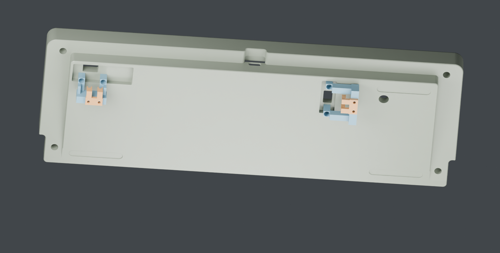

[English](e73-m05-parking-support.md) | 中文

# M05 插头停放支撑

J2 和 J4 的支撑都装在 M05 原有封盖螺孔上。每套含一个固定底座和一个可拆托架，托架接住一套夹头露出的两根导杆。两个夹头可在主板垂直抬升期间继续夹着已经脱开的胶壳。

## 一把键盘需要的试制件

| 项目 | 数量 | 文件或规格 |
|---|---:|---|
| J2 底座和导杆托架 | 各 1 | 底座 [STL](../../hardware/e73-hhkb-corner/mechanical/service-case-m05/parking-support/J2-carrier.stl)／[STEP](../../hardware/e73-hhkb-corner/mechanical/service-case-m05/parking-support/J2-carrier.step)，托架 [STL](../../hardware/e73-hhkb-corner/mechanical/service-case-m05/parking-support/J2-rod-shelf.stl)／[STEP](../../hardware/e73-hhkb-corner/mechanical/service-case-m05/parking-support/J2-rod-shelf.step) |
| J4 底座和导杆托架 | 各 1 | 底座 [STL](../../hardware/e73-hhkb-corner/mechanical/service-case-m05/parking-support/J4-carrier.stl)／[STEP](../../hardware/e73-hhkb-corner/mechanical/service-case-m05/parking-support/J4-carrier.step)，托架 [STL](../../hardware/e73-hhkb-corner/mechanical/service-case-m05/parking-support/J4-rod-shelf.stl)／[STEP](../../hardware/e73-hhkb-corner/mechanical/service-case-m05/parking-support/J4-rod-shelf.step) |
| 平行夹头工具 | 2 套 | 每只胶壳各用一套装好的 [M05 工具](e73-m05-service-tool.zh-CN.md)，让两个插头能同时保持夹紧。 |
| 底座螺钉 | 4 颗 | 复用 M2 × 0.4 × 4 mm 低头封盖螺钉，以及壳体内原有的封盖嵌件。 |
| 托架螺钉和嵌件 | 各 4 颗 | M2 × 0.4 × 5 mm 螺钉、M2 滚花嵌件 Ø3.2 × 2.5 mm。底座上的嵌件盲孔标称 Ø3.35 mm、深 3.2 mm。 |
| 导杆扎带和垫片 | 各 4 | 尼龙扎带的带身不超过 2.2 × 0.8 mm。导杆下方的绝缘薄片按实际间隙裁切。 |

四件刚性件使用韧性绝缘树脂，以毫米、100% 比例打印。每件从 STEP 和 STL 中选一个文件。STEP 保留外壳装配坐标，STL 已移动到局部原点。后固化后检查承压面、托架和嵌件盲孔。先在远离电子件的位置将嵌件冷粘到底座，再试装外壳。

## 断电试配顺序

1. 取下封盖，用原有螺孔固定两只底座，然后插入工具。用台架垫高键盘，让底部有空间操作工具，上方也可抬板。
2. 先用无电电池量块和断电接头练习。夹住 J2，沿 +Y 拔出，再向底面移动 0.45 mm。保持夹紧，从下方垂直抬起 J2 托架，使两个槽接住外露导杆，用两颗 M2 × 5 mm 螺钉从下方固定。对 J4 重复，拔出方向为 −X。
3. 在各导杆下试配绝缘垫片，把胶壳保持在停放位置。板厚为 1.44、1.6062 和 1.76 mm 时，标称垫片厚度分别为 0.436、0.270 和 0.116 mm，以实际壳体及夹头的试配为准。从托架下方的穿带孔给每根导杆加一条扎带。在导杆上留位置标记，检查它既不会抬起，也不会沿轴向滑走。
4. 两个插头停稳后确认导线可在理线槽中随动，再沿已检查的 25 mm 路径抬升主板叠层。装回时先使主板叠层落位，再扶住工具拆除托架和扎带，抬高插头并依次插回 J4、J2。

[停放支撑报告](../../hardware/e73-hhkb-corner/audit/m05-parking-support.json)检查了底座与夹头动作的间隙，以及每个端口在三种板厚下托架向上安装的 12 mm 行程。导杆槽单侧标称留量为 0.175 mm。[抬升报告](../../hardware/e73-hhkb-corner/audit/m05-lift.json)按这些停放位置验证。打印件刚度、实际配合、扎带预紧、防滑及重复操作仍需用样件验证。
