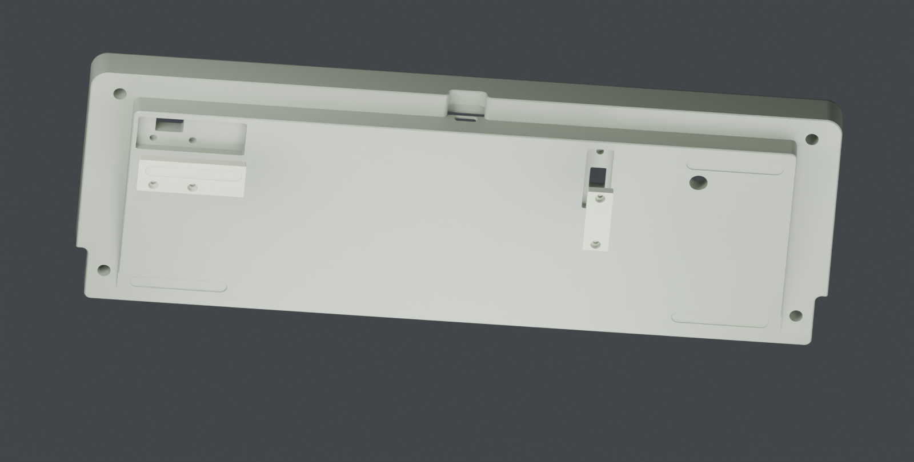

English | [Chinese](e73-m05-prototype.zh-CN.md)

# M05 access prototype for E73

M05 adds two removable covers to the CORNER-05 mechanical trial. It retains the M04 outer dimensions and the location of the footpads, upper shell, steel plate and C5 daughterboard. The original right rear foot recess is part of the J4 cover, so its footpad comes off with that cover. The current M04 files remain the baseline in the main ordering table.

## Files and parts for one prototype

| Part | Quantity | File or specification |
|---|---:|---|
| M05 bottom | 1 | [Print STL](../../hardware/e73-hhkb-corner/mechanical/service-case-m05/bottom-m05-REVIEW.stl) · [STEP](../../hardware/e73-hhkb-corner/mechanical/service-case-m05/bottom-m05-REVIEW.step) |
| J2 cover | 1 | [Print STL](../../hardware/e73-hhkb-corner/mechanical/service-case-m05/cover-J2-REVIEW.stl) · [STEP](../../hardware/e73-hhkb-corner/mechanical/service-case-m05/cover-J2-REVIEW.step) |
| J4 cover | 1 | [Print STL](../../hardware/e73-hhkb-corner/mechanical/service-case-m05/cover-J4-REVIEW.stl) · [STEP](../../hardware/e73-hhkb-corner/mechanical/service-case-m05/cover-J4-REVIEW.step) |
| Cover screws | 4 | M2 × 0.4, 4 mm under the head, low socket head with flat bearing face, head Ø ≤3.90 mm and height ≤1.50 mm. The SUNCO M2 low-head series gives a 3.8 × 1.3 mm nominal head. [Manufacturer dimensions](https://th.misumi-ec.com/en/vona2/detail/221005676582/?Tab=codeList) |
| Cover inserts | 4 | M2 × 0.4 knurled brass, Ø3.2 × 2.5 mm, same size as the C5 insert specification. Prepare four extra and use the cover bore depth in this guide. |
| Adhesive and footpads | As required | Use the case's cold-bond adhesive for the inserts. Use the four footpads from the keyboard materials list, one on the removable J4 cover. |

Print at 100% in millimetres using tough engineering SLA resin. Make one of each of the three parts and choose either STEP or STL for each part. Both formats use the same case coordinates. Inspect the seating faces, foot recess and blind bores after the resin is fully post-cured. Choose supports and drainage before printing and keep support damage off those faces.

## Fit the covers before installing electronics

1. Dry-fit each cover to its matching pocket and confirm that it comes off straight down. The nominal perimeter clearance is 0.35 mm per side and the exterior surfaces are flush in CAD. Keep the cover and the right rear foot recess flush when finishing the parts.
2. Finish the four blind insert bores to **Ø3.35 ±0.05 mm**. Set the depth stop to **2.90 mm from the seating shelf at the bore axis**. Cold-bond the inserts with the outward face recessed **0.30 mm** at that axis. Bond and cure the empty shell before installing the battery or PCB.
3. Confirm the screws clamp each cover and clear the blind bottom. CAD gives **2.15 mm** nominal thread overlap and **0.45 mm** at the screw tip. Inspect the actual head envelope and tip clearance. Check for cover flex, stripped resin, loose inserts and rocking with the feet fitted.
4. Attach the right rear footpad wholly within the J4 cover recess. Keep both screw heads exposed. Remove the two covers to gain access to J2 and J4. Open-shell trials use an inert gauge in place of the battery and unpowered harnesses.

The [CAD report](../../hardware/e73-hhkb-corner/audit/service-case-m05.json) checks envelope dimensions, the four new insert supports, the eight existing screw regions, full cover withdrawal and the open paths around J2 and J4. [Case service checks](../engineering/e73-corner-service.md) document the paired wire routing trial. M05 is for mechanical fit testing. It still needs a qualified release tool, a complete wired service demonstration, load and repeated removal tests before production use.
