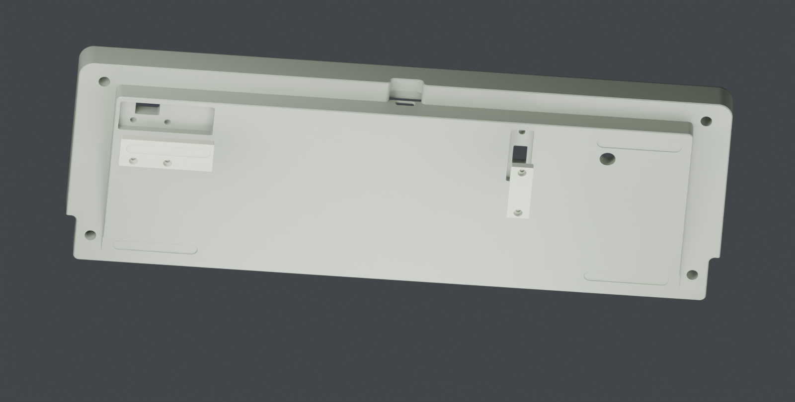

[English](e73-m05-prototype.md) | 中文

# E73 的 M05 维修口试制件

M05 为 CORNER-05 的装拆试验增加两个可拆盖。它保留 M04 的外形尺寸、脚垫位置及上壳、钢定位板和 C5 子板的安装基准。右后脚垫槽完整位于 J4 封盖上，拆盖时脚垫一起取下。制造总表仍列 M04 作为当前底壳基线。

## 一套试制件需要的文件和材料

| 零件 | 数量 | 文件或规格 |
|---|---:|---|
| M05 底壳 | 1 | [打印 STL](../../hardware/e73-hhkb-corner/mechanical/service-case-m05/bottom-m05-REVIEW.stl) · [STEP](../../hardware/e73-hhkb-corner/mechanical/service-case-m05/bottom-m05-REVIEW.step) |
| J2 封盖 | 1 | [打印 STL](../../hardware/e73-hhkb-corner/mechanical/service-case-m05/cover-J2-REVIEW.stl) · [STEP](../../hardware/e73-hhkb-corner/mechanical/service-case-m05/cover-J2-REVIEW.step) |
| J4 封盖 | 1 | [打印 STL](../../hardware/e73-hhkb-corner/mechanical/service-case-m05/cover-J4-REVIEW.stl) · [STEP](../../hardware/e73-hhkb-corner/mechanical/service-case-m05/cover-J4-REVIEW.step) |
| 封盖螺钉 | 4 | M2 × 0.4，头下长度 4 mm，带平底承压面的低头内六角。头部直径 ≤3.90 mm，高度 ≤1.50 mm。SUNCO M2 低头系列的标称头部尺寸为 Ø3.8 × 1.3 mm。[厂商尺寸表](https://th.misumi-ec.com/en/vona2/detail/221005676582/?Tab=codeList) |
| 封盖螺纹嵌件 | 4 | M2 × 0.4，滚花黄铜，Ø3.2 × 2.5 mm，与 C5 规格相同。另备四枚，孔深按本页施工。 |
| 胶和脚垫 | 按需 | 用外壳规定的冷粘胶固定嵌件。使用整机清单中的四个脚垫，其中一个装在 J4 封盖上。 |

使用韧性工程 SLA 树脂，按毫米、100% 比例打印。三种零件各做一件，每件从 STEP 和 STL 中选一个文件。两种格式使用相同的壳体坐标。在树脂完全后固化后复查承压面、脚垫槽和盲孔。安排打印支撑和排液方向时，避免支撑损伤这些面。

## 装电子件前试配封盖

1. 先把两只盖分别放进对应的凹槽，确认可垂直向下取出。每侧标称留缝 0.35 mm，CAD 外表面齐平。修整时保持封盖与底壳齐平，也保留右后脚垫槽原有高度。
2. 四个嵌件盲孔按 **Ø3.35 ±0.05 mm** 修孔。从孔轴中心所在的承压台阶计算，盲孔深度为 **2.90 mm**。冷粘嵌件，外端面比该处台阶内缩 **0.30 mm**。待空壳上的胶固化后再装电池和 PCB。
3. 确认螺钉能压住封盖，末端与盲孔底留有间隙。CAD 中标称螺纹重叠 **2.15 mm**，螺钉末端距孔底 **0.45 mm**。实测头部尺寸和孔底余量，并检查封盖受力、树脂裂纹、嵌件松动及装脚垫后是否摇晃。
4. 将右后脚垫完整贴在 J4 封盖槽内，留出两只螺钉的位置。取下两只盖后可接近 J2 和 J4。试装用无电池尺寸量块代替电池，并保持线束断电。

[CAD 报告](../../hardware/e73-hhkb-corner/audit/service-case-m05.json)检查了外形尺寸、四处新增嵌件的支撑、八处原有螺孔保护区、封盖拆出行程，以及打开后 J2、J4 的通道。[关壳装拆检查](../engineering/e73-corner-service.zh-CN.md)记录了配套的线束试验。M05 用于机械试配，仍需验证实际拔插工具、带线完整拆装、承载和反复拆装，之后才能用于正式装配。
