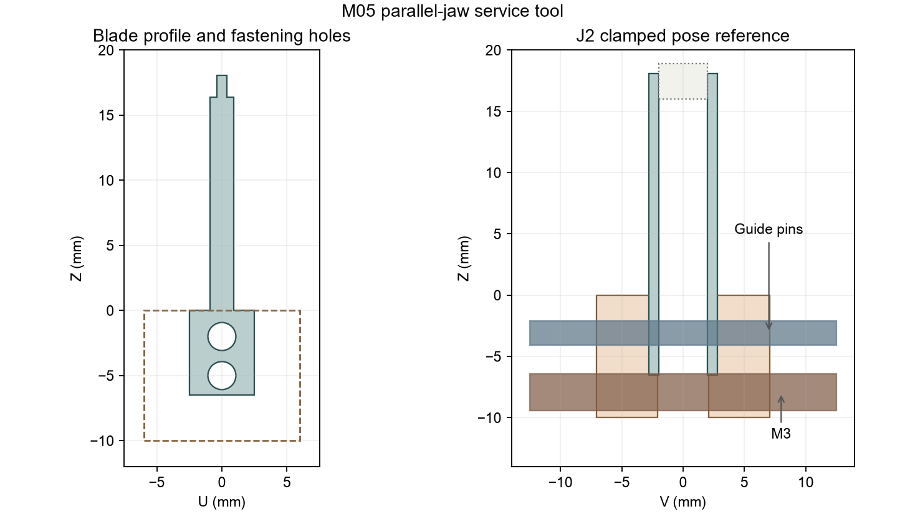

English | [Chinese](e73-m05-service-tool.zh-CN.md)

# M05 parallel-jaw service tool

The trial tool reaches J2 and J4 through the M05 bottom openings. It grips the exterior sides of the current SHR-03V-S and SHR-04V-S housings near the wire exit. Two transverse guide pins keep the jaws parallel. The nominal shaft and tip sizes follow the public SH dimensions. Grip on the actual molded housing needs to be confirmed using sample parts. [JST SH drawing](https://www.jst.com/wp-content/uploads/2025/06/eSH.pdf)

## Parts for one tool

| Part | Quantity | Specification |
|---|---:|---|
| Printed grip | 2 | [STL](../../hardware/e73-hhkb-corner/mechanical/service-case-m05/tool/parallel-grip.stl) or [STEP](../../hardware/e73-hhkb-corner/mechanical/service-case-m05/tool/parallel-grip.step). Print in tough insulating resin at 100% in millimetres. |
| Sheet blade | 2 | [Blade profile DXF](../../hardware/e73-hhkb-corner/mechanical/service-case-m05/tool/blade-06mm-profile.dxf), 0.60 mm spring stainless sheet. Deburr all edges. Finish the insulated blade thickness at no more than 0.80 mm. |
| Guide pin | 2 | Ø2 × 25 mm straight pins for the two parallel bores. Retain each pin in one grip, with a free sliding fit in the other. |
| Blade fasteners | 4 sets | M2 × 8 mm low heads and matching nuts. Keep their heads within the space between the grips without touching the other grip at the measured clamping width. |
| Clamping hardware | 1 set | M3 × 25 mm screw, matching nut and washers. Adjust it by hand during fitting. |
| Blade insulation | As needed | Thin, firmly attached electrical insulation on all metal that enters the case. Inspect edges and check total thickness after application. |

Print the two identical grips. Rotate the second grip by 180° about its vertical axis so the blade pockets face each other. Fasten each blade into its pocket with the same tip projection. Fit the pins into the outer pair of holes and the M3 screw into the lower central hole. Check that the moving grip slides freely without appreciable skew.

## Fit and verify on unpowered parts

1. Use disconnected sample connectors and an inert pack gauge for the first mechanical trial. Fit the covers, take them off, and approach the wire-side housing faces from below with open jaws. Check that the tool hardware remains outside the shell and the tips bear on the housing sides.
2. Close the jaws on the housing. Compare the tool’s grip with the force needed to release and re-seat a spare mated connector. Check for slip, gouging, deformation and insulation wear. JST calls for supporting the housing during removal and avoiding angled withdrawal. [JST handling precautions](https://www.jst-mfg.com/product/pdf/eng/handling_e.pdf)
3. In the M05 fixture, withdraw J2 along +Y and J4 along −X, keeping the jaw pair aligned with the corresponding mating axis. The modeled travels are 4.50 and 4.00 mm. Once free, move each housing 0.45 mm toward the underside. Use the [parking supports](e73-m05-parking-support.md) to hold the tools until the deck clears the housings. Confirm wire feed and check for any bounce back into the lift path.
4. Repeat in reverse with the wires supervised, re-seat each plug and check strain, continuity and seating. Record the measured travel, tool fit, grip and retention for both connectors before trying the wired assembly.

The [tool fit report](../../hardware/e73-hhkb-corner/audit/m05-tool.json) covers approaching, closing, pulling and lowering both jaws at three PCB thicknesses. It models the blade, handle and the external fastener envelope against the actual M05 case. The tool’s relationship to the wire envelopes is sampled separately. Grip force, elastic deflection, hold-open support and installed wire movement still need a physical trial.
