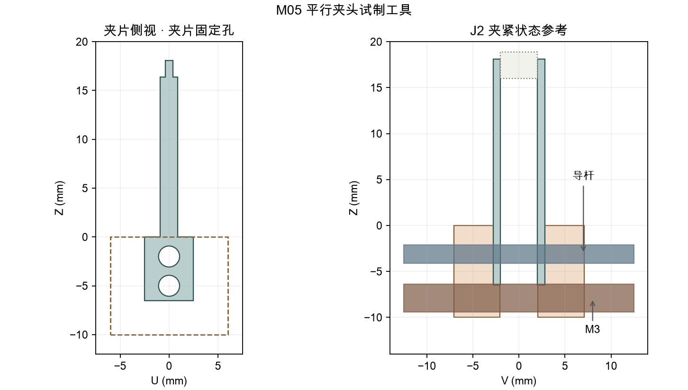

[English](e73-m05-service-tool.md) | 中文

# M05 平行夹头试制工具

工具从 M05 底部开口接近 J2 和 J4，夹住现用 SHR-03V-S 和 SHR-04V-S 胶壳靠出线端的两侧。两根横向导杆让两片夹头保持平行。夹片的标称尺寸依据 SH 公开图纸，实际能否夹牢仍需用到货胶壳验证。[JST SH 尺寸图](https://www.jst.com/wp-content/uploads/2025/06/eSH.pdf)

## 一套工具的材料

| 项目 | 数量 | 规格 |
|---|---:|---|
| 握块 | 2 | [STL](../../hardware/e73-hhkb-corner/mechanical/service-case-m05/tool/parallel-grip.stl) 或 [STEP](../../hardware/e73-hhkb-corner/mechanical/service-case-m05/tool/parallel-grip.step)。用韧性绝缘树脂，毫米、100% 比例打印。 |
| 金属夹片 | 2 | 按[夹片 DXF](../../hardware/e73-hhkb-corner/mechanical/service-case-m05/tool/blade-06mm-profile.dxf)加工 0.60 mm 弹簧不锈钢片。去毛刺，绝缘后成品厚度不超过 0.80 mm。 |
| 导杆 | 2 | Ø2 × 25 mm 直杆。分别固定在一侧握块中，在另一侧保持滑配。 |
| 夹片紧固件 | 4 套 | M2 × 8 mm 低头螺钉及配套螺母。核对螺钉头位于两块握块之间，并在实际夹持位置互不相碰。 |
| 夹紧紧固件 | 1 套 | M3 × 25 mm 螺钉、配套螺母及垫圈。试配阶段用手调节。 |
| 夹片绝缘 | 按需 | 覆盖所有进入壳内的金属表面，贴合边缘，并测量绝缘后的总厚度。 |

两只握块使用同一文件打印。第二只绕竖直轴转 180°，两条夹片槽相向。两只夹片分别紧固，钳尖伸出长度相同。外侧两孔装导杆，下方中央孔装 M3 螺钉。检查活动握块能平顺滑动，夹头不明显歪斜。

## 用断电样件试配

1. 首次用断电接头和无电电池量块试装。取下两只封盖，从底部用张开的夹头接近胶壳出线端。确认紧固件留在壳外，钳尖压在胶壳侧面。
2. 闭合夹头，先在备用接头上比较夹持力与插拔所需的力。检查打滑、压痕、变形和绝缘磨损。JST 的维护说明要求优先夹持胶壳，并避免斜拔。[JST 连接器操作须知](https://www.jst-mfg.com/product/pdf/eng/handling_e.pdf)
3. 在 M05 上，J2 沿 +Y、J4 沿 −X 拔出。让夹头与插拔轴线对齐。模型行程分别为 4.50 和 4.00 mm，脱开后各朝底面移动 0.45 mm。抬板前用独立支撑固定停放的插头，验证线束可以随动且插头不会弹回抬升路径。
4. 看着导线反向操作并重新插合，检查应力、通断和插合到位。实际带线试装前，记录两只接头的实际行程、工具是否合适、夹持力和停放稳定性。

[工具间隙报告](../../hardware/e73-hhkb-corner/audit/m05-tool.json)覆盖三种板厚下两侧夹片的接近、夹紧、轴向拔出和下沉动作。模型包含夹片、握块和壳外紧固件包络，采用 M05 实际底壳，并另行抽查与导线包络的间隙。夹持力、夹片弹性、停放支撑和实物线束随动仍待样件验收。
