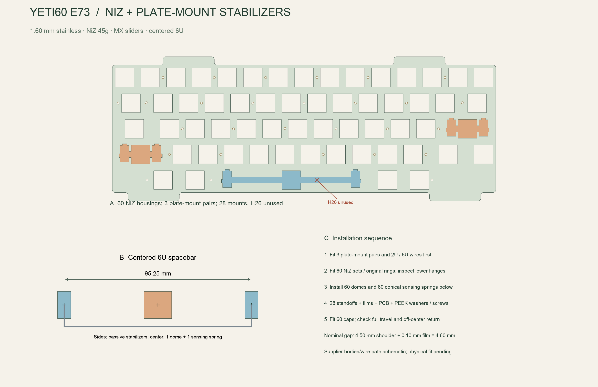

English | [Chinese](key-mechanism.zh-CN.md)

Current stock is unverified. The current NiZ N+ listing does not establish that its plastic clip heights match the earlier EC60 build; qualify one received housing and the 6U wire before commissioning all metal parts.

# NiZ switches with steel-plate-mounted stabilizers

The selected E73 build uses **60 NiZ housing/slider sets**, NiZ 45g domes and conical sensing springs, and **three separate Cherry/GMK plate-mounted stabilizer pairs**. Enter and left Shift each use a 2U wire; the centered HHKB 6U spacebar uses a separate 6U wire. NicePBT BoW caps remain selected. There are no Deskeys wide assemblies or Deskeys spacebar side units in this revision.

Use the [YETI60-NIZ-PM1 plate](../../mechanical/felk60_plate_hhkb.plate-mount.dxf) and [E73 assembly specification](../../mechanical/assembly-spec.json). The old 1.2 mm Deskeys plate is superseded. The native PCB is unchanged; the firmware calibration fingerprint now includes the selected plate/stack: the PCB retains 29 native holes, but **H26 is unused and only 28 fastener sets are installed**. The new spacebar opening passes through that old mounting axis.

This is a drawing-based engineering prototype. No sample exists. Actual NiZ clip retention, housing height, dome compression, wire bends and full cap/stabilizer travel require local first-article fitting. The CAD checks do not certify vendor plastic shapes or capacitance.

## Purchase exactly these items

Source stock observation: 2026-11-02; current stock quantities have not been requalified. Listed variants were available; no checkout, shipping or quantity reservation has been performed. Existing mechanism inventory is not verified and is not credited. Do not buy the superseded Deskeys kit as well.

| ID | Item / exact option | Buy | Install / spare |
|---|---|---:|---|
| K01 | [NiZ housing, slider and original silencing ring only](https://shop.beekeeb.com/products/niz-ec-switch?variant=45023311757619), **5 pieces per pack** | 13 packs | 65 supplied; 60 installed, 5 spare. One ordinary central housing for every key, including all three big keys |
| K02 | [NiZ conical spring only](https://shop.beekeeb.com/products/niz-ec-switch?variant=45023311790387), **5 pieces per pack** | 13 packs | 65 supplied; 60 installed, 5 spare. These sense capacitance; they are not stabilizer/helper springs |
| K03 | [NiZ 45g dome sheet, SKU A-25-7](https://flashquark.com/product/niz-keyboard-electrocapacitive-silicone-dome-sheet-104-key-45g/) | 1 sheet | Use 60 dome positions, trimming for the HHKB stagger. Listing title says 108; URL/tags retain other numbers. Require a labelled **45g** sheet with at least 60 usable positions; the nominal force is not a measured actuation force |
| K04 | [Genuine GMK stabilizer, **Plate mount / 2u**](https://kebo.store/products/gmk-stabilizer?variant=37169593581722) | 3 sets | Six housings and six passive stems. Use two supplied short wires; keep the third short wire as a spare and fit K05 to that pair |
| K05 | [Cherry-compatible **6u** stabilizer wire](https://mech-stock.myshopify.com/products/stabiliser-wire?variant=40929412776129) | 1 wire | Install on the spacebar pair. The seller lists compatibility with PCB or plate-mounted Cherry MX stabilizers; it is not a Deskeys EC wire |
| K06 | [NicePBT BoW current full kit](https://cannonkeys.com/products/nicepbt-bow), including **6.0c Centered** | 1 kit | 60 caps: centered 6U bar, 2.25U Enter/left Shift, 1.75U right Shift, 1.5U Backspace and matching HHKB bottom row |
| K07 | [New NiZ / plate-mount DXF](../../mechanical/felk60_plate_hhkb.plate-mount.dxf), 304 stainless | 1 plate | 60 active openings, three Cherry-style stabilizer openings and 28 M2 tapped axes |

K01 and K02 are separate product options, not whole switch sets. K03 is another purchase. Do not count springs/domes as included in K01. Do not buy complete MX switches, PCB screw-in stabilizers or PCB clip-in stabilizers. K04 must say **Plate mount** even though the same product page sells PCB variants.

The NiZ official 100-piece 2021 switch listing was sold out at this check, so it is not the default purchase source. Kebo's complete plate-mount 6U option was also sold out; K04 plus the separately listed K05 avoids depending on that unavailable variant. The [machine-readable selection](../../mechanical/yeti60-key-mechanism.json) records exact variant IDs and the dated observations.

## Mechanical requirements

| Feature | This revision |
|---|---|
| Case exterior | FELK60 325.700 x 125.200 x 31.190 mm; no scaling |
| Steel plate | CAD envelope **1.60 mm**; accept finished stock **1.55–1.60 mm**, with no burr/coating buildup at clips |
| Ordinary NiZ opening | **14.00 x 14.00 mm**, maximum internal corner radius 0.30 mm; confirm actual housing revision on a local sample |
| Short stabilizer stem spacing | **23.80 mm** for both 2.25U caps; use 2U wires |
| Spacebar side stem spacing | Design datum **95.25 mm**, centered about the active 6U key |
| Mounting | 28 installed sets; omit **H26** completely: no standoff, film, washer or screw there |
| Plate bottom / top | z=4.2062 / **5.8062 mm** |
| PCB top / bottom | z=-0.3938 / -2.0000 mm, unchanged |
| Plate-to-PCB gap | Nominal **4.60 mm**, 4.50 mm shoulder plus 0.10 mm polyimide film; actual NiZ dome preload unqualified |
| Lower gasket stock | **2.0 mm**; nominal installed gap 1.0162 mm |
| Upper gasket stock | **1.2 mm**; nominal installed gap **0.5838 mm**. Do not reuse the old 2 mm upper gasket |

The [original Cherry frame drawing](https://deskthority.net/wiki/images/d/de/Keymodule_MX.pdf), page 3, gives a 1.5 +/-0.1 mm plate. The specified 1.55–1.60 mm finished range stays within that drawing while following the nominal 1.6 mm NiZ construction documented by [Tako](https://github.com/ssbb/tako) and this [first-person NiZ/EC60 build](https://github.com/mattyintegrals/ecneko60). It does not prove that every NiZ or GMK production revision clips identically.

The DXF outer profile and all 60 sensing axes are preserved. Normal openings replace the old wide EC housings; three connected Cherry frame openings provide their separate stabilizer positions. The 6U opening crosses H26, so the old PCB hole remains electrically unchanged but receives no hardware. This is not a claim that omitting one support preserves local stiffness: inspect plate flex and spacebar sensing on the prototype.

The 6U label alone does not establish exact fit. Before final metalwork/bulk orders, verify the received K05 end spacing/bends and K06 outer sockets against the **95.25 mm design datum** and six received K04 stems. Some plate generators use 95.0 mm for 6U; this design has not silently changed to that value. Do not force the wire or cap sideways, reuse a 6.25U/7U wire, or assume an EC wire and a Cherry wire share bends.

[Vector guide](../engineering/images/key-mechanism.svg)

## Assemble in this order

1. Inventory all seven purchase lines. Identify six plate-mount housings/stems, two short wires and the separate 6U wire. Fit the long wire and spacebar cap to their side stems locally; confirm centered cap geometry, straightness, free movement and matching end spacing before assembling the full keyboard.
2. Inspect the new plate thickness, clip holes, edge finish and **28 M2 x 0.4 tapped axes**. The DXF circles are machining datums, not clearance-hole instructions. Tap/clean before any electronics is nearby. Mark the unused H26 axis on the PCB for assembly reference; do not drill or fill its existing hole.
3. Assemble each stabilizer housing/stem/wire pair, following its keycap orientation. Clip all three pairs into the plate **before installing the central NiZ housings**. Use two short wires for Enter/left Shift; replace the third short wire with K05 for the spacebar. Check that clips seat flat and cannot lift out.
4. Trial-fit the ordinary NiZ central housings. For the three stabilized keys, check lower flange and wire clearance. The [NiZ/EC60 builder's photos and procedure](https://github.com/mattyintegrals/ecneko60#housings) show that lower skirt material can obstruct plate-mount stabilizers. If needed, remove a spare housing from the plate, mark only the interfering lower skirt below the hook and trim incrementally with flush cutters. Do not cut clip hooks, slider guide rails or the dome seating surface. Refit and test the full stroke after every small cut. If clearance requires cutting a structural feature, reject that sample rather than forcing it together. Debris must be completely removed.
5. Assemble 60 NiZ sliders using their **original supplied silencing rings**. Do not stack Deskeys #5 rings onto them. Fit and operate Enter, left Shift and the spacebar from the center and both ends. Every cap must return without the stabilizer bottoming first, twisting the central slider or hitting a housing.
6. With the plate supported upside down, fit 60 dome positions and center one conical sensing spring inside each. Trim the sheet for the stagger without cutting a dome skirt/sealing seat. Only the central EC key receives a dome/sensing spring; all six stabilizer side stems are passive.
7. Fit **28** brass standoffs and polyimide rings, leaving H26 empty. Fit the unchanged PCB, then 28 PEEK washers and 28 M1.6x5 screws. Tighten progressively while checking the nominal 4.6 mm stack, housing seating and released key return. Do not use screw force to correct a mismatched housing height. Verify wires neither press on domes nor contact PCB copper.
8. Fit 2.0 mm lower gasket stock and **1.2 mm upper stock** at the original ledges. Do not add 0.4 mm to the outer case, move the PCB down, compress the battery or force the shell closed to fit the thicker plate.
9. Calibrate every key with the completed mechanism installed. While operating each stabilized key, check neighboring unpressed keys as well: moving metal and a changed dome/stack require real EC qualification. Repeat all keys, full travel and edge return after closing the case. Any housing, dome, spring, ring or stack change requires recalibration including changes to an actual received part even when the design fingerprint is unchanged.

Use the [28-step guide](../assembly/build-guide.md) for soldering, power, SWD, harness and shell assembly. These mechanical changes add no PCB order or electronic BOM part. Mainboard USB/BLE/charging behavior remains the matched E73 firmware policy.

## Verification boundary

[Plate checks](../audit/plate-mount.json) verify the outer profile, all 60 sensing centers, 28 retained mounting axes, H26 conflict, three stabilizer openings, neighboring cutouts and minimum retained web. Fault tests move a mount, alter a cutout, shift a stabilizer and reintroduce H26. The main assembly, electrode mapping and images use the new plate.

The rendered NiZ/stabilizer bodies and wire paths are explanatory geometry, not supplier-qualified MCAD. No physical switch fit, key feel, local stiffness, USB/BLE operation, charge performance or interference test has been passed by an actual unit.

[Build entry](../../BUILD.md) · [materials](../engineering/materials.md) · [assembly](../engineering/assembly.md)

The E73 electronic design remains on hold for USB protection, PH plug service, power-layout and supplier/physical gates. Use the [current E73 review](../audit/e73-review.md).

Nominal assembly does not close the [plate-ear and SW100 tolerance deficits](../engineering/e73-mechanical-tolerances.md). Keep plate/case machining on hold until that repair is verified.
