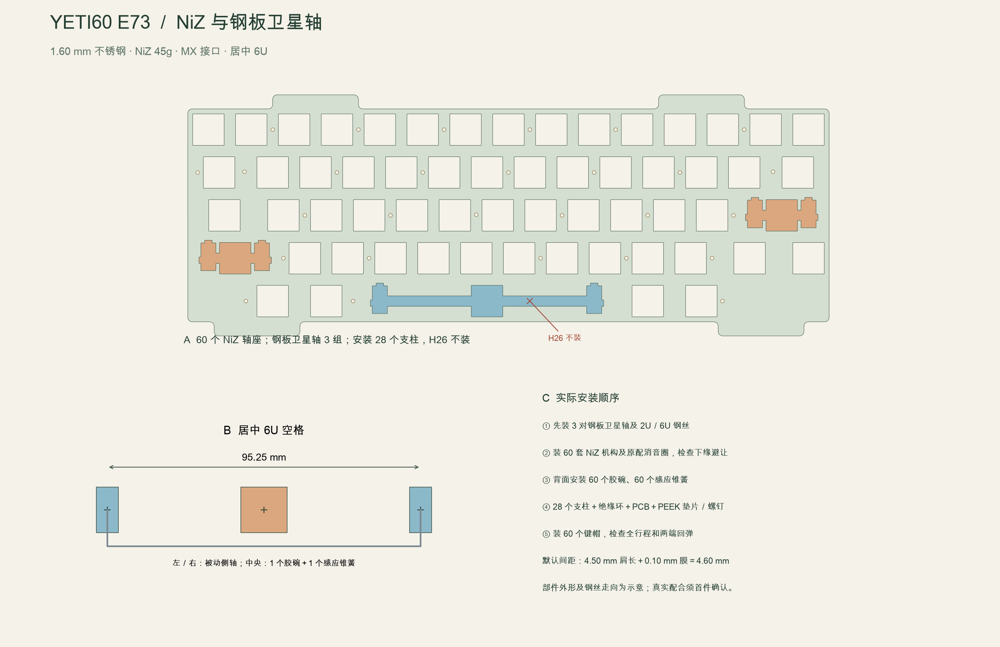

[English](key-mechanism.md) | 简体中文

当前库存未核实。NiZ 现售 N+ 产品页面不能证明其塑料卡扣高度与早期 EC60 装机相同；批量加工金属件前，先用一个实收轴座及 6U 钢丝试配。

# NiZ 轴体与钢板卫星轴方案

E73 当前方案采用 **60 套 NiZ 轴座／滑块**、NiZ 45g 胶碗及锥形感应弹簧，另配 **三组 Cherry／GMK 钢板卫星轴**。回车、左 Shift 各用一根 2U 钢丝；居中 HHKB 6U 空格另用一根 6U 钢丝。键帽继续使用 NicePBT BoW。本版不再使用 Deskeys 宽键总成或空格侧轴。

使用[新 NiZ 钢板卫星轴定位板](../../mechanical/felk60_plate_hhkb.plate-mount.dxf)和 [E73 专用装配规格](../../mechanical/assembly-spec.json)，原 1.2 mm Deskeys 定位板已被替换。原生 PCB 不变；固件校准指纹现在同时绑定选定定位板／叠层：PCB 仍有 29 个原孔，但 **H26 不装，实际只安装 28 套紧固件**，因为新空格开孔经过该安装轴。

这是按图设计的工程样机，目前没有实物。真实 NiZ 卡扣、轴座高度、胶碗压缩、钢丝弯形及键帽／卫星轴全行程须先做局部试装；CAD 检查不等于验证了供应商塑料外形或静电容性能。

## 按这张表购买

库存查询日期：2026-11-02。列出的选项查询时可购买，未进行结账、配送或数量预留。机械件已有库存未核实，不作抵扣。不再同时购买被替换的 Deskeys 整包。

| 编号 | 材料及准确选项 | 购买数量 | 安装／备件 |
|---|---|---:|---|
| K01 | [NiZ 轴座、滑块及原配消音圈](https://shop.beekeeb.com/products/niz-ec-switch?variant=45023311757619)，选仅轴座滑块消音圈，**每包 5 套** | 13 包 | 共 65 套，安装 60、备件 5；包括三个大键在内，每个按键中央都用普通轴座 |
| K02 | [NiZ 锥形感应弹簧](https://shop.beekeeb.com/products/niz-ec-switch?variant=45023311790387)，选仅锥簧，**每包 5 个** | 13 包 | 共 65 个，安装 60、备件 5；它不是卫星轴或辅助回弹弹簧 |
| K03 | [NiZ 45g 胶碗整张，编号 A-25-7](https://flashquark.com/product/niz-keyboard-electrocapacitive-silicone-dome-sheet-104-key-45g/) | 1 张 | 取 60 个位置，按 HHKB 错位配列裁分；标题写 108，网址／标签保留其他数字，收货要求必须是标识 **45g**、至少 60 个可用位置的整张；标称克数不是本机实测触发力 |
| K04 | [原装 GMK 卫星轴，选 **Plate mount／2u**](https://kebo.store/products/gmk-stabilizer?variant=37169593581722) | 3 组 | 六个外壳、六个被动柱；使用其中两根短钢丝，第三根短丝作备件，该组改装 K05 长丝 |
| K05 | [Cherry MX 兼容 **6u** 卫星轴钢丝](https://mech-stock.myshopify.com/products/stabiliser-wire?variant=40929412776129) | 1 根 | 装在空格卫星轴组；卖家说明适用于 Cherry MX 的 PCB 或钢板安装机构，它不是 Deskeys 静电容钢丝 |
| K06 | [NicePBT BoW 当前完整套装](https://cannonkeys.com/products/nicepbt-bow)，含 **6.0c Centered** | 1 套 | 使用 60 帽：居中 6U 空格、2.25U 回车／左 Shift、1.75U 右 Shift、1.5U 退格及对应 HHKB 底排 |
| K07 | [新的 NiZ 钢板卫星轴 DXF](../../mechanical/felk60_plate_hhkb.plate-mount.dxf)，304 不锈钢 | 1 张 | 60 个有效按键开孔，三个 Cherry 式卫星轴组合开孔，28 处 M2 螺纹轴 |

K01、K02 是同一商品页的不同选项，不是整套轴体；胶碗 K03 也须另买，不能以为 K01 已含锥簧和胶碗。无需买完整 MX 轴、PCB 螺丝卫星轴或 PCB 卡扣卫星轴。K04 同页也卖 PCB 版本，必须选 **Plate mount**。

NiZ 官网 2021 版百只装在本次查询时缺货，因此不作为默认来源；Kebo 的整组钢板 6U 选项也缺货，采用 K04 加单独 K05 的方式，不依赖缺货选项。[机器可读选型](../../mechanical/yeti60-key-mechanism.json)记录准确选项编号和查询快照。

## 机械尺寸

| 项目 | 本版要求 |
|---|---|
| 外壳外形 | FELK60 原尺寸 325.700×125.200×31.190 mm，不缩放 |
| 不锈钢板 | CAD 包络 **1.60 mm**；成品实收 **1.55—1.60 mm**，卡位不得有毛刺或涂层堆积 |
| 普通 NiZ 孔 | **14.00×14.00 mm**，内圆角不大于 0.30 mm；须用实收轴座版本先局部试装 |
| 短卫星轴柱距 | **23.80 mm**，对应两个 2.25U 键帽，配 2U 钢丝 |
| 空格卫星轴柱距 | 设计基准 **95.25 mm**，以有效 6U 中央轴对称布置 |
| 固定点 | 实装 28 套；**H26 整套不装**，支柱、膜、垫片、螺钉都省去 |
| 定位板底／顶面 | z=4.2062／**5.8062 mm** |
| PCB 顶／底面 | z=−0.3938／−2.0000 mm，不变 |
| 定位板到 PCB 间距 | 名义 **4.60 mm**，4.50 mm 支柱肩＋0.10 mm 聚酰亚胺膜；真实 NiZ 胶碗预压尚待验证 |
| 下侧胶棉原厚 | **2.0 mm**，名义安装间距 1.0162 mm |
| 上侧胶棉原厚 | **1.2 mm**，名义安装间距 **0.5838 mm**；不能继续用旧的 2 mm 上侧胶棉 |

[Cherry 原厂框架机构图](https://deskthority.net/wiki/images/d/de/Keymodule_MX.pdf)第 3 页给出 1.5±0.1 mm 板厚。这里选的 1.55—1.60 mm 成品范围落在图纸范围内，同时参考 [Tako](https://github.com/ssbb/tako) 及 [NiZ／EC60 实际装机](https://github.com/mattyintegrals/ecneko60)采用的名义 1.6 mm NiZ 结构。这不代表每一版 NiZ 或 GMK 塑料卡扣已经实测兼容。

DXF 保留外轮廓和全部 60 个感应轴心。原宽静电容轴座改成普通中央轴座，并用三个相连 Cherry 式框架开孔容纳独立卫星轴。6U 开孔穿过 H26，所以 PCB 原孔电气和加工均不改，但该处不装五金。少一个支撑后的局部刚度不能直接视为不变，首件须检查板弯与空格感应稳定性。

仅有“6U”名称不能证明柱距和弯形一致。定制金属件或批量采购前，先将实收 K05、K06 空格帽与六个 K04 柱体按 **95.25 mm 设计基准**试配。部分定位板生成器使用 95.0 mm，本版没有偷偷改用该值。不能横向硬掰钢丝／键帽，不能拿 6.25U／7U 钢丝替代，也不能认为静电容钢丝和 Cherry 钢丝弯形相同。

[矢量图](../engineering/images/key-mechanism.zh-CN.svg)

## 安装顺序

1. 清点七项采购材料，分出六个钢板卫星轴壳、六个柱、两根短丝及一根单独的 6U 长丝。先局部试配空格钢丝、两边柱体和键帽，检查居中、直线度、活动状态及柱距，再装整把。
2. 检查新钢板的厚度、卡位、去毛刺和 **28 处 M2×0.4 螺纹轴**。DXF 圆是加工基准，不能直接当螺丝通孔切割。攻牙和金属碎屑清理须在靠近电子元件之前完成。把 PCB 上 H26 标记为装配不使用，不钻改或填补原孔。
3. 按键帽方向装好三组卫星轴壳、柱及钢丝，**先把三组卫星轴卡入钢板，再装中央 NiZ 轴座**。回车、左 Shift 用两根短丝；第三组将短丝换为 K05 长丝用于空格。检查卡扣平贴、不会向上脱出。
4. 试装普通 NiZ 中央轴座；三个大键重点检查下缘及钢丝避让。[NiZ／EC60 作者的照片和操作](https://github.com/mattyintegrals/ecneko60#housings)表明，轴座下裙边可能挡住钢板卫星轴。需要修边时，先取下一个备用轴座，只标记卡钩以下真正碰到的薄裙边，用平口剪逐次少量修整。不能剪卡钩、滑块导轨或胶碗承托面，每修一点就重新试装完整行程。若必须剪到承力结构才能避让，应判该样件不合格，不能强装。装回前彻底清除塑屑。
5. 装 60 个 NiZ 滑块及其**原配消音圈**，不叠加 Deskeys #5 圈。装回车、左 Shift 和空格，分别按中间及两端，检查卫星轴不提前顶底、不扭中央滑块、不碰轴座，松手都能回弹。
6. 定位板翻面并支承平整，安装 60 个胶碗位置，每个胶碗内居中放一个锥形感应弹簧。胶碗整张按错位配列裁分，不剪坏胶碗裙边／承托面。只有中央静电容轴装胶碗和感应弹簧，六个卫星轴侧柱都是被动机构。
7. 安装 **28 套**黄铜支柱和聚酰亚胺环，H26 留空。装未改动的 PCB，再装 28 个 PEEK 垫片、28 颗 M1.6×5 螺钉。逐步均匀拧紧，同时检查名义 4.6 mm 高度、轴座贴合及松键回弹；不能靠锁螺钉强压高度不匹配的轴座。钢丝不得压胶碗或接触 PCB 铜面。
8. 原支承台下侧贴 **2.0 mm** 胶棉，上侧改贴 **1.2 mm**。不能通过外壳加高 0.4 mm、下移 PCB、挤压电池或强行合壳来容纳厚钢板。
9. 装完整套机构后逐键重新校准；按三个大键时也要检查附近未按键，移动金属、胶碗及结构变化都须实测静电容性能。合壳后复测全部键、完整行程和两端回弹。任何轴座、胶碗、弹簧、消音圈或高度改动，都需要重新校准，即使 PCB／固件指纹未变。

主板焊接、供电、SWD、线束和外壳顺序继续按 [28 步配图指南](../assembly/build-guide.zh-CN.md)。机械改版不增加 PCB 订单或电子材料；USB／蓝牙及同时充电策略仍使用匹配的 E73 固件。

## 验证范围

[定位板检查](../audit/plate-mount.json)验证外轮廓、60 个感应中心、28 个保留安装轴、H26 冲突、三个卫星轴组合开孔、相邻开孔及最小余料；错误注入测试会移动孔、改孔尺寸、移动卫星轴并重新加回 H26。主装配、电极映射及图像均使用新定位板。

渲染中的 NiZ、卫星轴塑料及钢丝路径是说明性几何，不是供应商认证的三维模型。尚无实物，未证明实际卡扣、手感、局部刚度、USB／蓝牙、充电或干扰验收通过。

[制作总入口](../../BUILD.zh-CN.md) · [材料表](../engineering/materials.zh-CN.md) · [总装配](../engineering/assembly.zh-CN.md)

E73 电气设计仍受 USB 保护、PH 插头检修、电源布局及供应商／实物门槛限制，参见[当前 E73 审查](../audit/e73-review.zh-CN.md)。

标称装配不能关闭[定位板耳部及 SW100 公差净空不足](../engineering/e73-mechanical-tolerances.zh-CN.md)。修补并验证前，定位板／壳体加工继续暂停。
