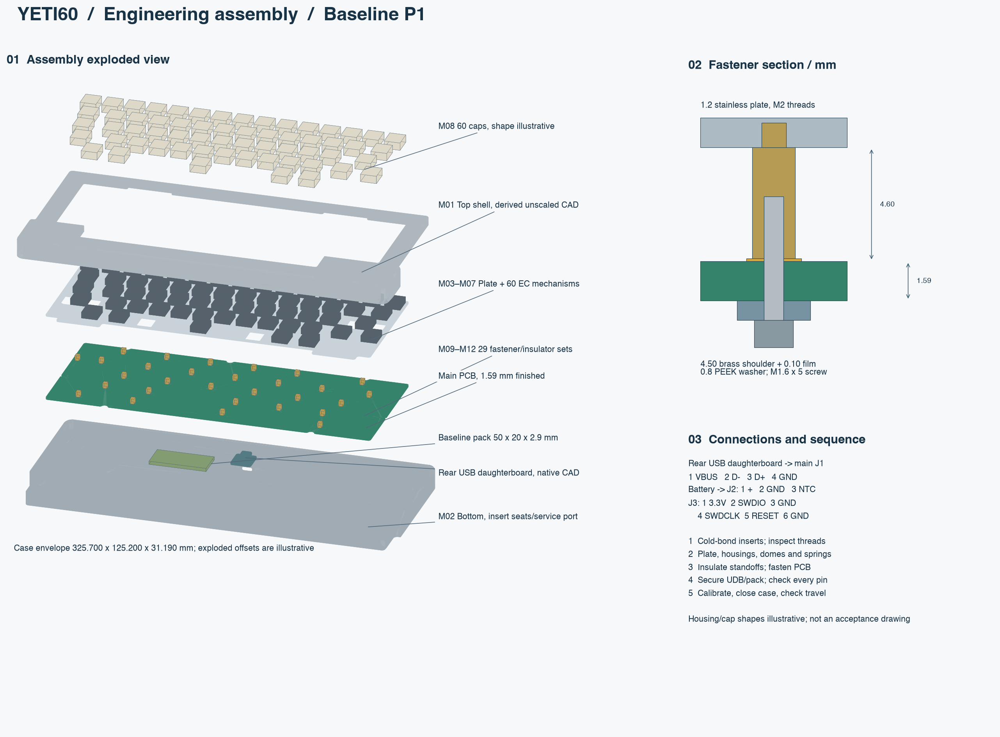

English | [Chinese](assembly.zh-CN.md)

# Assembly drawings and build sequence

These engineering sheets use the current, unscaled FELK60-derived shell meshes, native plate/PCB geometry and native exported USB daughterboard CAD. They are separate from the older studio renders. Keycap/housing silhouettes, threads and exploded offsets are illustrative; the written dimensions govern. Quantities refer to the [materials table](materials.md).

[Vector assembly drawing](images/assembly.svg) · [Optional battery-pocket drawing](images/battery-pocket.svg) · [Optional recess study](battery-study.md)

## Assembly datums

| Interface | Requirement |
|---|---|
| Exterior shell union | 325.700×125.200×31.190 mm in the source frame; no scale change |
| Lower/upper gasket ledges | z=3.19 / 6.39 mm; nominal compressed gaskets 1.0 mm each |
| Stainless plate | Bottom z=4.19; top z=5.39; thickness 1.20 mm |
| PCB | Top z=−0.41; bottom z=−2.00; finished thickness 1.59 mm |
| PCB-to-plate gap | 4.60 mm = 4.50 mm brass shoulder + 0.10 mm polyimide film |
| Mounting centers | 29 matched plate/PCB holes; maximum source center mismatch 0.05337 mm |
| Worst radial screw margin | Approximately 0.07663 mm using M1.6 shank, specified hole/position/concentricity tolerances; this is a tight imposed tolerance |
| Daughterboard | PCB bottom z=−10.91, thickness 1.6062 mm; 14×12.5 mm mounting rectangle |
| SW100 access | Ø8 bottom service port centered at X=112, Y=−121 mm; insulated tool only |

The standoff's insulating film lies **between PCB top and brass shoulder**, while the PEEK washer lies under the PCB. The bottom screw passes through the washer and PCB into the M1.6 female thread. Nominal engagement is `5−0.8−1.59−0.10 = 2.51 mm`, within the 3.2 mm female depth. The M2 stud enters the tapped plate from below. CAD thread envelopes do not represent actual thread flanks; confirm taps, engagement, head height and insulation on a first article. Do not force a misaligned screw through an electrode.

## Sequence

1. Manufacture one shell revision only. Use fully post-cured tough resin; inspect shrinkage before finishing insert bores. Cold-bond four M3 upper inserts and four M2 daughterboard inserts. Keep adhesive outside threads and allow full cure; thermoset resin is not a heat-insert material.
2. Deburr the 1.2 mm steel plate and tap its 29 mounting pilots to M2. Inspect its matched Topre-compatible housings, stabilizers and 6U spacebar hardware with the actual donor set. Fit the 60 housings/sliders and matched dome/spring set in the correct stack; keep every spring centered on its installed electrode.
3. Fit 29 brass adapter standoffs to the plate. Place 0.10 mm polyimide rings between each shoulder and PCB sensing face. Locate the PCB without shifting electrode centers, then fit 29 PEEK washers and M1.6×5 screws underneath. Tighten progressively using a first-article-qualified torque; no unverified torque value is prescribed.
4. Fit the rear daughterboard on its four bonded M2 insert seats using the proposed M2×4 screws/insulating washers. Confirm USB mouth alignment and actual cable plug access before proceeding. Connect the four-wire harness only after continuity and polarity checks. The 150 mm harness length is provisional pending the full bend/strain-relief routing check.
5. Use the baseline 200 mAh pack only with the baseline electrical configuration. Insulate and secure the pouch within its envelope without crushing it. For the optional recessed bottom, follow the separate pack/charger qualification gates; do not treat the 1000 mAh envelope as a ready-to-install battery. Keep the pack and harness clear of screw heads and the service opening.
6. With the case open and battery polarity verified, flash the USB calibrator through the **custom** J3 probe mapping. Follow the [firmware calibration procedure](../../firmware/target/README.md), preserve settings when loading the normal HEX, then check all 60 keys and USB/BLE operation on hardware.
7. Fit the gasket pads to their existing ledges and close the shell progressively. Proposed M3×5 screws with 0.30 mm shims give nominal 2.50 mm insert engagement from the recorded shell seats; inspect thread bottoming and heads in their recesses. Verify full key travel, connector clearance, no pinched leads and external switch access. Fit feet after checking the underside seating surfaces.

## Wiring

| Interface | Pin order | Assembly check |
|---|---|---|
| Daughterboard → J1 | 1 VBUS; 2 D−; 3 D+; 4 GND | Electrical 1-to-1 continuity at the numbered contacts, not visual left-to-right wire order |
| Battery → J2 | 1 PACK+; 2 PACK−; 3 10k NTC to PACK− | Measure polarity first; verify NTC connection and independent thermal protection from the pack drawing |
| J3 SWD | 1 3.3 V reference; 2 SWDIO; 3 GND; 4 SWDCLK; 5 RESET_N; 6 GND | Custom fixture; do not plug in an unverified standard ARM connector or back-feed an active supply |

## Rebuild and acceptance

Use KiCad Python for `export_yeti60_mechanical_metadata.py` and `export_yeti60_daughterboard.py`. With `requirements-audit.txt`, run `check_yeti60_assembly.py`, `export_yeti60_render_meshes.py`, `study_yeti60_battery_pocket.py`, then `draw_yeti60_assembly.py`. Finally run `python3 scripts/check_yeti60_engineering.py` and the existing target/DRC checks. Source/output hashes are in [drawing evidence](../audit/yeti60-assembly-drawings.json).

No sample exists yet. Shell and pack BRep checks establish the stated conditional geometry, not actual dome compression, acoustic feel, resin creep or electrical operation. The harness routing, exact donor part compatibility, supplier part heights, printed-shell tolerances and all physical checks remain first-article requirements. RF/SI remains deferred by the user.
