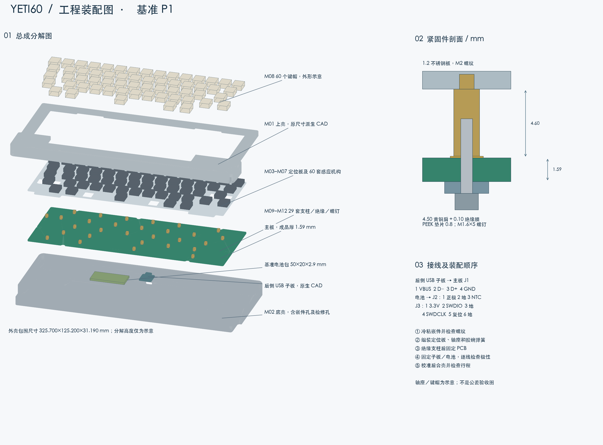

[English](assembly.md) | 简体中文

# 装配图及装配顺序

工程图采用当前原尺寸 FELK60 派生壳体网格、原生定位板／PCB 几何及原生导出的 USB 子板 CAD，与旧的摄影风格渲染分别保存。键帽／轴座轮廓、螺纹及分解高度为示意，以文字尺寸要求为准。编号和数量对应[材料表](materials.zh-CN.md)。

[矢量装配图](images/assembly.zh-CN.svg) · [可选电池槽图](images/battery-pocket.zh-CN.svg) · [底壳下挖研究](battery-study.zh-CN.md)

## 装配基准

| 接口 | 要求 |
|---|---|
| 上下壳外部联合包围尺寸 | 原坐标系 325.700×125.200×31.190 mm，不缩放 |
| 下／上胶棉支承台 | z=3.19／6.39 mm；名义压缩后两侧胶棉各 1.0 mm |
| 不锈钢定位板 | 底面 z=4.19、顶面 z=5.39、厚 1.20 mm |
| PCB | 顶面 z=−0.41、底面 z=−2.00、成品厚 1.59 mm |
| PCB 到定位板间距 | 4.60 mm，由 4.50 mm 黄铜肩及 0.10 mm 聚酰亚胺膜组成 |
| 安装中心 | 29 个定位板／PCB 匹配孔；源文件最大中心偏差 0.05337 mm |
| 最差螺钉径向余量 | 采用 M1.6 螺杆及规定孔径、位置、同轴度公差后约 0.07663 mm，属于严格制造要求 |
| 子板 | PCB 底面 z=−10.91、厚 1.6062 mm；安装孔矩形 14×12.5 mm |
| SW100 操作 | 底部 Ø8 检修孔，中心 X=112、Y=−121 mm；仅用绝缘工具 |

支柱绝缘膜位于 **PCB 顶面与黄铜肩之间**，PEEK 垫片位于 PCB 下侧。底部螺钉穿过垫片和 PCB，进入 M1.6 内螺纹。名义啮合 `5−0.8−1.59−0.10=2.51 mm`，小于 3.2 mm 内牙深度。M2 外牙从下侧进入已攻牙定位板。CAD 中只画螺纹包络，不是实际牙型；首件须确认攻牙、啮合、头高及绝缘。禁止强行让错位螺钉穿过感应电极。

## 装配顺序

1. 选择并制造一个明确版本的壳体。韧性树脂充分后固化，检查收缩后再精加工嵌件底孔。上壳冷粘四个 M3 嵌件，底壳子板座冷粘四个 M2 嵌件。胶液不得进入螺纹，按要求完全固化；热固性树脂不能按热熔嵌件工艺操作。
2. 1.2 mm 钢板去毛刺，并将 29 个安装底孔攻为 M2。用实际配套 Topre 兼容来源核对轴座、稳定机构和 6U 空格附件。按配套结构安装 60 套滑块／轴座、胶碗及弹簧，每个感应弹簧必须对中实际使用的电极。
3. 将 29 个黄铜转接支柱装到定位板。每个支柱肩与 PCB 感应面之间放 0.10 mm 聚酰亚胺绝缘环。PCB 对位时不能偏移感应中心，底部装 29 个 PEEK 垫片和 M1.6×5 螺钉。分步均匀拧紧，扭矩须经首件确认，不给出未经验证的数值。
4. 将后侧子板装到四个冷粘 M2 嵌件座，按建议采用 M2×4 螺钉及绝缘薄垫。先检查 USB 口对位和实际插头出线空间，再继续装配。四芯线束逐线测通并确认极性后才能插接；150 mm 长度仍待完整弯折／应力释放路径验收。
5. 基准电气配置仅使用基准 200 mAh 电池包。在规定包络内绝缘、固定软包，不能挤压。可选下挖底壳须另外满足电池包及充电电路验收条件，不能把 1000 mAh 包络视为可直接安装的现货电池。电池和线束不得碰螺钉头或堵塞检修孔。
6. 开壳状态核对电池极性，通过 **自定义** J3 探针接口先刷写 USB 校准版。按[固件校准流程](../../firmware/target/README.zh-CN.md)操作，保留设置分区刷普通版，然后实测全部 60 键及 USB／蓝牙。
7. 将胶棉放到原有支承台，逐步均匀合壳。建议 M3×5 加 0.30 mm 薄垫，按记录的壳体座面可得名义 2.50 mm 嵌件啮合；确认螺钉不顶底且头部进入沉孔。检查完整按键行程、接口空间、无夹线以及关壳后可操作电源开关，最后核对底部支承面并安装脚垫。

## 接线

| 接口 | 编号顺序 | 装配检查 |
|---|---|---|
| 子板 → J1 | 1 VBUS；2 D−；3 D+；4 GND | 按针脚编号确认电气直通，不能按肉眼左右顺序判断 |
| 电池 → J2 | 1 正极；2 负极；3 相对负极的 10k NTC | 先测极性；按电池签图确认温度线及独立温度断充保护 |
| J3 SWD | 1 3.3 V 参考；2 SWDIO；3 地；4 SWDCLK；5 RESET_N；6 地 | 自定义治具；不能直接插未经核对的标准 ARM 插头或向已供电板反灌电源 |

## 复现及验收

用 KiCad Python 运行 `export_yeti60_mechanical_metadata.py` 和 `export_yeti60_daughterboard.py`；使用 `requirements-audit.txt` 依次运行 `check_yeti60_assembly.py`、`export_yeti60_render_meshes.py`、`study_yeti60_battery_pocket.py`、`draw_yeti60_assembly.py`。最后运行 `python3 scripts/check_yeti60_engineering.py`，并执行既有目标固件及 DRC 检查。[图纸证据](../audit/yeti60-assembly-drawings.json)记录来源及产物哈希。

当前没有实物。壳体及电池包实体检查只证明明确条件下的几何关系，不证明实际胶碗压缩、手感、树脂蠕变或电气工作。完整线束路径、具体配套轴体兼容性、供方元件高度、打印壳体公差及全部实物检查仍是首件要求。信号／射频分析按用户要求继续暂缓。
