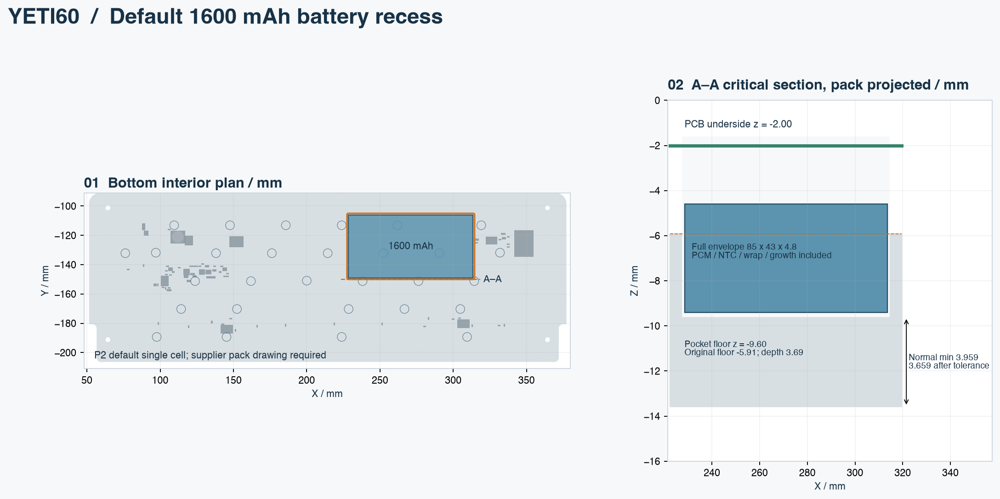

English | [Chinese](battery-study.zh-CN.md)

# Default single-cell battery and bottom recess

P2 selects **YETI60-BAT-1600-1S**, a custom protected pack based on Honcell HCP404074. The complete-pack design envelope is **85×43×4.8 mm**. The recess is included in the canonical [bottom STEP](../../mechanical/generated/yeti60-bottom.step); there is one default bottom, with the FELK60 exterior unchanged. C5 JSH remains the USB daughterboard.

This is the largest candidate found in the documented catalog/grid search. It is not an all-market or continuous-position maximum, and the finished pack still needs a supplier-signed drawing.



## Selection method and reliable sources

The [catalog snapshot](../../hardware/bom/cell-catalog.json) contains 249 Honcell and 402 Epec 3.7 V entries, retrieved on 2026-10-28 from the [Honcell table](https://www.honcell.com/lithium-battery/cells/hcp-lipo-battery-cells/1316) and [Epec table](https://www.epectec.com/batteries/lithium-prismatic-cells.html). No stock or price claim is made. Published values are retained, including the suspicious HCP256371 thickness of 25 mm; model codes are not used to silently correct data.

`screen_yeti60_batteries.py` tests entries of at least 1000 mAh, both 0°/90° orientations, a 1 mm XY grid, and pack tops at −4.6/−5.5/−6/−8 mm. Screening adds 10 mm to cell length, 2 mm to width and 0.8 mm to thickness for tabs/protection/wrapping/growth. It preserves the daughterboard/insert compartment, shell screw zones, component envelopes plus 0.5 mm, and ±0.4 mm pack XY allowance, requiring at least 3 mm wall after a 0.3 mm allowance. See the [screening report](../audit/yeti60-cell-screening.json). Finer positioning, other angles, other pack constructions or other catalogs could change the result.

| Found candidate | Published capacity | Screening outcome |
|---|---:|---|
| Honcell HCP404074 | 1600 mAh minimum in its individual sheet | Largest found; rounded complete envelope then checked with exact BRep geometry |
| Epec 502699 | 1450 mAh catalog value | Lower-capacity geometric candidate; not individually qualified |
| Epec 453969 | 1360 mAh catalog value | Lower-capacity geometric candidate; not individually qualified |

The [manufacturer's individual HCP404074 PDF](https://www.honcell.com/Public/Uploads/uploadfile/files/20240401/DATASHEETHCP4040743.7V1600mAhCELL2024.pdf), pp1–2, gives minimum 1600 / typical 1620 mAh at 0.2C and 23±2°C, 3.7 V nominal, 4.2 V charging, and 3.0 V discharge cutoff. Body maxima are 74.5×40.5×4.0 mm delivered, with thickness up to 4.3 mm after cycling; length excludes 6±1 mm tabs. The default pack budget rounds the screening size 84.5×42.5×4.8 upward to 85×43×4.8 mm. These allowances are engineering requirements, not a manufacturer's finished-pack drawing.

**Source discrepancy:** the charge rows label 0.2C as 270 mA and 1C as 1350 mA, inconsistent with 1600 mAh. Their explicit conditions are 270 mA over 0…45°C and 1350 mA over 15…45°C. Do not replace these with calculated 320/1600 mA or use the reference charge graph to promise a charge time. The supplier must correct/confirm the current limits, capacity test and permitted charger voltage tolerance in writing before order release.

## Exact selected geometry

| Quantity | Default P2 value |
|---|---|
| Complete pack | 85×43×4.8 mm, including protection, NTC, folded tabs, wrap and after-cycle growth |
| Pack bounds | X 228.5…313.5; Y −149…−106; Z −9.4…−4.6 mm |
| Pocket bounds | X 227.5…314.5; Y −150…−105 mm; corner radius 1 mm |
| Floor | z=−9.60 mm; original local inner floor −5.91; removal depth 3.69 mm |
| Removed volume | 14443.182 mm³ = 14.443 cm³ |
| Minimum normal wall | 3.958500 mm; **3.658500 mm** after the 0.30 mm allowance |
| Pack-to-fastener nominal clearance | 0.700 mm |
| Floor retention/gap budget | 0.200 mm, including tape/insulation thickness |
| Pack/case overlap | Zero for nominal and ±0.40 mm expanded XY envelopes |
| Components / protected insert zones | No collisions in the checked geometry |
| Minimum expanded-pack component gap | 0.555 mm to D2; exceeds the 0.50 mm requirement after ±0.40 mm XY allowance |
| Case union envelope | 325.700×125.200×31.190 mm; no scaling |

The exact BRep distance is measured from a conservative full rectangular pocket floor to the original 7° exterior underside, covering the entire floor rather than samples. With original plane normal `n` and point `p`:

```text
z_outer(x,y) = pz − [nx(x−px)+ny(y−py)]/nz
normal_wall = (z_floor − z_outer) × cos(7°)
remaining_wall = min(normal_wall) − 0.30 mm
```

The canonical bottom must remain one valid solid, have unchanged exterior bounding coordinates and zero material inside the cutter. Nominal and expanded pack boxes are checked against both shells. The 0.70 mm fastener gap leaves an illustrative `0.70−0.15(case floor)−0.05(retention)−0.15(PCB stack)−0.10(head)=0.25 mm`; these are imposed manufacturing budgets, not measured tolerances. A 3 mm residual wall is a geometric criterion, not resin strength certification.

## Electrical and procurement contract

P2 retains BQ24074 with R40=2.21k, R55=69.8k and R56=1.69k, all 1%; USB500 is enabled only after configuration. See the [current, timer, termination and runtime calculations](power-budget.md). The pack must independently interrupt charging outside a guaranteed **actual cell window within 15…43°C**, target 18…40°C including all sensor/IC tolerances, and provide separate third-wire 10k 103AT-2 NTC feedback. Ordinary voltage/current-only PCM or a two-wire pouch is not an equivalent substitute. J2/PHR-3 is custom: 1 PACK+, 2 PACK−, 3 NTC to PACK−.

The supplier must sign the complete envelope and lead exit/bend geometry, protection thresholds, thermal interruption, NTC coupling, charge-current limits and capacity. Insulate and retain the pack without pouch compression; the whole mounting system must fit the 0.2 mm floor budget. Do not use the old small-pack electrical configuration with this battery or the P2 charger with the old small pack.

FELK60 supplies exterior and plate datums; DELTA OMEGA at `64db818` informs separate battery/insulation/fastener BOM rows; [PH60 Rev.3](https://github.com/ph-design/PH60) informs purpose-designed battery accommodation. Their cell allowances do not establish YETI60 capacity. Resin creep/drop/insert pullout, full harness serviceability, supplier pack qualification and charge-to-termination remain physical acceptance work. No sample exists; RF/SI screening has started; antenna layout blockers remain open.

Rebuild in order: mechanical metadata, `build_yeti60_mechanical.py`, `check_yeti60_assembly.py`, `export_yeti60_render_meshes.py`, `study_yeti60_battery_pocket.py`, `screen_yeti60_batteries.py`, `draw_yeti60_assembly.py`. The [specification](../../mechanical/battery-pocket-study.json) and [BRep report](../audit/yeti60-battery-pocket.json) record the exact default.
