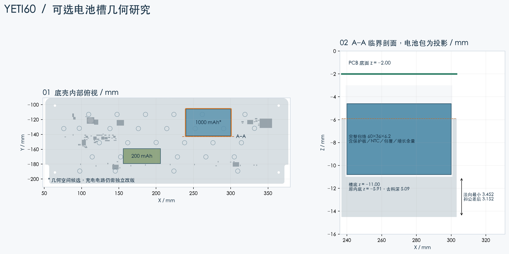

[English](battery-study.md) | 简体中文

# 底壳下挖及更大电池可行性

**局部下挖可在保持 FELK60 外部包围尺寸的情况下，预留完整 60×36×6.2 mm 电池包空间。但这不意味着 1000 mAh 电池可直接替换当前 200 mAh 电池。** 现有充电设定及安全计时器需要独立的大电池电气改版，见[功耗及充电计算](power-budget.zh-CN.md)。



## 几何及复算方法

源模型为带冷粘嵌件孔和开关检修孔的韧性树脂派生底壳，沿用 FELK60 坐标：X 向右、Y 向使用者方向变得更负、Z 向上。当前 PCB 底面 z=−2.00。上下壳外部联合包围尺寸仍为 **325.700×125.200×31.190 mm**。这里只验证一个候选位置，不宣称已经求得全壳可容纳的绝对最大电池。

| 项目 | 检查值 |
|---|---|
| 电池包完整最大包络 | 60.0×36.0×6.2 mm |
| 电池包坐标 | X 240.0…300.0；Y −142.0…−106.0；Z −10.8…−4.6 mm |
| 下挖槽坐标 | X 239.25…300.75；Y −142.75…−105.25 mm |
| 槽底／原内底 | z=−11.00／−5.91 mm；局部下挖深 5.09 mm |
| 内角半径 | 1.00 mm |
| 去料实体体积 | 11734.443 mm³，约 11.734 cm³ |
| 到倾斜外底面的最小法向壁厚 | 3.452489 mm |
| 扣除 0.30 mm 制造余量后 | 3.152489 mm，大于本研究**选定**的 3.0 mm 几何下限 |
| 到保守 PCB 紧固件包络的名义间隙 | 0.700 mm |
| 槽底固定／间隙预算 | 0.200 mm，须包含实际胶带及绝缘材料 |
| 电池包名义／XY 扩大包络与外壳相交体积 | 均为 0 mm³；XY 各方向扩大 0.40 mm，计入 0.25 mm 放置偏差及 0.15 mm 壳体余量 |
| 元件包络及嵌件保护区冲突 | 当前被检查模型中无冲突 |
| 派生底壳实体 | 单个有效 BRep 实体，外部包围坐标保留 |

原外底面随 7° 打字角倾斜，向前端逐渐变薄。竖直射线核对得到：Y=−115 处约 11.98 mm，−140 处约 8.91 mm，−180 处约 4.00 mm，因此应优先在后部局部下挖，不能均匀削薄前部底板。

壁厚最终验证采用**精确 BRep 最小距离**，从覆盖新槽底的保守矩形区域测到原倾斜外底大平面，覆盖整个槽底及角点，不只依靠采样网格。平面计算为：

```text
外底 z(x,y) = z0 − [nx(x−x0)+ny(y−y0)]/nz
竖直壁厚 = 槽底 z − 外底 z
法向壁厚 = 竖直壁厚 × cos(7°)
最差壁厚 = 最小法向壁厚 − 0.30 mm
```

报告记录实际平面法向、位置及精确距离。圆角槽还检查了包含 XY 制造／放置余量的矩形电池包。0.70 mm 紧固件间隙可按 `0.70−0.15（槽底）−0.05（固定材料）−0.15（PCB 结构）−0.10（螺钉头）=0.25 mm` 预留竖直预算；这些是要求供方满足的制造条件，不是已测得的供方公差。模组和 USB 子板附近的区域保持不挖。

在固定 CAD 运行环境执行 `python scripts/study_yeti60_battery_pocket.py`。可编辑[研究规格](../../mechanical/battery-pocket-study.json)、[可选底壳 STEP](../../mechanical/generated/yeti60-bottom-battery-pocket.step)和[检查报告](../audit/yeti60-battery-pocket.json)与基准底壳分别保存。若 PCB 几何变化，应先重新生成基准装配报告。

## 容量证据与电池包结构

[Honcell HCP-503450 的 2024 年裸电芯规格](https://www.honcell.com/Public/Uploads/uploadfile/files/20241220/DATASHEETHCP5034503.7V1000mAhCELL2024.pdf)给出：0.2C、23±2°C 下最低 1000 mAh，标称 3.7 V；本体最大 50×34 mm，不含极耳；交付最大厚度 5.0 mm，循环后最大 5.4 mm；充电终止 4.2 V、放电截止 3.0 V。标准充电为 0…45°C 下 200 mA，更高最大电流另有温度条件。这是裸电芯规格，不是完整电池包批准图。

拟定的 **60×36×6.2 mm** 完整包络为极耳折叠连接、保护板、独立充电温度保护、NTC 和包覆预留空间。这是工程设计预算，不是厂商承诺图纸。组包厂必须确认极耳弯折限制、焊点绝缘、保护板／NTC 厚度、循环后增长及容量，并签署完整电池包图。普通两线“503450”不能直接满足自定义三线极性及温度保护要求。

不能按槽体积等比例推算容量，也不能按六位尺寸代码推定容量。当前 200 mAh／2.9 mm 电池同样仍是待供方确认的定制目标。1000 mAh 有原厂裸电芯最低容量依据，但完整组包验收和电气兼容性仍须分别满足。

## 参考设计及结论

| 参考 | 可借鉴之处 | 不能直接套用之处 |
|---|---|---|
| FELK60，固定源提交 `624e6a7` | 保留外部尺寸、定位板和胶棉定位，只改选定的内部底板 | 原金属螺纹底孔不能证明树脂嵌件可靠性 |
| DELTA OMEGA，检查版本 `64db818` | 材料表分别记录电池、绝缘、紧固件和键帽间隙 | 其分体 MX 结构和电池包络不能直接套入本壳 |
| [PH60 Rev.3](https://github.com/ph-design/PH60) | 专用可拆电池托盘；README 列出最大 100×50×5 mm 空间 | 外壳及 PCB 不同，其空间和续航不能证明本方案 |

当前冻结的 P1 仍采用**基准底壳＋200 mAh 电气配置**。较大电池槽保留为下一电气版本的样机选项，不扩大外壳，不暗中替换基准电池。可拆托架或胶粘方案必须满足 0.2 mm 槽底预算，不能挤压软包，须保护出线口。完整线束路径、实际树脂强度／蠕变、振动跌落、嵌件抗拔和实物电池仍需验收；选定的 3 mm 壁厚仅为工程几何目标，不是树脂结构认证。
