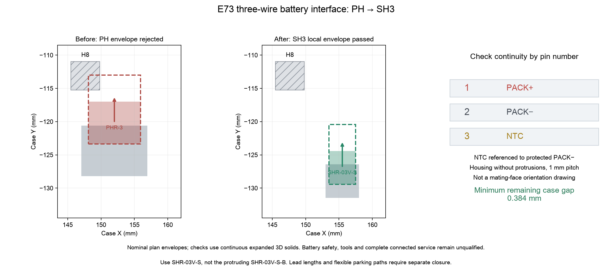

English | [Chinese](e73-battery-service.zh-CN.md)

# E73 SH3 battery connector repair

**Historical checkpoint:** this document describes commit `7aab295`; evidence links and reproduction belong to that commit. Subsequent power-stage changes invalidated the old local reports. The current development direction is the [E73 lower-right migration](e73-hhkb-corner.md). This document does not release the relocated candidate.

**This is an unreleased E73 candidate.** The canonical PH mainboard, firmware and manufacturing files have not been replaced. This page extends the [USB repair](e73-usb-repair.md) and [local case checks](e73-usb-local-fit.md). C5 UDB-C-JSH remains unchanged.

## Interface and materials

Candidate J2 changes to **JST SH, 1.0 mm pitch**, at PCB **(155.5, 129.0) mm, 0°, B.Cu**. Pin 1 is protected PACK+, pin 2 protected PACK− / GND, and pin 3 the separate pack NTC referenced to PACK−. Source identity, schematic path and numbered electrical roles are retained. It is not interchangeable with the canonical PH 2.0 mm header/housing.

| Item | Specification | Quantity per keyboard | Procurement note |
|---|---|---:|---|
| Mainboard J2 | JST SM03B-SRSS-TB(LF)(SN), side entry, three positions | 1 | No matched stock credit; replaces the PH header |
| Battery mating housing | JST SHR-03V-S, without protrusions, 4.0 mm nominal width | 1 | Prefer supplied/crimped with the protected pack |
| Battery contacts | JST SSH-003T-P0.2-H | 3 | Included in the pack assembly if supplied; do not count twice |
| Battery conductors | Three AWG28 stranded copper wires, insulation OD 0.4–0.8 mm | 3 | Final lead lengths and preformed routes remain open |

The [JST SH catalog](https://www.jst.com/wp-content/uploads/2025/06/eSH.pdf), pages 1–3, supports these contact/wire combinations and nominal geometry. **SHR-03V-S-B has protrusions and is 6.0 mm wide; it is outside the selected 4.0 mm housing envelope.** Do not substitute it based only on the three-position count. JST's 1 A rating at AWG28 does not qualify battery fault interruption, contact heating or charging safety.

The [candidate purchase tables](https://github.com/wZuck/YETI60/blob/7aab295c219d1e1cf696efc4cdb52380bec64e19/hardware/e73-usb-repair/mainboard-purchase.csv) specify the SH header and installed maximum height. Mainboard totals remain **75 fitted parts, 8 planned stock uses, 67 net purchases**; housing/contacts are separate from those totals. The original inventory workbook is untouched.

Retain the electrical and full-pack requirements in the [battery specification](battery-pack-specification.md): protected 1S pack, 85×43×4.8 mm complete envelope, separate third-wire NTC and independent thermal interruption. **For this candidate, override that baseline document's PH connector and lead-length references with this SH3 interface.** A two-wire cell or ordinary voltage/current-only PCM is not equivalent. Supplier confirmation, cell data discrepancies, thermal protection and full harness geometry remain open; this checkpoint does not authorize a pack order.

## Native PCB changes

The [E73-specific repair record](../../hardware/e73-battery-service-spec.json) identifies 14 retired source segments, one APLEX_EN_PIN_0 arc transferred from B.Cu to In2.Cu, 12 replacement segments and **two ordinary 0.50 mm land / 0.30 mm drill through vias**. The new vias are on that control net, not inside SMD lands. No special JLC process is added. The three battery nets reconnect to the same numbered pins; other component nodes, 43 E73 lands, sensing geometry, outline and mounting axes are preserved.

The frozen SH3 pattern comes from the KiCad Connector_JST library; [source pattern](../../hardware/e73-battery-source.pretty/JST_SH_SM03B-SRSS-TB_1x03-1MP_P1.00mm_Horizontal__J2.kicad_mod) and [library license](https://www.kicad.org/libraries/license/). The builder flips the actual frozen F.Cu pattern through KiCad, preserves the original J2 instance/pin identities and updates the power-sheet footprint property, frozen library map, netlist, component data and purchase rows together. No Raytac acceptance result is imported.

## M03 case and rigid motion

Use the one [M03 STEP](https://github.com/wZuck/YETI60/blob/7aab295c219d1e1cf696efc4cdb52380bec64e19/hardware/e73-usb-repair/mechanical/yeti60-e73-usb-battery-bottom-m03.step) / [STL](https://github.com/wZuck/YETI60/blob/7aab295c219d1e1cf696efc4cdb52380bec64e19/hardware/e73-usb-repair/mechanical/yeti60-e73-usb-battery-bottom-m03.stl) generated by the local-fit checker. It contains the USB recess and a second internal battery-header recess: **X 151–160, Y −134 to −119, Z −6.30 to −5.40 mm**, 0.5 mm corner radius. The FELK60 exterior, mounting axes, insert supports and gasket bearing height remain intact. The canonical selection remains M01 pending complete candidate acceptance.

J2's installed header and housing height limit is **3.2 mm below the local PCB**, including solder/seating. Body/placement growth is 0.1 mm per XY direction from the complete STEP/native Fab union, with a separate 0.25 mm installed-board point allowance. Plate, shoulder, film, mounted bow, complete 1.44–1.76 mm PCB thickness interval and case coordinate errors are counted as in the linked local-fit specification. These are inspected assembly requirements, not supplier-certified tolerances.

The [battery report](https://github.com/wZuck/YETI60/blob/7aab295c219d1e1cf696efc4cdb52380bec64e19/hardware/e73-usb-repair/audit/battery-service.json) checks actual E73-positioned J2 STEP geometry against all **five** native copper lands. It rejects a 1 mm model shift, checks the header/mated housing/continuous **4 mm +case Y** withdrawal, and reproduces the old E73 PH housing-envelope collisions with H8 and the lower shell. Twelve fit checks include three individual thicknesses and an envelope enclosing the full interval. Retained parts and fasteners still use proxies; their full tolerance/model closure is not implied.



Disconnect external USB and switch off the keyboard before physical handling. The arrow describes rigid housing motion only. Fingers/tools, own-wire bending, slack, loose-plug parking and lifting the connected stack are not accepted. The report's wire-exit center is explicitly provisional; supplier detail dimensions must be confirmed before final routing. Do not copy the Raytac battery-wire lengths.

## Reproduce and outstanding work

Use KiCad Python for the builder, native checker and `tests/audit/test_e73_usb_repair.py`. Then, with the pinned CAD runtime, run `study_e73_usb_return.py`, `check_e73_usb_local_models.py`, `check_e73_usb_local_fit.py` and finally:

```sh
uv run --python 3.14.7 --with-requirements requirements-audit.txt python scripts/check_e73_battery_service.py
```

The native suite now has 11 methods, including battery-positive/NTC swap and header-displacement faults. Current PCB changes require candidate-bound firmware/calibration identity and new CAM; canonical PH binaries/files are not its matched release. Complete flexible wiring, remaining models, left power/package/thermal closure, supplier battery approval and physical USB-with-charging, BLE, ADC, RF and fit tests remain required.
