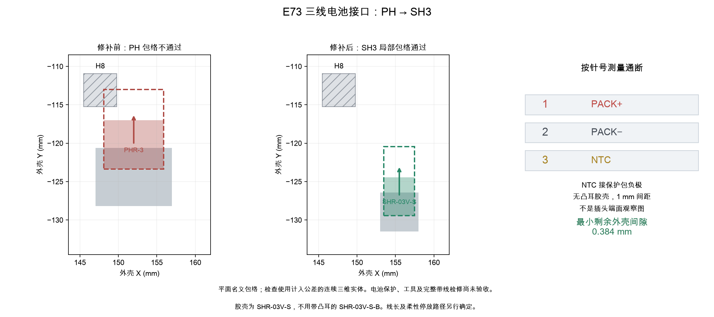

[英文](e73-battery-service.md) | 中文

# E73 SH 三针电池接头修补

**历史阶段记录：**本文描述提交 `7aab295`，证据链接已冻结到该提交，复现也应使用该提交。之后的电源布局修补使本地旧报告失效；当前开发方向为[E73 右下角迁移](e73-hhkb-corner.zh-CN.md)。本文不作为迁移后候选的放行依据。

**这是尚未放行的 E73 候选方案。** 正式 PH 主板、固件和制造文件尚未替换。本页接续 [USB 修补](e73-usb-repair.zh-CN.md)和[局部外壳检查](e73-usb-local-fit.zh-CN.md)。C5 UDB-C-JSH 子板保持不变。

## 接口与材料

候选 J2 改为 **JST SH、1.0 mm 间距**，PCB 坐标为 **(155.5, 129.0) mm、0°、B.Cu**。1 脚为保护包正极，2 脚为保护包负极／GND，3 脚为相对于保护包负极的独立 NTC。保留原实例标识、原理图路径和编号对应的电气功能。它不能与正式基线的 PH 2.0 mm 插座／胶壳互换。

| 材料 | 规格 | 每把键盘数量 | 采购备注 |
|---|---|---:|---|
| 主板 J2 | JST SM03B-SRSS-TB(LF)(SN)，侧插三针 | 1 | 没有匹配库存抵扣；替换原 PH 插座 |
| 电池配套胶壳 | JST SHR-03V-S，无凸耳，名义宽度 4.0 mm | 1 | 优先由保护电池包供应商配套压接 |
| 电池端子 | JST SSH-003T-P0.2-H | 3 | 若已随电池包提供，不再重复采购计数 |
| 电池导线 | 三根 AWG28 多股铜线，绝缘外径 0.4–0.8 mm | 3 | 最终线长和预成形路径仍待完成 |

[JST SH 官方目录](https://www.jst.com/wp-content/uploads/2025/06/eSH.pdf)第 1–3 页支持这些端子／线径组合及名义几何。**SHR-03V-S-B 带凸耳，宽 6.0 mm，不在所选 4.0 mm 胶壳包络内。** 不能仅按三针数量替代。JST 在 AWG28 条件下的 1 A 额定值不能证明电池故障切断、触点温升或充电安全已经验收。

[候选采购表](https://github.com/wZuck/YETI60/blob/7aab295c219d1e1cf696efc4cdb52380bec64e19/hardware/e73-usb-repair/mainboard-purchase.zh-CN.csv)已指定 SH 插座和安装高度限值。主板仍为 **75 只装板元件、计划使用库存 8 只、净补购 67 只**；胶壳／端子不计入该主板数量。原库存工作簿未修改。

保留[电池规格](battery-pack-specification.zh-CN.md)中的电气和完整组包要求：受保护的单节电池、85×43×4.8 mm 完整包络、第三线独立 NTC，以及独立温度断充。**对于这个候选，该基线文档中的 PH 接头与引线长度改按本页 SH 三针接口处理。** 两线裸电芯或仅做电压／电流保护的普通保护板不能等效代替。供应商确认、电芯资料矛盾、温度保护及完整线束几何仍未收尾；本检查点不代表可以下单电池包。

## 原生 PCB 改动

[E73 专属修补记录](../../hardware/e73-battery-service-spec.json)明确列出 14 段移除的原走线、一段从 B.Cu 转移至 In2.Cu 的 APLEX_EN_PIN_0 圆弧、12 段替换走线，以及 **两个焊盘直径 0.50 mm／钻孔直径 0.30 mm 的普通贯通过孔**。新增过孔位于该控制网络，不在贴片焊盘内，没有引入特殊 JLC 工艺。电池三根网络接回原编号针脚；其他元件节点、43 个 E73 焊盘、感应几何、板框和安装轴线保持不变。

冻结的 SH 三针封装来自 KiCad Connector_JST 库：[来源封装](../../hardware/e73-battery-source.pretty/JST_SH_SM03B-SRSS-TB_1x03-1MP_P1.00mm_Horizontal__J2.kicad_mod)、[库许可](https://www.kicad.org/libraries/license/)。生成器通过 KiCad 翻转实际冻结的 F.Cu 封装，保留 J2 原实例和针脚标识，并同步更新电源页封装属性、冻结库映射、网表、元件数据和采购行。未继承 Raytac 的验收结果。

## M03 外壳与刚性插拔

只使用局部匹配度检查生成的一份 [M03 STEP](https://github.com/wZuck/YETI60/blob/7aab295c219d1e1cf696efc4cdb52380bec64e19/hardware/e73-usb-repair/mechanical/yeti60-e73-usb-battery-bottom-m03.step)／[STL](https://github.com/wZuck/YETI60/blob/7aab295c219d1e1cf696efc4cdb52380bec64e19/hardware/e73-usb-repair/mechanical/yeti60-e73-usb-battery-bottom-m03.stl)。它合并 USB 内凹和第二处电池接头内凹：**X 151–160、Y −134 至 −119、Z −6.30 至 −5.40 mm**，圆角半径 0.5 mm。FELK60 外形、安装轴线、嵌件支撑区与垫条承台高度保留。完整候选验收前，正式装配选择仍是 M01。

J2 插座和胶壳安装后低于局部 PCB 底面的高度上限为 **3.2 mm**，包含焊接和就位。本体／焊接位置相对完整 STEP／原生 Fab 合并包络，在 XY 每方向最多外扩 0.1 mm，另外计入 0.25 mm 的安装后 PCB 点位误差。定位板、支柱、绝缘膜、装配板弯、完整 1.44–1.76 mm 板厚区间及外壳坐标误差，按所链接的局部匹配度规格计算。这些是实测装配要求，不是供应商已保证的公差。

[电池接头报告](https://github.com/wZuck/YETI60/blob/7aab295c219d1e1cf696efc4cdb52380bec64e19/hardware/e73-usb-repair/audit/battery-service.json)将实际 E73 坐标下的 J2 STEP 模型与全部 **五处**原生铜焊盘匹配；能拒绝 1 mm 模型位移，检查插座／已连接胶壳／沿外壳 Y 增大方向连续 **4 mm** 拔出，并复现旧 E73 PH 胶壳包络与 H8 和底壳相交的反例。12 项匹配检查包括三种单独板厚和覆盖整个连续区间的包络。其余元件和紧固件仍使用代理包络，不能据此宣称它们的完整公差和模型已验收。



实物操作前拔掉外部 USB，并关闭键盘电源。箭头只表示刚性胶壳运动，尚未验收手指／工具、线材弯曲、余量、松开胶壳的停放或带线抬起整套内胆。报告中的出线中心明确属于暂定值；完整布线验收前须确认供应商详细尺寸。不能照抄 Raytac 的电池线长。

## 复现与剩余工作

生成器、原生检查器和 `tests/audit/test_e73_usb_repair.py` 使用 KiCad Python。随后在锁定的 CAD 环境中依次执行 `study_e73_usb_return.py`、`check_e73_usb_local_models.py`、`check_e73_usb_local_fit.py`，最后执行：

```sh
uv run --python 3.14.7 --with-requirements requirements-audit.txt python scripts/check_e73_battery_service.py
```

原生测试现有 11 项方法，包含电池正极／NTC 接反和接头位移反例。当前 PCB 改动要求重新绑定候选固件／校准标识并生成制造文件；正式 PH 版本的旧固件／文件不构成它的配套发布。完整柔性线束、其余模型、左侧电源／封装／温升收尾、电池供方验收，以及实物 USB 同时充电、蓝牙、模拟采集、射频和装配测试仍需完成。
