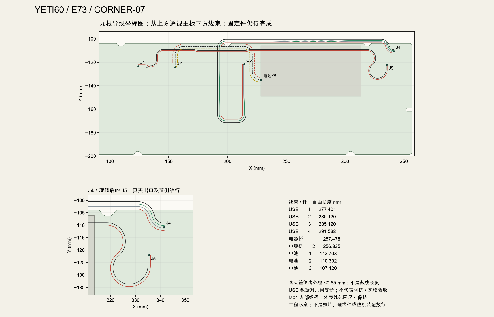

[English](e73-corner-harness.md) | 中文

# E73 右下角方案线束与内部线槽

本页记录 M04 基线。M05 首件请按 [M05 打印与布线清单](../build/e73-m05-prototype.zh-CN.md) 选取线长和配套零件。

CORNER-07 使用**在原坐标旋转 180° 的主板 J5**和已经制作的 **C5 JSH 子板**。J5 朝外壳前侧出线，电源线可与 J4 USB 线分开绕行。连接器附近的 GND、USB_FEED、ROW_DRV4 局部修补在基础布线补丁之后重放，并通过原生 DRC 检查。

**这是工程绕线检查，不是整机关壳验收。** 证据见[导线／插头／障碍物检查](../../hardware/e73-hhkb-corner/audit/harness-study.json)和[来源规格](../../hardware/e73-corner-harness-spec.json)。理线件静态试装和整机图已纳入交付。实际安装和维修动作仍须验收。配图是坐标示意，不是照片或实测装配。



[每根导线的长度表](../../hardware/e73-hhkb-corner/mechanical/harness-conductors.zh-CN.csv)

## 接法与采购

| 线束 | 主板端 | 另一端 | 网络／实际针序 |
|---|---|---|---|
| USB，4 根导线 | J4，SHR-04V-S | C5 四针接口，SHR-04V-S | 1→1 USB 供电，2→2 D−，3→3 D+，4→4 GND |
| 电源桥，2 根导线 | J5，SHR-02V-S | J1，SHR-04V-S | J5.1→J1.1 VBUS；J5.2→J1.4 GND；J1.2／J1.3 留空 |
| 保护电池包引线，3 根 | J2，SHR-03V-S | 保护包／独立 NTC | 1 PACK+，2 PACK−，3 为以 PACK− 为参考的独立 10k NTC |

净需求：**SHR-04V-S 三个、SHR-02V-S 一个、SHR-03V-S 一个、SSH-003T-P0.2-H 压接端子 15 个**，包括电池包的三个端子。若保护包自带插头／引线，不重复购买。板上插座已计入 75 个主板元件或现有 C5。

使用 AWG28 多股铜线，**含公差的实测绝缘外径不超过 0.65 mm**，电流额定值满足电池／USB 要求，并与正品 SH 端子匹配。薄壁线以供应商图纸为准；仅线规相同不能确定绝缘外径。建议颜色：红正极、黑地、白 D−、绿 D+、黄 NTC。弯曲与压接适配仍需到货核实，普通粗硅胶线不能直接代入此几何。

每根导线的标称**自由长度**和实际端点坐标保存在检查报告中。自由长度沿绝缘层，在**两端插头出线平面之间**测量；电池端量到保护包应力释放面，**不是裸线裁切长度**。供应商须另加正确的端子插入／剥线余量，并按最终固定治具核实样品。旧 150 mm 等长线不适用。两根数据线几何等长，外侧供电／地线因弯曲而长度不同。固定件尚未冻结，暂不批量制作线束。

USB 数据对在后段绕 3.25 圈，下降段半圈，返回段四分之一圈，相位最终恢复实际端点针序。这不代表已经获得合格的 90 Ω 线材或通过 USB 眼图。保持数据对成对，核实完成线束的电气性能，不能凭 AWG 或圈数认定阻抗。

## 外壳与电池接口

[M04 底壳 STEP](../../hardware/e73-hhkb-corner/mechanical/yeti60-e73-corner-bottom-m04.step)和 [STL](../../hardware/e73-hhkb-corner/mechanical/yeti60-e73-corner-bottom-m04.stl)在已审查 M03 基线上增加**内部**后线槽，保留外包围尺寸。新增切削按原生外表面及四个 M3、四个 M2 嵌件支撑保护区检查；这是几何检查，不是结构有限元或树脂性能验收。扣除指定外壳公差后，剩余壁厚约 **2.01 mm**。

保护包主体仍须不超过 85 ×43 ×4.8 mm，包括保护板、传感器、包膜、极耳和增长余量。要求的**外部引线出口**位于主体最小 X／Y／Z 角为原点的局部 `[0,14,4.5]` mm，朝 −X；对应外壳坐标 `[228.5,-135,-4.9]` mm。外部绝缘导线另行检查，不计入保护包主体方盒。请供应商在同一张图中画清完整应力释放、主体和引线出口，不能用裸电芯尺寸替代。

## CAD 检查覆盖范围

- 由原生 PCB 导出的 J1／J2／J4／J5 针序、安装面和网络，以及固定的 C5 接口。
- 九根圆导线的连续实体；绞合数据对使用完整保守管状包络，不能用稀疏采样点替代碰撞检查。
- 全部 75 个实装元件的原生 XY 包络及明确的到货高度限制、28 处已安装 PCB 紧固件、C5 标称 STEP 与四处紧固件、插头包络、主板、上／底壳，以及扩大的完整保护包主体。
- 标称 1.6062 mm CAD 包络及普通 PCB 成品 1.44／1.76 mm 两端点。最小静态弯曲半径 4 mm；整条安装路线按 ±0.25 mm 包络检验；其后最小净距 0.15 mm。外壳检查另扣坐标误差及 0.002 mm 计算保护量。
- 同束非绞合导线另用 ±0.10 mm 相对包络，不把整束共同移动重复累计。只有绞合数据对允许绝缘层有意接触；实际股线、端子和抗拉未验收。
- 起终点接触豁免局限于局部出口，不能整体忽略插座或电池主体。

独立线束扩大包络间约 0.156 mm、导线至 PCB 约 0.165 mm 的最小间隙是较紧的工程检验边界，**不能证明未经测量的手工理线或任意打印公差一定装得下**。需核实最终治具及安装路线。固定件、胶／膜公差、PCB 退出和维修动作纳入后才能放行整机装配。

## 重现

当前原生 PCB、局部模型与铜检查完成后运行：

```sh
/Applications/KiCad/KiCad.app/Contents/Frameworks/Python.framework/Versions/Current/bin/python3 scripts/export_e73_harness_map.py
uv run --python 3.14.7 --with-requirements requirements-audit.txt python scripts/check_e73_corner_harness.py --publish
```

失败时检查返回非零。必须核实全部 `source_sha256` 及输出校验值，不能将历史绿灯当成当前证据。`python3 tests/audit/test_e73_connector_repair.py` 验证普通工艺修补限制；原生布局故障注入也会拒绝错误的 J5 朝向。
