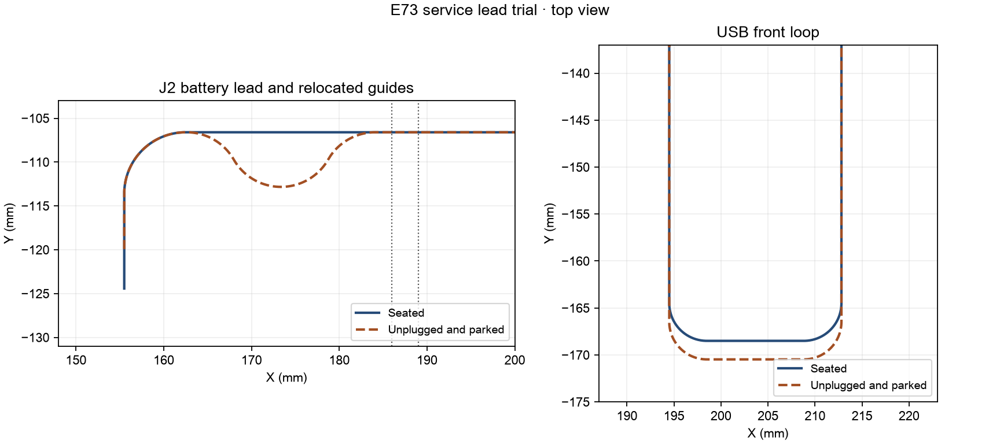

English | [Chinese](e73-corner-service.zh-CN.md)

# E73 case assembly and removal checks

This page records the M04 baseline. For the first article, use the [M05 print checklist and wire lengths](../build/e73-m05-prototype.md).

This check covers the CORNER-06 PCB, the M04 bottom, the installed C5 daughterboard and the selected nine-wire harness. Removing the top shell leaves the J2 battery and J4 USB plugs under the mainboard. Keep the keyboard unpowered for dry fitting.

## Findings for the selected harness

| Check | Result |
|---|---|
| Pull the J4, J2 and C5 housing proxies along their respective mating axes | Nine continuous 4 mm sweeps clear the checked rigid obstacles at 1.44, 1.6062 and 1.76 mm PCB thickness. The check excludes each connector's own header and the PCB mating plane. |
| Reach a plug from above | A straight 2 × 2 mm tool at each wire exit intersects the PCB by 5.76–7.04 mm³ across those thicknesses. This rules out that tool approach. |
| Raise the bare PCB 25 mm at fixed XY | The bare board has 0.800 mm nominal clearance to the bottom. The PCB-mounted guides also clear the bottom in this separate check. |
| Raise the deck with its power bridge as the USB and battery routes remain in their guides | The power bridge's pin 1 conductor intersects USB D+ at the checked 0.75 mm height. Pulling the deck straight up in this configuration can catch the wire. |

## Alternate wiring trial

The trial drops the USB section sooner and moves the power bridge forward locally. At the crossover near case X 193 mm, the power bridge passes **above** the USB route. It retains all connector endpoints and pin assignments. The CAD trial meets the 0.15 mm residual static gap and 4 mm minimum bend requirement at all three PCB thicknesses. The measured geometric USB pair skew stays below 1 mm.

The 14 moving-versus-fixed conductor pairs at each thickness maintain at least 0.15 mm clearance through the modeled 0–25 mm vertical lift. The proof uses an envelope of the 0.65 mm maximum wire outer diameter plus 0.25 mm placement allowance per side, with an additional envelope around the twisted data pair. Interval bounds cover the continuous motion between distance evaluations.

The [machine-readable report](../../hardware/e73-hhkb-corner/audit/service-motion.json) includes the trial's free lengths. Use the [selected harness table](e73-corner-harness.md) for the current build. The alternate still requires retention, parked plug and tool clearance, controlled mating/release with strain relief, and data checks. The 4 mm trial stroke is a geometric input. Sample housing release travel and the force needed to release or re-seat it still need to be measured. [JST SH series drawing](https://www.jst.com/wp-content/uploads/2025/06/eSH.pdf)

## Access and rigid lift trials

At each thickness, the PCB, fitted component and mount proxies, power-bridge housings and board-mounted retainers clear the bottom, C5, battery and case-mounted retainers by more than 0.48 mm throughout a 25 mm straight lift. This rigid-body trial assumes the J2 and J4 plugs are already out of the lift path.

Two hypothetical underside openings admit the geometric tip envelopes of a pair of jaws throughout 4 mm of axial travel. The J4 opening is 11.50 × 7.50 mm and the J2 opening is 6.50 × 11.50 mm in XY. The tips clear the checked solid obstacles by at least 0.30 mm at all three thicknesses, and the openings avoid the insert guards. These sizes describe a CAD experiment. A workable solution needs room for the actual tool, wire movement and connector parking, plus closure parts and strength checks for any opening. The supplied M04 shell uses its existing geometry.

The [M05 mechanical prototype](../build/e73-m05-prototype.md) pairs the bottom and two removable covers with its own checked wire lengths, data winding plan and relocated battery guides. Use those files together for dry fitting.

## Cable feed and parking trial

The trial disconnects J2 first and J4 second. It translates each housing along its extraction axis, 4.50 mm for J2 and 4.00 mm for J4, then lowers it 0.45 mm. The two-step housing sweeps clear the checked rigid geometry at all three thicknesses. They approach within 0.10 mm of the PCB before lowering. Once parked, the housings clear the checked rigid objects by more than 0.50 mm during the 25 mm PCB lift. A real tool still needs to reach and move the actual housings through the full sequence.

The battery leads combine the three-pin fan-out and the height change at J2. A bow starts at case X 162.60 mm, ahead of the proposed battery guide positions at X 186 and 189 mm. The USB cable takes up its extra length by deflecting its front loop by up to 2 mm. Both moves require that the installed guides allow the leads to feed along their slots.

The [sampled-pose report](../../hardware/e73-hhkb-corner/audit/service-leads.json) covers seven connector poses at each of the three board thicknesses. The swept wire volumes in each pose clear the checked obstacles by at least 0.15 mm after the stated routing allowances. The worst change in a conductor's modeled free length is under 0.06 mm. The report also checks guide capture and the parked housings. Clearance between poses, actual wire motion and friction, contact strain and the finished covers still require qualification. Build wire lengths and guide locations remain those of the current delivery.

The [plate envelope report](../../hardware/e73-hhkb-corner/audit/service-reference.json) separately sweeps the steel plate's tolerance-expanded DXF outline through 25 mm of vertical removal against the M04 bottom. The remaining gap after the case tolerance and geometric allowance is 0.188 mm. The top shell is removed for this check.

## Dry fit and bench verification

1. Verify the board, USB, charging and keys outside the case using the [first-article record](../testing/e73-first-article.md).
2. For mechanical checks, use disconnected harnesses and an inert pack-size gauge. Temporarily locate the retainers. Check that a tool can grip each housing and release it along its mating axis without loading the leads or the PCB header.
3. Confirm where each unplugged housing and lead can park before moving the deck. During insertion and removal, inspect them and the power crossover for catching, pinching, strain and damage. Record the tool and motion in the first-article record before permanently attaching the retainers or closing the case.
