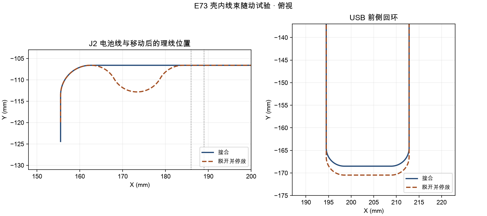

[English](e73-corner-service.md) | 中文

# E73 关壳装拆检查

本次检查针对 CORNER-05 主板、M04 底壳、已制作的 C5 子板和当前九根导线。拆掉上壳后，J2 电池插头和 J4 USB 插头仍在主板下方。机械试装全程断电。

## 当前线束的检查结果

| 检查动作 | 结果 |
|---|---|
| 分别沿配合轴线拔出 J4、J2 和 C5 插头 | 在 1.44、1.6062 和 1.76 mm 三种板厚下，9 项连续 4 mm 胶壳行程均避开了所检刚体。计算排除了插头所属的插座及 PCB 配合面。 |
| 从上方伸工具到插头 | 在各插头出线处，截面 2 × 2 mm 的直工具与 PCB 相交 5.76–7.04 mm³。这条入口不可用。 |
| 平移抬升裸 PCB 25 mm | XY 坐标固定时，裸板与底壳的最小标称间隙为 0.800 mm。单独检查随 PCB 移动的理线件时，也未撞到底壳。 |
| USB 和电池线留在槽内，垂直抬起带电源桥的叠层 | 在采样的 0.75 mm 抬升位置，电源桥 1 号导线与 USB D+ 导线相交。按这个动作提板会卡线。 |

## 备选改线试验

试验将 USB 线束提前下沉，电源桥在交叉处局部向前绕。在外壳坐标 X 约 193 mm 处，电源桥从 **USB 上方**经过。各插头端点和针序保持一致。三种板厚均满足静态余隙至少 0.15 mm、最小弯曲半径 4 mm，USB 数据双线的几何长度差小于 1 mm。

每种板厚各检查 14 对运动导线与留在底壳的导线。在模拟的 0–25 mm 连续抬升内，各对均保有至少 0.15 mm 间隙。单线包络计入 0.65 mm 最大线径和每侧 0.25 mm 位置裕量，另为绞合数据对保留绞合包络。区间界同时覆盖了测距点之间的运动。

[数据报告](../../hardware/e73-hhkb-corner/audit/service-motion.json)记录了备选线长。当前制作仍使用[现行线束表](e73-corner-harness.zh-CN.md)。备选走法仍需验证理线件、拔下插头的停放、工具可达性、推入／退出时的应力释放和数据质量。4 mm 为模型的试验行程，实际插头的脱开行程与插拔力需要用样品测量。[JST SH 系列规格图](https://www.jst.com/wp-content/uploads/2025/06/eSH.pdf)

## 工具入口与刚体抬升试验

在三种板厚下，PCB、焊接元件及安装件包络、电源桥插头与板载理线件一起直线抬升 25 mm 时，和底壳、C5、电池及壳载理线件均有大于 0.48 mm 的间隙。这项刚体试验假设 J2、J4 插头已移出抬升路径。

在底壳开两个试验孔后，两只工具钳口的模型能沿插头轴线移动 4 mm。J4 开口的 XY 尺寸为 11.50 × 7.50 mm，J2 为 6.50 × 11.50 mm。三种板厚下，两侧钳口与所检刚体的间隙至少 0.30 mm，试验孔避开了螺纹嵌件的保护区。这些尺寸用于 CAD 试验。若采用这种走法，还要验证完整工具、导线随动、拔下插头停放、开口封盖及壳体强度。交付件继续使用现行 M04 底壳。

[M05 机械试制件](../build/e73-m05-prototype.zh-CN.md)将底壳和两只可拆盖与专用线长、数据对绞合图和移位后的电池理线件配套。试配时使用该页同一套文件。

## 线束随动与插头停放

试验先断开 J2，再断开 J4。J2 轴向移动 4.50 mm，J4 移动 4.00 mm，然后各下沉 0.45 mm。三种板厚下，两段连续行程均避开了所检刚体，下沉前插头与 PCB 的最近间隙为 0.10 mm。停放后，主板在 25 mm 抬升行程内与两个插头之间的刚体间隙大于 0.50 mm。仍需用实际工具贯通整段拆装动作。

J2 的三线分线与高度变化在同一段弯曲中完成。电池线从外壳坐标 X 162.60 mm 开始向前形成侧弯，理线位置拟移至 X 186 和 189 mm。USB 前侧回环最多向前变形 2 mm，吸收拔出产生的余量。两处都需要导线能在理线槽内沿轴向移动。

[姿态检查报告](../../hardware/e73-hhkb-corner/audit/service-leads.json)覆盖三种板厚各七个插头姿态。每个姿态内以各根导线的完整扫掠体做检查，扣除定位裕量后，导线与所检障碍的间隙至少 0.15 mm。单根导线在各姿态中的模型自由长度差小于 0.06 mm。报告还检查了导线入槽和插头停放。姿态之间的连续过程、实物线材变形与摩擦、触点受力及封盖仍待验收。现行交付的制线长度和理线件位置保持原版。

[定位板包络报告](../../hardware/e73-hhkb-corner/audit/service-reference.json)以实际 DXF 外轮廓及公差，另行检查钢定位板垂直抬升 25 mm 的完整扫掠体。扣除 M04 底壳公差及计算裕量后，间隙为 0.188 mm。检查时已移除上壳。

## 断电试装与台架验收

1. 按[首件验收表](../testing/e73-first-article.zh-CN.md)先在壳外验主板、USB、充电和按键。
2. 机械检查使用断开的线束和无电池尺寸量块，临时定位理线件。工具需能夹住胶壳，并能沿轴线解除配合，同时确认导线及板端插座没有承受拆卸拉力。
3. 移动叠层前确认拔下的插头和导线有可停放的空间。装入与取出时同时观察接头和电源桥交叉处，检查卡线、夹伤、受拉及损伤。将工具和动作录入首件验收表，再永久粘接理线件和关壳。
