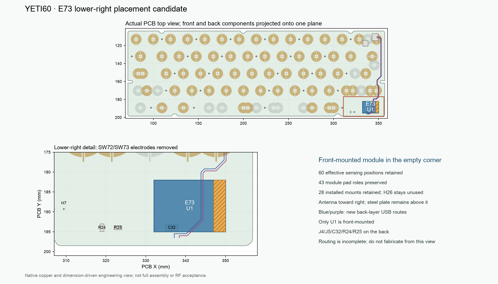

[English](e73-hhkb-corner.md) | [Chinese](e73-hhkb-corner.zh-CN.md)

# E73 in the HHKB lower-right corner

**Selected development direction; manufacturing remains on hold.** The [native corner project](../../hardware/e73-hhkb-corner/EC60-nRF52840.kicad_pro) and [replay specification](../../hardware/e73-corner-spec.json) replace the upper-right module position for development. This candidate is not an order package. Older upper-right acceptance reports do not qualify this revision.

Only the E73 module is front-mounted, between the PCB and plate. J4 USB input and J5 power bridge retain their original back-side positions, preserving the already-made UDB-C-JSH C5 daughterboard and its interfaces. The retained 1.6 mm steel plate and case exterior are unchanged. No additional lower-right floor cut is required by the selected placement; the earlier back-mounted trial did not retain the required floor-wall reserve.



## Controlled changes

Coordinates are PCB top-view coordinates in millimetres, including back-mounted parts.

| Reference | Origin X, Y | Orientation | Side |
|---|---|---|---|
| U1, E73-2G4M08S1C | 332, 195 | 0° | Front |
| J4, USB input | 346.1, 110.7 | 90° | Back, retained |
| J5, power bridge | 335.5, 117.5 | 0° | Back, retained |
| C32, VBUS capacitor | 336.5, 194 | 180° | Back |
| R24, COL14 pull-down | 319, 194 | −90° | Back |
| R25, COL13 pull-down | 323, 194 | 180° | Back |

- Remove only SW72/SW73 sensing electrodes and their dedicated schematic branches. Neither belongs to the existing 60-key HHKB transform. They are copper electrodes, not two purchased NiZ switches.
- Preserve all 60 effective sensor positions, 43 module pin roles, 28 installed mount positions and the unused H26 rule. R24/R25 remain populated because their columns are shared by active keys.
- Restore the old upper-right wing to the original straight PCB edge in both the board and frozen outline library.
- Replace USB data routing with a paired B.Cu path avoiding the retained side-clamp mask openings, and one ordinary through-via per data net to a short F.Cu module launch. The planned pair has 0.30 mm trace width and 0.50 mm centre spacing. These dimensions are not a certified 90 Ω stack-up. Fresh native DRC, reference connectivity and impedance review are required after all routing is complete.
- Move the former right-edge COL14 backbone from In2.Cu to In1.Cu between existing through-via connections. This frees the adjacent In2 ground reference corridor without changing an effective sensor land or its net. The exact retired primitives and replacement path are recorded in the replay specification and checked against the actual PCB.
- Provide 30 module control/power escape vias, two USB data vias and one local USB ground stitch. These 33 placement vias plus 13 vias in the current replayable routing repair total 46 new vias. The repair includes J5 ground and a B.Cu ground-island stitch. All 46 are ordinary 0.50/0.30 mm plated through-vias, tented on both sides and outside SMD copper. This count excludes pre-existing board vias and the separately documented power exposed-pad vias.
- Preserve the SH3 battery repair and current power-stage repair. Their earlier results do not constitute whole-board acceptance of the relocated module.

## Antenna and assembly limits

The nominal module body occupies **X 332–350, Y 182–195**. The provisional last 3 mm antenna band occupies **X 347–350, Y 182–195**, pointing right. The specification also defines an explicit four-layer copper keepout extending to the board edge. This band is an engineering screening assumption, not an Ebyte-approved numeric clearance.

The steel plate remains above the antenna band. Its projection covers the nominal 39 mm² band; a copper keepout does not remove that metal. The requested 2–3 m range remains a physical acceptance target. Confirm the keepout with Ebyte and test the assembled board with normal hand positions and orientations. Zero body overlap with active sensing copper does not prove EC noise immunity.

The nominal PCB-to-plate gap is 4.6 mm. Maximum installed heights, including solder and seating, are 3.2 mm for U1/J4/J5, 1.0 mm for C32 and 0.6 mm for R24/R25. These are inspection requirements, not vendor maximum-height certifications. Only U1 consumes the front gap. Check NiZ lower flanges/clips, stabilizers, all fasteners, mated plugs, withdrawal sweeps and flexible wires against the final board revision. Body-box checks alone do not establish full assembly fit.

J4/J5 and C5 connector positions are retained. Do not change the C5 board. Existing cable specifications are reference inputs; the complete final assembly and service motion still need to be checked before declaring the harness accepted. Battery selection remains the protected 1S 1600 mAh pack envelope, 85 × 43 × 4.8 mm, with supplier electrical and protection parameters pending confirmation.

## Current checkpoint

The [replayable routing patch](../../hardware/e73-corner-routing.json) currently adds 97 traces and 13 vias. Native checking still finds **30 unconnected items**. Whole-board electrical acceptance, fabrication and complete assembly release remain open.

| Gate | Current evidence and disposition |
|---|---|
| Effective keys and module lands | [Placement proof](../../hardware/e73-hhkb-corner/audit/placement-check.json): 60 effective positions, all 43 module pad roles and transformed coordinates retained |
| Strict native DRC | Same report: zero violation errors and zero schematic-parity differences; 30 unconnected items still prevent electrical acceptance |
| Ordinary vias | Same report: 33 placement vias plus 13 routing/repair vias; all 0.50/0.30 mm through-vias, both faces tented, outside SMD copper |
| USB and ground | [Actual-copper screen](../../hardware/e73-hhkb-corner/audit/USB-reference.json): paired-route reference, local ground stitches and whole-ground connectivity screened successfully; no impedance or physical USB acceptance |
| Models and assembly bounds | [J4/J5/C32 models and feet](../../hardware/e73-hhkb-corner/audit/local-models.json), [body/case/plate envelopes](../../hardware/e73-hhkb-corner/audit/corner-fit.json); detailed NiZ geometry and harness motion remain open |
| Frozen power geometry | [Native-saved geometry and fault tests](../../hardware/e73-usb-repair/audit/power-geometry-faults.json) passed; relocated whole-board power connectivity/returns still require final routing acceptance |
| Verifier fault witnesses | [Placement mutation tests](../../hardware/e73-hhkb-corner/audit/placement-faults.json) must reject a wrong GPIO, sensor overlap and a removed antenna keepout |
| Firmware and fabrication | Candidate PCB calibration identity and release images have not yet been rebuilt; no fabrication release |
| RF and battery measurements | Steel remains over the provisional antenna band; RF, EC noise, actual pack parameters, charging/discharging and thermal acceptance remain open |

## Reproduction and acceptance

Run these sequentially from the repository root:

```sh
/Applications/KiCad/KiCad.app/Contents/Frameworks/Python.framework/Versions/Current/bin/python3 scripts/build_e73_corner.py
/Applications/KiCad/KiCad.app/Contents/Frameworks/Python.framework/Versions/Current/bin/python3 scripts/check_e73_corner.py
/Applications/KiCad/KiCad.app/Contents/Frameworks/Python.framework/Versions/Current/bin/python3 scripts/test_e73_corner.py
/Applications/KiCad/KiCad.app/Contents/Frameworks/Python.framework/Versions/Current/bin/python3 scripts/export_e73_corner_geometry.py
uv run --python 3.14.7 --with-requirements requirements-audit.txt python scripts/check_e73_corner_usb.py --require-pass
uv run --python 3.14.7 --with-requirements requirements-audit.txt python scripts/check_e73_usb_local_models.py --base hardware/e73-hhkb-corner --work .assembly-work/e73-corner/models
uv run --python 3.14.7 --with-requirements requirements-audit.txt python scripts/check_e73_corner_fit.py
uv run --python 3.14.7 --with-requirements requirements-audit.txt python scripts/draw_e73_corner.py
```

The checker reads actual native pad roles, retained copper, effective sensing polygons, module land support, mount positions, explicit data paths, escape vias and four-layer antenna copper. Strict DRC re-enables ignored project rules and checks schematic parity. `--require-routed` must return nonzero while electrical errors, unconnected items or parity differences remain. A placement proof is not electrical acceptance.

The fit checker uses conservative body proxies, the ordinary 1.44–1.76 mm PCB thickness interval where applicable and a deliberate wrong-placement witness. It does not qualify detailed NiZ plastic, flexible wire motion, structural strength or RF performance. Mutation tests deliberately reseal fixture hashes so geometric/semantic checks must detect the changed board.

Use only current, source-bound reports in the [candidate audit directory](../../hardware/e73-hhkb-corner/audit). Remaining gates include all signal/power routing, USB ground connectivity and impedance, full mechanism/harness tolerances, firmware calibration identity rebinding and power/battery review. Physical USB/BLE/EC, charging, thermal and range tests require a sample. The source electronics count remains 75: 8 planned stock parts and 67 purchases. The mechanism still needs 60 NiZ housing/slider sets, 60 domes and 60 conical springs.
