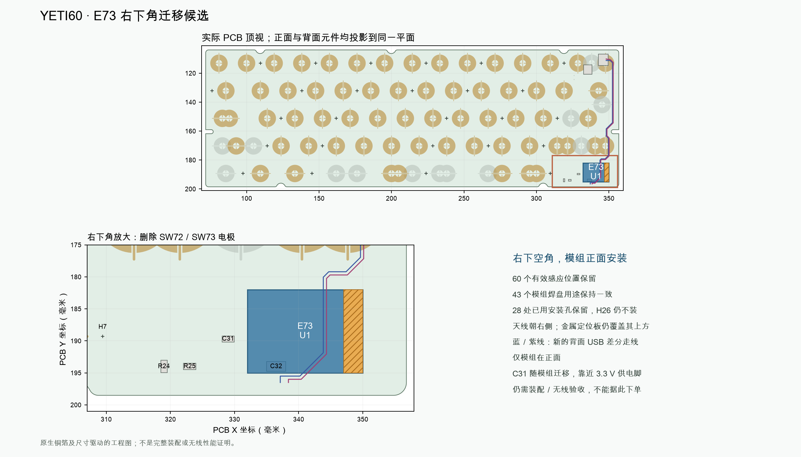

[English](e73-hhkb-corner.md) | [中文](e73-hhkb-corner.zh-CN.md)

# E73 迁移至 HHKB 右下角

**已选定的开发方向，尚未放行生产。** 后续开发使用[右下角原生工程](../../hardware/e73-hhkb-corner/EC60-nRF52840.kicad_pro)和[可重放规格](../../hardware/e73-corner-spec.json)，替代原右上角模组位置。该候选不是下单包，旧版右上角验收报告不能用于验收本版。

仅 E73 模组安装在正面，利用 PCB 与定位板之间的空间。J4 USB 输入和 J5 电源桥保留原来的背面位置，沿用已制作的 UDB-C-JSH C5 子板及其接口。1.6 mm 钢定位板和外壳外形保留。当前布局不需要额外切除右下角底壳；此前的背面安装试案无法保留要求的底壁余量。



## 受控修改

以下统一使用 PCB 顶视坐标，单位为毫米，背面元件也不镜像标注。

| 位号 | 原点 X、Y | 角度 | 安装面 |
|---|---|---|---|
| U1，E73-2G4M08S1C | 332、195 | 0° | 正面 |
| J4，USB 输入 | 346.1、110.7 | 90° | 背面，原位 |
| J5，电源桥 | 335.5、117.5 | 0° | 背面，原位 |
| C31，3.3 V 去耦 | 329，189.7 | 180° | 背面 |
| C32，VBUS 电容 | 336.5、194 | 180° | 背面 |
| R24，COL14 下拉 | 319、194 | −90° | 背面 |
| R25，COL13 下拉 | 323、194 | 180° | 背面 |

- 仅移除 SW72／SW73 感应电极及其专用原理图支路。现有 60 键 HHKB 映射不使用这两处；它们是铜箔电极，不是少买两套 NiZ 轴体。
- 保留 60 个有效感应位置、43 个模组焊盘用途、28 处已用安装孔和 H26 不安装规则。原生安装检查覆盖全部 29 个钻孔／槽孔：26 个 H 位号，以及板框封装内的 3 处孔槽；只检查 H 位号会漏掉后者。R24／R25 所属列仍有有效按键，必须保留。
- PCB 和冻结的板框封装同时删除旧右上角翼部，恢复原直边。
- USB 数据线改走背面配对线路，绕开原有侧边夹持区阻焊开窗，每根线使用一个普通通孔过孔，连接正面的短模组引出线。规划线宽 0.30 mm、中心距 0.50 mm。这些尺寸不等于经过认证的 90 Ω 层叠；全部线路完成后必须重新检查原生 DRC、参考地连通和阻抗。
- 原右边缘 COL14 干线从 In2.Cu 改到 In1.Cu，通过原有通孔过孔连接，为背面 USB 保留相邻的 In2 地参考通道。有效感应焊盘及其网络不变。可重放规格列出被替换的铜箔及新路径，检查程序核对实际 PCB。
- 保留 SH3 电池接口修补及当前电源级修补；这些部分的旧报告不能替代迁移后的整板验收。

## 天线与装配限制

模组标称外形范围为 **X 332–350、Y 182–195**。暂定末端 3 mm 天线带为 **X 347–350、Y 182–195**，朝向右侧。规格还定义了延伸至板边的四层禁铜区。这是工程筛查假设，不是亿佰特认可的定量净空。

钢定位板仍在天线带上方，投影覆盖标称 39 mm² 天线带；禁铜不能消除这块金属。2–3 米距离仍需实测验收。需向亿佰特确认净空，并在装配、正常手位及不同方向下测试。模组外形与有效电极没有投影重叠，也不能证明静电容扫描完全不受干扰。

PCB 到定位板标称间隙为 4.6 mm。含焊锡及落座后的安装高度上限：U1／J4／J5 为 3.2 mm，C32 为 1.0 mm，R24／R25 为 0.6 mm。这是装配检验要求，并非厂商最大高度认证；其中只有 U1 占用正面间隙。必须按最终板版核对 NiZ 底部凸缘／卡扣、卫星轴、全部紧固件、插头、拔插运动和柔性导线；元件包围盒检查不能替代完整装配检查。

J4／J5 和 C5 接口位置保留，不要修改已制作的 C5 子板。现有线缆规格可作为输入，但完整装配及维修拔插仍需按本版复核后才能验收。电池维持带保护的单节 1600 mAh 包，外形包络 85 × 43 × 4.8 mm，供应商电气及保护参数仍待核实。

## 当前阶段验收记录

CORNER-03 同时将现有 100 nF、0402 的 C31 移到模组供电脚附近，局部连接约 1.17 mm。当前[可重放布线](../../hardware/e73-corner-routing.json)为 455 段线路、82 个过孔；另有 33 个基础引出过孔，共新增 115 个普通 0.50／0.30 mm 通孔，两面盖油且避开贴片焊盘。原生检查为 0 条违规错误、0 项未连接、0 项原理图一致性差异。报告仍保留悬空线路、过孔端点和缺少庭院层警告，不能宣称零警告；完整装配及投板尚未放行。

| 检查项 | 当前证据及结论 |
|---|---|
| 有效按键及模组焊盘 | [摆位检查](../../hardware/e73-hhkb-corner/audit/placement-check.json)：60 个有效位置、43 个模组焊盘用途及变换坐标保留 |
| 严格原生 DRC | 同一报告：0 条违规错误、0 项原理图一致性差异；0 项未连接；机构、供应商和实物验收仍未完成 |
| 普通过孔 | 同一报告：33 个基础引出过孔及 82 个修补过孔，均为 0.50／0.30 mm 通孔、两面盖油且不与贴片铜焊盘重叠 |
| USB 与接地 | [实际铜箔检查](../../hardware/e73-hhkb-corner/audit/USB-reference.json)：配对线路参考地、局部接地过孔及整板接地连通筛查通过；不代表阻抗或实物通信通过 |
| 元件模型及装配边界 | [J4／J5／C32 模型及焊脚检查](../../hardware/e73-hhkb-corner/audit/local-models.json)、[元件与外壳／定位板边界检查](../../hardware/e73-hhkb-corner/audit/corner-fit.json)；完整 NiZ 细节和线束运动仍待检查 |
| 电源冻结几何 | [原生保存后的电源几何及故障测试](../../hardware/e73-usb-repair/audit/power-geometry-faults.json)通过；迁移后的整板电源连接与回流仍需随剩余线路验收 |
| 校验器故障样本 | [摆位故障测试](../../hardware/e73-hhkb-corner/audit/placement-faults.json)：错误 GPIO、电极重叠、删除天线禁铜必须被拒绝 |
| 固件与生产文件 | 已增加候选板独立构建流程，以对应源文件的固件清单为准；根目录迁移前固件不能验收本版；尚未放行投板 |
| 无线与电池实测 | 钢板覆盖暂定天线带；射频、静电容噪声、实际电池参数、充放电与温升仍需确认／实测 |

## 重现及验收

在仓库根目录按顺序执行：

```sh
/Applications/KiCad/KiCad.app/Contents/Frameworks/Python.framework/Versions/Current/bin/python3 scripts/build_e73_corner.py
/Applications/KiCad/KiCad.app/Contents/Frameworks/Python.framework/Versions/Current/bin/python3 scripts/check_e73_corner.py
/Applications/KiCad/KiCad.app/Contents/Frameworks/Python.framework/Versions/Current/bin/python3 scripts/test_e73_corner.py
/Applications/KiCad/KiCad.app/Contents/Frameworks/Python.framework/Versions/Current/bin/python3 scripts/export_e73_corner_geometry.py
uv run --python 3.14.7 --with-requirements requirements-audit.txt python scripts/check_e73_corner_usb.py --require-pass
uv run --python 3.14.7 --with-requirements requirements-audit.txt python scripts/check_e73_usb_local_models.py --base hardware/e73-hhkb-corner --work .assembly-work/e73-corner/models
uv run --python 3.14.7 --with-requirements requirements-audit.txt python scripts/check_e73_corner_fit.py
uv run --python 3.14.7 --with-requirements requirements-audit.txt python scripts/draw_e73_corner.py
```

检查器读取真实的原生焊盘用途、保留铜箔、有效感应多边形、模组焊盘板边支撑、安装孔、明确的数据线路、引出过孔及四层天线铜箔。严格 DRC 重新启用工程忽略的规则，并核对原理图一致性。只要仍有电气错误、未连接项或一致性差异，`--require-routed` 就必须返回非零；通过摆位检查不等于电气验收通过。

装配检查采用保守元件包围盒，适用处计入普通 PCB 1.44–1.76 mm 厚度区间，并验证故意放错位置的样本必须被拒绝。它不验收详细 NiZ 塑料、柔性线束运动、结构强度及射频。故障测试会重新封存测试样本的文件哈希，要求实际几何／语义检查识别修改，避免只凭哈希拒绝。

仅使用[候选审核目录](../../hardware/e73-hhkb-corner/audit)内与当前源文件绑定的报告。待完成项包括电源布局／回流复核、USB 阻抗、整套机构／线束公差、固件校准身份重新绑定及电源／电池复核。USB／蓝牙／静电容、充电、温升和距离的实物验收需要样机。源版本电子元件仍为 75 件：计划用库存 8 件、购买 67 件；机构仍需 60 套 NiZ 轴座／滑块、60 个胶碗和 60 个锥形弹簧。

相邻机构检查使用明确的**来料验收边界**，并非厂商认证塑料模型：定位板下方 NiZ 轴座平面包络不超过 16 × 16 mm，卫星轴单侧不超过 8 × 14 mm，各计入每轴 0.2 mm 位置误差。检查涵盖 60 个轴座、6 个卫星轴侧座、3 条钢丝运动带和 28 处已安装支撑。来料必须满足这些边界；卡扣、胶碗预压和完整行程仍需样品。C31 安装高度上限为 0.65 mm。独立 USB 检查读取实际填充地铜及跨层地连接；重布线同时避开地铜间距和现有 0.254 mm 最小填充宽度，并以原生 PCB 故障注入验证参考铜缺口会被拒绝。
