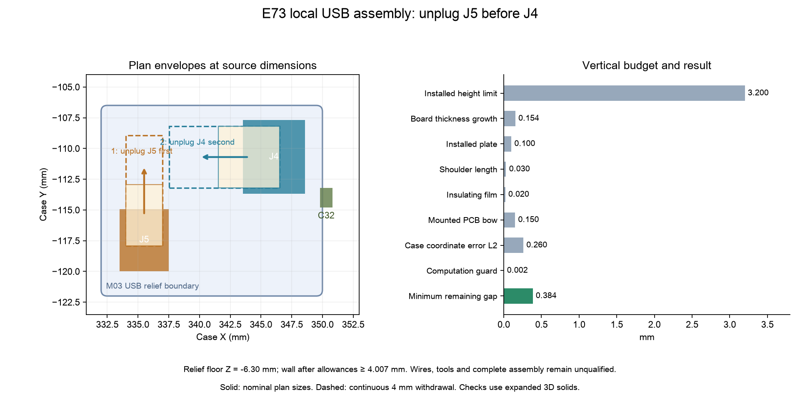

English | [Chinese](e73-usb-local-fit.zh-CN.md)

# E73 USB connector space and ordered removal

**This is an isolated design checkpoint, not an accepted keyboard or fabrication release.** It extends the [USB repair](e73-usb-repair.md) and [native-model checkpoint](e73-usb-return.md). The canonical assembly still selects M01; M03 below is not selected automatically. The existing UDB-C-JSH C5 daughterboard is unchanged.

## Geometry and inspected limits

J4 is a four-position side-entry JST SH header at PCB **(346.1, 110.7) mm, 90°**, opening toward decreasing case X. J5 is the two-position power header at **(335.5, 117.5) mm, 0°**, opening toward increasing case Y. Use SHR-04V-S / SHR-02V-S housings respectively, with SSH-003T-P0.2-H contacts. These are SH 1.0 mm parts; inherited footprint names do not replace the specified MPNs and numbered continuity checks.

The [JST SH catalog, pages 1–3](https://www.jst.com/wp-content/uploads/2025/06/eSH.pdf) gives nominal housing depth **5 mm**, height **2.8 mm**, and side-entry assembled depth reference **6.25 mm**. Housing widths here are **5 mm / 3 mm**. These are nominal/reference dimensions, not maximum installed-size guarantees. Obtain the current detail drawing and inspect these project limits:

| Item | Required inspected envelope |
|---|---|
| J4 / J5 bodies and mating housings | At most 3.2 mm below the local PCB underside, including solder and seating |
| J2 SH3 interface | Same 3.2 mm limit; [independent battery model and motion check](e73-battery-service.md) |
| C32, 4.7 µF / 10 V, 0603 imperial / 1608 metric | At most 1.0 mm below the local PCB underside |
| Body dimensions and component placement | At most 0.1 mm growth in each XY direction from the union of complete model and native Fab graphics |
| Installed PCB point position | At most 0.25 mm per XY axis, including translation, rotation and deformation |
| Additional mounted PCB bow | At most ±0.15 mm in Z |
| Installed plate surface | ±0.1 mm combined installed face error, including gasket compression |
| Shoulder / insulating film | ±0.03 / ±0.02 mm, counted once |
| Resin case coordinates | ±0.15 mm per axis; distance allowance √3 × 0.15 = 0.2598 mm |

These are measured incoming/installed acceptance requirements, not supplier guarantees. A nominal model fit cannot waive them.

The nominal envelope takes the union of complete STEP geometry and native Fab graphics before adding placement/size allowances. The SH header's Fab front is 0.1 mm farther out than the standard model; that difference is not treated as spare clearance. Full terminal geometry is retained as well.

## M03 internal floor repairs

At 1.76 mm board thickness, the original M01 floor leaves about **0.2562 mm** at the deepest header envelope. Subtracting the case allowance and 0.002 mm computation guard exhausts the required **0.15 mm** reserve, despite zero nominal solid intersection.

The [M03 specification](../../hardware/e73-usb-local-fit-spec.json) retains the USB recess at case-coordinate bounds **X 332–350, Y −122 to −106.5, Z −6.30 to −5.40 mm**, corner radius **0.5 mm**, and adds the [SH3 battery-header recess](e73-battery-service.md). Material removed is the cutters/M01 intersection. The shell bounding dimensions, selected external skin, insert-support guards and gasket bearing height are preserved. Remaining selected exterior wall is about **4.007 mm** after deducting errors on both inner and outer surfaces and the computation guard, above the **2.0 mm** requirement. This is dimensional screening, not resin strength qualification.

Candidate geometry: [STEP](../../hardware/e73-usb-repair/mechanical/yeti60-e73-usb-battery-bottom-m03.step), [STL](../../hardware/e73-usb-repair/mechanical/yeti60-e73-usb-battery-bottom-m03.stl). This replaces the isolated M02 bottom. Retain the M01 plate and generated original top. These candidate files do not establish acceptance of all E73 wiring or connected battery service.

The [fit report](../../hardware/e73-usb-repair/audit/local-fit.json) checks nominal, 1.44 mm, 1.76 mm and a solid enclosing the complete continuous thickness interval. Its **28 checks** cover J4/J5/C32 bodies, two mated housings and ordered **4 mm continuous axial withdrawal**. Minimum remaining case air gap is about **0.3844 mm**, above the 0.15 mm requirement. Other components and 28 fasteners are screened with inherited proxy envelopes; their real dimensions and models remain unaccepted.

## Connection and removal order

With power disconnected, connect **J4 first, then J5**. For removal, disconnect external USB and switch off the keyboard, then:

1. Unplug **J5**, the two-wire mainboard power jumper.
2. Move its disconnected housing out of J4's path. The flexible-wire parking route remains to be designed and checked.
3. Unplug **J4** toward decreasing case X.

If J5 remains mated, its expanded housing intersects the J4 removal envelope. The checker reproduces this wrong-order condition as a negative case. Fingers, tools, loose wires and parking the disconnected housing have not been checked; complete connected service remains open. The separate [battery repair](e73-battery-service.md) now uses SH3 and checks its rigid motion independently.



## Reproduce and remaining work

After the native/model checks in the linked checkpoint:

```sh
uv run --python 3.14.7 --with-requirements requirements-audit.txt python scripts/check_e73_usb_local_fit.py
```

This rebuilds candidate STEP/STL, paired drawings and the hash-bound report, and tests the original-floor regression and wrong-order fault. Full PCB installation/removal, remaining part models/tolerances, flexible harness/tool access, connected battery service, power/thermal qualification, matched firmware/CAM and physical electrical/RF tests remain required.
