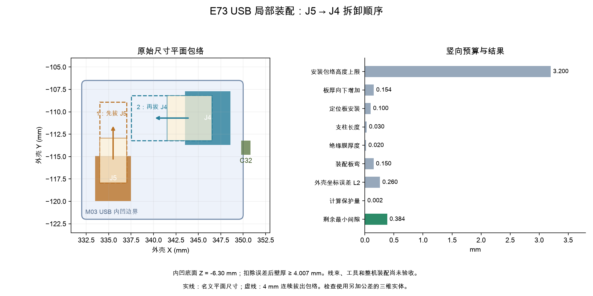

[英文](e73-usb-local-fit.md) | 中文

# E73 USB 接头空间与拆卸顺序

**历史阶段记录：**本文描述提交 `7aab295`，证据链接已冻结到该提交，复现也应使用该提交。之后的电源布局修补使本地旧报告失效；当前开发方向为[E73 右下角迁移](e73-hhkb-corner.zh-CN.md)。本文不作为迁移后候选的放行依据。

**这是独立候选方案的设计检查点，整机尚未验收，也未放行生产文件。** 本页接续 [USB 修补](e73-usb-repair.zh-CN.md)和[原生模型检查](e73-usb-return.zh-CN.md)。当前正式装配选择仍为 M01；下列 M03 不会自动替换它。已经制作的 UDB-C-JSH C5 子板保持不变。

## 几何与实测限值

J4 是四针侧插 JST SH 接头，PCB 坐标 **(346.1, 110.7) mm、90°**，朝外壳 X 减小方向开口。J5 是两针电源接头，坐标 **(335.5, 117.5) mm、0°**，朝外壳 Y 增大方向开口。分别配 SHR-04V-S / SHR-02V-S 胶壳，以及 SSH-003T-P0.2-H 端子。这些是 SH 1.0 mm 系列；继承封装库中的名称不能代替指定料号与逐针通断检查。

[JST SH 官方目录第 1–3 页](https://www.jst.com/wp-content/uploads/2025/06/eSH.pdf)给出的胶壳名义深度为 **5 mm**、高度为 **2.8 mm**，侧插组合深度参考值为 **6.25 mm**；这里两种胶壳宽度分别为 **5 mm / 3 mm**。这些是名义尺寸或参考值，不是最大安装尺寸保证。需要取得当前详细图纸并按以下项目限值验收：

| 项目 | 需要测量确认的包络 |
|---|---|
| J4 / J5 插座及配套胶壳 | 含焊接和就位后，低于局部 PCB 底面的最大高度为 3.2 mm |
| J2 SH 三针接口 | 同样限定为 3.2 mm；另见[独立电池模型与插拔检查](e73-battery-service.zh-CN.md) |
| C32，4.7 µF / 10 V，英制 0603 / 公制 1608 | 低于局部 PCB 底面的最大高度为 1.0 mm |
| 元件本体尺寸和焊接位置 | 相对完整模型与原生 Fab 图形的合并包络，XY 每个方向最多外扩 0.1 mm |
| 安装后的 PCB 点位 | XY 每轴误差不超过 0.25 mm，包含平移、旋转与变形 |
| 附加装配板弯 | Z 方向不超过 ±0.15 mm |
| 安装后的定位板表面 | 每个安装表面的综合误差为 ±0.1 mm，已包含垫条压缩 |
| 支柱 / 绝缘膜 | 分别 ±0.03 / ±0.02 mm，仅计算一次 |
| 树脂外壳坐标 | 每轴 ±0.15 mm；距离保守扣除量为 √3 × 0.15 = 0.2598 mm |

以上是来料和装配后需要实测的验收要求，不是供应商已保证的公差。名义模型能放下，不能免除这些验收。

名义包络先合并完整 STEP 模型与原生 Fab 图形，再加入尺寸／安装误差。SH 接头 Fab 前缘比标准模型向外多 0.1 mm，这个差值不能当成空隙；完整金属脚几何也保留在包络内。

## M03 内部底面修补

在 1.76 mm 板厚及最深接头包络下，原 M01 底面仅剩约 **0.2562 mm**。扣除外壳误差和 0.002 mm 计算保护量后，不能满足要求的 **0.15 mm** 余量，虽然名义实体没有相交。

[M03 规格](../../hardware/e73-usb-local-fit-spec.json)保留 USB 圆角凹槽：外壳坐标 **X 332–350、Y −122 至 −106.5、Z −6.30 至 −5.40 mm**，圆角半径 **0.5 mm**，并增加 [SH 三针电池接头凹槽](e73-battery-service.zh-CN.md)。实际去除部分为刀具体与 M01 实体的交集。它保留外壳边界尺寸、选定外表皮、嵌件支撑保护区及垫条承台高度。扣除内、外两个表面的误差及计算保护量后，选定外表皮的剩余壁厚约 **4.007 mm**，高于 **2.0 mm** 要求。这只检查尺寸，尚未验收树脂强度。

候选几何：[STEP](https://github.com/wZuck/YETI60/blob/7aab295c219d1e1cf696efc4cdb52380bec64e19/hardware/e73-usb-repair/mechanical/yeti60-e73-usb-battery-bottom-m03.step)、[STL](https://github.com/wZuck/YETI60/blob/7aab295c219d1e1cf696efc4cdb52380bec64e19/hardware/e73-usb-repair/mechanical/yeti60-e73-usb-battery-bottom-m03.stl)。它替换独立候选 M02 底壳；定位板保留 M01，上壳保留原有生成文件。这些候选文件不能证明全部 E73 线束和带线电池检修已经验收。

[匹配度报告](https://github.com/wZuck/YETI60/blob/7aab295c219d1e1cf696efc4cdb52380bec64e19/hardware/e73-usb-repair/audit/local-fit.json)检查名义板厚、1.44 mm、1.76 mm，并用实体包络覆盖整个连续板厚区间。共 **28 项检查**，覆盖 J4/J5/C32 本体、两种已连接胶壳，以及按顺序进行的 **4 mm 连续轴向拔出**。扣除误差后的最小外壳间隙约为 **0.3844 mm**，高于 0.15 mm 要求。其他元件和 28 组紧固件使用已有代理包络筛查；这些元件的真实尺寸和模型尚未验收。

## 插接与拆卸顺序

断电装配时，**先连接 J4，再连接 J5**。拆卸前，先拔掉外部 USB 并关闭键盘电源，然后：

1. 先拔 **J5**，即主板两线电源跳线。
2. 将断开的胶壳移出 J4 的路径；柔性线束的临时停放路线尚需设计与检查。
3. 再朝外壳 X 减小方向拔出 **J4**。

如果 J5 仍插着，J4 扩大后的拔出包络会与 J5 胶壳相交。检查脚本使用这个错误顺序作为反例。手指、工具、松散线材与断开胶壳的停放尚未检查；完整带线检修仍未验收。另行进行的[电池接口修补](e73-battery-service.zh-CN.md)已改用 SH 三针，并独立检查其刚性插拔。



## 复现与剩余工作

完成所链接检查点的原生检查与模型检查后，执行：

```sh
uv run --python 3.14.7 --with-requirements requirements-audit.txt python scripts/check_e73_usb_local_fit.py
```

该命令重建候选 STEP/STL、中英文图示和绑定输入哈希的报告，同时检查原底面的回归反例及错误拆卸顺序。整块 PCB 装入/取出、其余元件模型与公差、柔性线束和工具空间、带线电池检修、电源及温升、配套固件与生产文件、实物电气及射频测试仍需完成。
