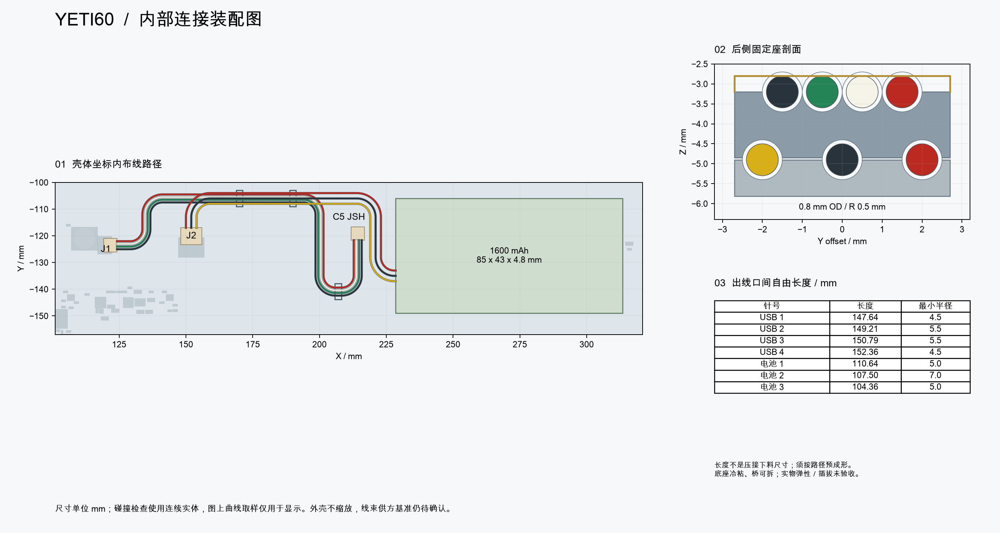

[English](interconnects.md) | 中文

# 内部线束及可拆固定座

内部连接保持 **C5 JSH → 四线 SH 线束 → 主板 J1**，保护电池包通过三线 PH 引线连接 J2。不使用 UDB S 或第二主控。[完整规格](../../mechanical/interconnect-spec.json)与[实体检查报告](../audit/yeti60-interconnects.json)约束此样机设计，供方出线基准及实物装配尚待验收。

[矢量图](images/interconnects.zh-CN.svg) · [五件按装配位置放置的固定座 STEP／STL](../../mechanical/generated/interconnect-guides) · [电池包接口](battery-pack-specification.zh-CN.md)

## 连接器与导线

| 接口 | 每把键盘数量 | 电气要求 |
|---|---|---|
| USB | 1 条线束：2 个 SHR-04V-S 插壳、8 个 SSH-003T-P0.2-H 端子、4 根 AWG28 多股线 | 1 红色正电源、2 白色 D−、3 绿色 D+、4 黑色地；按针号直通，肉眼左右顺序不作为依据 |
| 电池 | 包含在 1 个电池总成中：1 个 PHR-3 插壳、3 个 SPH-004T-P0.5S 端子、3 根 AWG28 多股线 | 1 红色正极、2 黑色负极、3 黄色独立 10k NTC 接负极；温度反馈不能替代独立保护 |

绝缘外径须不大于 0.8 mm，并与指定端子兼容。[JST SH](https://www.jst.com/wp-content/uploads/2025/06/eSH.pdf)的 SHR-04V-S 插壳为 5×5×2.8 mm；[JST PH](https://www.jst.com/wp-content/uploads/2025/06/ePH.pdf)的 PHR-3 为 7.8×6.35×4.5 mm。CAD 检查采用保守的完整插接包络，属于尺寸代理，不是转载受限的厂商原生模型。

主板继承的 J1 信号及固定焊盘与标准 SH 脚位只相差 0.0625 mm 的整体原点平移，J2 与标准 PH 零偏移匹配，不必修改板端铜。C5 的 SH 替代模型 Y 偏移已从错误的 +2.425 改为 −1.45 mm，只修正派生可视化，不改上游子板 PCB。

## 控制路径

USB 中心线名义长 150 mm，1–4 针的逐根自由长度约为 147.64／149.21／150.79／152.36 mm。定义为插壳出线面之间的绝缘长度，**不是压接下料长度**。生产图须采用报告中七根线的未舍入数值，不能把等长 150 mm 排线直接认定为可用。

选定的导线规则是不小于 **4 mm 静态弯曲半径**，仍须线材供方接受。设计中 USB 最小内侧半径不小于 4.5 mm，电池线不小于 5 mm。自由长度公差为 ±0.5 mm，同时要求预成形并固定在控制路径内。检查将每根线沿半径扩大 0.25 mm 计入壳体与路径位置余量，再要求至少剩余 0.15 mm 空隙；两条线束分别扩大。碰撞依据是七根连续圆截面扫掠实体，图中曲线取样仅用于显示。

后侧 USB 线位于 z=−3.20 mm、电池线位于 z=−4.90 mm。前侧 USB 环路位于 z=−4.90 mm，以避开普通板厚上限时的 H21 螺钉头。连接器端过渡适应普通板 1.44–1.76 mm 厚度范围，固定座位置保持不变，报告记录两端板厚及自由长度变化。电池包出线局部基准为 [0,14,4.4] mm，朝 -X，仍须供方签图。

## 固定座数量及安装

| 材料 | 数量 | 几何与安装位置 |
|---|---:|---|
| 后侧底座 | 2 | `rear-1-base`、`rear-2-base` 各 1；壳体坐标 X=170／190、Y=−106 mm；宽 5.4、路径方向长 2 mm，底面贴合壳体 |
| 后侧可拆桥 | 2 | `rear-1-bridge`、`rear-2-bridge` 各 1；下层三槽、上层四槽，槽半径 0.5 mm |
| 前侧底座 | 1 | `front-base`；X=207 mm，Y 见报告；宽 6、路径方向长 1.8 mm |
| 可拆桥固定胶带 | 供两座使用的少量材料 | 可移除、非导电双面胶，总厚 0.05 mm，仅用于两侧支承面 |
| 上侧保持膜／胶带 | 3 片 | 膜与胶总厚不超过 0.10 mm，覆盖上层导线并向侧面包覆，不能悬空放一条膜 |

公开 STEP／STL 保持**壳体装配坐标**，是五个按位置命名的零件，不应统一堆在同一原点，也不能缩放。采用尺寸合格、韧性、非导电且槽面光滑的材料。底座按 0.10 mm 名义粘接间隙冷粘到壳体，胶须与树脂兼容。完成压接的线束直接放入开放槽内，下层用可拆桥保持，再包覆上侧保持膜。不能让插头穿封闭孔，也不能把桥永久环氧粘死。

固定座与检查的壳体、主板、元件及紧固件无相交，且不夹压名义导线实体。底座已缩窄以避开后壁，此方案**不需要新增线束开槽**。支座强度、粘接、导线回弹和打印尺寸波动仍需实物样件验证。

## 检查与维修

连接前逐个检查压接、针号导通、电池极性与热敏电阻，并按图拍摄装线照片。确认导线不回弹／扭束至禁入区、不拉扯软包或焊片、没有锐边，合壳无需施压。使用实物插头检查插入和拔出空间。维修时断电并断开电池，拆保持膜及桥后整体抬出线束，不能拉电芯焊片或以软包作为撬点。信号及射频分析继续暂缓，不宣称已通过疲劳或拉力认证。
