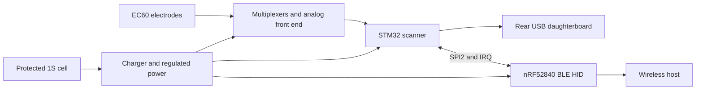

English | [简体中文](felk60-bluetooth.zh-CN.md)

# Historical FELK60 / EC60 Bluetooth proposal

**Superseded:** YETI60 now uses one nRF52840. The STM32/SPI bridge described here is preserved only as research history. See [current hardware](../hardware/ec60-nrf52840/README.md).

The 2026-10-26 proposal assumed a resin case, PCB changes allowed and rear-only Type-C at the Esc/number-row side. It proposed STM32F401 scanning/calibration/key mapping plus an nRF52840 BLE HID controller over SPI2, retaining the original matrix, analog front end and USB data path. USB-host-to-BLE was a fallback. A single nRF scanner was deferred then because it required ADC/timing/threshold revalidation; that earlier decision was later explicitly replaced by the user.

The battery, radio and power path were not wired into that interface prototype. The original onboard USB1 is about 124.3 mm away from the case aperture in X, so the external port requires a rear daughterboard connected to J1. J1 carries no CC signals; the daughterboard must implement its own correct Type-C CC terminations and protection. The 8×2 mm diagnostic path check did not validate a real plug/overmould.

## Reference research

| Source | Revision and inspected files | Scope |
|---|---|---|
| [Hasu HHKB Controller](https://github.com/tmk/HHKB_controller) | `d1a149c0bf60ff8264b450dd72fb1f660fe328d0`, `bluetooth.sch`, `BOM.txt` | Partitioning, charger and switch ideas; do not copy RN42/5 V boost/AVR circuitry |
| [Yang/YDKB TMK](https://github.com/yangdigi/tmk_keyboard) | `c63495fa995ad0e7dd75d9acc9c591df1a8cc331`, `ble51.c`, `ble51_task.c` | Separate BLE reports, key release on transport switch, enumeration and idle management; old UART AT commands are not generic nRF firmware |
| [kanru/hhkb-zmk](https://github.com/kanru/hhkb-zmk) | `b2b680b7c7abe7e2c5902a9498c59326e1450c0d`, `kscan_hhkb_pro2.c`, `west.yml` | nRF52 scan/sleep/power ideas; pinned ZMK v0.3 was not assumed compatible with current upstream |
| [Hasu HHKB notes](https://github.com/tmk/tmk_keyboard/blob/master/keyboard/hhkb/doc/HHKB.txt) | TP1684 KEY/HYS/STROBE interface | Original HHKB's digital controller interface is not EC60's analog ADC interface |

References retain their attribution. Their interface, PCB outline, current consumption and runtime are not automatically applicable to EC60.

## Historical USB-powered interface

[BLE-IF-0.2](../hardware/ec60-ble-interface/README.md) kept original circuitry and three byte-identical matrix/analog/mounting sheets, added six previously NC MCU pins and an unfootprinted J2. No final radio, battery circuit, PCB routing or firmware existed.

| J2 | Net | Historical STM32 assignment |
|---|---|---|
| 1 | SYS_3V3 | Regulated supply, never battery voltage |
| 2 | GND | Common ground |
| 3 | BLE_SCK | PB13 / pad 26, SPI2 AF5 |
| 4 | BLE_MOSI | PB15 / pad 28 |
| 5 | BLE_MISO | PB14 / pad 27 |
| 6 | BLE_CS_N | PB12 / pad 25, active-low GPIO |
| 7 | BLE_IRQ_N | PC13 / pad 2, status input, not a load supply |
| 8 | BLE_RESET_N | PC14 / pad 3, low-speed output subject to GPIO drive limits |

USART1 TX options PA9/PB6 and USART2 RX PA3 were already used by scanning. The nRF pinout was not assigned then. Supply budget, regulator identity, pull-ups, power order and back-powering needed review; independently powered modules would leave J2-1 disconnected. The historical global `VBAT` label was actually regulated 3.3 V and was relabeled SYS_3V3, while the STM32 VBAT pin name was retained. Real lithium input is BAT_CELL.

## Requirements carried into later work

Retain outline/hole/electrode/plate registration; the original displayed 285.3×94.9 mm bounding box includes line width and is not a machining profile. Finished thickness was set to 1.59 mm. The Raytac module is 10.5×15.5×2.05 mm; footprint and antenna clearance are separate requirements. BQ24074/TPS63031 were power candidates: charger output cannot feed logic directly, old/new regulator outputs must not be paralleled, and VBUS/BAT_CELL/system/analog rails must remain distinct. NTC, current limits, heat, protection, genuine VBUS detection and rail isolation need review.

A GPIO must not supply the whole analog front end. OPA350's typical static current is significant, so idle scanning and analog rail gating must be measured. A powered-off EC front end cannot promise instantaneous arbitrary-key wake without periodic polling or a separately qualified wake circuit. Resin case M3 bores require an insert design. Battery capacity, case cuts and antenna position were not fixed before clearance review.

The historical firmware plan required 6KRO/modifiers, media keys, status/LED return, release on switching, timeout clearing and resynchronization. BLE NKRO, mouse keys and multi-host switching were separate work. SPI framing needed version/length/sequence/integrity/acknowledgment/backpressure/timeouts and a new session after reset. VIA/Vial stayed on original STM32 USB. None of this was an implemented radio stack.

The original scanner bounds and hysteresis defects were repaired in the separate GPL reference and tested under host ASan/UBSan, without target timing or wireless certification. Regenerate/check the prototype with `build_ble_interface.py` and `check_ble_interface.py`; the checker preserves original networks, validates new pins and invalidates stale reports on failure. ERC electrical errors were corrected without changing actual existing component connections/values; library, grid and alias warnings remained. This historical proposal did not produce fabrication Gerbers or establish battery/Bluetooth operation.
