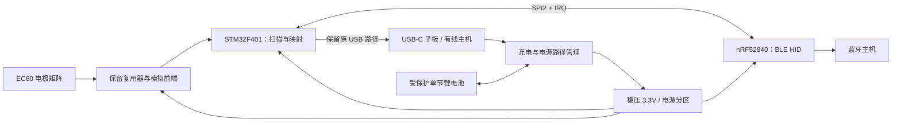

> **历史方案，已停止采用。** 当前按用户要求改为单颗 nRF52840，移除 STM32 和双主控 SPI 桥接。见 [当前设计](../hardware/ec60-nrf52840/README.zh-CN.md)。

# FELK60 / EC60 蓝牙改版

日期：2026-10-26。外壳暂按普通树脂设计，用户允许修改 PCB。蓝牙采用 nRF52840；Type-C 必须位于数字键／Esc 一侧的后面，禁止布置在空格键一侧的前面。约束记录在 `design-constraints.json`。当前已完成参考设计调查、接口原理图和网表验证；尚未完成蓝牙固件、电池电源电路、PCB 布线或整机装配验证。

## 首版架构

采用 **STM32F401 + nRF52840 双控制器，通过 SPI2 传输 HID 报告**。保留 FELK60 外形、定位板、gasket 安装结构、EC60 电极矩阵、模拟前端和原 USB 数据路径。STM32 负责扫描、校准与按键映射，nRF52840 负责 BLE HID、配对及无线连接状态。

此前 USB Host → BLE 方案降为备选。允许改 PCB 后，直接连接控制器可以去掉 USB Host 芯片和为原主板升至 5V 的需要；这是设计方向，实际功耗仍需验证。单 nRF52840 直接扫描则留作下一版：它可减少控制器数量，但涉及 ADC、时序和阈值的重新验证，不适合作为尽量保留现有扫描实现的首版。



图中的电池、电源管理、无线模块尚未接入本轮接口原理图。有线数据仍由 STM32 处理，因此不需要在两个 USB Host 之间切换。

2026-10-27 的 STEP 交叉检查确认：原外壳 Type-C 开口在后侧中央，EC60 板载 USB1 在后侧偏左，两者横向相差约 124.3 mm，不能直接对口。最终外接接口采用后侧 USB 子板 → J1 的路径；板载 USB1 不能当作整机外接接口。子板必须自行具备正确的 Type-C CC 终端与接口保护，J1 的四根线不包含 CC 信号。具体检查证据见[装配审查](audit/case-assembly.json)。

## HHKB 参考设计：借鉴范围与差异

| 参考 | 已检查的源码/资料 | 对本项目的价值与限制 |
| --- | --- | --- |
| [Hasu HHKB Controller](https://github.com/tmk/HHKB_controller) | `bluetooth.sch`、`BOM.txt`，版本 `d1a149c0bf60ff8264b450dd72fb1f660fe328d0` | 蓝牙与扫描分工、充电、硬件开关；原版 RN42、5V 升压和 AVR 电路不照搬 |
| [Yang / YDKB TMK 分支](https://github.com/yangdigi/tmk_keyboard) | `tmk_core/protocol/ble51/ble51.c`、`ble51_task.c`，版本 `c63495fa995ad0e7dd75d9acc9c591df1a8cc331` | 通过独立 BLE 驱动发送报告；切换输出前清键、USB 枚举状态和无线空闲管理。其旧 UART AT 协议不等于 nRF52840 通用协议 |
| [kanru/hhkb-zmk](https://github.com/kanru/hhkb-zmk) | `config/zephyr/kscan/kscan_hhkb_pro2.c`、`config/west.yml`，版本 `b2b680b7c7abe7e2c5902a9498c59326e1450c0d` | nRF52、活动/空闲扫描与检测电路断电的实现参考。该版本固定 ZMK v0.3，不直接视为当前上游兼容代码 |
| [Hasu 的 HHKB 接口记录](https://github.com/tmk/tmk_keyboard/blob/master/keyboard/hhkb/doc/HHKB.txt) | 原厂 TP1684 的 KEY/HYS/STROBE 数字接口 | 解释了为什么 HHKB 替换控制板不能直接插到 EC60：EC60 需要自身的模拟 ADC 采样 |

不将第三方板的接口、功耗或续航直接套用到 EC60，也不复制 HHKB 电路板外形。借鉴架构，保留各原项目归属；本轮派生的 EC60 原理图附带其 MIT 许可证。

## 已生成的 KiCad 接口原型

项目：[`EC60-BLE-Interface.kicad_pro`](../hardware/ec60-ble-interface/EC60-BLE-Interface.kicad_pro)。

这是 **USB 供电下的接口调试原理图**，不是电池版成品或打样文件。原 MCU、电源、USB、扫描元件及其连接关系保留，只扩展六个原本 NC 的 MCU 引脚，并增加 J2；矩阵、模拟、安装孔三个子页与上游逐字节一致。新增连接器暂不指定生产封装，待布局/装配确定。

| J2 引脚 | 网络 | STM32 UFQFPN48 引脚 | 功能 |
| --- | --- | --- | --- |
| 1 | SYS_3V3 | 原稳压 3.3V 电源 | 仅用于电源预算确认后的外接模块供电；不能输入电池电压 |
| 2 | GND | 地 | 共地 |
| 3 | BLE_SCK | PB13 / 26 | SPI2 SCK，AF5 |
| 4 | BLE_MOSI | PB15 / 28 | STM32 → nRF SPIS |
| 5 | BLE_MISO | PB14 / 27 | nRF SPIS → STM32 |
| 6 | BLE_CS_N | PB12 / 25 | STM32 GPIO 片选，低有效 |
| 7 | BLE_IRQ_N | PC13 / 2 | nRF → STM32 状态/握手输入；不承担负载供电 |
| 8 | BLE_RESET_N | PC14 / 3 | STM32 → nRF 复位控制；需在模块端定义上拉及复位配置 |

上述 SPI2 引脚按 [STM32F401 数据手册](https://www.st.com/resource/en/datasheet/stm32f401cb.pdf)核对。UART 未作为首版接口：USART1 常用 TX 引脚 PA9、PB6 已分别用于行驱动、模拟复用器选择；USART2 RX PA3 是 ADC 输入。SPI2 的四个引脚均未使用，可以保留扫描引脚定义。PC14 作为低速复位输出，还需遵守芯片对 PC13–PC15 的驱动限制。

nRF 端的具体 GPIO 与模块焊盘编号尚未分配，不能直接按 J2 顺序焊到任意 nRF 开发板。调试时先确认模块电源需求、原 U5 的确切型号和余量；若模块独立供电，J2-1 不连接，保持共地，并验证两端上电顺序及 I/O 反向供电问题。

原图里名为 `VBAT` 的全局网络连接 U5 输出和 STM32/OPA350 等电源，实际属于 **稳压后的 3.3V 系统电源**。派生图仅将该网络标签改为 `SYS_3V3`，STM32 的物理 VBAT 引脚名称保留。真正的锂电池端将独立命名 `BAT_CELL`，不能接到 J2-1。

## 电池版 PCB 的具体改动要求

1. 保留 PCB 外轮廓、安装孔、电极与定位板关系，原板 Edge.Cuts 含线宽的显示包围盒约 285.3 × 94.9 mm，板厚设置 1.59 mm。该包围盒含线宽，不能当作轮廓中心线的加工尺寸，也不能替代 FELK60 的装配净空验证。
2. 首选射频模块候选为 [Raytac MDBT50Q-1MV2](https://www.raytac.com/product/ins.php?index_id=24)，nRF52840、集成天线，厂商给出尺寸 10.5 × 15.5 × 2.05 mm。按其手册的焊盘、供电和天线净空设计；该尺寸不包括载板与天线周围的空间。
3. 电池电源候选为 [BQ24074](https://www.ti.com/product/BQ24074) 电源路径充电管理 + [TPS63031](https://www.ti.com/product/TPS63031) 3.3V 升降压。BQ24074 系统输出不能直接接 STM32 电源；经稳压后再供电。最终按电池规格设计 NTC、充电电流、输入电流限制与热布局。
4. 原 U5 的 5V → 3.3V 路径应在电池版中替换/隔离，不能把新稳压器输出直接与原 U5 并联。USB 原始 VBUS、受保护的 USB 输入、BAT_CELL、系统电源及模拟电源应明确区分。保留 USB ESD、CC、电源保护，增加真实 VBUS 检测与掉电处理。
5. 为模拟前端设置可控供电分区，预留稳定时间与隔离措施；不得用 nRF GPIO 直接给整块 EC 电路供电。SPI 端的片选上拉、复位上拉、IRQ 默认状态、必要的串联阻尼与掉电隔离应在模块电路完成时定值。
6. 低功耗是整机工作：原 [OPA350](https://www.ti.com/product/OPA350) 的典型静态电流为 5.2 mA。只增加 BLE 不能消除这个负载。首版先保留它验证扫描，随后测试前端间歇供电、降低空闲扫描频率；若无法达到功耗目标再考虑换运放。
7. 静电容按键没有普通触点矩阵的直接闭合唤醒。关闭前端后应周期唤醒采样，或增加经验证的独立唤醒电路；不能承诺完全断电扫描后仍能任意键瞬时唤醒。

普通树脂壳可优先评估内置天线，仍要避开钢定位板、PCB 铜层、电池和导电涂层。上盖 M3 孔按 FELK60 原说明调整为合适的螺纹嵌件结构。完整装配净空尚未核对，因此不预定电池容量、壳体开槽或天线位置。

## 固件边界

- 首版 STM32 保留 QMK 的扫描和映射，再增加自定义 BLE 传输层；nRF52840 需要独立的 BLE HID 与 SPI 从机固件。[QMK 无线文档](https://docs.qmk.fm/features/wireless)列出的标准蓝牙驱动不能直接当作 STM32 + 任意 nRF52840 的现成支持。
- 首先实现键盘 6KRO + 修饰键、媒体键、连接状态、LED 回传、模式切换清键、链路超时释放和重连时的状态同步。USB NKRO 可保留；蓝牙 NKRO、鼠标键、多设备切换需各自实现和验证，不能默认已有。
- SPI 协议需包含版本、长度、序号、完整性校验、应答/背压及超时。空闲时由 IRQ/握手唤醒处理，避免两个 MCU 持续忙轮询。两端任一复位后都需建立新会话并清除旧按键状态。
- VIA/Vial 继续走 STM32 原 USB 路径，不假定 BLE 可配置。上游固件较旧，需固定构建版本、验证接口后再适配。
- 上游存在清行访问第 6 行、扫描访问第 16 列、high 小于 low 的阈值配置。派生 `firmware/ec60/` 已修复，且用真实扫描 C 源码通过主机 ASan/UBSan、75 个位置及滞回测试；尚未证明目标 MCU 时序、阈值校准或无线功能。

## 可复现检查与当前结果

```sh
python3 scripts/build_ble_interface.py
python3 scripts/check_ble_interface.py
```

检查脚本需要 KiCad CLI；结果保存在 [`validation.json`](../hardware/ec60-ble-interface/validation.json)。已验证原有连通网络和元件值保留、六个新引脚原先空闲、J2 针号正确、三个子页未变。

派生接口图 BLE-IF-0.2 的 ERC 电气错误已清零：补齐 3 个 NC 标志、按内部稳压器输出纠正 VCAP1 的本地符号、将冗余 3.3V PWR_FLAG 移至 USB 输入并去掉遗留悬空标志连线。原有实际元件连接关系和元件值保持。检查器会阻止 `python -O` 跳过断言，失败时作废旧验证报告，并记录输入文件哈希。

警告仍包括上游符号/封装库、网格与网名等问题；具体数量以 `validation.json` 为准，不用“错误类别数量与上游相同”充当检查通过依据。原 PCB 的 DRC 仍有错误，不能打样。完整问题、生产 CPL 位号修正和机械审查见[审查记录](audit/README.zh-CN.md)。

后续顺序：双控制器协议与台架输入验证 → 电源电路及模块焊盘定版 → FELK60 装配与天线位置确认 → PCB 布线/ERC/DRC → 实物扫描、续航、充电及合盖射频验证。当前没有生成 Gerber，也没有宣称键盘已支持电池蓝牙运行。
