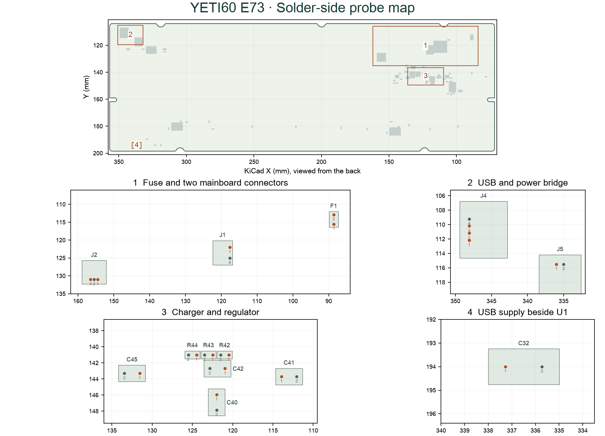

English | [Chinese](e73-bench-power.zh-CN.md)

# CORNER-07 bench power and charging

Use the CORNER-07 mainboard, existing C5 JSH daughterboard, and the J4-to-C5 harness and J5-to-J1 bridge from the [M05 build](../build/e73-m05-prototype.md). These tests can begin with the PCB on insulating supports, before printing the shell. Keep a real pack disconnected. Use the staged soldering checks and SWD install first. An operable and calibrated NiZ stack is needed for the typing tests. [Soldering and first power](../assembly/e73-corner/soldering.md) · [Firmware installation](e73-corner-firmware.md)

## Instruments and connections

1. Inspect J4 pins 1–4 to C5 pin-for-pin and the two-wire bridge J5.1 → J1.1, J5.2 → J1.4. J1.2 and J1.3 in this bridge are empty. Verify the isolated cables with a meter before mating.
2. After the current-limited, no-host first-power check, physically disconnect that bench supply. Use one data-capable USB host connection through C5, with an inline current logger that passes data. Measure total host input current upstream of C5 so the separate MCU VBUS branch and daughterboard are included.
3. At J2, use a current-limited battery simulator that can **sink charge current and source system current**. Use its battery emulation mode at a mid-charge setting around 3.7 V, with suitable current limits and stable source/sink crossover. Check with power off: J2.1 is simulator positive, J2.2 return, J2.3 the simulator's NTC fixture, referenced to J2.2. Confirm latch orientation and continuity from the mated plug before applying power. A nominal 10 kΩ thermistor-network setting is for the simulator test only. The solder map shows PCB pads, so use the mated orientation for the plug.
4. Secure probes with power off. Use a floating meter or differential instrumentation for each specified pad pair and for F1 voltage drop. A common-ground scope must use one circuit ground connection. Measure charge current in series with the simulator lead or from the simulator's signed readout, with positive current into the simulator.

### J2 simulator lead and temperature input test

Make a dedicated bench lead with **one SHR-03V-S housing**, **three SSH-003T-P0.2-H contacts** and three AWG28 stranded wires. Label both ends and verify each wire to the mated J2 pins before powering the board. The simulator connects only to pin 1 (BAT+) and pin 2 (GND). Connect the selector common to pin 3 (BAT_NTC). Connect one resistor between each switch position and pin 2. The native board connects BAT_NTC directly to U5 pin 1 (TS).

Use a lab battery simulator or an SMU in fixed-voltage mode that can both source and sink at **3.70 V**. Start with **0.50 A** current limits in both directions for this CORNER-07 test. The published maximum programmed charge current is 445.63 mA, so 0.50 A covers that current and corresponds to 1.85 W at 3.70 V. Check the limits and sign convention before attaching the board. For example, a Keithley 2450 supports bipolar current limiting and source/sink operation on its 20 V and 1 A ranges. A fixture with this capability can be shared across builds. [Keithley 2450 limits](https://www.tek.com/en/sitewide-content/datasheets/m/o/d/model-2450-touchscreen-source-measure-unit-smu-instrument)

For the selector, use one break-before-make SP3T switch and **one each 2.2 kΩ, 10 kΩ and 33 kΩ resistor, ±1%, at least 0.125 W**. Label the three positions. Use this lead with the simulator and no cell. Start at Normal with USB configured and positive BAT current, then test each fault and return to Normal while logging TS and signed BAT current.

| Position | Resistor between J2.3 and J2.2 | Calculated TS voltage range | Expected charge result |
|---|---:|---:|---|
| Hot | 2.2 kΩ | 0.157–0.173 V | Below the 0.270 V minimum hot trip. Sustained positive BAT current stops |
| Normal | 10 kΩ | 0.713–0.788 V | Inside the valid window, including recovery hysteresis. Charging resumes |
| Cold | 33 kΩ | 2.352–2.600 V | Above the 2.200 V maximum cold trip. Sustained positive BAT current stops |

Calculate `VTS = INTC × R` using TI's **72–78 µA** bias and both ±1% resistor extremes. Compare measured TS with the trip direction and verify BAT current at each stable setting. These three resistor positions exercise the mainboard's TS input. The pack's independent protection has a separate evidence requirement. [TI electrical characteristics and §9.3.6](https://www.ti.com/lit/ds/symlink/bq24074.pdf) · [Pack acceptance](../engineering/battery-pack-specification.md)

## Probe points on the back of the mainboard



The dots mark solder-pad centers from KiCad. Grey denotes ground. Use the exposed end of an installed pad or a breakout where the connector blocks access. Use the component's matching ground in the table. [PCB-bound coordinates and nets](../../hardware/e73-hhkb-corner/audit/bench-power-plan.json)

| Measurement | Positive and reference points |
|---|---|
| USB at the jack | Log the voltage and current at the **C5 input** with a data-capable fixture |
| C5 cable arrival | J4.1 relative to J4.4 |
| Send and receive at the power bridge | J5.1 relative to J5.2, then J1.1 relative to J1.4 |
| F1 drop | F1.2 upstream relative to F1.1 downstream |
| Charger IN, BAT, OUT | C40.1 → C40.2, C41.1 → C41.2, C42.1 → C42.2, respectively |
| Regulated rail | C45.1 → C45.2 |
| Module VBUS | C32.1 → C32.2 beside U1. This is a local proxy. Resolve borderline readings at U1.27 relative to U1's local ground with suitable instrumentation |
| Charger control | R42.1 EN1, R43.1 EN2, R44.1 CE, each relative to its own pad 2 |
| Thermistor signal | J2.3 relative to J2.2 at the breakout |

## Test in order

Record both minimum transient voltage and steady voltage where relevant. Start with the simulator and valid NTC setting. Record the host, cable, ambient temperature, configured image and recorded current resolution. TI input limits are for the charger IC. Evaluate total current at the host as well. [TI electrical and logic limits, §8.5](https://www.ti.com/lit/ds/symlink/bq24074.pdf) · [Nordic USB operating conditions](https://docs.nordicsemi.com/r/bundle/ps_nrf52840/page/power.html)

For the total-current check, use a data-capable connection at 5.0 V loaded at C5 first. Set the simulator above the precharge threshold and below the constant-voltage region, then confirm that battery current is positive. Test both firmware builds in their normal activity, including HID polling or calibration sampling. Measure upstream of the C5 daughterboard. Add the instrument's stated current uncertainty to the maximum steady reading when comparing with the 100 mA preconfiguration and 500 mA configured limits. Measure hot-plug inrush separately with a current probe or an appropriate USB test fixture and retain the trace. Run the reduced-VBUS test separately so foldback does not hide a high-current operating point. [Host-current budget](../engineering/e73-corner-power-process.md) · [USB-IF attach test, §B.4](https://www.usb.org/sites/default/files/USB-IFTestProc1_3.pdf)

| State | What to verify |
|---|---|
| SW100 on, USB attached before host configuration | Capture enumeration with USB and control signal timestamps. Once firmware initializes, expect EN1/EN2/CE = 0/0/1 and no sustained charging. Check that steady pre-configuration host current stays within 100 mA. Capture the uninitialized interval separately because all three control lines have hardware pull-downs |
| Host configured | Expect 1/0/0, valid USB HID, and positive battery current at the mid-charge simulator setting with valid TS. Total steady host draw must stay within the 500 mA descriptor. The charger IC's input cap is 450–500 mA across its tolerance. Check C32 and the actual U1 VBUS when required against 4.35–5.50 V while USB runs |
| Reduced available VBUS | Use a USB test fixture with an isolated, adjustable downstream VBUS and data passed to the host. Record loaded C5 input, C40 IN, C32/U1 and current. Verify charge-current foldback without resets, USB link loss or HID errors inside the declared operating range. Stop and record any drop below the USB operating window |
| Host suspend and resume | Expect 1/1/1 in suspend, no sustained battery charging, and low USB input current. Record host/USB suspend current separately. Resume restores charge only with configuration in place. Reset/deconfiguration returns to the charge-disabled state |
| USB detach | Verify no positive charging current. With the simulator sourcing battery current and a previously paired, calibrated normal image, check BLE typing. Reattach and check that USB takes priority |
| SW100 off, USB present | Run as a separate test. Expect 0/0/0 and USB100 autonomous charging when the simulated pack and NTC allow it. Check the 3.3 V rail is off and steady upstream USB draw stays within 100 mA. Record the mode's charging current and timer behavior |
| NTC abnormal and recovery | Use the simulator's resistance fixture to drive the TS measurement outside each applicable TI threshold, then restore the valid value. Verify charge stops and resumes using BAT current. The CHG signal can remain asserted during temperature suspension. Run the separate pack protection test only with a supplier-approved procedure |

A simulator can exercise CC/CV controls and fault transitions. A fixed 3.7 V setting alone cannot demonstrate taper, termination or charge time. For a real pack, first obtain signed electrical and thermal limits, verify the independent protector, and record CC, CV, termination and temperatures in both charging modes according to the [pack specification](../engineering/battery-pack-specification.md). TI specifies 4.16–4.23 V CV regulation and conditional termination. Leave the safety timer enabled. [TI charge cycle and temperature monitoring, §§9.3.5–9.3.6](https://www.ti.com/lit/ds/symlink/bq24074.pdf)

### Attach inrush and suspend current

For the USB 2.0 attach screen, measure upstream of C5 with the planned cable and the USB test fixture. Keep the link unconfigured during this capture so configured charging stays outside the trace. Repeat with SW100 on and off, using the battery simulator and the valid NTC setting. Capture from VBUS/GND contact through at least **100 ms after the first pulse** at **1 MS/s or faster**. If there is no pulse, capture at least 100 ms after contact. Record the physical contact as time zero, keep the pretrigger samples, and capture each current pulse and its return to baseline without clipping or decimating the trace. [USB-IF inrush analysis](https://compliance.usb.org/index.asp?Format=Standard&UpdateFile=Electrical)

Export current in amperes and time in seconds with columns named `time_s,current_a`. Run the [offline inrush checker](../../scripts/check_e73_usb_inrush.py) with the CSV and the current probe's absolute uncertainty in mA. For example, from the delivery folder:

```sh
python3 06-validation/check-usb-inrush.py attach.csv --current-uncertainty-ma 2
```

The example uses a 2 mA probe allowance. Substitute the actual value. The script integrates the current above **100 mA** using linear interpolation and separates pulses after **100 µs** continuously below that level. The worst region is screened against **50.0 µC**. Preserve the CSV, result and fixture details for each run. Use USBET and the specified test fixture for formal USB compliance. [USB-IF low/full-speed procedure, §B.4](https://www.usb.org/sites/default/files/USB-IFTestProc1_3.pdf) · [USBET20](https://www.usb.org/document-library/usbet20)

Suspend is a separate test after enumeration. Once the host reports suspend and the current has settled, compare total upstream current plus meter uncertainty with **2.5 mA**. Capture suspend and resume transients separately. [USB-IF suspend current change](https://compliance.usb.org/index.asp?Format=Standard&UpdateFile=Electrical)

### Record for each unit

| State and time | C5 V / mA | U5 IN / OUT / BAT V | U1 VBUS min | EN1 / EN2 / CE | Signed BAT mA, temperature and HID result |
|---|---|---|---|---|---|
|  |  |  |  |  |  |

Mark any uninstrumented state unmeasured. The [M05 headroom model](../engineering/e73-corner-power-process.md) helps interpret the voltage loss. Use the [first-article record](e73-first-article.md) for the final disposition.
