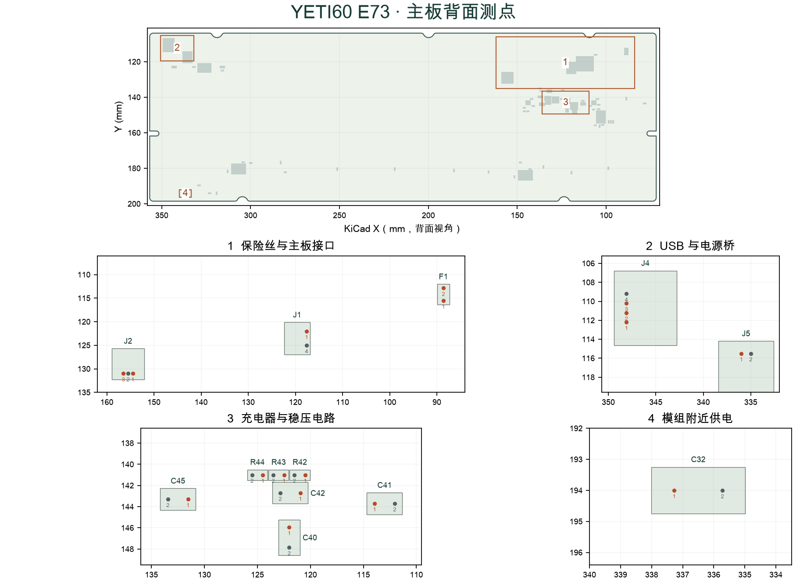

[English](e73-bench-power.md) | 中文

# CORNER-07 台架供电与充电测试

使用 CORNER-07 主板、已有 C5 JSH 子板，以及 [M05 指南](../build/e73-m05-prototype.zh-CN.md)里的 J4 至 C5 线束和 J5 至 J1 电源桥。外壳打印前即可把主板放到绝缘支座上开始测试，先断开实物电池。完成分段焊接检查和 SWD 刷写。打字测试需要已装好并校准的 NiZ 感应机构。[焊接与首次上电](../assembly/e73-corner/soldering.zh-CN.md) · [固件安装](e73-corner-firmware.zh-CN.md)

## 仪器与接线

1. 确认 J4 到 C5 的 1–4 号针逐一对应。电源桥 J5.1 接 J1.1、J5.2 接 J1.4，J1 中间两孔留空。插上之前用万用表核对各线导通。
2. 完成不接电脑的限流首次上电后，物理断开台式电源。用一根支持数据的 USB 线通过 C5 接电脑，可串入保留数据连接的电流记录仪。在 C5 上游测整机从电脑取的总电流，把子板和模组独立的 VBUS 支路计入。
3. J2 使用带限流的电池模拟器，须能**吸收充电电流并给系统供电**。用电池模拟模式，先设在约 3.7 V 的中段电压，设置适合的电流保护并确认供电与吸收切换稳定。断电核对 J2.1 接模拟器正极、J2.2 接回流、J2.3 接以 J2.2 为参考的热敏电阻模拟端。接通前按配对插头的卡扣方向核对针序和导通。10 kΩ 标称值仅用于模拟器测试。下图是 PCB 焊盘，插头需按配对方向核对。
4. 断电固定探头。按表中成对测点用浮地万用表或差分测量，F1 压降也按此方式测。共地示波器只接一个电路地。充电电流用串入模拟器回路的仪表或模拟器的有符号读数，流入模拟器记为正。

## 主板背面测点

圆点标出 KiCad 中的焊盘中心，灰色为地。用焊装后露出的端点，插座挡住焊盘时用测试转接线。各电压按表中配对测点量取。[绑定到 PCB 的测点坐标和网络](../../hardware/e73-hhkb-corner/audit/bench-power-plan.json)

| 项目 | 测点和参考点 |
|---|---|
| USB 插座带载电压和电流 | 在 **C5 输入侧**用保留数据链路的仪器测量 |
| C5 线束到主板 | J4.1 对 J4.4 |
| 电源桥两端 | 分别量 J5.1 对 J5.2、J1.1 对 J1.4 |
| F1 压降 | 上游 F1.2 对下游 F1.1 |
| 充电器 IN、BAT、OUT | 依次量 C40.1 对 C40.2、C41.1 对 C41.2、C42.1 对 C42.2 |
| 3.3 V 电源轨 | C45.1 对 C45.2 |
| 模组 VBUS | U1 附近 C32.1 对 C32.2 为就近测点。读数接近限值时，用适用仪器直接测 U1.27 对模组本地地 |
| 充电控制 | R42.1 为 EN1、R43.1 为 EN2、R44.1 为 CE，分别对各自的 2 号焊盘 |
| 热敏输入 | 在测试转接线上量 J2.3 对 J2.2 |

## 测试顺序

需要时同时记录瞬态最低值和稳态值。首先使用电池模拟器和有效热敏电阻设定。记录主机、线材、环境温度、固件及电流测量分辨率。TI 表里的输入电流限值针对充电芯片，还要另测电脑端总电流。[TI 电气与逻辑电平规格，第 8.5 节](https://www.ti.com/lit/ds/symlink/bq24074.pdf) · [Nordic USB 工作条件](https://docs.nordicsemi.com/r/bundle/ps_nrf52840/page/power.html)

测整机总电流时，先在 C5 带载约 5.0 V、数据链路可用的条件下进行。把电池模拟器设在预充阈值以上、恒压区以下，确认 BAT 电流为正。分别运行正常版和校准版固件，包含 HID 轮询或校准采样等正常活动。从 C5 子板上游取样，用稳态读数的最大值加仪表误差，与配置前 100 mA、配置后 500 mA 比较。插入浪涌用电流探头或合适的 USB 测试夹具另测并保存波形。低电压降流测试另做，以免降流掩盖高电流工作点。 [电脑端电流预算](../engineering/e73-corner-power-process.zh-CN.md) · [USB-IF 插入测试，第 B.4 节](https://www.usb.org/sites/default/files/USB-IFTestProc1_3.pdf)

| 状态 | 检查内容 |
|---|---|
| SW100 开启，主机尚未完成 USB 配置 | 同步记录 USB 枚举及控制信号时间。固件初始化后，EN1／EN2／CE 应为 0／0／1，无持续充电，配置前稳态总电流应在 100 mA 内。三个控制脚有硬件下拉，初始化前的时段另行记录 |
| 主机完成配置 | 应为 1／0／0，走 USB HID，热敏设定有效且模拟器处于中段电压时应有正向充电电流。稳态整机电流须在固件描述符的 500 mA 预算以内。芯片本身的输入上限随器件公差为 450–500 mA。USB 工作时核对 C32，并按需直接确认 U1 VBUS 在 4.35–5.50 V |
| USB 供电余量降低 | 用保留数据连接、下游 VBUS 可调且与主机 VBUS 隔离的测试夹具。记录 C5 带载输入、C40、C32／U1 与电流。确认在申报工作范围内降流时不复位、不掉 USB、不丢键。电压跌出工作范围时停止并记录 |
| 主机挂起和恢复 | 挂起时应为 1／1／1，不持续充电，另行记录 USB 挂起时的整机电流。恢复时只有仍处于已配置状态才重开充电。复位或取消配置应禁充 |
| 拔掉 USB | 确认正向充电结束。由模拟器供电，用已配对并完成校准的正常固件测试蓝牙打字。重连 USB 后验证 USB 优先 |
| SW100 关闭，保留 USB | 单独测试，应为 0／0／0。模拟器和热敏条件允许时走硬件 USB100 慢充。确认 3.3 V 轨关闭、上游稳态电流在 100 mA 内，并记录充电电流和定时行为 |
| 热敏故障与恢复 | 用模拟器的电阻夹具让 TS 测量值分别越过 TI 给出的冷热阈值，再恢复有效值。用 BAT 电流确认停充与恢复。温度暂停时 CHG 信号可能仍显示充电。保护包的独立温控另按供方确认的方法验证 |

模拟器用于验证充电控制及故障切换。只固定在 3.7 V 无法验收恒压收尾、终止或充满时间。实物电池应先取得签字确认的电气与温度限值并核实独立保护，然后按[电池包规格](../engineering/battery-pack-specification.zh-CN.md)记录两种充电模式的恒流、恒压、终止和温升。TI 的恒压调节范围为 4.16–4.23 V，终止取决于测试条件。保持安全定时器启用。[TI 充电周期及温度监测，第 9.3.5–9.3.6 节](https://www.ti.com/lit/ds/symlink/bq24074.pdf)

### 每台首件记录

| 状态和时间 | C5 电压／电流 | U5 IN／OUT／BAT 电压 | U1 VBUS 最低值 | EN1／EN2／CE | BAT 有符号电流、温度及 HID 结果 |
|---|---|---|---|---|---|
|  |  |  |  |  |  |

未布置仪器的项目记为未测。[M05 供电余量计算](../engineering/e73-corner-power-process.zh-CN.md)可用于比对压降。结论填入[首件验收表](e73-first-article.zh-CN.md)。
