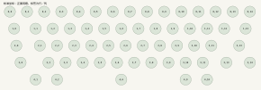

[English](e73-corner-firmware.md) | [中文](e73-corner-firmware.zh-CN.md)

# E73 右下角 PCB 对应固件

CORNER-07 交付包包含正常版、校准版 HEX 和配套固件清单。使用交付目录 `05-firmware/releases/` 内的固件。 [主板与固件验收检查](../engineering/e73-hhkb-corner.zh-CN.md)

首次通过 SWD 写入时使用 **HEX**。它包含将 NFC 引脚释放为 GPIO 的 UICR 记录。应用从地址零开始。连接探针前先核对自定义 J3 针序，再按下文逐键校准。

两份固件均使用内部低频 RC 时钟和 REG1 LDO。主机完成配置后，可同时充电和使用 USB HID，并优先走 USB；挂起时关闭充电器输入，拔线后允许回退蓝牙。这些是链接产物及主机模型检查，尚无实物 USB、蓝牙、静电容、充电、温升或无线验收。电量上报仍待电池及测量集成完成后启用。被动 RC 模型采用假定寄生参数，并非 PCB／NiZ 提取电容。

[固件清单](../../hardware/e73-hhkb-corner/firmware/manifest.json) · [正常版 HEX](../../hardware/e73-hhkb-corner/firmware/releases/normal/yeti60-e73.hex) · [校准版 HEX](../../hardware/e73-hhkb-corner/firmware/releases/calibrator/yeti60-e73.hex)

## 使用 J-Link 首次刷写

安装 [SEGGER J-Link 软件](https://kb.segger.com/J-Link_Commander)，探针使用 3.3 V 目标逻辑。通过已检查的电源路径供电，打开 SW100，先确认 3.3 V。J3 的 1 脚是 VTref，不是探针供电输入；2／3／4／5／6 分别为 SWDIO／GND／SWDCLK／RESET_N／GND。不要同时接入两个互相竞争的 5 V 电源。

在包含本版固件清单及 `releases/` 的目录打开终端：集中交付版为 `05-firmware/`，仓库内为 `hardware/e73-hhkb-corner/firmware/`。启动 Commander，Windows 程序名为 `JLink.exe`：

```sh
JLinkExe -device nRF52840_xxAA -if SWD -speed 1000 -autoconnect 1
```

在提示符下写入校准版：

```text
r
h
loadfile releases/calibrator/yeti60-e73.hex
r
g
q
```

确认下载／校验成功。这是按工具文档给出的命令，不是本板的实物刷写通过记录。出厂锁定模组可能需要恢复，但恢复／全片擦除会清空设置，完成校准后的更新不得这样操作。代码分区为 `0x00000～0xEFFFF`，必须保留 `0xF0000～0xFFFFF` 的设置。更新前检查烧录器擦除计划并备份设置；若工具要求全片擦除，先停止并解决保留问题。HEX 已包含所需 UICR 记录，不会出现 UF2 拖拽盘。

## 逐键采样并安装正常版

连接电脑 USB 前物理断开台架电源。校准版提供 USB 日志／命令行接口，在串口终端打开对应端口，可设置为 115200、8N1、无硬件流控。用另一把键盘输入命令。先安装定位板、胶碗和弹簧；用手触摸裸电极不能替代完整机构的校准。

使用 [60 键行列坐标表](../assembly/e73-corner/calibration-keys.csv)及正面图。空格仅中央静电容位置参与采样，卫星轴侧柱是被动机构。



1. 全部按键释放，执行 `yeti_calibrate release`，等待 128 帧完成提示。
2. **先完全按住**一个键，再输入对应命令。图中 `0,0` 位置使用 `yeti_calibrate press 0 0`。保持到 128 样本完成提示再松开，依图对全部 60 个有效位置重复操作。
3. 执行 `yeti_calibrate status`。样本不足、区间重叠、饱和或保护量不合格时先排查，不绕过保护。全部按键通过后才执行 `yeti_calibrate save`。
4. 按相同电压和极性要求重新接 SWD，再按下节保留设置的流程安装正常版。

### 安装正常版并保留校准

在交付包的 `05-firmware/` 目录操作。先退出 J-Link Commander，让 nRF Util 可以使用探针。首次安装 `device` 命令时执行下列第一行。列出探针后换成自己的序列号，备份和更新期间保持同一块主板供电并连接。[Nordic 安装要求](https://docs.nordicsemi.com/r/bundle/nrfutil/page/guides/installing.html/prerequisites) · [安装 device 命令](https://docs.nordicsemi.com/r/bundle/nrfutil/page/guides/installing_commands.html/installing-latest-commands)

```sh
nrfutil install device
nrfutil device list
PROBE=123456789
python3 prepare-normal-update.py prepare yeti60-e73-update.hex
nrfutil device read --serial-number "$PROBE" --address 0x1000120C --bytes 4
nrfutil device read --serial-number "$PROBE" --address 0xF0000 --bytes 65536 \
  --to-file settings-before.hex
python3 prepare-normal-update.py check-settings settings-before.hex
```

[离线升级工具](../../scripts/prepare_e73_normal_update.py)先比对正常版 HEX 的发布校验值，再生成地址低于 `0xF0000` 的应用区镜像。读回 **NFCPINS = 0xFFFFFFFE**，且工具确认设置备份完整、非空后，再开始编程。空白设置要回校准版检查保存结果。备份可能含有蓝牙配对数据，请留在本机。[Nordic 内存读取语法](https://docs.nordicsemi.com/r/bundle/nrfutil/page/nrfutil-device/nrfutil-device-read.html/syntax)

```sh
nrfutil device program --serial-number "$PROBE" --firmware yeti60-e73-update.hex \
  --options chip_erase_mode=ERASE_RANGES_TOUCHED_BY_FIRMWARE,verify=VERIFY_READ,reset=RESET_NONE
nrfutil device read --serial-number "$PROBE" --address 0xF0000 --bytes 65536 \
  --to-file settings-after.hex
python3 prepare-normal-update.py compare-settings settings-before.hex settings-after.hex
```

使用上述显式擦除选项，nRF Util 的默认模式为全片擦除。编程校验和回读均成功、工具输出 `same_settings: true` 后，执行 `nrfutil device reset --serial-number "$PROBE"`。如果校验或比对失败，保留原备份，先排查原因再进行擦除或复位。[Nordic 编程选项](https://docs.nordicsemi.com/r/bundle/nrfutil/page/nrfutil-device/nrfutil-device-program.html/programming-options)

检查 USB 按下／释放、修饰键、Fn 和大键边缘回弹，再测试蓝牙配对、重连、唤醒和 USB 优先。轴座、胶碗、弹簧、定位板叠层或 PCB 指纹变化后重新校准。

记录真实结果；交付的主机测试不能代替这些样机测试。

## 蓝牙配置槽与清除

按住 Fn，点按 Q、W、E、R 或 T，可依次选择 0–4 号蓝牙配置槽。首件验证时选一个备用槽。确认按住 Fn 后，单击或长按退格键都会保留绑定。在按住 Fn 的同时于 400 ms 内点按两次退格键，只清除当前槽。需要时先在该主机上移除旧配对，再重新配对。确认其他已配对槽仍可重连，键盘仍能使用之前保存的校准。普通层的退格键保留原功能。[编译固件及恢复行为检查](../../hardware/e73-hhkb-corner/firmware/firmware-recovery.json)

## 从源码重建

在完整源码仓库中完成原生布线、USB 参考地和装配检查后，运行以下命令。

```sh
uv run --python 3.14.7 --with-requirements requirements-audit.txt python scripts/build_e73_corner_firmware.py
python3 scripts/check_e73_corner_firmware.py
```

构建需要锁定版本的 ZMK 工作区、固定摘要的 Docker 镜像，以及正在运行的 Docker 服务。脚本在忽略目录内隔离构建，检查两份 ARM 链接产物，运行核心、校准、USB、GPIO、扫描、按键事件、NVS、恢复及 RC 灵敏度测试，并执行链接目标和套件故障注入测试，通过后才复制固件。`--prepare-only` 仅准备引脚契约；`--development-build` 仅在忽略目录构建测试，不发布镜像。
