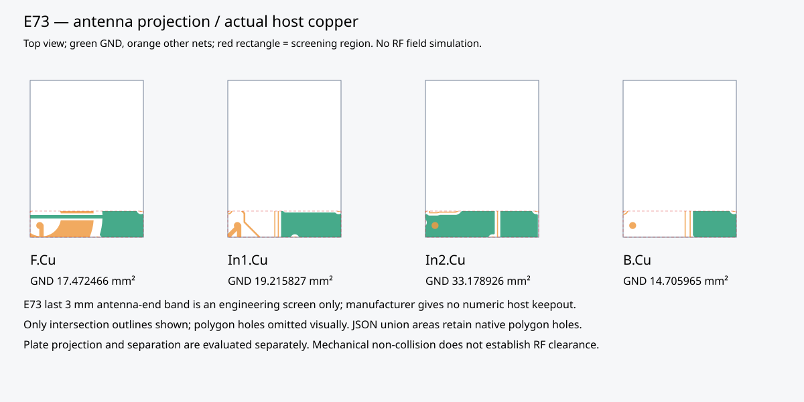
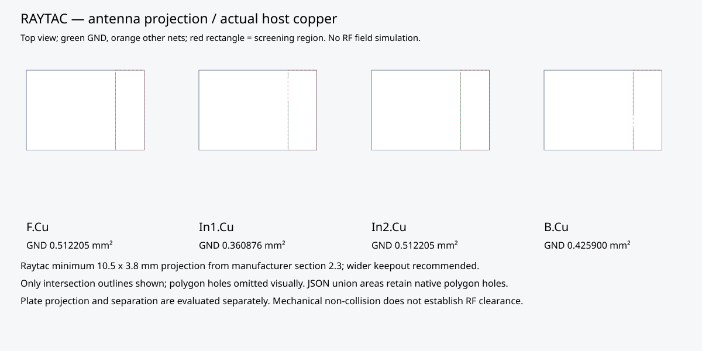
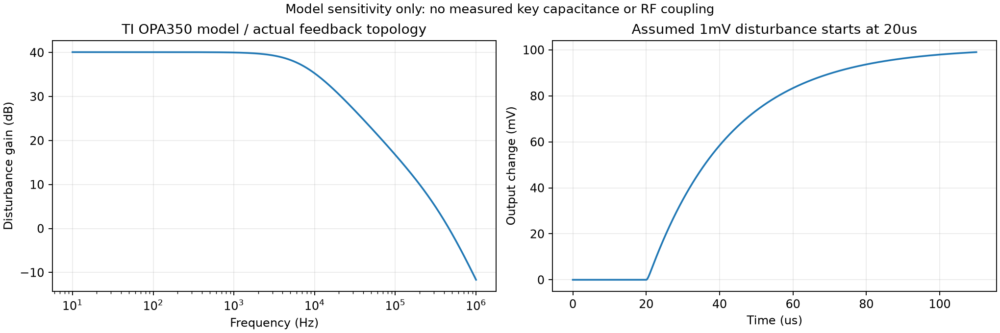

English | [Chinese](interference.zh-CN.md)

# Interference screening and open findings

The screen was executed against **both native PCB designs in this branch**. It found layout blockers; it did not demonstrate RF immunity or wireless range. The [acceptance procedure](README.md) and [machine-readable evidence](../audit/acceptance.json) control the current status. Earlier dated reviews and the legacy interconnect specification's deferral annotation describe the previous planning boundary; interference work is now active.

## Antenna copper and plate

[Raytac's official Version L specification](https://www.raytac.com/download/index.php?index_id=43), section 2.3, PDF page 11, shows a 10.5 × 3.8 mm minimum antenna projection with no ground copper on every host layer, recommends a wider region and edge placement. The screen transforms that minimum rectangle into the board's top-view coordinates. This minimum does not exhaust the manufacturer's wider-clearance advice.

[Ebyte's official E73-2G4M08S1C manual](https://www.ebyte.com/downpdf/444.html), PDF page 9 (printed page 8), discusses routing under the module, interference sources and antenna proximity to metal. It supplies **no numeric host antenna keepout**. We therefore screen the antenna-end **last 3 mm** of the vendor body as an explicitly provisional engineering region, not a manufacturer requirement or a complete RF model. Ebyte must confirm the host keepout and actual antenna reference before release. Vendor source hashes and page references are in [vendor-sources.json](vendor-sources.json); PDFs remain in ignored local storage.

| Quantity | E73 | Raytac |
|---|---:|---:|
| PCB top-view rectangle, mm | X 341.6–354.6; Y 131.5–134.5 | X 350.95–354.75; Y 119.75–130.25 |
| Screen area, mm² | 39.0, provisional | 39.9, vendor minimum projection |
| F.Cu GND intersection, mm² | 17.472466 | 0.512205 |
| In1.Cu GND intersection, mm² | 19.215827 | 0.360876 |
| In2.Cu GND intersection, mm² | 33.178926 | 0.512205 |
| B.Cu GND intersection, mm² | 14.705965 | 0.425900 |
| Metal plate projected area, mm² | 13.199388 | 38.860031 |
| Module mounting plane to plate bottom, mm | 6.2062 | 6.2062 |
| Disposition | Copper/proximity risk; vendor keepout unresolved | Fails minimum no-ground projection |

The Raytac intrusion is a thin fringe approximately 0.05mm wide at the region boundary; it is a layout-rule finding, not a measured radio failure. It can be difficult to see at overview scale.

The native KiCad calculation intersects filled zones, pads and tracks with each rectangle, unions copper before measuring, and preserves polygon holes. Track polygon approximation is 0.002 mm; this is a geometric screen, not an RF accuracy statement. The drawings show clipped copper outlines and omit polygon holes visually; use JSON union areas for measurements. They look at the PCB from above, unlike the mirrored underside assembly guide.





Plate projection uses the actual audited FELK60 DXF extruded by 1.2 mm, with the source cutouts retained. Intersection volume divided by plate thickness gives projected metal area. The 6.2062 mm plane separation is 4.6 mm provisional PCB-to-plate gap + 1.6062 mm finished board; antenna conductor height within each module is unavailable. This is nearby metal, **not a mechanical collision**, and cannot be converted into dB loss from geometry alone. Resin material, metal fasteners, springs, hands, cables and battery foil still affect the real antenna.

**Required adjustment before release:** obtain approved antenna regions, evaluate module relocation/rotation toward an edge, remove host copper and routes from those regions on every applicable layer, and recheck sensing geometry, return paths, ordinary fabrication, fit and firmware. If the fixed Topre plate still prevents acceptable radiation, evaluate a qualified remote-antenna alternative as a separate design change. Do not simply delete sensing electrodes or cut the plate without mechanical/EC revalidation. No board or plate was silently modified to hide this test result. Current fabrication ZIPs remain DFM review packages, not RF-approved production data.

## Analog disturbance simulation

The [bench circuit](../../tests/interference/afe.cir) is bound to both schematic XML netlists: U3 non-inverting input is `APLEX_OUT_PIN_0`, output `ADC`; R16=100k feedback, R17=1k to ground, C10=220p to ground, and each selected column has a 100k bleeder. It is a non-inverting voltage amplifier:

```text
Low-frequency noise gain = 1 + R16/R17 = 101 V/V
Assumed source path = selected 100k bleeder + 100 ohm mux
tau = 100100 ohm × 220 pF = 22.022 us
single-pole estimate = 1/(2*pi*tau) = 7.227 kHz
```

This source path models a disturbance at the selected bleeder's ground. It does not substitute for the unknown physical key capacitance, charge injection or sampling network. A 5mV DC bias avoids output saturation in the small-signal benchmark; a 1mV step starts at 20us. The official [TI OPA350 PSpice model](https://www.ti.com/product/OPA350) is SBOM071E, member `OPAx350.LIB`, Final 1.5 (2022-06-01). The script downloads and verifies fixed archive/member hashes. The ngspice `ltpsa` compatibility and `rshunt=1e12` regularization are explicit; a second 1e13 run checks DC output and gain sensitivity. Unregularized trials did not converge and were not accepted as evidence. See [ngspice compatibility documentation](https://ngspice.sourceforge.io/modelparams.html).

| Nominal model result | Value |
|---|---:|
| Gain at 10 Hz | 100.9603 V/V |
| Gain at 1 kHz | 99.9518 V/V |
| Gain at 100 kHz | 6.8583 V/V |
| Gain at 1 MHz | 0.2611 V/V |
| Output change 5us after 1mV step | 18.459 mV |
| Output change 45us after step | 86.841 mV |
| Output change at end of 110us run | 99.023 mV; not the final steady-state value |



The sweep covers 27 combinations of assumed mux resistance 60/100/200 ohm, assumed ADC capacitive load 5/10/50pF and imposed C10 variation 198/220/242pF, plus one regularization comparison: 28 sensitivity cases. These bounds are assumptions, not purchased-part guarantees. Every run rejects solver errors, absent/nonfinite vectors, implausible rail/DC levels or low-frequency gain inconsistent with 101×. [AC vectors](afe-ac.csv), [transient vectors](afe-transient.csv), [sensitivity table](afe-sensitivity.csv), [nominal ngspice log](afe-ngspice.log) and [model report](../audit/interference-analog.json) are preserved.

At low frequency, 1mV of input-referred disturbance can therefore approach 101mV at the ADC in this topology. This exposes sensitivity; it does not assert that a BLE transmission produces 1mV on this board. There is no extracted mutual-capacitance network, sampled ADC model, switching regulator/charger model or RF rectification model. The sweep stops at 1MHz; extrapolating it to 2.4GHz is invalid. Firmware waits and per-key thresholds must be qualified with actual pressed/released waveforms.

## Firmware and USB screening

Both portable cores now additionally execute 2000 frames of correlated ±400-code ripple around a synthetic released baseline of 1000, with isolated 2500-code bursts. With high=2000, low=1500 and two-frame debounce, isolated bursts produce no keys. Two consecutive 2100-code frames deliberately produce **75 synthetic false keys**, then release after two low frames. This expected limit test passes: debounce cannot distinguish sustained interference from a press. These are all raw positions; actual fitted keys remain 60. ADC codes are synthetic and are not converted into a measured noise margin. The existing host suite also tests 2000 hysteresis-band frames, all raw positions, transport changes, failures and AFE gating under ASan/UBSan.

USB screening sums all native tracks of `D+` + `USB_DP` and `D-` + `USB_DM`, and records width/layer/via counts. Aggregate positive/negative length differences are **9.436091 mm E73** and **5.625726 mm Raytac**. These totals include branch stubs and exclude pad lengths, resistor package, module routing, C5 and cable; they are **not end-to-end pair skew or compliance limits**. Full-path differential impedance, coupling, return-plane transitions, receiver eye and enumeration remain open. DRC continuity and a 500mA descriptor cannot establish USB signal integrity. Raw per-net values are in [layout evidence](../audit/interference-layout.json).

## Physical interference matrix

Run on each assembled alternative with normal firmware and its own per-key calibration. Record board serial, firmware HEX hash, host/OS, battery voltage, temperature, TX power/connection interval, antenna orientation and all instrument settings. Use the [template](first-article-template.csv). For each condition log at least 10 minutes released, then 100 deliberate press/release cycles of each of the 60 keys; retain time-stamped raw ADC and expected/received HID events. Project criterion: zero false, missed or stuck keys. Calibration logging can change timing; repeat event tests with logging disabled in normal firmware.

| Condition | Setup / observations |
|---|---|
| Baseline and supply | Battery-only at accepted full/mid/low voltage; scoped 3.3V and AFE rail at device ground, short ground spring; avoid probing the sensing node without accounting for probe capacitance |
| Charging / USB | Unconfigured USB100, configured USB500, suspended and switch-off states; power bank and intended computer/charger/cables. Capture supply and ADC changes at attach/detach and load transitions |
| BLE activity | Advertising, connected idle, continuous valid HID traffic, reconnect and five-profile switching; inspect ADC distributions synchronized with radio activity |
| Ordinary 2.4GHz coexistence | Normal sustained Wi-Fi traffic on permitted channels 1/6/11, AP at fixed 1m position; record channel, bandwidth and RSSI. Repeat with the intended USB 3.x hub active; do not use an RF jammer |
| Completed enclosure | Compare bare board, plate installed and fully assembled; battery/harness in final positions; hands resting and typing; four orientations. Log RSSI and delivered HID sequence at imposed 1/3/5m unobstructed distances |
| Host and reconnection | USB connection/suspend cycles and BLE reconnection/profile tests from the acceptance sequence; verify key releases during transport changes |

For each key and condition compute released maximum `Rmax`, pressed minimum `Pmin` and standard deviations `sigmaR`, `sigmaP` from labeled samples. The guard `G = max(6*sigmaR, 6*sigmaP, 1 ADC code)` is an imposed project screening margin, not a Gaussian error-rate guarantee. Require `Rmax + G < low < high < Pmin - G`; no valid interval means failure and a hardware/timing investigation. A narrow gap must not be hidden by recalibrating only in a quiet environment. Joint distributions may be correlated/non-Gaussian; retain extrema and events as well as standard deviations.

For the range target, require no missing/duplicate application HID sequence or unexpected disconnect over 10 minutes at each 1/3/5m pose, and record RSSI changes from bare to assembled. This is an imposed usability target, not the vendor's open-air range claim. Use a BLE sniffer for packet error/retransmission measurements; application HID delivery does not directly measure RF packet error rate. Keep failed orientations as failures. No results from this matrix exist yet, and no EMC/ESD certification has been performed.
