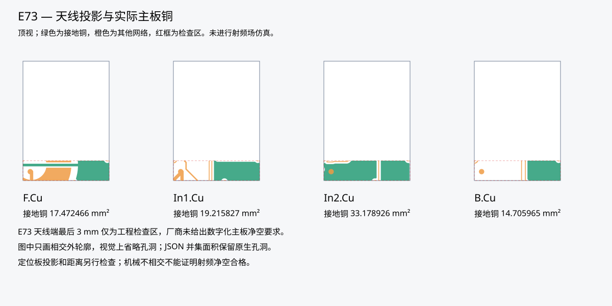
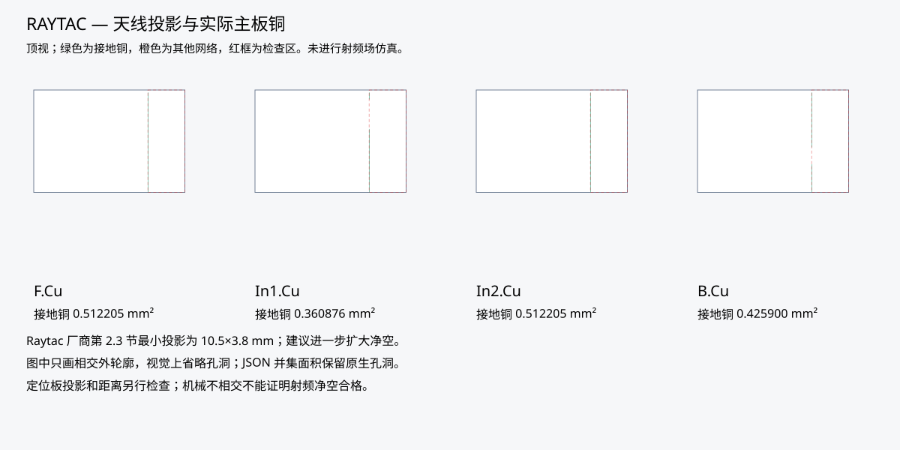
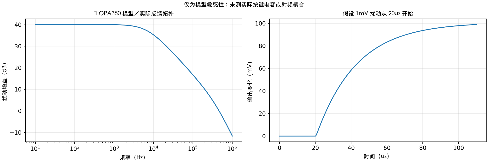

[English](interference.md) | 简体中文

# 干扰检查与未关闭问题

本次检查针对**同一分支的两块实际设计板**执行，发现了布局阻塞项，不能证明抗射频干扰或无线距离。[验收流程](README.zh-CN.md)和[机器证据](../audit/acceptance.json)定义当前状态。较早的日期化评估及旧线束规格中的“暂缓”标记仅描述此前边界；当前已经开始干扰工作。

## 天线区域铜与定位板

[Raytac 官方 L 版规格](https://www.raytac.com/download/index.php?index_id=43)第 2.3 节、PDF 第 11 页给出 10.5×3.8 mm 的最小天线投影，要求主板每层对应区域无接地铜，并建议扩大净空、靠近板边放置。本检查把该最小矩形变换至 PCB 顶视坐标；它不能代替厂商对更大净空的建议。

[亿佰特官方 E73-2G4M08S1C 手册](https://www.ebyte.com/downpdf/444.html)PDF 第 9 页（印刷第 8 页）讨论模组下方走线、干扰源与天线附近金属，**没有提供数字化的主板天线净空尺寸**。因此取厂商本体天线端**最后 3 mm**作为明确暂定的工程检查区，不把它称作厂商要求或完整射频模型。发布前须由厂商确认主板净空和实际天线基准。[vendor-sources.json](vendor-sources.json)记录来源哈希和页码，PDF 留在忽略的本地目录。

| 数值 | E73 | Raytac |
|---|---:|---:|
| PCB 顶视矩形，mm | X 341.6–354.6；Y 131.5–134.5 | X 350.95–354.75；Y 119.75–130.25 |
| 面积，mm² | 39.0，暂定 | 39.9，厂商最小投影 |
| F.Cu 接地铜相交，mm² | 17.472466 | 0.512205 |
| In1.Cu 接地铜相交，mm² | 19.215827 | 0.360876 |
| In2.Cu 接地铜相交，mm² | 33.178926 | 0.512205 |
| B.Cu 接地铜相交，mm² | 14.705965 | 0.425900 |
| 金属定位板投影面积，mm² | 13.199388 | 38.860031 |
| 模组安装平面至定位板底面，mm | 6.2062 | 6.2062 |
| 结论 | 铜与邻近金属风险；厂商净空待确认 | 不满足最小无接地铜投影要求 |

Raytac 相交铜为检查区边界约 0.05mm 宽的薄边，是布局规则问题，不是已测出的无线失效；在总览尺度下不易看见。

原生 KiCad 算法将填充铜区、焊盘和走线分别与矩形相交，测量前合并同类铜，保留多边形孔洞。走线多边形近似误差为 0.002 mm，这是几何检查精度，不是射频精度。示意图只画相交铜的外轮廓，视觉上省略孔洞；面积以 JSON 的原生并集结果为准。图为 PCB 顶视，与从背面观察的装配图不同。





定位板投影使用实际已审计的 FELK60 DXF 拉伸 1.2 mm，保留源开孔；实体相交体积除以厚度得到金属投影面积。6.2062 mm 的平面间距等于暂定 PCB 到定位板 4.6 mm 加成品 PCB 1.6062 mm；模组内天线导体高度未提供。这是邻近金属，**不是机械碰撞**，不能仅凭几何转换成 dB 衰减。树脂材料、金属紧固件、弹簧、手、线束和电池铝箔仍会影响实际天线。

**发布前需要调整：**取得认可的天线区域，评估模组向板边移动／旋转，清除适用各层对应区域的铜和走线，并重新验证感应几何、回流路径、普通工艺、装配与固件。如果固定 Topre 定位板仍阻碍可接受辐射，再把合格外置天线作为独立设计变更评估。不能未经机械／静电容复核直接删感应电极或切定位板。本次没有为隐藏失败而悄悄修改 PCB／定位板；当前光绘压缩包仍是工艺审查包，不是已通过射频的量产数据。

## 模拟扰动仿真

[测试电路](../../tests/interference/afe.cir)绑定两版原理图 XML：U3 同相输入为 `APLEX_OUT_PIN_0`，输出为 `ADC`；R16=100k 反馈，R17=1k 接地，C10=220p 接地，每列有 100k 下拉。这是同相电压放大器：

```text
低频噪声增益 = 1 + R16/R17 = 101 V/V
假设源路径 = 选中列 100k 下拉 + 100Ω 多路开关
时间常数 = 100100Ω × 220pF = 22.022us
单极点估算 = 1/(2*pi*时间常数) = 7.227kHz
```

该源路径模拟选中列下拉接地端的扰动，不能替代未知的实际按键电容、开关注入及采样网络。小信号台架用 5mV 直流偏置避开输出饱和，在 20us 时加入 1mV 阶跃。[TI 官方 OPA350 PSpice 模型](https://www.ti.com/product/OPA350)为 SBOM071E 内的 `OPAx350.LIB`，Final 1.5（2022-06-01），下载时核对固定压缩包及成员哈希。明确启用 ngspice 的 `ltpsa` 兼容模式和 `rshunt=1e12` 正则化，并用 1e13 再跑一次核对直流与增益敏感性。未正则化的尝试不收敛，未作为通过证据。参见 [ngspice 兼容说明](https://ngspice.sourceforge.io/modelparams.html)。

| 标称模型结果 | 数值 |
|---|---:|
| 10Hz 增益 | 100.9603 V/V |
| 1kHz 增益 | 99.9518 V/V |
| 100kHz 增益 | 6.8583 V/V |
| 1MHz 增益 | 0.2611 V/V |
| 1mV 阶跃后 5us 输出变化 | 18.459mV |
| 阶跃后 45us 输出变化 | 86.841mV |
| 110us 仿真末尾输出变化 | 99.023mV；不是最终稳态值 |



扫描假设开关电阻 60／100／200Ω、假设 ADC 电容负载 5／10／50pF，以及施加的 C10 198／220／242pF 变化，共 27 种组合，另加正则化比较一次，共 28 组。这些边界是假设，不是已购零件保证。每次运行均拒绝求解器错误、缺失／非有限数据、不合理的电源／直流值，以及与 101 倍不符的低频增益。保留[交流数据](afe-ac.csv)、[瞬态数据](afe-transient.csv)、[敏感性表](afe-sensitivity.csv)、[标称日志](afe-ngspice.log)及[模型报告](../audit/interference-analog.json)。

因此在低频下，1mV 输入等效扰动可在 ADC 端接近 101mV。这揭示电路敏感性，不能据此声称本板一次蓝牙发射会产生 1mV。模型未提取互电容、采样 ADC、稳压器／充电器开关噪声或射频整流；频扫截止 1MHz，不能外推至 2.4GHz。固件等待时间及逐键阈值仍须使用实物按下／松开波形验收。

## 固件与 USB 初筛

两版可移植核心新增 2000 帧：以模拟松开值 1000 为基准叠加相关 ±400 码纹波，并加入孤立的 2500 码突发。在高阈值 2000、低阈值 1500、两帧消抖下，孤立突发不会触发键；连续两帧 2100 则特意触发 **75 个模拟误键**，之后两帧低值释放。这个边界测试通过，说明消抖不能区分持续干扰和真实按键。这里覆盖所有原始位置，实际键仍为 60 个；ADC 码为人工输入，不换算成已测噪声裕量。现有主机测试还在 ASan/UBSan 下验证 2000 帧迟滞区噪声、全部原始位置、连接切换、故障与前端门控。

USB 对 `D+` 加 `USB_DP`、`D-` 加 `USB_DM` 的所有原生走线求和，并记录线宽、层和过孔数量。正负总长差分别为 **E73 9.436091 mm、Raytac 5.625726 mm**。总长含分支末端，未含焊盘、串联电阻封装、模组内部、C5 和线束，**不是端到端差分时延失配或合规限值**。全路径差分阻抗、耦合、参考地切换、接收眼图和枚举仍待验证。DRC 连通和 500mA 描述符不能证明 USB 信号完整性。[布局证据](../audit/interference-layout.json)提供逐网原始数值。

## 实物干扰矩阵

每套装配后的板分别使用普通固件及自身逐键校准。记录序列号、HEX 哈希、主机／系统、电池电压、温度、发射功率／连接间隔、天线朝向及仪器配置，填写[模板](first-article-template.csv)。每种工况至少松开记录 10 分钟，再对 60 键各按下／松开 100 次，保留带时间戳的原始 ADC 和期望／收到的 HID 事件。项目要求零误键／漏键／卡键。校准日志可能改变时序，事件测试还须以关闭日志的普通固件复测。

| 工况 | 设置与观察 |
|---|---|
| 基准与供电 | 纯电池，验收过的满／中／低电压；器件地附近用短地弹簧观察 3.3V 和前端电源；探测感应节点须计入探头电容 |
| 充电／USB | 未配置 USB100、已配置 USB500、挂起、关机；充电宝及计划使用的电脑／充电器／线束；记录插拔和负载切换时电源与 ADC |
| 蓝牙活动 | 广播、连接空闲、持续有效 HID、重连、五配置切换；检查与射频活动同步的 ADC 分布 |
| 正常 2.4GHz 共存 | 合法信道 1／6／11 的正常持续 Wi-Fi 流量，AP 固定距 1m；记录信道、带宽、RSSI；另测实际 USB 3.x 集线器活动，不使用干扰器 |
| 完整外壳 | 对比裸板、安装定位板和完整装配；电池／线束位于最终位置，双手搭放和打字，四个朝向；按项目规定无遮挡 1／3／5m 记录 RSSI 与 HID 序列 |
| 主机与重连 | 按验收流程执行 USB 插拔／挂起、蓝牙重连／配置切换，确认传输切换中的按键释放 |

每键、每工况根据有标签采样计算松开最大值 `Rmax`、按下最小值 `Pmin` 和标准差 `sigmaR`、`sigmaP`。保护值 `G = max(6*sigmaR, 6*sigmaP, 1 ADC码)` 是人为设定的项目筛选裕量，不是高斯误码率保证。要求 `Rmax + G < low < high < Pmin - G`；不存在有效区间即失败，排查硬件或时序。不能只在安静环境重新校准掩盖狭窄裕量；分布可能相关、非高斯，须同时保留极值和事件。

距离目标为每个 1／3／5m 朝向持续 10 分钟，无应用 HID 序列丢失／重复或意外断连，同时记录裸板到完整装配的 RSSI 变化。这是项目可用性目标，不能采用厂商开阔场地距离宣称代替。需要蓝牙嗅探器测量包错误和重传，应用层 HID 送达不能直接测出射频包错误率。失败朝向须保留失败。本矩阵尚无实物结果，也未执行电磁兼容／静电认证。
