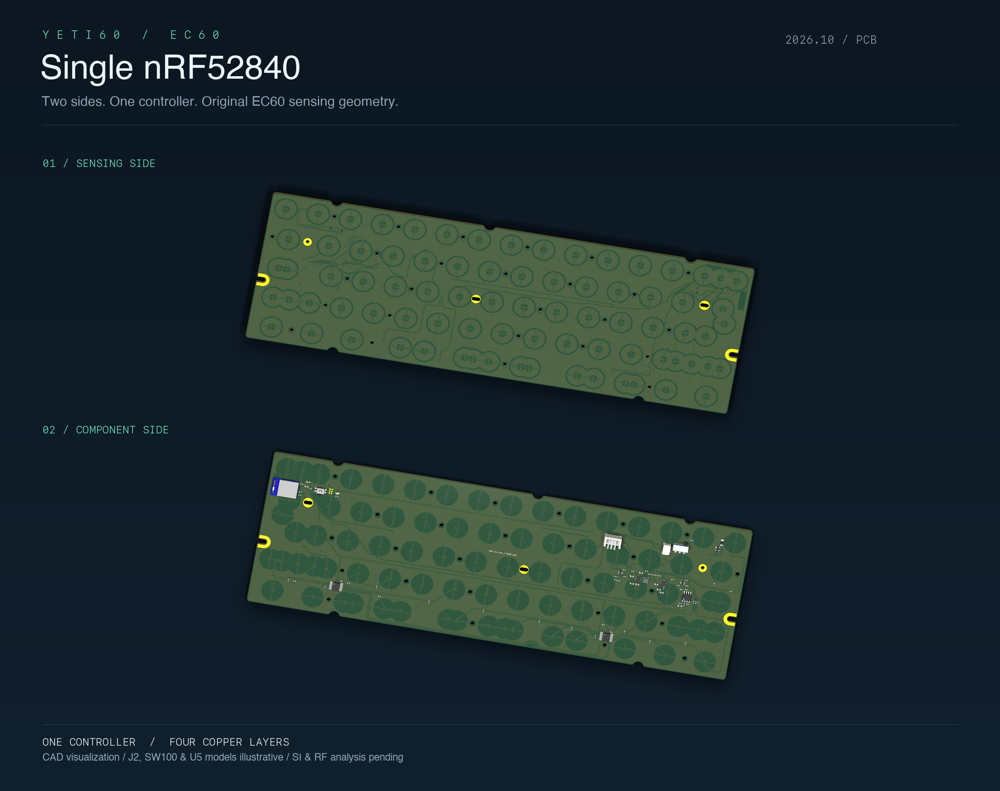
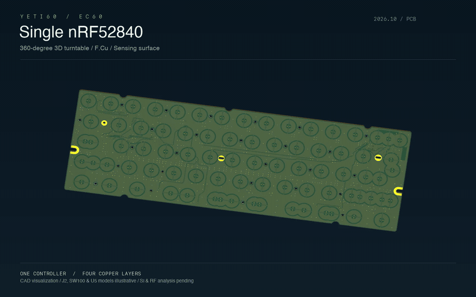

English | [Chinese](README.zh-CN.md)

# YETI60 single-nRF52840 PCB renders

Images and the animation are regenerated from the **current audited PCB**. Every animation frame rotates the actual 3D board; this is not a flat image flip.





[MP4](pcb-turntable.mp4) · [GIF](pcb-turntable.gif) · [Sensing side](pcb-front.png) · [Component side](pcb-back.png)

The MP4 is 1600×1000, 24 fps, 72 frames and 3 seconds. The looping GIF is 960×600 at 12 fps. Front/back PNGs are 2400×1500; the two-side overview is 2400×1900.

The renderer checks the input against the CAD source hash and confirms it is unchanged afterward. Only model references change in a render-only snapshot. Legacy KiCad 6 WRL references resolve to current standard STEP models. J1 uses the same standard part with its origin aligned to the retained footprint; U2/U4 discard an obsolete duplicate and retain their existing SSOP STEP.

J2 has an illustrative body using the sourced 5.5 mm side-entry PH height; its full mating geometry is not qualified. SW100 remains illustrative and U5 uses a generic WQFN model. These caveats appear in the images. Native tile-size differences are center-padded without stretching the PCB. Model/recipe/source/output hashes and substitutions are recorded in `render-manifest.json`.

```sh
uv run --with-requirements requirements-audit.txt python scripts/render_single_nrf.py --frames 72 --fps 24
```

Run from the repository root with KiCad 10, its standard 3D model library and ffmpeg installed. `--stills-only`, `--frames`, `--fps`, `--jobs` control output; environment overrides are `KICAD_CLI`, `KICAD10_3DMODEL_DIR`, `RENDER_FONT`, `RENDER_MONO_FONT`. The cache keys source, recipe, model hashes, renderer version and animation parameters. Temporary snapshots and frames live in ignored `.render-work/`; only project-authored proxies are stored in `models/`.

These are PCB visualizations. [Assembled studies](../yeti60-assembly/README.md) are separate and conditional; neither set certifies manufacturing, firmware, SI or RF performance.
