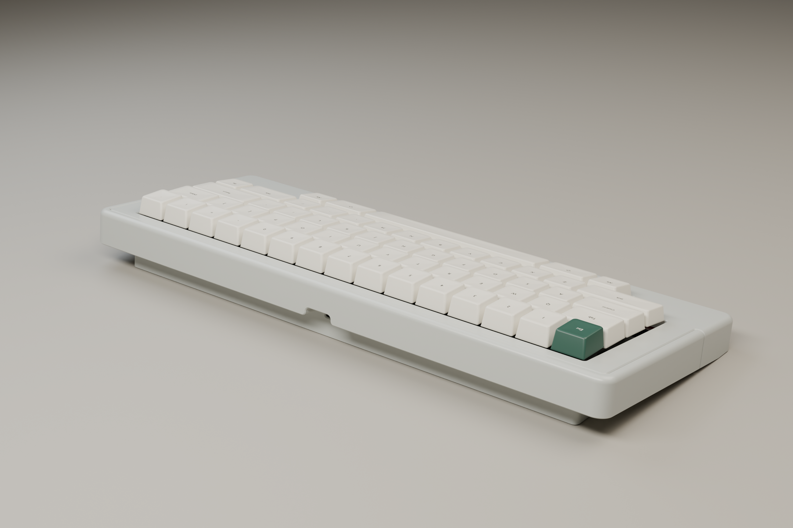
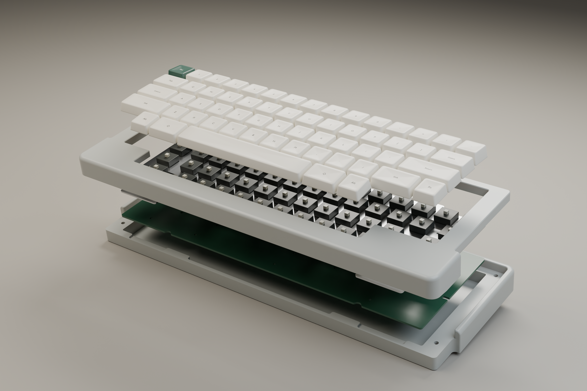
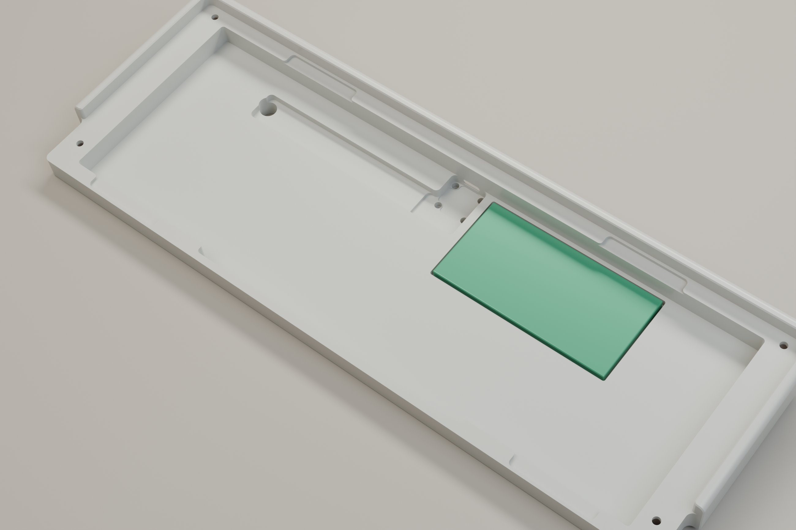

# YETI60 物理光照渲染

[英文](README.md) | 简体中文

图像使用 Blender Cycles 路径追踪、柔光箱照明、细微树脂／键帽表面粗糙度、有圆角和指腹凹面的键帽及接触阴影，图中不叠加说明文字。外壳直接从 FELK60 原始 STEP 实体生成，**不缩放外壳、不增加改变尺寸的倒角修改器、不调整轮廓，也不改变上下壳相对位置**。








## 尺寸与范围

上下壳在原始 CAD 坐标系中的联合包围尺寸为 **325.700 × 125.200 × 31.190 毫米**。这是该坐标系中的包围盒，不代表投影到桌面后的深度，也不包含键帽总高度。整机仅做一次 7° 刚性旋转，使原有楔形底面落在桌面上。网格线性离散偏差设为 0.015 毫米，并检查网格包围坐标与原始实体的差值小于 0.02 毫米。渲染时统一将毫米换算为米。

[几何验证](../../docs/audit/yeti60-render-geometry.json)和[渲染清单](render-manifest.json)记录原始文件哈希、壳体尺寸、渲染脚本、网格离散参数及图片哈希。1.2 毫米定位板与当前 PCB 使用和[装配检查](../../docs/audit/yeti60-assembly.json)一致的坐标。

**外观逼真不等于未选定部件已经完成尺寸验收。** 树脂颜色和表面处理、键帽及字符、轴体和轴心、元件高度包络均为示意。暂定 4.6 毫米板间距仍需实际胶碗／紧固件结构确认。绿色块为默认定制 1600 mAh 完整电池包包络（85×43×4.8 mm）；供应商图纸和独立温度保护仍须验收。后侧开孔保持原始壳体几何；最终 USB 子板、插头和线缆尚未作为已验证部件装入。

## 重新生成

先用 KiCad 的 Python 运行 `scripts/export_yeti60_mechanical_metadata.py` 更新元数据。前两条命令使用固定依赖的 CAD 环境，最后一条使用独立的 Blender 环境：

```sh
python scripts/check_yeti60_assembly.py
python scripts/export_yeti60_render_meshes.py
uv run --python 3.11 --with-requirements requirements-render.txt python scripts/render_yeti60_assembly.py
```

参数 `--preview --view assembled` 将低分辨率试图保存到已忽略的 `.assembly-work/`。最终图片为 2600 × 1734 像素，Cycles 最高 256 采样并启用降噪。材质与照明使用[官方渲染器](https://www.blender.org/features/rendering/)和[材质接口](https://docs.blender.org/api/5.0/bpy.types.Material.html)。尚未完成的硬件条件见[完整复查](../../docs/audit/yeti60-comprehensive-review.zh-CN.md)。
