中文 | [English](build-guide.md)

# YETI60 逐步焊接与安装指南

本指南按 P2 当前主板、C5 JSH、1600 mAh 单电芯及原尺寸 FELK60 派生外壳生成。每一步均配独立示意图。尚无实物，图示是工程装配说明，不是已完成的操作照片。实际物料、胶碗／轴壳、钢网、充电及首件验收条件仍然适用。

[需要制作的 PCB 与完整材料](../../README.zh-CN.md#需要下单制作哪些-pcb) · [主板补购表](../../hardware/bom/mainboard-purchase.zh-CN.csv) · [子板自焊材料](../../hardware/bom/daughterboard.zh-CN.csv) · [结构尺寸](../engineering/assembly.zh-CN.md)

主板元件位于背面，主板图已按背面观察进行水平镜像；C5 图从 F.Cu 元件面观察。数字行侧为后方。金黄色圆圈标出原生焊盘 1，仍须与实际器件封装标识核对。PCB 线路省略，机械分解高度及未定型胶碗／轴壳／键帽外形为示意。

步骤 12–13 仅用于自焊 C5，购买成品时跳过；其余步骤仍需执行。

**装配前验收：** 两版天线均有未解决的布局风险；当前只能按工程样机装配，不能据此认定蓝牙已经验收。先阅读[验收与干扰测试](../../../../docs/testing/README.zh-CN.md)，记录板型、固件哈希及每项实测结果。

步骤目录

- [01 准备板子、元件和工具](#step-01)
- [02 识别正反面并检查裸 PCB](#step-02)
- [03 支撑主板并印刷锡膏](#step-03)
- [04 放置全部 43 只电阻](#step-04)
- [05 放置全部 17 只电容](#step-05)
- [06 放置电源及保护元件](#step-06)
- [07 放置静电容模拟前端](#step-07)
- [08 放置唯一的 nRF52840 模组](#step-08)
- [09 放置连接器、开关和指示灯](#step-09)
- [10 回流、冷却并检查焊点](#step-10)
- [11 完成断电电气检查](#step-11)
- [12 自焊 C5 分支：印锡膏并放置七只元件](#step-12)
- [13 自焊 C5 分支：回流并检查 USB 两排触点](#step-13)
- [14 检查 C5 与四芯 USB 线束](#step-14)
- [15 不接电池，首次 USB 上电](#step-15)
- [16 通过 J3 写入并验证校准固件](#step-16)
- [17 处理树脂壳并冷粘八个嵌件](#step-17)
- [18 准备钢定位板并装配 60 套轴壳](#step-18)
- [19 对齐胶碗与锥形感应弹簧](#step-19)
- [20 安装 29 套绝缘 PCB 紧固件](#step-20)
- [21 安装下侧垫片、C5 和开口走线底座](#step-21)
- [22 检查并固定经过确认的电池包](#step-22)
- [23 铺设七根导线并封好可拆走线桥](#step-23)
- [24 安装 60 个匹配键帽并检查行程](#step-24)
- [25 逐键校准、保存并写入普通固件](#step-25)
- [26 开壳检查 USB、蓝牙及充电状态](#step-26)
- [27 安装上侧垫片并合壳](#step-27)
- [28 安装四个脚垫并完成最终检查](#step-28)

## 01 — 准备板子、元件和工具

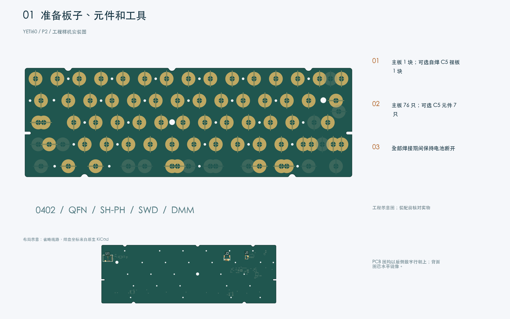

[放大矢量图](images/01-step.zh-CN.svg)

1. 按 README 中的四层制板文件制作主板；自行焊子板时再制作一块 C5 JSH 裸板。
2. 逐项核对阻值、容量、封装及额定参数，将已匹配的五种库存与未经确认的替代件分开放置。
3. 准备放大观察、静电防护、锡膏／钢网、可控回流设备、镊子、万用表、限流 USB 电源及 SWD 探针；电池保持断开。

**检查后再继续：** 先确认实际料号和兼容焊接曲线，再印锡膏；仅用烙铁不能完成底部隐藏焊点。

## 02 — 识别正反面并检查裸 PCB

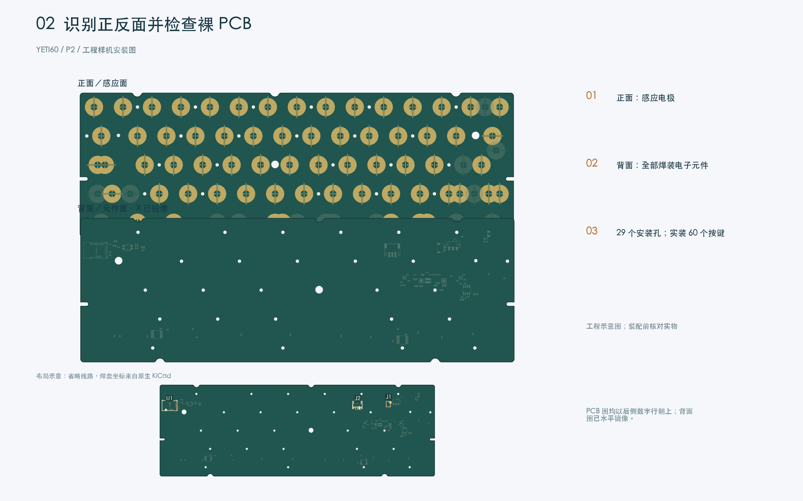

[放大矢量图](images/02-step.zh-CN.svg)

1. 区分正面感应电极与背面元件；按图中的视角说明辨认方向。
2. 检查 29 个安装孔、板边及感应电极清洁度，不打磨、不上锡、不涂覆感应焊盘。
3. 检查铜箔和阻焊缺陷，并按工艺说明核对实收尺寸及板厚。

**检查后再继续：** PCB 有 74 个备选电极位置，实际安装 60 个按键；电极不是待焊开关，不增加每键二极管。

## 03 — 支撑主板并印刷锡膏

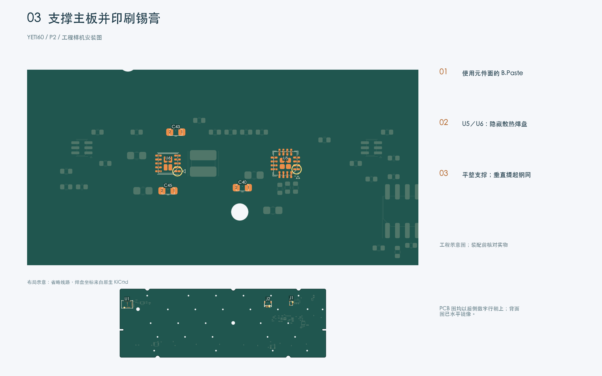

[放大矢量图](images/03-step.zh-CN.svg)

1. 用平整治具支撑 PCB，元件面向上，避免划伤或弯曲感应面。
2. 将确认过的钢网对准当前 B.Paste 图形，按钢网方案封住或去掉 JP1 开口；印刷后垂直提起，检查连膏、少膏及偏移。
3. 重点检查 U5／U6 裸露焊盘和主控模组焊盘；普通开放散热孔需要控制吸锡。

**检查后再继续：** 原生锡膏层不等于已经验收的钢网配方；须确认减量／分窗、锡膏及温度曲线，不能向散热盘堆锡。

## 04 — 放置全部 43 只电阻

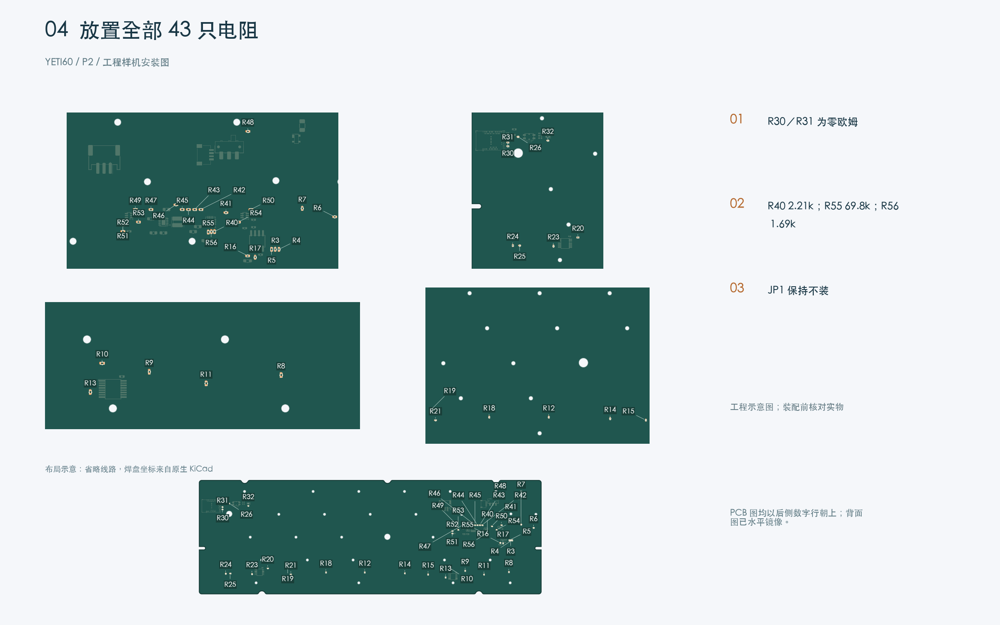

[放大矢量图](images/04-step.zh-CN.svg)

1. 按阻值分装 0402 电阻，逐一按下表位号放置，不能靠外观辨别阻值。
2. R30／R31 装零欧姆；R40=2.21k、R55=69.8k、R56=1.69k，均为 1%，不能用相近库存阻值替代。
3. 完成其余增益、下拉、指示灯及分压电阻；JP1 保持空置。

**检查后再继续：** 核对共 43 只电阻；电阻无极性，但阻值和位置必须正确。

本步放置位号：R10, R11, R12, R13, R14, R15, R16, R17, R18, R19, R20, R21, R23, R24, R25, R26, R3, R30, R31, R32, R4, R40, R41, R42, R43, R44, R45, R46, R47, R48, R49, R5, R50, R51, R52, R53, R54, R55, R56, R6, R7, R8, R9.

| 位号 | 数量 | 设计值 | 封装 |
|---|---:|---|---|
| R3, R4, R5, R6, R7, R47, R53, R54 | 8 | 100 | R_0402_1005Metric |
| R8, R9, R10, R11, R12, R13, R14, R15, R16, R18, R19, R20, R21, R23, R24, R25, R42, R43, R44, R45, R46, R48, R49, R50 | 24 | 100k | R_0402_1005Metric |
| R17 | 1 | 1k | R_0402_1005Metric |
| R26 | 1 | 10k | R_0402_1005Metric |
| R30, R31 | 2 | 0 | R_0402_1005Metric |
| R32 | 1 | 2.2k | R_0402_1005Metric |
| R40 | 1 | 2.21k/1% | R_0402_1005Metric |
| R41 | 1 | 7.50k/1% | R_0402_1005Metric |
| R51, R52 | 2 | 1M/1% | R_0402_1005Metric |
| R55 | 1 | 69.8k/1% | R_0402_1005Metric |
| R56 | 1 | 1.69k/1% | R_0402_1005Metric |

## 05 — 放置全部 17 只电容

[放大矢量图](images/05-step.zh-CN.svg)

1. C10 装 0402、220 pF、C0G，C47 装 0402、10 nF；其余按下表放置。
2. 库存 100 nF 仅用于 C9／C11／C12／C31；库存 1 µF 仅用于 C13／C48。
3. C40／C44 和大容量电容保持指定的 0603 封装，确认耐压、介质及直流偏压下有效容量。

**检查后再继续：** 核对共 17 只电容；指定陶瓷电容无极性，不能将库存 0805 直接装入 0603 焊盘。

本步放置位号：C10, C11, C12, C13, C30, C31, C32, C40, C41, C42, C43, C44, C45, C46, C47, C48, C9.

| 位号 | 数量 | 设计值 | 封装 |
|---|---:|---|---|
| C9, C11, C12 | 3 | 100n | C_0402_1005Metric |
| C10 | 1 | 220p | C_0402_1005Metric |
| C13 | 1 | 1u | C_0402_1005Metric |
| C30, C41, C42, C43, C45, C46 | 6 | 10u/10V | C_0603_1608Metric |
| C31 | 1 | 100n/16V | C_0402_1005Metric |
| C32 | 1 | 4.7u/10V | C_0603_1608Metric |
| C40 | 1 | 1u/10V | C_0603_1608Metric |
| C44 | 1 | 100n/16V | C_0603_1608Metric |
| C47 | 1 | 10n | C_0402_1005Metric |
| C48 | 1 | 1u/10V | C_0402_1005Metric |

## 06 — 放置电源及保护元件

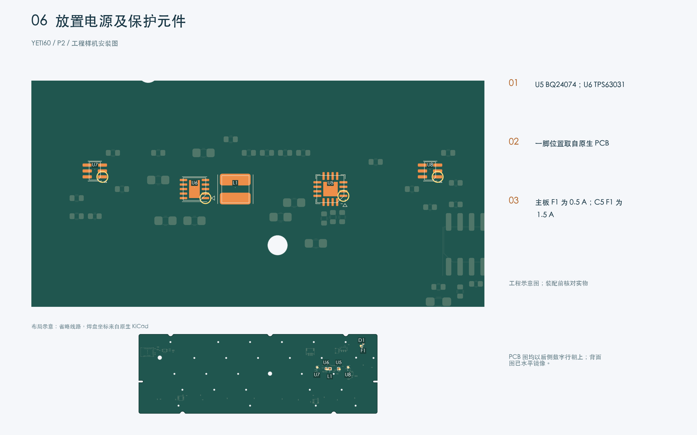

[放大矢量图](images/06-step.zh-CN.svg)

1. 将 U5 BQ24074、U6 TPS63031、U7／U8 TPS22919 的实际封装一脚标识与原生焊盘 1 对齐。
2. L1 使用指定的 1.5 µH 电感，F1 使用主板要求的 1206／0.5 A 保险丝；它与 C5 的保险丝不同。
3. D1 PRTR5V0U2X 按 SOT-143 原生脚序放置；放下 U5／U6 前先检查底部焊盘锡膏。

**检查后再继续：** 不能漏焊 U5／U6 底部接地散热盘，也不能用磁珠代替电感；封装标识须按实际厂商图纸核对。

本步放置位号：U5, U6, U7, U8, L1, D1, F1.

| 位号 | 数量 | 设计值 | 封装 |
|---|---:|---|---|
| D1 | 1 | PRTR5V0U2X | SOT-143 |
| F1 | 1 | 500mA | Fuse_1206_3216Metric |
| L1 | 1 | 1.5uH_74438336015 | L_Wuerth_MAPI-3015 |
| U5 | 1 | BQ24074RGT | VQFN-16-1EP_3x3mm_P0.5mm_EP1.6x1.6mm |
| U6 | 1 | TPS63031DSK | WSON-10-1EP_2.5x2.5mm_P0.5mm_EP1.2x2mm |
| U7, U8 | 2 | TPS22919DCK | SOT-363_SC-70-6 |

## 07 — 放置静电容模拟前端

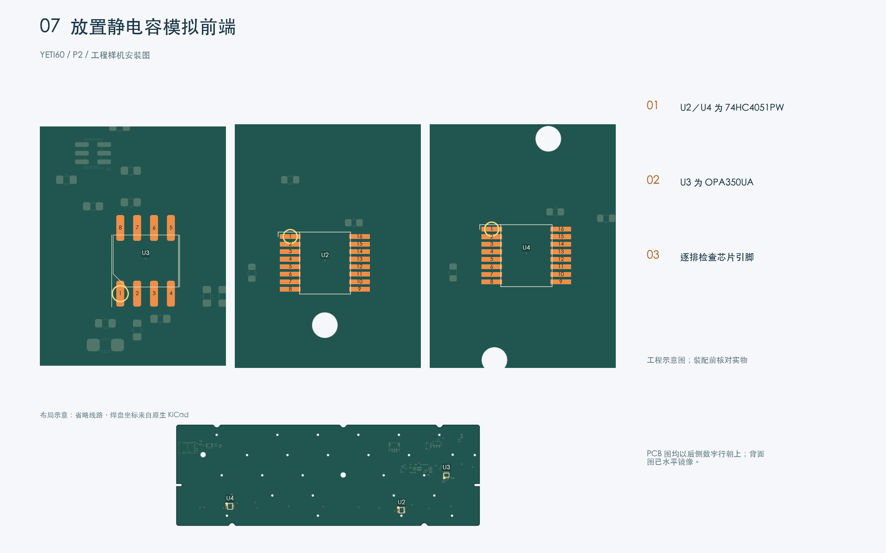

[放大矢量图](images/07-step.zh-CN.svg)

1. U2／U4 使用 TSSOP-16 的 74HC4051PW，不能用 HCT 或其他封装。
2. U3 使用 SOIC-8 的 OPA350UA，不能用双路 OPA2350 或 MSOP 封装。
3. 对齐一脚，检查细引脚，避免碰移周围的 0402 元件。

**检查后再继续：** 三只芯片均须符合原生焊盘一脚位置与材料表；JP1 继续保持空置。

本步放置位号：U2, U3, U4.

| 位号 | 数量 | 设计值 | 封装 |
|---|---:|---|---|
| U2, U4 | 2 | 74HC4051 | TSSOP16 |
| U3 | 1 | OPA350 | SOIC-8_3.9x4.9mm_P1.27mm |

## 08 — 放置唯一的 nRF52840 模组

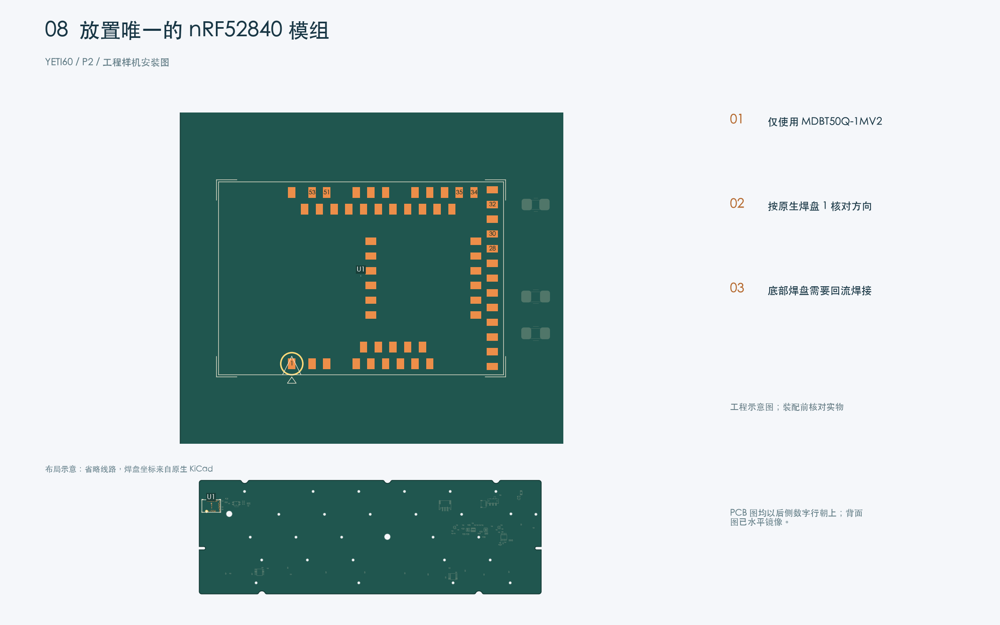

[放大矢量图](images/08-step.zh-CN.svg)

1. 确认使用 Raytac MDBT50Q-1MV2 及正确订货后缀，不使用库存 nice!nano 开发板。
2. 根据模组图纸核对一脚、天线端和原生焊盘方向，放置前检查底部焊盘。
3. 天线区域不沾锡膏和金属碎屑；模组平放，不在相邻焊盘上拖动。

**检查后再继续：** 这是直接焊接在 PCB 上的模组，包含底部焊点；不安装排针或第二颗主控。

本步放置位号：U1.

| 位号 | 数量 | 设计值 | 封装 |
|---|---:|---|---|
| U1 | 1 | MDBT50Q-1MV2 | Raytac_MDBT50Q |

## 09 — 放置连接器、开关和指示灯

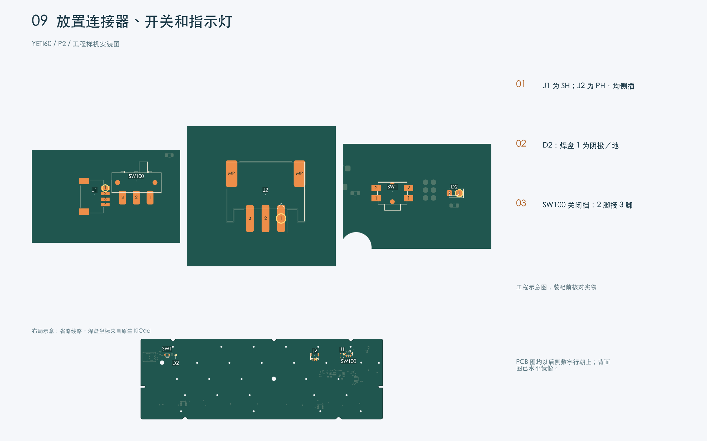

[放大矢量图](images/09-step.zh-CN.svg)

1. 按原生侧插方向放置主板 J1 的 SH 座和 J2 的 PH 座，同时对齐固定脚及信号脚。
2. 放置 SW1 复位键和 SW100 电源开关。断电测量 OFF 档：此时 SW100 的 2 脚应接到接地的 3 脚，而不是 VSYS 的 1 脚。
3. D2 使用经过确认的 0603 LED，阴极对应焊盘 1 GND，阳极对应焊盘 2 LED_A；确认本步元件兼容共同回流工艺。

**检查后再继续：** 至此已放置全部 76 只实装件，JP1 不装，J3 保持探针焊盘。若某个实际物料不能采用共同曲线，须在印膏前调整钢网／焊接方案，不能将未放件的锡膏留着回流。

本步放置位号：J1, J2, SW1, SW100, D2.

| 位号 | 数量 | 设计值 | 封装 |
|---|---:|---|---|
| D2 | 1 | STATUS | LED_0603_1608Metric |
| J1 | 1 | REAR_USB_DAUGHTERBOARD | JST-SR-4 |
| J2 | 1 | PROTECTED_1S_4V2_NTC10K | JST_PH_S3B-PH-SM4-TB_1x03-1MP_P2.00mm_Horizontal |
| SW1 | 1 | EVQPUC02K_RESET | Panasonic_EVQPUL_EVQPUC |
| SW100 | 1 | JS102011SAQN_POWER | SW_SPDT_CK_JS102011SAQN |

## 10 — 回流、冷却并检查焊点

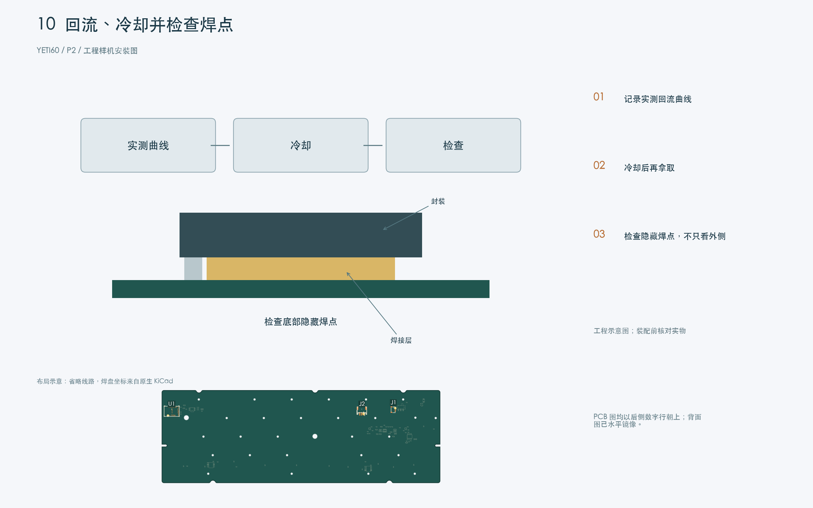

[放大矢量图](images/10-step.zh-CN.svg)

1. 使用经过确认的锡膏／元件曲线，并记录实测板温；不采用虚构的通用炉温或热风档位。
2. 支撑板子充分冷却后再移动，检查偏移、立碑、连锡、虚焊及锡珠。
3. 放大检查可见焊点，对 U5／U6／模组底部焊点取得 X 光或工艺验证证据；受控返修后按材料兼容流程清洁并彻底干燥。

**检查后再继续：** 外侧焊点好看不能证明底部已经焊好；任何加热操作均不带电池和外壳进行。

## 11 — 完成断电电气检查

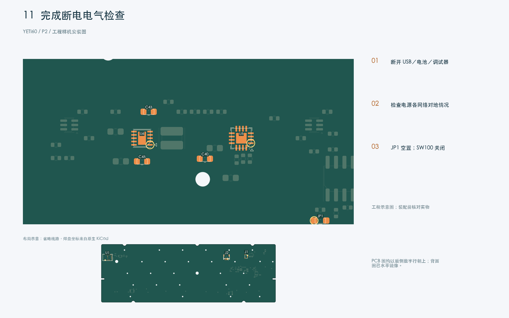

[放大矢量图](images/11-step.zh-CN.svg)

1. 断开 USB、电池和调试器，确认 SW100 关闭、JP1 未被锡桥短接。
2. 测量 VBUS／USB_5V、VSYS、+3.3V 对地的稳定电阻；不能仅凭电容充电时的短暂蜂鸣判断短路。
3. 核对连接器编号、D2 极性及保险丝通路，并放大排查连锡；记录结果后再上电。

**检查后再继续：** 持续硬短路或异常读数须先排除；本电路没有凭空指定的通用电阻合格阈值。

## 12 — 自焊 C5 分支：印锡膏并放置七只元件

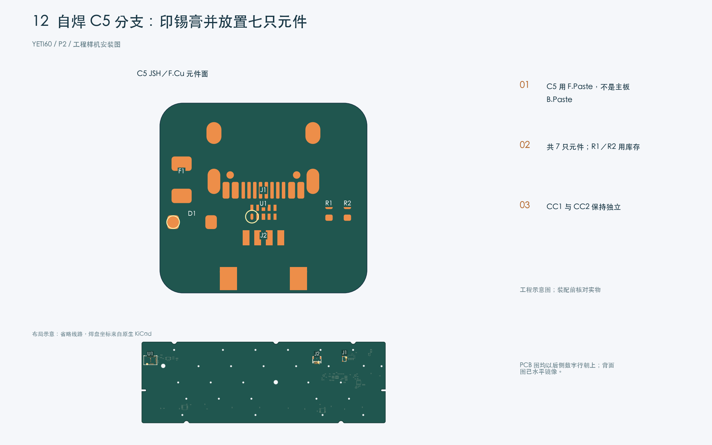

[放大矢量图](images/12-step.zh-CN.svg)

1. 购买成品 C5 时跳过本分支；自焊时使用固定版本四层 C5 JSH 裸板及本仓库七只元件表。
2. 将 F.Cu 元件面朝上支撑，按确认过的 F.Paste 钢网印膏；放置 R1／R2=5.1k、U1 TPD4E05U06DQAR、D1 SMF6.0A 及 F1 ASMD1206-150。
3. 放置 USB-C 的 J1 和 SH 的 J2，核对信号脚及外壳／固定脚；按实际焊盘与网络图检查 U1 一脚和 D1 阴极。

**检查后再继续：** 两个 CC 下拉电阻互相独立，不能将 CC1 与 CC2 短接；库存 USB-C 替代插座仍须确认尺寸。

## 13 — 自焊 C5 分支：回流并检查 USB 两排触点

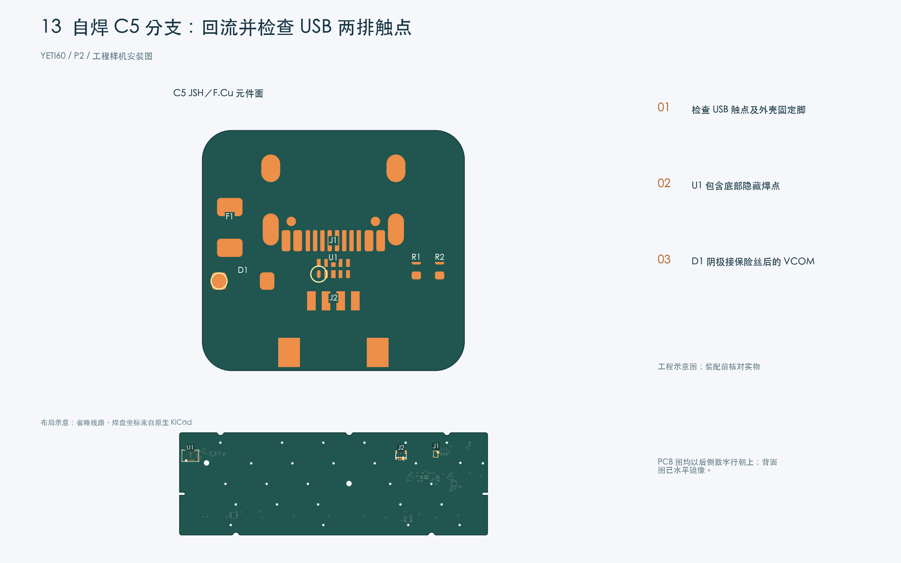

[放大矢量图](images/13-step.zh-CN.svg)

1. 按 C5 实际物料确认的曲线回流，冷却后再检查。
2. 检查 USB-C 细信号脚与外壳固定脚，核对正反插两组 D+／D− 触点各自接到正确网络且相邻不短路。
3. 检查 U1 的 USON 底部焊点及 D1 极性，再核对 SH 编号通路、保险丝导通及两个独立 CC 下拉。

**检查后再继续：** USB 插头能插入不代表触点已经焊好；C5 的七只元件不包含在主板的 76 只中。

## 14 — 检查 C5 与四芯 USB 线束

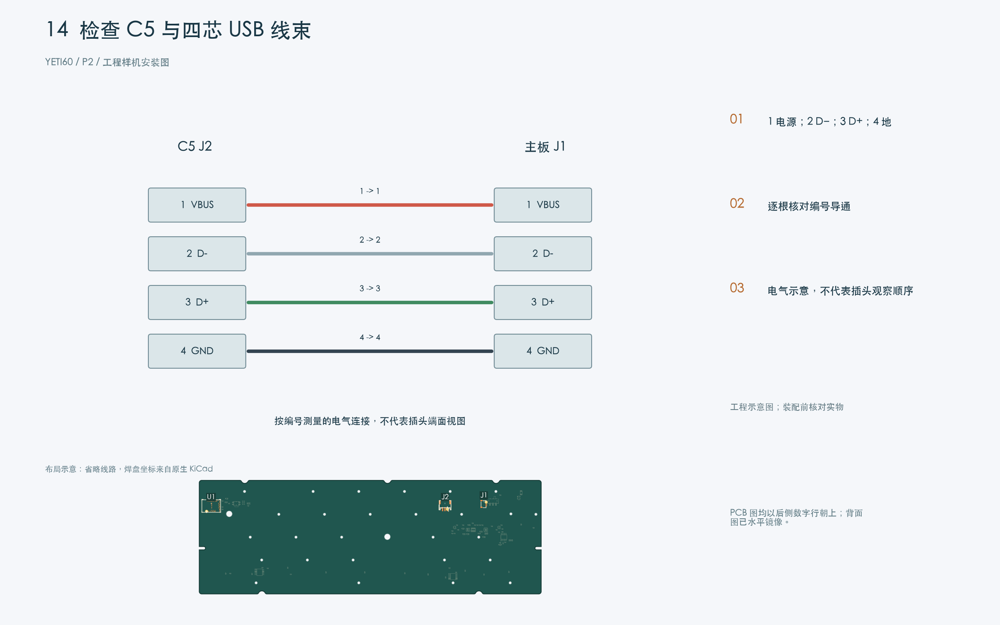

[放大矢量图](images/14-step.zh-CN.svg)

1. 使用两个 SHR-04V-S 插壳、八个匹配端子及 AWG28 多股导线，每根绝缘外径不超过 0.8 mm。
2. 完全断电，逐编号测量 C5 的 SH 1 脚到主板 J1 的 1 脚，以及 2→2、3→3、4→4，并检查相邻线不短路。
3. 插接前检查压接和卡扣；按受控的逐线长度制作，150 mm 中心线不等于四根线都剪 150 mm。

**检查后再继续：** 以编号导通为准；相对的插头看起来可能反向，不能仅凭颜色或视觉左右顺序判断。

## 15 — 不接电池，首次 USB 上电

[放大矢量图](images/15-step.zh-CN.svg)

1. 在绝缘治具上连接已检查的 C5 与线束，J2 保持空置，SW100 初始关闭。
2. 使用受控 5 V USB 输入，首次将限流保守设为 100 mA；这是上电检查上限，不是声称的正常耗电。若持续限流或异常发热，立即断电。
3. 记录 C40 的 USB_5V 及 C43 的 VSYS；开启 SW100 后，在 C45 检查 +3.3V 是否符合 U6 的实际规格，改变探针接线前先断电。

**检查后再继续：** 不能通过调高限流掩盖故障；VSYS 为电源路径输出，不要求等于假想的 3.7 V 电池电压，空白模组也不应被要求已枚举为键盘。

## 16 — 通过 J3 写入并验证校准固件

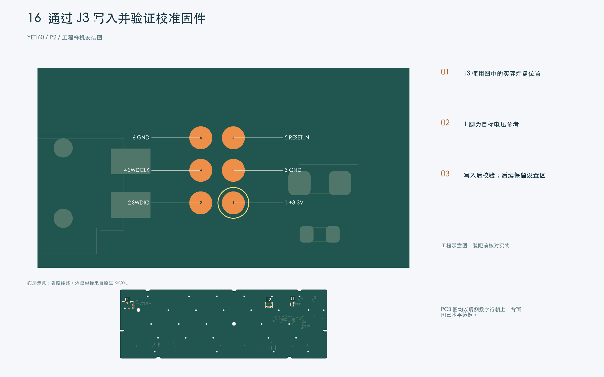

[放大矢量图](images/16-step.zh-CN.svg)

1. 对接自定义六针治具前先断电，J3 的 1 脚是 3.3 V 目标参考，不用作第二路供电。
2. 按实际编号连接 2 SWDIO、3 地、4 SWDCLK、5 RESET_N、6 地，再通过已检查的 USB 通路为板子供电。
3. 在调试工具中选择 nRF52840，写入 firmware/releases/calibrator/yeti60-raytac.hex，执行校验并复位；装好静电容机械结构后再校准。

**检查后再继续：** J3 不是标准 ARM 接口脚序，不能并接两路主动 3.3 V 电源；后续更新普通固件须保留 0xF0000–0xFFFFF 设置区。

## 17 — 处理树脂壳并冷粘八个嵌件

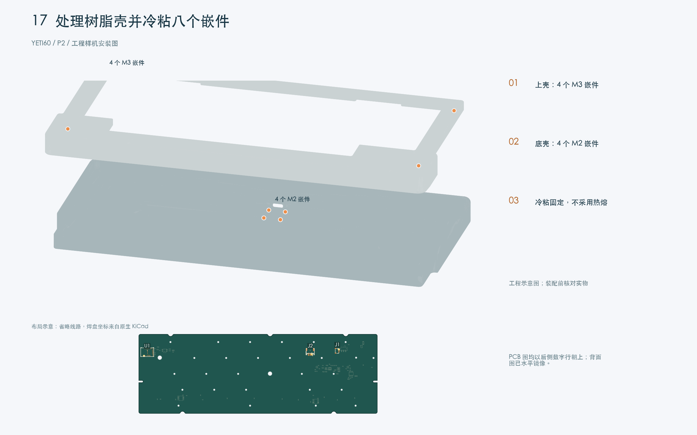

[放大矢量图](images/17-step.zh-CN.svg)

1. 使用当前原尺寸上下壳文件，按所选树脂充分后固化，检查壳体对位。
2. 按指定尺寸精修上壳四个 M3 嵌件孔和底壳四个子板 M2 嵌件孔。
3. 用兼容树脂的结构环氧胶冷粘，螺纹内不进胶，保持轴线正确，完全固化后再受力。

**检查后再继续：** 不能在热固性树脂上采用热熔嵌件，也不直接用未经确认的 RTV 替代结构胶；先检查实孔、嵌件端面及螺纹深度。

## 18 — 准备钢定位板并装配 60 套轴壳

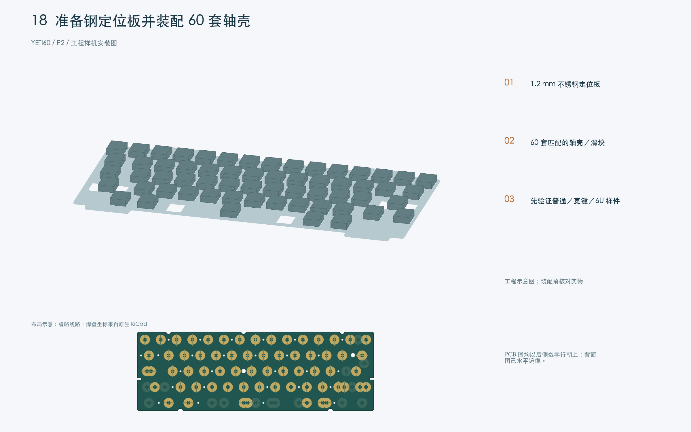

[放大矢量图](images/18-step.zh-CN.svg)

1. 为 1.2 mm 不锈钢定位板去毛刺，完成 29 个 M2 螺纹，清除金属碎屑后再靠近 PCB。
2. 在 60 个实际按键位置试装成套、可独立安装的兼容 Topre 轴壳及滑块。
3. 宽键和 HHKB 6U 空格采用匹配的稳定轴壳、钢丝及卡扣；装胶碗前先检查滑动是否顺畅。

**检查后再继续：** 先验证普通键、宽键和 6U 空格样件；不假设原版 HHKB 一体板轴壳或通用 7U MX 卫星轴兼容。

## 19 — 对齐胶碗与锥形感应弹簧

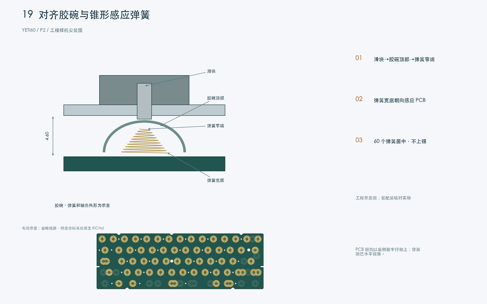

[放大矢量图](images/19-step.zh-CN.svg)

1. 用治具倒置支撑定位板／轴壳，避免滑块轴心承压。
2. 放置匹配胶碗，凸起顶部朝向滑块；每个锥形弹簧窄端朝胶碗顶部，宽底朝 PCB。
3. 按实际按键位置图将 60 个弹簧宽底与电极居中，14 个未使用布局位置保持空置。

**检查后再继续：** 剖面中的胶碗／弹簧外形为示意，须检查所选实物的落位与回弹；锥形弹簧不焊接到电极上。

## 20 — 安装 29 套绝缘 PCB 紧固件

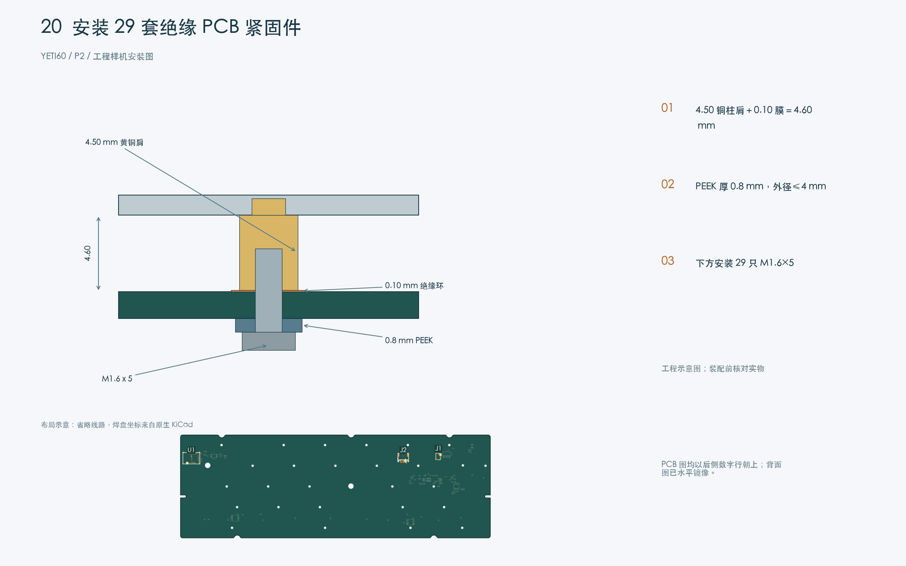

[放大矢量图](images/20-step.zh-CN.svg)

1. 在已攻牙定位板下安装转接柱：黄铜肩高 4.50 mm，上部 M2 外牙，下部 M1.6 内牙。
2. 每个铜柱肩与 PCB 感应面之间放置 0.10 mm 聚酰亚胺环，落下 PCB 时不移位弹簧。
3. 从元件面安装 0.8 mm 厚、外径不超过 4 mm 的 PEEK 垫圈及 29 只 M1.6×5 螺丝，按样件确认的扭矩逐步均匀紧固。

**检查后再继续：** 标称板间距为 4.60 mm；不能用库存 M1.6×2 短螺丝，不能让金属垫圈压感应铜面，也不能强迫错位孔对齐。

## 21 — 安装下侧垫片、C5 和开口走线底座

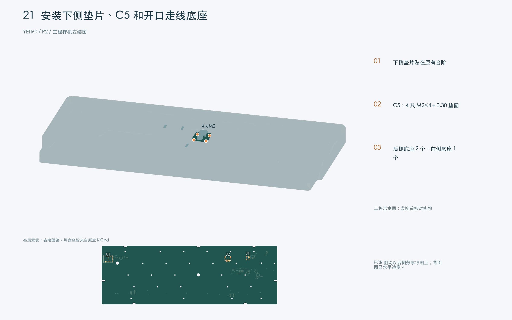

[放大矢量图](images/21-step.zh-CN.svg)

1. 将指定的 2 mm 缓冲垫材料裁到原有下侧支承台阶，不覆盖端口、走线和检修开口。
2. 用四只 M2×4 螺丝及 0.30 mm 绝缘垫圈固定 C5，检查 USB 开口对位。
3. 按检查过的壳体坐标粘接两个后侧底座和一个前侧底座；两个后侧桥盖保持可拆，走线时用治具支撑尚未落下的定位板／PCB 总成。

**检查后再继续：** 不可缩放已定位的走线支架文件，也不能将它们按共同原点叠放；底座胶固化后再装线。

## 22 — 检查并固定经过确认的电池包

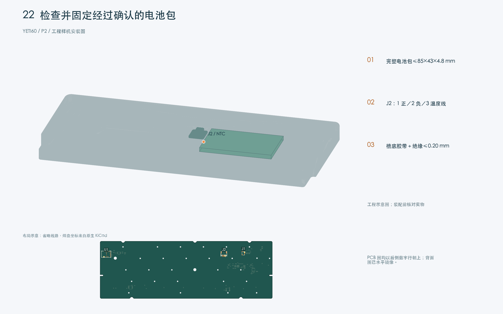

[放大矢量图](images/22-step.zh-CN.svg)

1. 只接受指定受保护 1600 mAh 单电芯包，供方确认完整包络≤85×43×4.8 mm，具备独立温度切断和单独 NTC。
2. 插 J2 前先测量极性，并核对自定义 PHR-3 编号：1 正极、2 负极、3 为接负极的 10k NTC。
3. 在电池槽内布置绝缘、可拆固定及边缘保护，槽底总厚度预算不超过 0.20 mm；全部走线检查合格前，电池电气连接保持断开。

**检查后再继续：** 电池附近不焊接、不加热；不使用库存 110 mAh 电芯，不挤压软包，不通过插头外形推断极性。

## 23 — 铺设七根导线并封好可拆走线桥

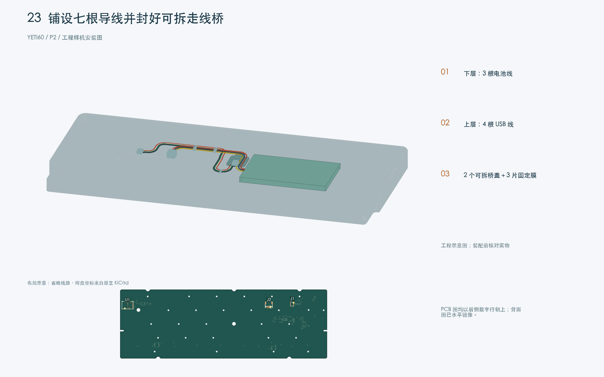

[放大矢量图](images/23-step.zh-CN.svg)

1. 后侧底座先铺三根下层电池线，侧边用总厚度 0.05 mm 胶带固定两个可拆桥盖，再铺四根上层 USB 线。
2. 前侧 USB 回环放入对应底座，保持受控弯曲，导线不碰螺钉、锐边和电池软包。
3. 贴三片上层绝缘固定膜，膜加胶总厚度≤0.10 mm，并沿桥盖侧面包下；复核导通／极性后插 J1，最后插 J2，再将治具支撑的总成落下，避免夹线。

**检查后再继续：** 受检路径中 USB 最小内侧弯曲半径至少 4.5 mm，电池线至少 5 mm；不将可拆桥盖永久粘死，不留下悬空固定膜。

## 24 — 安装 60 个匹配键帽并检查行程

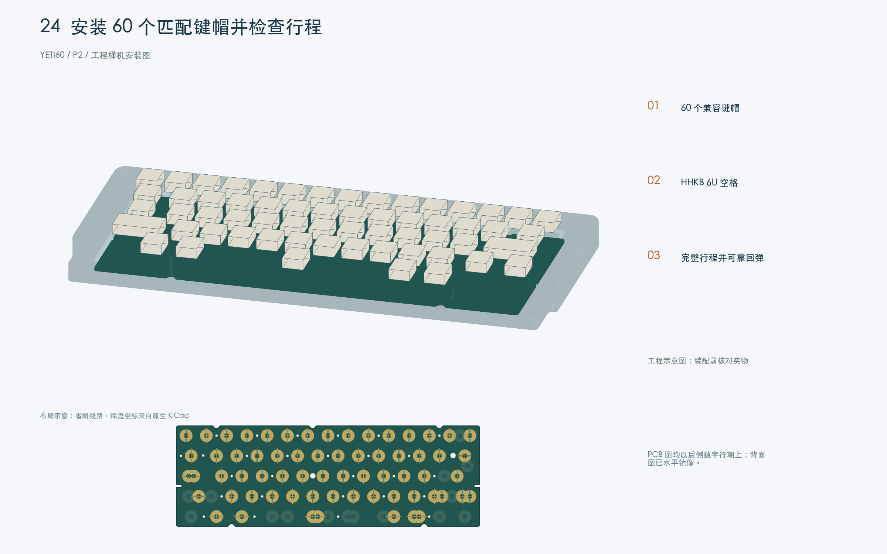

[放大矢量图](images/24-step.zh-CN.svg)

1. 支撑定位板，再将兼容键帽压到所选滑块轴心上；安装匹配的 6U 空格及宽键键帽，不弯曲稳定钢丝。
2. 逐键检查边缘及相邻宽键的间隙、完整行程与回弹。
3. 按 HHKB 映射核对 Fn 及所有实际按键；未确认轴心和空格兼容性前，不直接使用库存 133 键套装。

**检查后再继续：** 校准前 60 个键都应自由运动；机械卡滞先修复，不能靠调整扫描阈值掩盖。

## 25 — 逐键校准、保存并写入普通固件

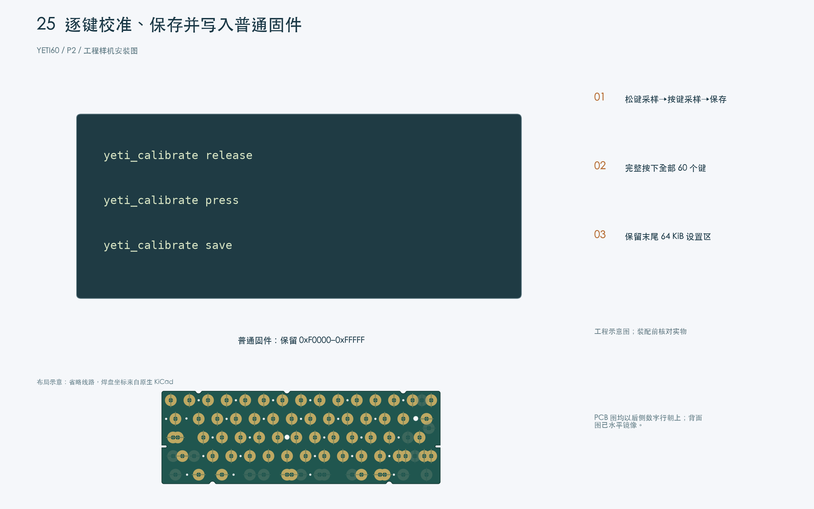

[放大矢量图](images/25-step.zh-CN.svg)

1. 完整机械结构按预定预压状态支撑，启动校准固件并打开 USB CDC 控制台。 三条命令分步执行，待松键采样完成后再进入按键采样阶段，不一次粘贴三条命令。
2. 全部松键执行 yeti_calibrate release，再执行 yeti_calibrate press，完整按下并松开每个实际按键；最后全部松键执行 yeti_calibrate save，并检查返回结果。
3. 重新连接 SWD 前先断电；按写入范围／扇区操作方式写入并校验 firmware/releases/normal/yeti60-raytac.hex，保留 0xF0000–0xFFFFF，重启检查校准仍然有效。

**检查后再继续：** 保存校准后不使用全片擦除或恢复操作；量程不足、ADC 饱和须排查，没有有效校准时固件刻意不输出按键。

## 26 — 开壳检查 USB、蓝牙及充电状态

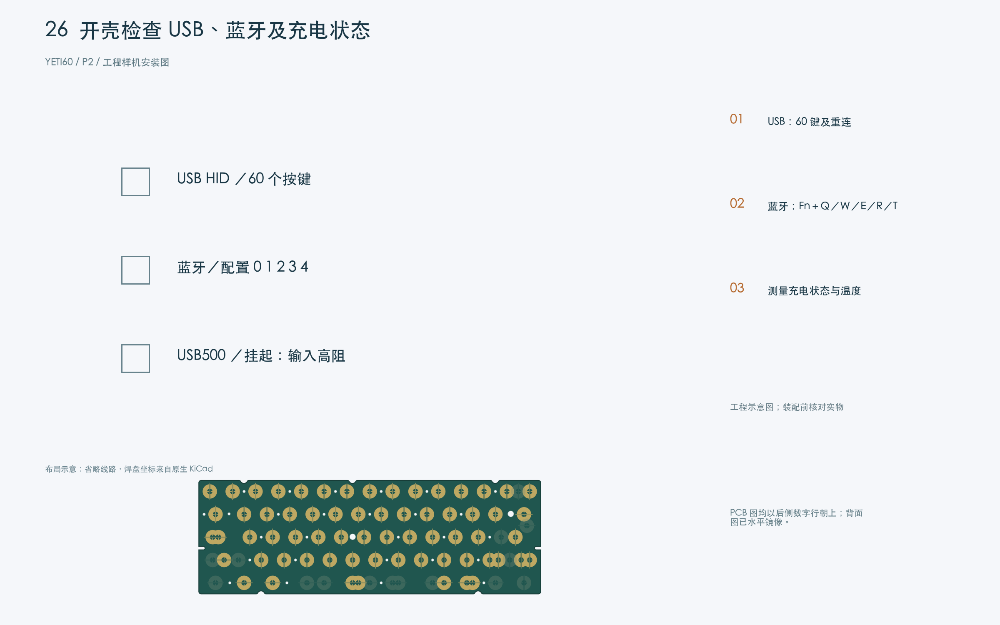

[放大矢量图](images/26-step.zh-CN.svg)

1. 使用普通固件，通过 USB 检查逐键、长按、多键及复位重连。
2. 使用验收过的电池，拔掉 USB 后检查蓝牙；当前键位 Fn+Q／W／E／R／T 分别选择 0／1／2／3／4 号配置，检查目标主机配对及绑定保留。
3. 分别检查主机完成配置后的 USB500，以及配置前、挂起和关机 USB100 状态；记录实测电流／温度，不把估算续航当作验收数据。

**检查后再继续：** 构建成功不等于本步实测通过；依赖充电功能前先完成电池温度／充电验收，当前未开启电量百分比上报。

## 27 — 安装上侧垫片并合壳

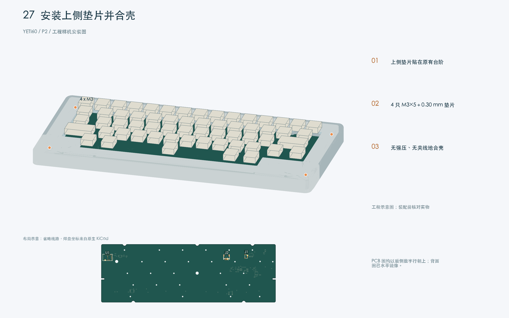

[放大矢量图](images/27-step.zh-CN.svg)

1. 最终操作前拔掉 USB 并关闭电源；调整内部走线时再断开电池。上侧垫片只贴在原有台阶。
2. 检查导线和固定膜均不伸入合壳面，不用蛮力压合，保持定位板对位及确认过的垫片压缩量。
3. 安装四只 M3×5 螺丝及 0.30 mm 垫片，逐步均匀紧固；若合壳后手感或感应改变，先开壳修正结构，再重新校准。

**检查后再继续：** 检查螺丝不顶底、电池不受压、导线不被夹；未经确认的库存长螺丝不是默认替代件。

## 28 — 安装四个脚垫并完成最终检查

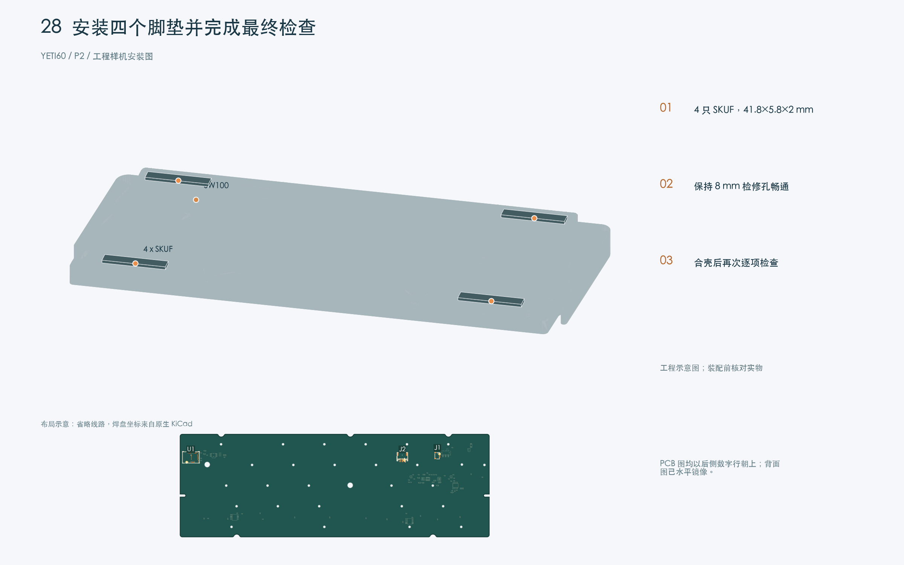

[放大矢量图](images/28-step.zh-CN.svg)

1. 清洁底部四个原有脚垫槽，贴四只带背胶 SKUF 脚垫，规格 41.8×5.8×2 mm，不遮挡 SW100 检修孔。
2. 在平面上检查支撑稳定、USB 插拔空间，并用绝缘工具通过 8 mm 检修孔操作 SW100。
3. 再次检查全部 60 键、宽键回弹、USB／蓝牙重连及拔线后的重新上电，并为这台样机保存上电、校准和装配实测记录。

**检查后再继续：** 仍须完成首件实测验收；这些示意图不代表已经取得实物、寿命、充电或射频认证。

## 重建与依据

使用 KiCad Python 执行 `scripts/export_yeti60_build_map.py`，再用 `requirements-audit.txt` 的 CAD 环境执行 `scripts/draw_yeti60_build_guide.py`。生成器核对 76 只主板元件均在放置步骤中出现一次、60 个实际电极、29 个安装孔及当前装配／线束来源。文件和图像哈希见 [指南验证记录](../audit/yeti60-build-guide.json)。

编排参考 [DELTA OMEGA 安装指南](https://github.com/wZuck/delta-omega/blob/main/docs/BUILD_GUIDES.md) 的逐工序图示形式；图像及位号按 YETI60 原生数据重新绘制，不沿用 MX 焊接步骤。

焊接依据：[TI QFN／SON 装配说明 SLUA271C](https://www.ti.com/lit/an/slua271c/slua271c.pdf) 的钢网、回流和隐藏焊点检查章节；[Raytac MDBT50Q-1MV2 资料](https://www.raytac.com/product/ins.php?index_id=24) 的模组引脚、尺寸及独立焊接工艺包；[C&K JS 系列资料](https://www.ckswitches.com/media/1422/js.pdf) 的开关封装和焊接限制。电源、线束及固件步骤另按本仓库 [电源计算](../engineering/power-budget.zh-CN.md)、[线束规格](../engineering/interconnects.zh-CN.md)、[目标固件说明](../../firmware/target/README.zh-CN.md)。
