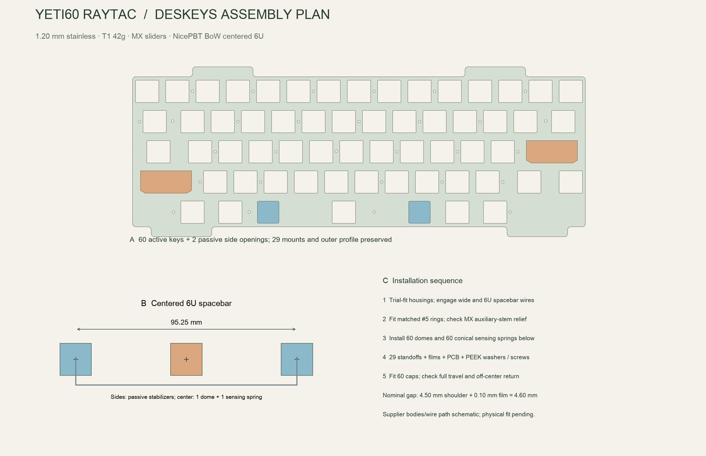

English | [Chinese](key-mechanism.zh-CN.md)

# Selected key mechanism: Deskeys EC with MX caps

Use **one Deskeys EC parts kit 68 keys, T1 / 42g**, default Cement housings, Ivory MX sliders and #5 silencing rings. Use **CannonKeys NicePBT BoW, current full kit including the labelled `6.0c Centered` spacebar**. Keep the FELK60 HHKB layout. This is the selected engineering build, rather than a list of interchangeable alternatives.

Use the [Deskeys plate DXF](../../../../mechanical/felk60_plate_hhkb.deskeys.dxf). The original `audited.dxf` remains an upstream comparison reference; it is not the plate to order for these parts. No PCB stabilizer mounting holes or additional sensing keys are required. The exterior case dimensions, 60 sensing centers and 29 mounting axes remain unchanged.

The dimensions and CAD checks below establish a drawing-based build plan. No physical assembly exists yet: clip retention, actual housing height, full travel and cap-to-case clearance must be checked on the first plate/parts. A listing marked available is a dated observation, not a reservation.

## Buy these items

Availability checked 2026-11-02. Inventory does not record verified existing mechanism parts; the purchases below do not deduct the electronics inventory or claim the user owns these items.

| Order | Exact item / selection | Purchase | Contents used in one keyboard | Existing stock |
|---|---|---:|---|---|
| K01 | [Deskeys EC parts kit 68 keys](https://deskeys.io/products/des-ec-parts-kit-68-keys?variant=43323966554147), **T1 / 42g**, Cement / Ivory / #5 defaults | 1 kit | 58 normal housing/slider pairs, 2 wide assemblies, 60 domes, 60 sensing springs, one pair of spacebar side stabilizers and one 6U wire | Not verified; purchase 1 |
| K02 | [NicePBT BoW](https://cannonkeys.com/products/nicepbt-bow), **current complete kit**, not a replacement 6.25U spacebar or an old incomplete kit | 1 kit | 60 caps; choose the `6.0c Centered` bar, 2.25U Enter/left Shift, 1.75U right Shift, 1.5U Backspace and the HHKB bottom-row modifiers | Not verified; purchase 1 |
| K03 | [Deskeys-compatible plate](../../../../mechanical/felk60_plate_hhkb.deskeys.dxf), 304 stainless, **1.20 mm**, finished M2 x 0.4 at 29 existing axes | 1 plate | All 60 active openings plus 2 passive spacebar side openings | Custom fabrication |

K01 supplies M04–M07 in the main materials table. **Do not buy separate 1U packs, domes, conical springs, 2U assemblies, a spacebar stabilizer pack or a 6U wire in addition to K01.** The kit's 6.25U and 7U wires are spares, not installation alternatives for this plate. Normal MX plate/PCB stabilizers and complete MX switches are not used.

The public K01 variant API reported T1 / 42g available; K02's product page reported in stock. The current kit illustration shows relieved wide housings and extra-stem MX wide sliders; no housing drill is part of this order. Shipment to the destination, checkout stock and taxes have not been verified or paid.

## Contents and net quantities

| Part included in K01 | Kit quantity | Install | Spare / note |
|---|---:|---:|---|
| Normal housings | 72 | 58 | 14; this includes the central spacebar housing |
| Normal MX sliders | 72 | 58 | 14 |
| Wide housing + slider + wire assemblies | 4 | 2 | 2; Enter and left Shift each use one |
| T1 42g domes | 18 strips x 4 = 72 positions | 60 | 12; separate strips only on the moulded cutting lines when required by the staggered layout |
| Conical EC sensing springs | 120 | 60 | 60; one under each sensing dome |
| #5 silencing rings | 120 | 60 sensing sliders | At least 60 remain; side-unit rings only if supplied/required by the matching assembly instructions |
| Spacebar stabilizer set | 1 pair | 2 side units | Neither side is another sensing key |
| Long wires | 1 each 6U / 6.25U / 7U | 1 x 6U | Retain 6.25U and 7U as unused spares |

The [official T1 specification](https://deskeys.io/products/des-domes-t1) identifies four domes per strip and Pink as 42g. The force label does not establish measured actuation force on this PCB. Housing helper springs, dome gaskets and housing gaskets are **not** part of the default stack; adding any changes force or compression and requires a new fit check. A helper spring, if later needed for spacebar return, is not another conical sensing spring.

## What changes on the plate

| Opening | Quantity | Original FELK60 | Selected Deskeys plate |
|---|---:|---|---|
| Normal active key, including spacebar center | 58 | 14.60 x 14.00 | **14.70 x 14.10 mm, R0.5 corners** |
| Wide active key | 2 | 32.00 x 14.00 | **32.15 x 14.10 mm**, existing front bevel orientation retained |
| Passive spacebar side unit | 2 | 13.462 x 13.741 | **13.60 x 13.90 mm, C0.5 corners** |
| External plate profile / mounting axes | 1 / 29 | FELK60 original | Preserved exactly |

Specify dimensions **after deburring**, cutout size target +/-0.025 mm and center position +/-0.05 mm. Ask the metal fabricator whether its process can meet these values; ordinary laser-cut nominal dimensions alone do not establish the fit. Do not powder-coat the fit edges. The plate is metalwork, separate from the ordinary four-layer JLC PCB order. Do not substitute a 1.5 mm FR-4/MX plate.

The DXF mounting circles are inherited machining datums. Finish them as **M2 x 0.4 tapped holes**, not M2 clearance holes; agree the tap pilot with the fabricator. Retain the existing 29 insulated brass standoffs. The nominal plate-to-PCB gap remains **4.60 mm = 4.50 mm shoulder + 0.10 mm film**. This Z gap remains subject to actual housing/dome compression; do not force it closed to compensate for a mismatched housing.

The [Deskeys housing page](https://deskeys.io/products/des-housings) specifies 14.7 x 14.1 and 32.15 x 14.1 in its header, but its text also says 32.1 for the wide opening. This design explicitly selects the header's **32.15**. [Cipulot's plate specification](https://github.com/Cipulot/ec60x-plate-maker/blob/02cc973c43f980394434e39372471096d3df3459/EC_Plate_Specifications.pdf), pages 3–4, identifies 1.2 mm and General OEM Style for Deskeys. Its [reference DXF](https://github.com/Cipulot/ec60x-plate-maker/blob/02cc973c43f980394434e39372471096d3df3459/Plate_Indexed_Name/EC60X_Plate_Indexed_Name/EC60X_0_1_0_1_0_9.dxf) provides the 13.6 x 13.9 side opening. Its whole plate is **not** compatible with YETI60 mounting axes. Functional dimensions were used to construct our derived FELK60 plate; no EC60X plate file is substituted.

[Vector drawing](../engineering/images/deskeys-mechanism.svg)

## Installation order

1. Inventory the entire kit before installing anything. Identify 58 normal pairs, two complete wide assemblies, the two spacebar side units and the **6U** wire. Check that both side housings and plungers are included in the supplied spacebar set. Photograph/count remaining parts as spares. Compare the cap kit against its [official kitting image](https://cannonkeys.com/cdn/shop/files/NicePBTBoW_Layout.jpg?v=1720545415): it must contain the labelled centered 6U bar. Its underside outer stems must match **95.25 mm** and its center stem must be centered; other 6U geometries are not substitutes.
2. Deburr and inspect the plate, thickness and 29 tapped axes. Trial-fit one normal housing, each wide housing and both spacebar side housings **before** fitting 60 domes. Their shoulders must seat flat without splitting clips, bowing the plate or relying on the shell to hold them.
3. Fit the supplied #5 rings to the matched sensing sliders and assemble the sliders/housings. Install the two wide assemblies in the plate's keyed orientation, with their wires properly engaged. Fit Enter and left Shift locally; each must move and return from both ends. Do not add normal MX stabilizers around these assemblies.
4. Use the kit's **extra-stem 2U sliders and pre-opened wide housings**, shown together in the [manufacturer's contents illustration](https://cdn.shopify.com/s/files/1/0225/2908/1418/files/ScreenShot_2026-07-08_113054_400.png?v=1783481466). Align the cap's auxiliary sockets with those stems. Inspect free movement through the whole stroke. Do not substitute old flat sliders or unrelieved stock Topre housings. No PCB, plate or plastic drilling is required by this selected build; if the delivered parts differ from the illustrated current kit, resolve the wrong revision before assembly.
5. Install the two passive spacebar side units and engage the supplied 6U wire with both. The center spacing is **95.25 mm**, with the active spacebar axis midway between them. The center receives one normal housing/slider, **one dome and one conical spring**. Put no sensing dome or conical spring under either passive side unit. Press the centered 6U cap on evenly, check it at the left end, middle and right end, and ensure the wire cannot scrape the plate or PCB.
6. Turn the plate over onto a soft flat support. Fit 60 domes and 60 centered conical springs, retaining the strip alignment and cutting only on the designated lines. Fit the 29 standoffs, 0.10 mm polyimide rings, PCB, PEEK washers and M1.6 screws in the [main assembly sequence](../engineering/assembly.md). Tighten gradually, checking housing seating and free movement instead of compressing the domes by force.
7. Before closing the shell, install all caps and check every key at its edges and through its entire stroke. Verify no cap skirt hits the shell, no auxiliary stem bottoms on plastic, no wire drops out, and no key stays down. Verify all 60 keys with the calibrator; a mechanical pass does not establish correct EC sensitivity. Repeat all three stabilized keys after closing the shell. Changing housings, domes, springs, rings or stack height requires new per-key calibration even if the PCB/firmware fingerprint is unchanged.

Do the local normal/wide/spacebar fitting before ordering repeated plates or extra kits. If the actual Z fit differs, record the measured housing seat and relaxed/compressed dome dimensions and revise the stack and case/battery checks. Do not replace the specified 4.6 mm stack with an unverified spacer length from another project.

## What has actually been checked

The [machine report](../audit/deskeys-plate.json) checks all 60 centers, all 29 mounts, the complete outer profile, the two passive centers and 95.25 mm spacing against the unchanged FELK60 baseline. It also measures the minimum material web from each opening to the inherited mounting pilot. Tests deliberately move a mounting axis/side unit and restore an undersized stock cutout to ensure they are rejected. The main assembly and plate-to-electrode checks use the **new** Deskeys DXF.

Actual vendor plastic profiles, Z dimensions, force/travel, wire underside clearance and fully assembled cap envelopes remain first-article checks. Published compatibility and CAD dimensions support this selection; they are not a claim that a nonexistent prototype has already been assembled.

[Build entry](../../BUILD.md) · [complete materials](../engineering/materials.md) · [assembly](../engineering/assembly.md)
