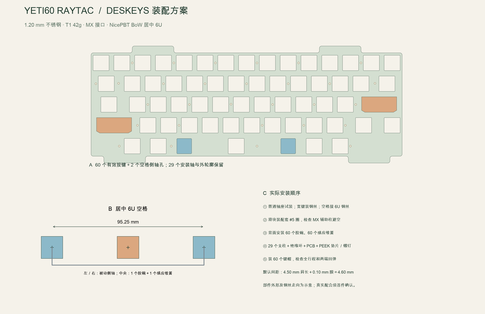

[English](key-mechanism.md) | 简体中文

# 选定的按键机构：Deskeys 静电容机构与 MX 键帽

采用 **Deskeys 68 键静电容配件包一套，选择 T1／42g**，默认 Cement 轴座、Ivory MX 接口滑块及 #5 消音圈。键帽采用 **CannonKeys NicePBT BoW 当前完整套装，必须包含标注 `6.0c Centered` 的居中空格**。保留 FELK60 的 HHKB 配列。这是本次选定的工程样机方案。

使用[适配 Deskeys 的定位板 DXF](../../../../mechanical/felk60_plate_hhkb.deskeys.dxf)。原 `audited.dxf` 留作上游对照，不是本套配件应下单的定位板。无需增加 PCB 卫星轴安装孔或感应按键；外壳外形、60 个感应中心及 29 个安装轴线均保留。

下列尺寸与 CAD 检查构成按图制造方案。目前没有实物，卡扣保持力、真实轴座高度、完整行程及键帽与外壳间隙须在首件确认。页面可购买状态只是查询时的记录，不是预留库存。

## 直接购买清单

可购买状态查询日期：2026-11-02。库存未记录已经核实的按键机构；下表没有挪用电子元件库存，也不假定用户已有这些配件。

| 采购编号 | 具体材料及选项 | 购买数量 | 单把键盘实际使用 | 已有库存 |
|---|---|---:|---|---|
| K01 | [Deskeys 68 键静电容配件包](https://deskeys.io/products/des-ec-parts-kit-68-keys?variant=43323966554147)，选 **T1／42g**，Cement／Ivory／#5 默认配置 | 1 套 | 58 套普通轴座滑块、2 套宽键总成、60 个胶碗、60 个感应弹簧、一对空格稳定侧轴和一根 6U 钢丝 | 未核实；补购 1 套 |
| K02 | [NicePBT BoW](https://cannonkeys.com/products/nicepbt-bow)，**当前完整套装**，不能只买替换用 6.25U 空格或缺件的旧版套装 | 1 套 | 60 个键帽；选 `6.0c Centered` 空格、2.25U 回车／左 Shift、1.75U 右 Shift、1.5U 退格及 HHKB 底排修饰键 | 未核实；补购 1 套 |
| K03 | [适配定位板](../../../../mechanical/felk60_plate_hhkb.deskeys.dxf)，304 不锈钢、**1.20 mm**，原有 29 处加工 M2×0.4 螺纹 | 1 张 | 60 个有效按键开孔，加 2 个被动空格侧轴开孔 | 委托加工 |

K01 已覆盖主材料表的 M04—M07。**买了这一套，就不用再分别购买普通轴座、滑块、胶碗、锥簧、宽键总成、空格稳定轴或 6U 钢丝。** 套装里的 6.25U／7U 钢丝留作备件，不能直接装到这张板。无需购买普通 MX 钢板／PCB 卫星轴或完整 MX 轴。

K01 的公开商品接口返回 T1／42g 可购买；K02 页面显示现货。官方套装图展示已经开避空孔的宽轴座及带辅助柱的 MX 宽滑块，本方案不另买轴座手钻。尚未核实收货地配送、结账时余量或税费，也没有下单付款。

## 套装数量及实际用量

| K01 内含材料 | 包内数量 | 实际安装 | 余量／说明 |
|---|---:|---:|---|
| 普通轴座 | 72 | 58 | 余 14；58 个中已经包含空格中央轴座 |
| 普通 MX 接口滑块 | 72 | 58 | 余 14 |
| 宽键轴座＋滑块＋钢丝总成 | 4 | 2 | 余 2；回车和左 Shift 各一套 |
| T1 42g 胶碗 | 18 条×4＝72 个位置 | 60 | 余 12；错位配列需要拆分时，只沿模压裁切线剪开 |
| 锥形静电容感应弹簧 | 120 | 60 | 余 60；每个感应胶碗下一个 |
| #5 消音圈 | 120 | 60 个感应滑块 | 至少余 60；侧轴仅在配套机构说明要求时安装相应消音圈 |
| 空格稳定机构 | 1 对 | 2 个侧轴 | 两侧都不是额外感应按键 |
| 长钢丝 | 6U／6.25U／7U 各一根 | 6U 一根 | 另两根保留，不安装 |

[T1 官方规格](https://deskeys.io/products/des-domes-t1)说明每条四个胶碗、Pink 对应 42g。标称克数不代表本 PCB 已测得的触发力。默认不加轴座辅助回弹弹簧、胶碗垫或轴座垫；增加这些材料会改变回弹力或压缩量，须重新确认。如后续空格需要辅助回弹弹簧，它也不是第二个锥形感应弹簧。

## 定位板具体改哪里

| 开孔 | 数量 | FELK60 原尺寸 | 本方案尺寸 |
|---|---:|---|---|
| 普通有效按键，含空格中央 | 58 | 14.60×14.00 | **14.70×14.10 mm，圆角 R0.5** |
| 宽键 | 2 | 32.00×14.00 | **32.15×14.10 mm**，保留原朝前倒角方向 |
| 空格被动侧轴 | 2 | 13.462×13.741 | **13.60×13.90 mm，倒角 C0.5** |
| 外轮廓／安装轴线 | 1／29 | FELK60 原版 | 完整保留 |

要求按**去毛刺后的成品尺寸**验收，开孔尺寸目标公差 ±0.025 mm、中心位置 ±0.05 mm。先向金属加工方确认能否达到，普通激光切割的标称尺寸不能直接证明卡扣配合。配合孔边不要喷粉增厚。定位板是独立金属加工件，与 JLC 普通四层 PCB 分开下单，不能替换成 1.5 mm 的 FR-4／MX 定位板。

DXF 内的安装圆继承原加工基准。29 处须加工为 **M2×0.4 螺纹孔**，不能直接切成 M2 螺钉通孔；攻牙底孔由加工方确认。继续使用原有 29 个绝缘支柱。定位板到底部 PCB 感应面名义间距仍为 **4.60 mm＝4.50 mm 肩长＋0.10 mm 绝缘膜**。这个高度须用真实轴座与胶碗确认，不能强行拧紧来适应高度不符的配件。

[Deskeys 轴座页面](https://deskeys.io/products/des-housings)顶部列出 14.7×14.1 和 32.15×14.1，正文又将宽孔写成 32.1；本方案明确采用顶部的 **32.15**。[Cipulot 定位板规范](https://github.com/Cipulot/ec60x-plate-maker/blob/02cc973c43f980394434e39372471096d3df3459/EC_Plate_Specifications.pdf)第 3—4 页给出 Deskeys 使用 1.2 mm、通用原厂式开孔的依据；其[参考 DXF](https://github.com/Cipulot/ec60x-plate-maker/blob/02cc973c43f980394434e39372471096d3df3459/Plate_Indexed_Name/EC60X_Plate_Indexed_Name/EC60X_0_1_0_1_0_9.dxf)提供 13.6×13.9 的侧轴孔尺寸。该项目整张定位板的安装孔不匹配 YETI60，不能拿来替代；这里只依据功能尺寸构造 FELK60 派生板。

[矢量图](../engineering/images/deskeys-mechanism.zh-CN.svg)

## 安装顺序

1. 先清点整套配件，分出 58 套普通轴座滑块、两个完整宽键总成、空格左右侧轴和 **6U** 钢丝。空格稳定套件须实际收到两边的轴座与柱塞。其余拍照记为备件。按[官方键帽配列图](https://cannonkeys.com/cdn/shop/files/NicePBTBoW_Layout.jpg?v=1720545415)核对居中 6U 空格；底部两侧柱间距须为 **95.25 mm**，中央柱须居中，其他结构的 6U 不能替换。
2. 定位板去毛刺，检查板厚及 29 处螺纹。在装胶碗之前，先试装一个普通轴座、两个宽轴座和空格左右侧轴。肩面须平贴，不能掰裂卡扣、压弯钢板或依靠外壳强行固定。
3. 给配套感应滑块装 #5 消音圈并装入轴座。按定位板非对称方向安装两个宽键总成，钢丝两端须进入对应位置。局部装回车和左 Shift，分别按两端确认下压顺畅、能够回弹。这两套总成周围不再安装普通 MX 卫星轴。
4. 使用套装里的**带辅助柱宽滑块及预开孔宽轴座**，按[原厂配件图](https://cdn.shopify.com/s/files/1/0225/2908/1418/files/ScreenShot_2026-07-08_113054_400.png?v=1783481466)核对。将键帽辅助柱接口对准宽滑块对应柱位，检查完整行程。不要替换成旧版平滑块或未避空的原装 Topre 轴座。本方案不需要钻 PCB、定位板或塑料；若收到的部件与当前套装图不符，先解决发错版本问题再装配。
5. 装空格两个被动侧轴，接好 6U 钢丝。两边中心距 **95.25 mm**，中央有效轴在中点。中央装一套普通轴座滑块、**一个胶碗和一个锥形感应弹簧**；左右被动侧轴下面不放感应胶碗和锥簧。居中 6U 键帽均匀压入，分别按左端、中间、右端，检查回弹及钢丝是否刮到定位板或 PCB。
6. 将定位板翻面放在平整软垫上，按实际感应中心装 60 个胶碗和 60 个锥簧；胶碗条只在指定裁切线处分开。按[主装配流程](../engineering/assembly.zh-CN.md)装支柱、0.10 mm 聚酰亚胺环、PCB、PEEK 垫片和 M1.6 螺钉。逐步均匀拧紧，同时检查轴座贴合与活动状态，不能靠强压胶碗合板。
7. 合壳前装全套键帽，逐键按边缘并检查完整行程：键帽裙边不撞壳、辅助柱不顶塑料、钢丝不脱位、松手不滞留。用校准固件检查全部 60 键；机械顺畅并不等于感应幅度已合格。关壳后再次测试三个带稳定机构的大键。轴座、胶碗、弹簧、消音圈或装配高度改变后，即使 PCB／固件指纹未变，也必须重新逐键校准。

先完成普通键、宽键和空格的局部试装，再购买重复定位板或更多套件。若真实高度不符，记录轴座肩位、胶碗自由及压缩尺寸，调整装配高度并重做外壳／电池检查。不能照搬其他项目的支柱长度替换当前 4.6 mm 结构。

## 已经检查与尚待实物确认的范围

[机器报告](../audit/deskeys-plate.json)逐项对照未改动 FELK60 基准，检查 60 个有效轴中心、29 个安装轴、完整外轮廓、两个被动侧轴中心及 95.25 mm 柱距，并计算各开孔与原安装底孔之间的最小剩余材料。测试会故意移动安装孔／侧轴、恢复过小原孔，确认能检出错误。主装配及感应电极对应检查采用的是**新的 Deskeys DXF**。

真实塑料外形、高度、力度／行程、钢丝下方空间及完整键帽包络仍须首件验证。公开配套关系及 CAD 尺寸是选定本方案的依据，不能把它们写成尚不存在的实物已装配通过。

[制作总入口](../../BUILD.zh-CN.md) · [完整材料表](../engineering/materials.zh-CN.md) · [装配流程](../engineering/assembly.zh-CN.md)
