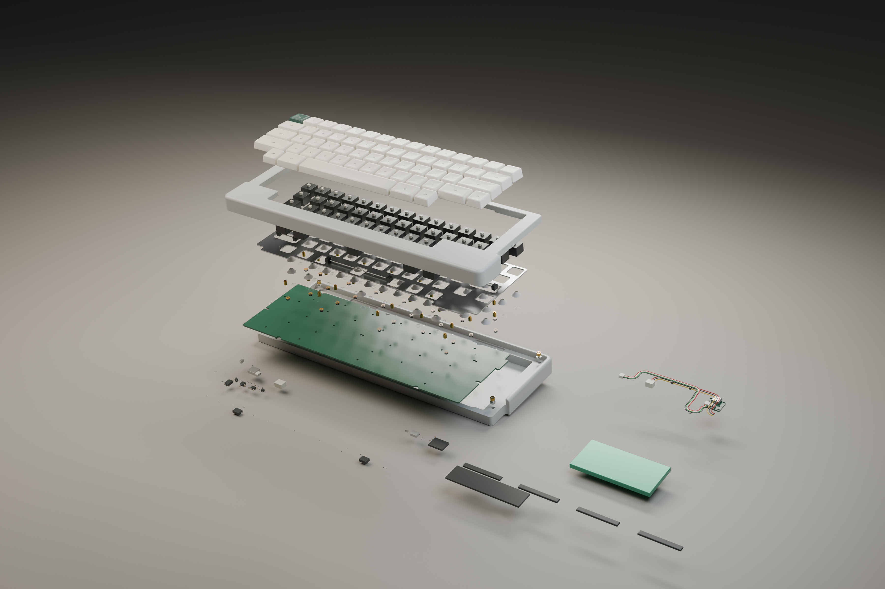
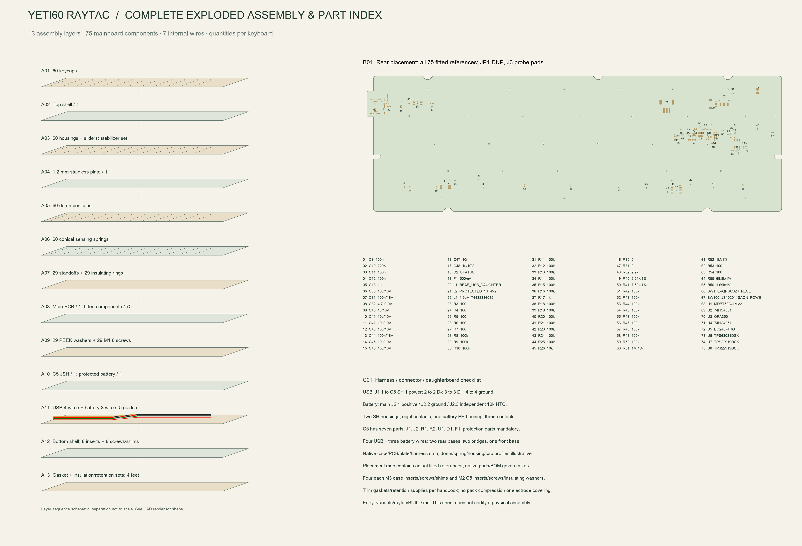

English | [Chinese](exploded.zh-CN.md)

# Raytac complete explosion and component index

Return to the [handbook](../../BUILD.md). These sheets correspond to this directory's Raytac PCB/firmware.

## Native CAD assembly explosion

Includes shells, caps, housings/sliders, stabilizers, plate, domes, conical sensing springs, standoffs/insulation, PCB and fitted electronics, PEEK washers/fasteners, C5 JSH, battery, four USB wires, three battery wires and five routing-guide pieces. Feet and cut-to-fit gasket stock are presented as a side parts tray, not mounting coordinates. Vertical separation is for visibility, not installation spacing.

Shell/PCB/plate/C5/controlled harness shapes come from native CAD, without shell scaling. Unselected key mechanisms, caps, domes, springs and stabilizers, thread/some component envelopes and the pack remain illustrative; they are not qualified supplier manufacturing drawings. The [render manifest](../../renders/yeti60-assembly/render-manifest.json) binds geometry and records visible groups.

## Zoomable numbered sheet

[Vector SVG](images/complete-exploded.svg). Left: 13 schematic assembly layers with per-unit quantities; silhouettes/separations are schematic. Right: native-pad rear placement and an index of all 75 fitted mainboard parts. JP1, J3 and electrodes are not purchases. The seven C5 parts are separate; removing mainboard D1 does not remove required C5 D1/U1.

See [actual harness lengths, pinout and bends](interconnects.md), [net-purchase CSV](../../hardware/bom/mainboard-purchase.csv), [complete materials](materials.md) and [28 illustrated operations](../assembly/build-guide.md). Do not assemble using exploded-view separation distances.

[Numbered-sheet provenance/counts/hashes](../audit/complete-exploded.json). No physical key, charge, RF or mechanical acceptance is implied.
