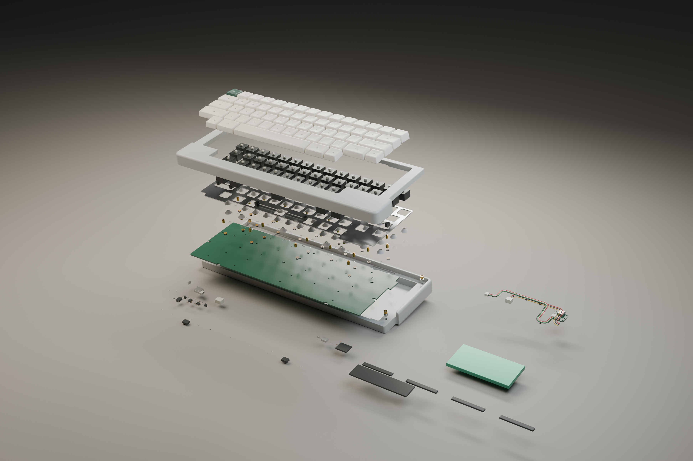
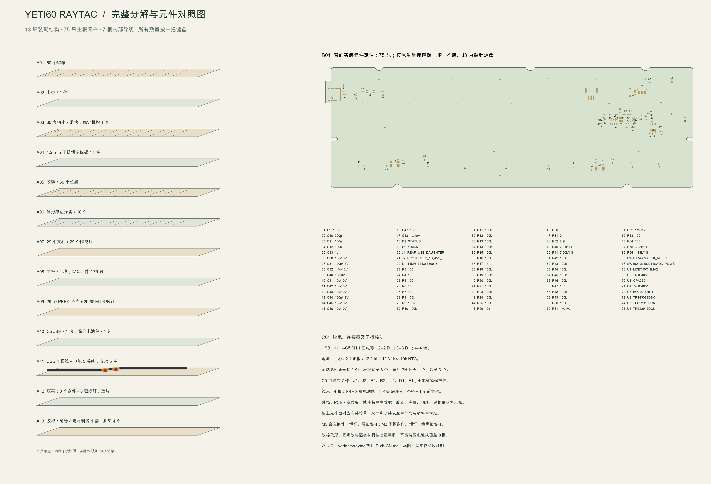

[English](exploded.md) | 简体中文

# Raytac 完整爆炸图与元件对照

返回[总入口](../../BUILD.zh-CN.md)。本图集对应本目录的 Raytac PCB 和固件。

## 原生 CAD 装配爆炸渲染

包含上下壳、键帽、轴座／滑块、稳定机构、定位板、胶碗、锥形弹簧、支柱／隔离环、PCB 及实装元件、PEEK 垫片与紧固件、C5 JSH、电池、四根 USB 线、三根电池线及五件走线支架。脚垫与待裁胶棉以旁列物料托盘表示，不代表安装坐标。显示的层间偏移用于看清结构，不是装配时的距离。

壳体、PCB、定位板、子板和受控线束取自原生 CAD，外壳不缩放。尚未选定的键帽、胶碗、弹簧、轴座和稳定机构外形，以及螺纹／部分器件高度和电池包均有示意成分；不得把这些外形用作未经确认的供应商加工图。原生实体来源及可见组记录在[渲染清单](../../renders/yeti60-assembly/render-manifest.json)。

## 可放大编号图

[下载矢量 SVG](images/complete-exploded.zh-CN.svg)。左侧为 13 层装配顺序和净数量，轮廓／分层间距属于示意；右侧按原生 PCB 焊盘绘制 75 只实装器件的背面定位与逐项编号。该图不把 JP1、J3 或电极当成需购买的器件。C5 的 7 只元件单独统计，主板删除 D1 不影响 C5 的 D1 和 U1。

线序与每根线的长度／弯曲半径见[线束装配图](interconnects.zh-CN.md)；完整物料与库存抵扣见[主板净补购表](../../hardware/bom/mainboard-purchase.zh-CN.csv)和[总材料表](materials.zh-CN.md)。实际焊接按[28 步指南](../assembly/build-guide.zh-CN.md)，不要按爆炸图的垂直间距搭建结构。

[编号图来源、数量和哈希](../audit/complete-exploded.json)。当前图集不能代替真实按键、充电、射频和机械首件验收。
